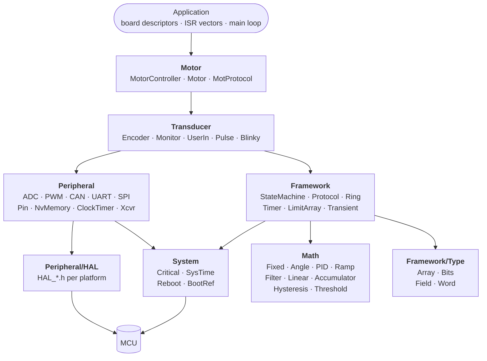
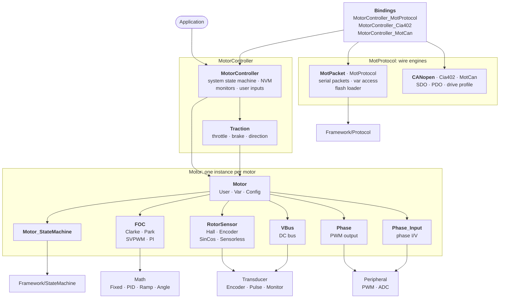

# FireSourcery Library Architecture

Embedded C library for bare-metal motor controllers on ARM Cortex-M. It provides a complete field-oriented motor control stack (control loops, rotor sensing, protection, CANopen/CiA 402 and serial protocols), built from reusable math, state machine and protocol modules that also work on their own.

- **Language**: C23, built with `arm-none-eabi-gcc` for Cortex-M0+ and Cortex-M4.
- **Runtime**: bare metal. No RTOS, no heap after init, no `stdio`, no blocking in the main loop.
- **Arithmetic**: fixed-point at runtime; no FPU required.
- **Platforms**: NXP Kinetis KE0x in tree. Other platforms plug in from the application.

## Motor control

- **Field-oriented control**: Clarke/Park transforms, SVPWM, d/q current PI loops, speed PID. Feedback modes are voltage, current, or a speed loop over either.
- **Rotor sensing**: Hall, quadrature encoder, analog sin/cos, and a sensorless sliding-mode observer with PLL (in development). All sit behind one `RotorSensor_T` interface, selectable per motor at runtime.
- **Motor states**: passive (freewheel or hold), run, open loop with alignment and sensor start-up sequences, calibration, intervention (zero torque, ramp-down, safe stop), fault.
- **Calibration**: phase current zero offsets, Hall table, encoder homing and alignment, sin/cos, standstill Rs/Ld/Lq identification.
- **Protection**: DC bus over/under-voltage, supply discharge and regen current limits (mapped onto the q axis by power balance), thermal derating for the motor, MOSFETs and PCB.
- **Controller**: one `MotorController` runs a table of motors. Operating modes plug into its state machine as subtrees: direct motor command, or traction (throttle, brake, direction, park).
- **Communication**: serial packet protocol with variable read/write by ID and a flash loader; CANopen SDO/PDO with the CiA 402 drive profile. Every motor variable is also reachable over SDO.
- **Configuration**: parameters persist in Flash or EEPROM and are addressed by variable ID.

## Design

- **Compile-time HAL**: the platform is selected by include path, so `HAL_*.h` functions inline down to register access with no runtime dispatch.
- **Const descriptors**: hardware-bound modules are `const` structs in ROM (HAL handles, pin IDs, NVM config address) that point at their mutable state in RAM.
- **Hierarchical state machine**: states are `const` tree nodes in ROM; an instance's RAM holds the active-state pointer and input buffers. Other translation units can mount substates onto a published state.
- **Fixed-point quantities**: Q1.15 `fract16`, `angle16` and per-unit motor values. The type names the representation, the identifier suffix names the unit. Floating point appears only in compile-time constant macros.
- **Pure math layer**: control and physics equations are stateless `*_math.h` functions over scalars, kept apart from the modules that hold state.
- **Decoupled protocols**: the serial, CANopen and CiA 402 engines depend on neither the controller nor a specific transport. Small binding files map their requests onto controller and motor variables.

## Dependencies

Arrows point from a module to what it depends on. A layer may use anything below it; nothing includes upward.

### Layers

`Transducer` turns peripheral signals into measurements and user commands. `Framework` holds reusable engines with no peripheral access. `Math` covers numeric values and `Framework/Type` the shape of memory; neither depends on anything. Register access is confined to `Peripheral/HAL/Platform` and to `System`, which wraps the Cortex-M core: critical sections, SysTick time, reset. Vendor headers (CMSIS, device registers) are in `External/`.

### Motor stack

Each `Motor` composes its own state machine, FOC loop, sensor table and phase I/O. `MotorController` owns the motor table, the system state machine, monitors, NVM and communication ports; both levels run on `Framework/StateMachine`. The wire engines know nothing of the controller, so binding files supply the mapping.

## Integration

1. Put the library root on the include path. Includes are root-relative, e.g. `#include "Motor/MotorController/MotorController.h"`.
2. Select the HAL with one define: `HAL_PERIPHERAL_PATH_PLATFORM=KE0x` for an in-tree platform, or `HAL_PERIPHERAL_PATH_DIRECTORY=<dir>` for a platform directory the application supplies.
3. Define the board as `const` descriptors: peripherals, motors, and the `MotorController_T`.
4. Call the thread entry points from their execution contexts:

| Context | Rate | Call | Work |
|---|---|---|---|
| PWM ISR | PWM frequency, typically 20 kHz | `MotorController_PWM_Thread` | ADC sampling, rotor angle capture, motor state machine: FOC and duty update |
| Timer ISR | 1 kHz | `SysTime_CaptureMillis_ISR`, `MotorController_Timer1Ms_Thread` | Millisecond time base, DC bus over/under-voltage |
| Main loop | Free-running | `MotorController_Main_Thread` | 1 ms: controller state machine, protocols, user inputs. 10 ms: supply limits. ~1 s: thermal, derating, fault roll-up |

Peripheral interrupts (UART, CAN, encoder edges) call their module's `*_ISR` handlers.

## Directory Map

