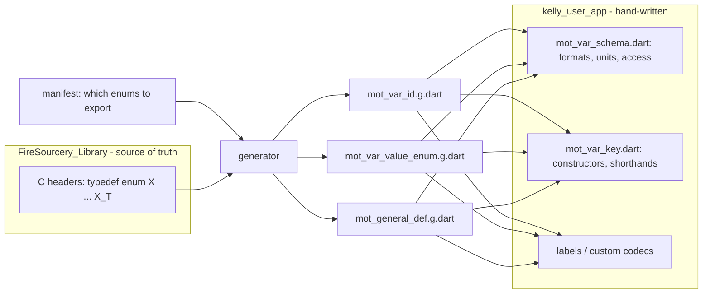
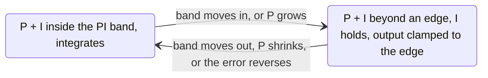

```mermaid
flowchart LR
    subgraph C["C group table row"]
      D["array designator<br/>MOTOR_VAR_TYPE_USER_OUT"]
      T["META type<br/>Motor_Var_UserOut_T"]
    end
    subgraph E["base enum, ordered"]
      M["[0] MOTOR_VAR_SPEED<br/>[1] MOTOR_VAR_I_PHASE<br/>[2] MOTOR_VAR_V_PHASE"]
    end
    subgraph V["MotVarId"]
      W["Type = 0<br/>Base = n"]
    end
    subgraph S["CSV row"]
      O["id_object"]
      B["id_base"]
    end
    D --> O
    D --> W
    T --> M
    M -- "member[Base]" --> B
    M -- "index" --> W
````

```mermaid
flowchart LR
    CAP["ω capture, 1 ms"] --> FF["vd_ff = −ω·Lq·iq<br/>vq_ff = ω·Ld·id + ω·ψ"]
    BUS["vPhaseLimit = vBus / 2"] --> BD["PidId band<br/>±vPhaseLimit − vd_ff"]
    FF --> BD
    BD --> PD["PidId: P + I, anchored"] --> VD["Vd = PI + vd_ff"]
    VD --> CIRC["Vq budget<br/>√(vPhaseLimit² − Vd²)"]
    CIRC --> BAND["vqBand = ±budget ∩ VLimit"]
    POL["VLimit policy"] --> BAND
    BAND --> BQ["PidIq band<br/>vqBand − vq_ff"]
    FF --> BQ
    BQ --> PQ["PidIq: P + I, anchored"] --> VQ["Vq = PI + vq_ff"]
```
