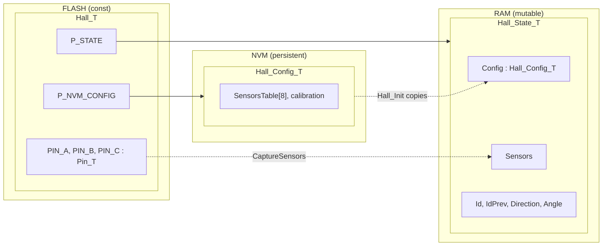

# Descriptor Pattern

A module's top-level structs are aggregate roots, one per storage region.
The top level partition serve as allocation containers, mapping to a memory region.
Specialized domain logic and operations go in nested structs inside them.

| Struct | Storage | Holds |
|---|---|---|
| `Module_T` | FLASH, `const` | descriptor: HAL bindings, compile-time constants, `P_STATE`, `P_NVM_CONFIG` |
| `Module_State_T` | RAM | runtime mutable state, including the working copy of `Config` |
| `Module_Config_T` | NVM | persisted parameters, stores to flash |

`Module_T` is `const`, so it can live in FLASH and the compiler can fold its fields.

Internal details use `Module_*`. Outer abstractions get the shortened name.

{Vocabulary, Surface, Facet, Constituent}

## Example: `[Hall_T]`

`Module_Config_T`
- include transport interface via enum ids mapping
- optionally use schema descriptor or per value id

`[Hall_State_T]` holding its `Config` is Option 1 in [Config_State_Ref.md](Config_State_Ref.md).
