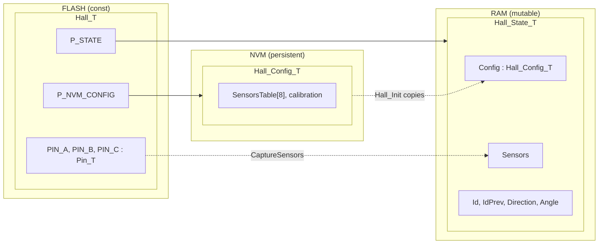

# Descriptor Pattern

The hardware form of a [Descriptor](Descriptor.md). A module's top-level structs are aggregate
roots, one per storage region. Each serves as an allocation container mapped to a memory region;
specialized domain logic and operations go in structs nested inside them.

**Level** — architectural: every hardware-bound module is split this way (`ARCHITECTURE.md`, Const
descriptors).

**Force** — A hardware-bound module holds three lifetimes: the binding, fixed for the image (which
pins, which peripheral); the runtime state, written every tick; the parameters, persisted across
power cycles. Each lifetime has its own memory region. One struct for all three puts constants in
RAM or state in FLASH. What stays still is the binding, and the one handle every caller holds.

**Shape**

| Struct | Storage | Holds |
|---|---|---|
| `Module_T` | FLASH, `const` | descriptor: HAL bindings, compile-time constants, `P_STATE`, `P_NVM_CONFIG` |
| `Module_State_T` | RAM | runtime mutable state, including the working copy of `Config` |
| `Module_Config_T` | NVM | persisted parameters, stores to flash |

- Every public function takes the descriptor alone, `Hall_PollCaptureSensors(Hall_T * p_hall)`, and
  reaches the state through `P_STATE`.
- `Module_T` is `const`, so it lives in FLASH and the compiler folds its fields at inline call sites
  ([Descriptor.md](Descriptor.md) § Folding).
- `Module_State_T` holds the working copy of its `Config`, Option 1 in
  [Config_State_Ref.md](../Conventions/Config_State_Ref.md). Init copies `*P_NVM_CONFIG` into it.
- A binding with no runtime state has no `P_STATE`: `Pin_T`, `PWM_T`.
- `Module_Config_T` includes its transport interface through an enum-id mapping; optionally a schema
  descriptor, or one id per value.
- Internal details use `Module_*`. Outer abstractions get the shortened name.

Example, `Hall_T`:

**In code**

- `Hall_T` — `Motor/Motor/Sensor/Hall/Hall.h`: three `Pin_T`, `P_STATE`, `P_NVM_CONFIG`.
- `Motor_T` — `Motor/Motor/Motor.h`: its state is `Motor_Context_T` at `P_MOTOR`; nests `TimerT_T`,
  `Phase_VOut_T` and `StateMachine_T` by value.
- `UART_T` — `Peripheral/UART/UART.h`: `P_HAL_UART` and two `RingT_T`; its state is in the rings.
- `PWM_T` — `Peripheral/PWM/PWM.h`; `Pin_T` — `Peripheral/Pin/Pin.h`: bindings only.

**Rejected**

- **One RAM struct per module** for binding, state and config. The binding costs RAM and a copy at
  init, is writable, and does not fold.
- **A descriptor for a struct with no hardware binding**, such as shared coefficients.
  [EquationStruct.md](EquationStruct.md) rejects it; `CLAUDE.md` keeps this pattern for hardware and
  static polymorphism.

**Source** — Zephyr's device model: `struct device` points at `config`, read-only and set at build
time, and at `data`, the instance's runtime state in RAM. Aggregate (Evans, *Domain-Driven Design*,
2003): a cluster of objects with one root as its boundary; here the boundary is the storage region.

**Open** — a term for the nested structs and the outer surfaces: {Vocabulary, Surface, Facet,
Constituent}. Facet and Surface are taken by [Facets.md](Facets.md) and
[WrapperSurface.md](WrapperSurface.md).
