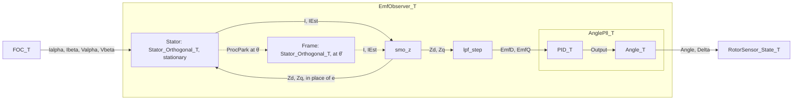

# Equation in a struct

A stateful math module is one published equation, with its coefficients and its state bound into a
struct. Inputs come in as arguments; outputs that other blocks read are stored. The struct is not a
model of a physical part: [Stator_Orthogonal_T] is the stator equation on two orthogonal axes, the
virtual α/β of the stationary frame or the d/q of an estimated one, with the extended-EMF L = Lq.

**Level** — design.

**Force** — The equation runs every tick on new inputs. Its coefficients change rarely and its state
carries from tick to tick; neither should be re-supplied at every call site. What stays still is the
equation's structure: which coefficients exist and how they are tied. What varies is their values
and the operands.

**Shape** — The pure function takes every quantity as an argument, most constant first, which orders
them coefficients, then state, then inputs. The struct binds that leading prefix. Its step passes
the inputs and stores the result.

```c
/*! y[n] = clamp(y[n-1] + K · u[n], LimitLower, LimitUpper) — clamp at output. */
static inline accumulator_state_t accumulator(accumulator_state_t coeff, accumulator_state_t min, accumulator_state_t max, accumulator_state_t state, accumulator_state_t input)
{
    return math_clamp(state + (coeff * input), min, max);
}

typedef struct Accumulator
{
    accumulator_state_t Accumulator;  /* integrator output, internal scale */
    accumulator_state_t Coefficient;  /* gain K, internal scale */
    accumulator_state_t LimitUpper;   /* saturation bound, internal scale */
    accumulator_state_t LimitLower;
}
Accumulator_T;

static inline accumulator_io_t Accumulator_Step(Accumulator_T * p_accum, accumulator_io_t input)
{
    p_accum->Accumulator = accumulator(p_accum->Coefficient, p_accum->LimitLower, p_accum->LimitUpper, p_accum->Accumulator, input);
    return Accumulator_Output(p_accum);
}
```

A struct that binds only coefficients is a Ref: [Stator_Winding_T] binds the R and L of
`stator_emf(r, l, i_prev, i, v)`, and [Stator_Axis_T] carries the period record after them.

### Roles

Set by who writes a field and who reads it.

| Role | Written by | Read by | Lives in |
|---|---|---|---|
| Coefficient | init, config, or a slower loop | the step | field |
| State | the step | the step, next tick | field |
| Input | another block | the step | argument |
| Output | the step | other blocks | field, stored |

An integrator's output is its state: Accumulator in [Accumulator_T], Output in [MovAvg_T], the
angle in [Angle_T].

### Coefficients

Each struct is a structured instance of the discrete state-space form `x[k+1] = A·x[k] + B·u[k]`,
`y[k] = C·x[k] + D·u[k]`. The type fixes which entries exist and how they are tied, and the fields
are the free entries, named in the published notation. The names make it a specialized model rather
than a generic matrix step.

- **Zero entries are absent, tied entries are one field.**
  - The Park rotation `[[c, s], [−s, c]]` is Sine and Cosine in [FOC_T].
  - The dq coupling `ω·[[0, −Lq], [Ld, 0]]`, with the offset `ω·ψ`, is OmegaLd, OmegaLq and
    OmegaPsi in [FOC_ElectricalSpeed_T].
  - Clarke has no free entries, so [foc_clarke] is a pure function with constants and no struct.
- **Each coefficient keeps its own unit, base and fixed-point format.** R is `accum32_t` because it
  exceeds 1 pu. KiPerTick is a mantissa and a shift.
- **Derived coefficients sit beside their source**, the equation pre-computed for the step. Config
  holds the published form, the runtime the derived form.
  - G = 1/L beside L in [Stator_Winding_T].
  - InvSlope beside Slope in [Linear_T], for the inverse map.
  - Kp and KiPerTick beside the Config's Kp, Ki, Kd in [PID_T].
- **A coefficient has an update rate**: constant (the winding, the gains), per operating point
  ([FOC_CaptureSpeed], at the speed loop), or per tick ([FOC_SetTheta]).
  - Store a per-tick coefficient that two operations share: Park and inverse Park share Sine and
    Cosine.
  - Pass one that a single operation uses as an argument: θ and Δθ of [Stator_Orthogonal_ProcPark].

### Rules

- **State is what the step reads back.** A field the step writes and nothing reads is neither state
  nor output.
- **A new type per coefficient structure, not per physical part.** The αβ stator (scalar R and L on
  uncoupled axes) and a dq stator (R, Ld, Lq and the ω coupling) are different matrices, so different
  types. The dq stator's coefficients already live in [FOC_Electrical_T] and [FOC_ElectricalSpeed_T].
- **Composition is the block diagram.** Nested structs are blocks, and stored outputs are the wires
  between them.
- **A type or a pure function earns its place by naming an established, published concept**:
  physical, mathematical, control or DSP. Being physics is not the test.
- **Outputs other blocks read are stored.** Whether the stateful layer also returns them is open;
  [FOC_GetVOut] is the candidate.

The sensorless angle sensor, as blocks and the stored outputs between them:



**In code**

- [Accumulator_T] — `Math/Accumulator/Accumulator.h`, over [accumulator]
- [MovAvg_T] — `Math/Filter/MovAvg.h`, over [mov_avg]
- [Linear_T] — `Math/Linear/Linear.h`, over `linear_math.h`
- [Hysteresis_T] — `Math/Hysteresis/Hysteresis.h`
- [PID_T] — `Math/PID/PID.h`
- [AnglePll_T] — `Math/Angle/AnglePll.h`, a PI into an integrator
- [Stator_Winding_T], [Stator_Axis_T], [Stator_Orthogonal_T] — `Motor/Motor/Model/Stator.h`, over `stator_math.h`
- [FOC_T] — `Motor/Motor/Math/FOC.h`
- [EmfObserver_T] — `Motor/Motor/Model/EmfObserver.h`, a composition: the stator equation in two frames, the filters on its error ([smo_z], [lpf_step]), and the tracker

**Related**
- Module struct caches output, similar other async object that `Proc` runs to completion. In the equation case, the output is further required to feed into the next input.
- Inputs take in from function parameters e.g. Module_Input(Module_T * module, int, int)
- a specialized domain model. struct fields name the coefficient that would indexes in a matrix or vector math operation.
- in a system model, where functions feed into the next, the out composite struct boundary block is determined by the thread it operates on, i.e tick.

**Rejected**

- **Indexed coefficients**, a dense A, B, C, D or a coefficient array behind one generic step. One
  code path serves every model, but zero entries are stored, every coefficient shares one
  fixed-point format, and the step no longer reads as the equation. It pays off only where one step
  serves many models, as in FIR or biquad banks.
- **A copy or a pointer of shared coefficients in each instance**, the rejected
  `Stator_AxisModel_T` sketches. A copy duplicates a derived value per axis. A pointer is the
  descriptor pattern, which `CLAUDE.md` keeps for hardware and static polymorphism.
- **A type per physical part.** It ties a type to hardware rather than to its equation. One equation
  serves several parts (both αβ axes, the observer's model axes), and the αβ stator's windings are
  already virtual.

**Source** — precedents:

- CMSIS-DSP `arm_pid_instance_q15`, in `CMSIS/DSP/Include/dsp/controller_functions.h`. It keeps
  the named Kp, Ki, Kd beside the derived `A0 = Kp + Ki + Kd`, `A1 = −Kp − 2Kd`, `A2 = Kd`, which
  its step multiplies against the current and two previous errors.
- Simulink Coder generated code: structures tagged P (block parameters), DW (discrete states),
  ExtU (root inputs) and ExtY (root outputs) around one step function.
  [Data Structures in the Generated Code](https://www.mathworks.com/help/rtw/ug/data-structures-in-the-generated-code.html)
- The Givens rotation, stored as (c, s). Grey-box vs black-box models: a known structure with named
  parameters vs generic coefficients (Ljung, *System Identification: Theory for the User*).
