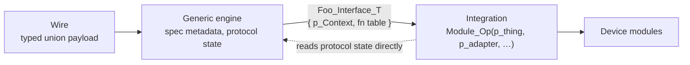

# Protocol Stack

**Level** — architectural.

**Force** — A wire protocol has a profile fixed by its spec and an integration with the device it
drives. The engine must be reusable across profiles and devices; the integration must stay small
enough to be obviously correct, and the call sites should read like the spec.

**Shape**

1. **Generic engine, opaque-context callback table.** The engine takes a `Foo_Interface_T`
   `{ void * p_Context; function pointers }` and never names an integration type.
2. **The public integration API is the explicit pair**, `Module_Op(p_thing, p_adapter, …)`, with
   concrete types. A context bundle `Module_Ctx_T { Thing *, Adapter * }` is internal to the `.c`,
   only to bridge onto the engine's single-context callback.
3. **Cast once at the binding site**, `(Foo_GetFn_T)Module_Op`, through function-pointer typedefs.
   No trampoline wrappers whose body is `return public_op(...)`
   ([FunctionPointerCasting.md](FunctionPointerCasting.md)).
4. **The caller owns the context storage.** `MakeInterface(&ctx)` takes a pointer to the caller's
   local. Never return a struct whose `p_Context` points at a compound literal: its lifetime ends
   with the enclosing block, inlined or not (C11 §6.5.2.5p6).
5. **Spec-fixed metadata is a compile-time const switch.** One macro per type (`OD_U16(acc)`)
   expands to a const literal with `sizeof(wire_type)`; adding an entry is one line, with no runtime
   `TypeSize()`.
6. **Encode helpers return struct literals.** `*p_resp = Foo_EncodeAck(...)`, not a
   `Foo_BuildAck(p_resp, ...)` wrapper.
7. **Wire payloads are typed unions** `{ Bytes[N], I8, U8, I16, U16, I32, U32, AbortCode }`, read
   as `p->Data.I16`; no `memcpy` or byte shifts. The packed struct and the ABI handle endianness.
8. **Protocol state is read directly, integration effects go through the interface.** Reading
   `Cia402_Adapter_T.Input.ActiveMode` is the canonical path, not coupling; pushing a setpoint or a
   state-machine input is an effect, so it is a callback.
9. **One source of truth per spec concept.** The metadata switch lives once in the engine; the
   integration's `Module_Od_GetInfo` delegates in one line.

**In code** — the CiA 402 stack: `Cia402.h`, `Cia402.c`, `Motor_Cia402.h`, `Motor_Cia402.c` in
`Motor/MotProtocol/Cia402/`. It is the reference shape for new wire protocols (CANopen profiles,
Modbus, OD-style register interfaces).

**Rejected** — earlier iterations of the same stack: `Build*` wrappers, runtime `TypeSize()`
helpers, manual byte-shift parsing, and trampolines that leaked context-shape decisions across
layers.

**Source** — the generic engine with an opaque-context integration follows CANopenNode and
lely-core.
