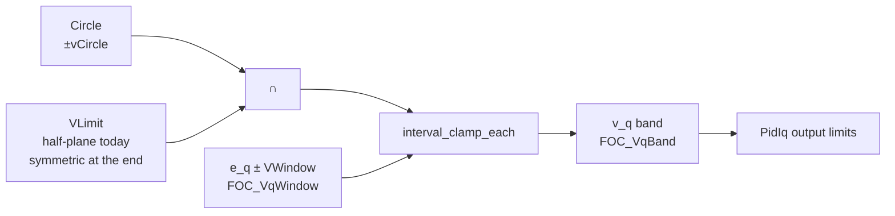

# DirectionEndState

Replace the direction lock's anti-plugging half-plane with a symmetric v_q limit plus a window around the back-EMF, once the readers that are not about the lock stop reading the direction.

**Status**: deferred 2026-10-17. The proposal is [0009](../Decisions/0009_DirectionPolicy.md), still at "proposed".
The item moved from the open list in StateMachineOverview on 2026-11-20 and here on 2026-11-22. It waits on two
things: moving the readers of `Motor_Direction()` that are not about the lock, then the owner's choice of end form
and window. It lands as 0009 accepted, or as a record that supersedes it. The wiring follows
[VLimitPolicy.md § Wiring, when taken up](../../Motor/Motor/Math/VLimitPolicy.md).

## Context

**Today.** `Motor_SetDirection` ([Motor.c:276](../../Motor/Motor/Motor.c#L276)) writes
`Motor_Context_T.Direction` and the FOC v_q half-plane (`Motor_GetVLimitsAntiPlugging`,
[Motor.h:474](../../Motor/Motor/Motor.h#L474)). Every reader goes through `Motor_Direction()`
([Motor.h:467](../../Motor/Motor/Motor.h#L467)), so the source can be changed in one place.

**The problem.** During rollback, forward torque needs v_q = R · i_q + E with E < 0. Once |E| > R · i_q, the PI pins
v_q at 0 and the current becomes |E| / |Z|. At 90 mΩ, 18 V gives 200 A at low speed, which is outside every I limit.
A symmetric VLimit keeps the limits enforced. Anti-plugging then becomes command policy: Traction holds the gear,
brakes against the motion, and changes direction at zero speed.

**The proposed end form** (0009, 2026-10-18): there is no policy enum; the setter that is called is the policy.

- The loop composes `clamp_each(circle ∩ VLimit, e_q ± VWindow)` every cycle. `VWindow = FRACT16_MAX` is the
  identity, so nothing re-centers per tick.
- Each bound is clamped into the circle (`interval_clamp_each`), not intersected with it. Above base speed
  (|E| > V_bus / 2 + w) the window misses the circle. An intersection would then give low > high, which
  `PID_CaptureOutputLimits` rejects.
- The window replaces the half-plane.
- `Direction` is the sign of the half-plane. A symmetric VLimit reads as NULL, which is correct: there is no lock.
- Window size w = 1.5 · R · I, which is 27 V at 90 mΩ and 200 A:
  - reverse voltage is blocked only above |E| > w, about 37 % speed
  - |i_q| ≤ w / |Z| ≈ 300 A holds even with the PI saturated
  - w must cover the ψ error × top speed
- Centering the window on OmegaPsi costs nothing in the Base build (`FOC_DECOUPLE` off), but it leaves out ω · Ld · id.
  `FOC_VqFeedforward` costs one multiply-add per cycle.

VLimitPolicy.md compares the lock, symmetric, and symmetric-plus-window forms row by row.

**Readers that must move first** (from 0009):

| Reader | Today | End state |
|---|---|---|
| Arming gates (Passive → Run, OpenLoop StartUp, Sensorless start) | `Motor_Direction() != NULL` | VLimit has width, or a run command; OpenLoop and Sensorless start still require a direction |
| Motoring / generating key | `Direction` | `Direction` if locked; otherwise the speed sign with a hysteresis deadband (`hysteresis_sign`), symmetric motoring at standstill. The generating default becomes a braking-torque limit, and battery charge moves to `IChargeLimit` ([0005](../Decisions/0005_ILimitFrames.md)) |
| TorqueZero's `_Motor_GeneratingOnly` | The half-plane fades braking at zero speed implicitly | A motion key |
| I and V readbacks | Unsigned | Signed i_q / v_q (`FOC_GetIPhase`, `FOC_GetVPhase`) |
| `Motor_IsSpeedAligned` ([Motor.h:646](../../Motor/Motor/Motor.h#L646)) | Motor | Traction's gear |
| `Motor_UserMotoringOf` ([Motor_User.c:191](../../Motor/Motor/Motor_User.c#L191)) | Direction × command | Valid only under a lock; Traction moves to the forward frame (CiA 402 shape) |

## Design

The v_q band at the end state:



## Sketch

These already exist and are not wired in (FOC.h, Motor.h):

```c
static inline interval_t FOC_VqWindow(const FOC_T * p_foc) { return interval_symmetric(FOC_VqFeedforward(p_foc), p_foc->VWindow); }
static inline interval_t FOC_VqBand(const FOC_T * p_foc, ufract16_t vqCircleLimit) { return foc_vq_band(vqCircleLimit, p_foc->VLimit, FOC_VqWindow(p_foc)); }
// static inline bool Motor_IsArmed(const Motor_Context_T * p_motor) { return FOC_IsVLimitOpen(&p_motor->Foc); }
// static inline Motor_Direction_T Motor_Direction(const Motor_Context_T * p_motor) { return (Motor_Direction_T)FOC_GetVLimitDirection(&p_motor->Foc); }
```

Wiring order:

1. Initialize `Foc.VWindow = FRACT16_MAX` first. Zero, the init value, pins v_q to e_q.
2. `FOC_VqBand` replaces the `vqBand` lines in `FOC_ProcIFeedback_Base` and `FOC_ProcIFeedback_Decouple`.
3. Add a motion field holding the previous sign, plus thresholds, for `hysteresis_sign`.
4. Readbacks.

## Done already

- 2026-10-18, added but not wired in:
  - `interval_clamp_each` (math_general.h)
  - `hysteresis_sign` (hysteresis_math.h)
  - `foc_vq_band` (foc_math.h)
  - `FOC_VqWindow`, `FOC_VqBand`, `FOC_GetVLimitDirection`, `FOC_IsVLimitOpen` (FOC.h)
  - `Motor_ILimitIntervalOfMotion`, `_Motor_BrakingOnly` (Motor.h)
  - `Motor_IsArmed` and the VLimit form of `Motor_Direction`, commented out in Motor.h
- A host probe ran 366,626 band cases with 0 failures. The full-width window is the identity for |e_q| ≤ 16384.
- The dynamic sides (no-plugging, brake overlay, regen-only, plugging-only) are in foc_math.h, not wired in. Their
  behavior is described in VLimitPolicy.md.
- A known trip, still present 2026-11-22: including `hysteresis_math.h` in Motor fails `-Werror`, because
  `abs(input - prev_output) > hysteresis` at
  [hysteresis_math.h:170](../../Math/Hysteresis/hysteresis_math.h#L170) is a sign-compare.

## Open for you

**End form**

- [ ] symmetric VLimit plus window (0009's proposal)
- [ ] symmetric VLimit, no window
- [ ] keep the direction lock as the end state and close 0009

**Window size w** (if a window is used)

- [ ] 1.5 · R · I (27 V at 90 mΩ, 200 A)
- [ ] other: `____`

**Window center**

- [ ] OmegaPsi (costs nothing in Base, leaves out ω · Ld · id)
- [ ] `FOC_VqFeedforward` (one multiply-add per cycle)

- Notes: `____`
