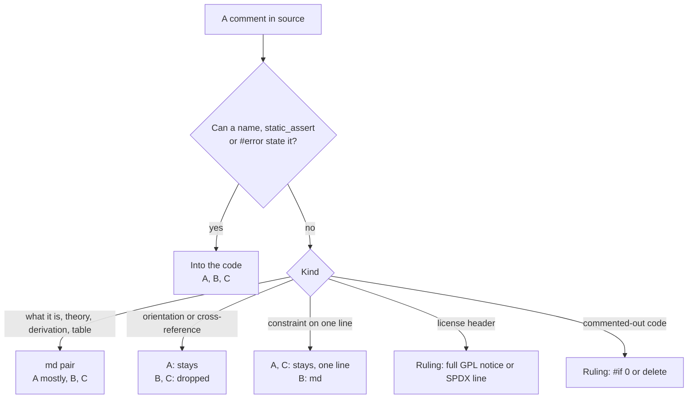

# NoCommentsInSource

Whether source files keep any comments, or all documentation moves to the `.md` pair beside the source.

**Status**: open. Raised 2026-11-17 and moved here 2026-11-22. No file has been changed. It is unblocked by the owner's
choice among A, B and C and by the rulings below. The residue count can run before that choice. The outcome lands in
[Comments.md](../Conventions/Comments.md) and in the Core Principles and Documentation bullets of
[CLAUDE.md](../../CLAUDE.md).

## Context

The proposal is that source files carry no comments. All documentation goes in the md pair beside the source
(`Module.md`, `Module.exp.md`; placement in [Modules/README.md](../Modules/README.md)). Source stays purely as
expression through code.

[Comments.md](../Conventions/Comments.md) already says code expresses everything code can express, and a comment
holds only the reason the language cannot state. It keeps three cases:

- rationale that no declaration states
- a one-line orientation at a file or section head
- a cross-reference to the full explanation

The proposal removes all three.

| | Rule | Comments left in source |
|---|---|---|
| A | Comments.md as it stands | Rationale, orientation, cross-references |
| B | No comments at all | None (license header aside) |
| C | No documentation in source, one exception | Line-anchored constraints only |

Where each kind of comment goes:

| Comment kind | A | B | C |
|---|---|---|---|
| What a module, type or function is; theory, derivations, tables | Mostly md | md | md |
| Orientation at a file or section head | Stays | Dropped | Dropped |
| Cross-reference to the doc | Stays | Dropped | Dropped; the filename implies the pair |
| Fact that code can state | Name, `static_assert`, `#error` | Same | Same |
| Constraint on one line that code cannot state | Stays | md | Stays, one line |
| License header, tool annotations | Stays | Needs a ruling | Stays, or an SPDX one-liner |
| Commented-out code (parking) | Stays | Needs a ruling | Needs a ruling |

B and C differ only in the fifth row.

**What B costs over C**

- **Locality.** A constraint helps only at the line where the mistake would be made. In `Motor_FaultFlags_T`
  ([Motor.h:212](../../Motor/Motor/Motor.h#L212)), a comment notes that `SafeStopTimeout` sits after `RequestV0` so
  that it keeps its bit. C cannot `static_assert` a bit-field position, and whoever reorders the struct will not have
  the md open.
- **Odd-looking code.** Motor.h includes the private header `_StateMachine.h`
  ([Motor.h:52](../../Motor/Motor/Motor.h#L52)) so that `StateMachine_Active_T` can sit inside `Motor_Context_T`.
  A note says so. Without the note the include reads as a mistake to clean up.
- **Drift.** The case against restating comments is two sources of truth that drift. That case is stronger against a
  parallel file. A comment is in the diff hunk when its line changes; the md is not. The md can refer to symbols but
  not to statements.

**What B gains over C**

- One rule with no judgment call: nothing to classify, nothing to review.
- No stale comments of any kind.

**Test for the exception under C**: a comment survives only if both of these hold.

1. Deleting it would let a reasonable edit break something.
2. No name, `static_assert` or `#error` can carry it.

**Other places the rule reaches** (checked 2026-11-22):

- The CLAUDE.md principle "Function body should look like the equation in its docstring" assumes a docstring.
  Under B and C that equation moves to the md, as do the rate blocks in
  [Motor_Electrical.h](../../Motor/Motor/Motor_Electrical.h) (`F(V) = AngleFreqPerVolt · V`).
- The CLAUDE.md symbol notation for C comments (`[TypeName_T]`, highlighted by the `.vscode/comment-reference`
  grammar) and the C-comment rule in [Comments.md § Layout](../Conventions/Comments.md#layout) become moot under B.
  Under C they cover the one-line residue only.
- Size: Motor.h has 748 lines, and 192 of them carry a comment marker (`//` or `/*`). That count includes
  commented-out code and the license block. None of these lines has been classified yet.

**Recommendation** (from the 2026-11-17 note): C.

## Design

How one comment is sorted under each option:



## Sketch

The residue count: sort every comment in Motor.h through the Design chart, then count the comments that reach
"constraint on one line". If none do, B costs nothing over C.

The forms that survive, under each ruling:

```c
uint16_t SafeStopTimeout : 1U;  /* after RequestV0: keeps its bit */     /* C: a line-anchored constraint */

// #define MOTOR_CALIBRATION_HOMING_ENABLE                               /* parking today, Motor.h:96 */
#if 0
#define MOTOR_CALIBRATION_HOMING_ENABLE                                  /* parking as #if 0 */
#endif

/* SPDX-License-Identifier: GPL-3.0-or-later */                          /* the notice reads "version 3 ... or any later version" */
/* Copyright (C) 2023 FireSourcery */
```

## Done already

- Nothing has changed in any file (2026-11-22). Comments.md as it stands is option A.

## Open for you

**Rule**

- [ ] A: Comments.md as it stands
- [ ] B: no comments at all
- [ ] C: no documentation in source, line-anchored constraints only

**Commented-out code (parking), under B or C** (the `MOTOR_CALIBRATION_HOMING_ENABLE` and
`MOTOR_I_SUPPLY_LIMITS_ON_*` blocks in Motor.h)

- [ ] `#if 0`
- [ ] delete and rely on git

**License header**

- [ ] keep the full GPL notice in each file
- [ ] reduce it to an SPDX line

**Residue count**

- [ ] classify Motor.h before choosing the rule
- [ ] choose without it

**Docstring equations, under B or C**

- [ ] move them to the md; the principle then reads "the equation in its sheet"
- [ ] keep the equation line as a second exception

- Notes: `____`
