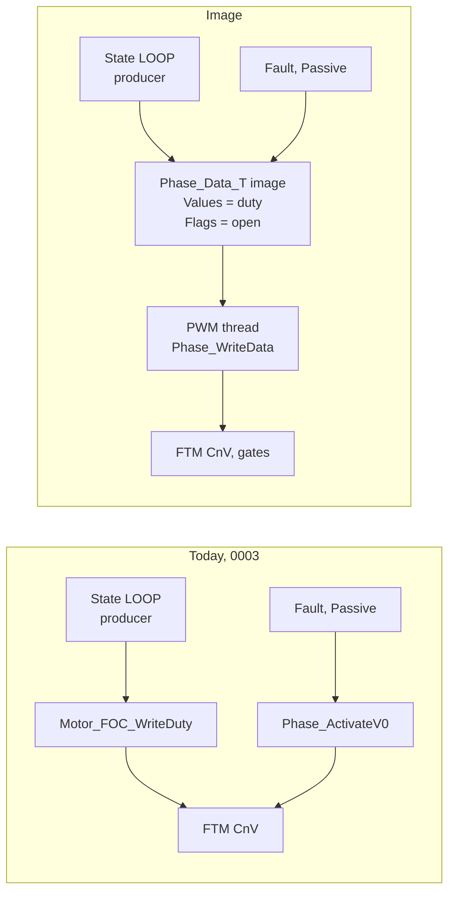

# PhaseOutputImage

Make the PWM thread the only phase-register writer: the states write a duty-domain output image, and the thread transfers it.

**Status**: deferred 2026-10-17, in the Consequences of [0003](../Decisions/0003_PhaseOutputOwnership.md). The owner
started it on 2026-11-14 with two functions that have no callers yet. The item moved from the open list in
StateMachineOverview on 2026-11-20 and here on 2026-11-22. It waits on two answers: what `Flags` means on the output
side, and whether a one-period gate-off delay is acceptable for main-thread software faults. It lands as a record
that supersedes 0003.

## Context

**Today** (0003, accepted 2026-10-13 "for now"):

- Each state LOOP that produces FOC output calls `Motor_FOC_WriteDuty`
  ([Motor_FOC.c:38](../../Motor/Motor/Motor_FOC.c#L38)) right after its producer. That call writes the registers
  through `Phase_WriteSvpwm`.
- Hold states write nothing, so `Phase_ActivateV0` holds.
- `Motor_PWM_Thread` writes no duty.

The reason: a write at thread level overwrote V0 with the last vector. Deciding in the thread by reading the duty
back is racy, because FTM CnV writes are buffered until the next load point.

**What today's form costs**

- Every new driving state must remember the write.
- Open question: resuming from Z at speed enables the gates before the new duty loads (stale CnV, then T0). This is
  inferred from the sync configuration, not measured.

**The deferred form.** The states write a duty-domain image, a `Phase_Data_T` with `Flags` = gates and `Values` =
duty. The thread transfers it as the only register writer. Handlers on `Motor_Context_T` follow later.

- The study "Motor Context Image Study" (2026-10-17,
  https://claude.ai/code/artifact/030a8734-22e8-4bd0-8066-17c49597c701) recommends doing the image and the thread
  transfer first, and treating buffered inputs as a separate decision.
- The study's open question: is a one-period (≤ 50 µs) gate-off delay acceptable for main-thread software faults?
  Hardware trips bypass this path.

**`Phase_Data_T`** ([Phase_Types.h:277](../../Motor/Motor/Phase/Phase_Types.h#L277)) is 8 bytes: `Values` {A, B, C}
as `int16_t`, plus a `Flags` bitmask. On the input side, `Phase_Capture` sets a channel's flag, and taking the data
clears the flags, which makes them a fresh-sample edge (cleared by `FOC_CaptureIData`).

The naming (VZ / V0 / T0, Config → Nvm, Runtime) is parked.

## Design



## Sketch

```c
static inline Phase_Data_T Phase_SvpwmVOut(uint32_t vBusInv_pu, fract16_t vA, fract16_t vB, fract16_t vC);   /* Phase_Svpwm.h, exists */
static inline void Phase_WriteData(Phase_VOut_T * p_phase, const Phase_Data_T * p_data);                    /* Phase_VOut.h, exists */

/* a producing state's LOOP */
p_context->VOut = Phase_SvpwmVOut(VBus_Inv_Pu(p_motor->P_VBUS), FOC_Va(&p_context->Foc), FOC_Vb(&p_context->Foc), FOC_Vc(&p_context->Foc));

/* PWM thread, after the state machine: the only register writer */
Phase_WriteData(&p_motor->PHASE, &p_context->VOut);
```

`VOut` is the image itself, a new field on `Motor_Context_T`. Both functions stay `static inline`: a plain definition
in a header fails the link with multiple definitions.

## Done already

- 2026-11-14 (by the owner): `Phase_SvpwmVOut` returns a `Phase_Data_T`, and `Phase_WriteData` writes one. Neither
  has a caller. The states still write through `Phase_WriteSvpwm` in `Motor_FOC_WriteDuty`.

## Open for you

**What `Flags` means on the output side**

- [ ] gates: which phases are driven
- [ ] a fresh mark that the transfer consumes, as on the input side

**One-period gate-off delay (≤ 50 µs) for main-thread software faults**

- [ ] acceptable: faults go through the image too
- [ ] not acceptable: fault entry writes the gates directly, and the image carries duty only

**Buffered inputs**

- [ ] a separate decision, as the study recommends
- [ ] together with the image

- Notes: `____`
