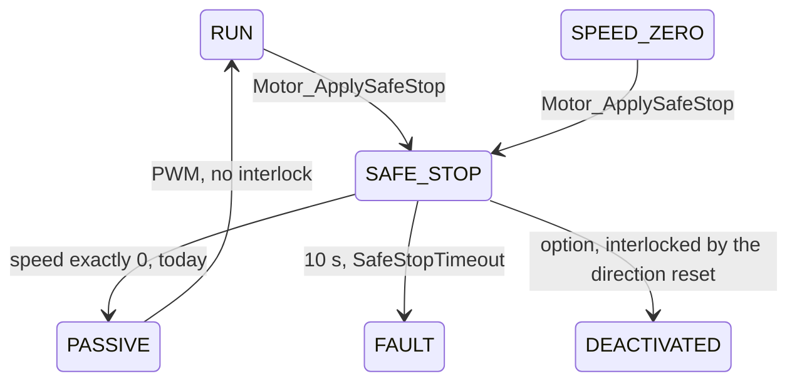

# SafeStopGaps

Close or record the three gaps between `SAFE_STOP` and the stop functions it is mapped to: no restart interlock, an exact-zero standstill test, and no id to report Quick Stop Active.

**Status**: open. The gaps were found 2026-10-16 in a standards survey. The item moved from the open list in
StateMachineOverview on 2026-11-20 and here on 2026-11-22. The third gap waits on [SubStateIds.md](SubStateIds.md);
the first two wait on the owner's choice. The outcome lands in
[Motor_Intervention.c](../../Motor/Motor/StateMachine/Motor_Intervention.c) and in the stop-function mapping table of
[StateMachineOverview.exp.md](../../Motor/StateMachineOverview.exp.md).

## Context

**What `SAFE_STOP` does today**
([Motor_Intervention.c:223](../../Motor/Motor/StateMachine/Motor_Intervention.c#L223)):

- It is a child of `SPEED_ZERO`, at depth 2, and runs that state's loop: decelerate to zero on the speed PID.
- `SafeStop_InputControl` refuses a PWM resume, brake included.
- `SafeStop_InputIntervention` refuses re-entry, which would restart the watchdog.
- After `MOTOR_INTERVENTION_SAFE_STOP_WATCHDOG` (10 s) it sets `SafeStopTimeout` and goes to `FAULT`.
- When `Motor_IsSpeedZero` holds, it goes to `PASSIVE`.

**Entry.** The entry point is `Motor_ApplySafeStop` ([Motor_User.c:143](../../Motor/Motor/Motor_User.c#L143)).

- Its one caller today is RxLost: [MotorController_Thread.h:240](../../Motor/MotorController/MotorController_Thread.h#L240)
  safe-stops every motor. RxLost is latched, and once the motors stop it escalates to the controller's `FAULT`
  within 1 s ([StateMachineOverview.md](../../Motor/StateMachineOverview.md)). So the RxLost path already has an
  interlock: the fault clear.
- CiA 402 `QUICK_STOP` maps to nothing yet. [Motor_Cia402.h:39](../../Motor/MotProtocol/Cia402/Motor_Cia402.h#L39)
  notes that a controlled stop would be `Motor_ApplySafeStop`.

**Mapping.** StateMachineOverview.exp.md maps `SAFE_STOP` to SS1-d (IEC 61800-5-2) and to CiA 402 Quick Stop
option 1, with no safety-rated monitoring channel.

| Gap | `SAFE_STOP` today | The standard function |
|---|---|---|
| End state | `PASSIVE`: a PWM input restarts the motor | Quick Stop option 1 ends in Switch On Disabled, where a restart needs the enable sequence again. SS1 ends in STO |
| Standstill | `Motor_IsSpeedZero` is exact: `Motor_GetSpeedFeedback(p) == 0` ([Motor.h:577](../../Motor/Motor/Motor.h#L577)) | SS1-d switches to STO below a speed limit |
| Report | Reports `INTERVENTION`; there is no sub-state id | The CiA 402 status word shows Quick Stop Active |

A speed estimate that dithers around zero, as a sensorless one can, may never read exactly 0. The stop would then
end at 10 s in `SafeStopTimeout` and `FAULT` instead of in `PASSIVE`.

The nearest state to Switch On Disabled is `DEACTIVATED`: it resets the direction, and the direction must be set
again before `PWM` can run the motor.

## Design



## Sketch

```c
/* Standstill below a threshold instead of exact zero */
static inline bool Motor_IsStandstill(const Motor_Context_T * p_motor) { return (math_abs(Motor_GetSpeedFeedback(p_motor)) < MOTOR_STANDSTILL_SPEED_PU); }

static State_T * SafeStop_Next(Motor_T * p_motor)
{
    if (Motor_IsStandstill(p_motor->P_MOTOR)) { return &MOTOR_STATE_DEACTIVATED; } /* or PASSIVE, per the end-state box */
    if (p_motor->P_MOTOR->ControlTimerBase > MOTOR_INTERVENTION_SAFE_STOP_WATCHDOG) { p_motor->P_MOTOR->FaultFlags.SafeStopTimeout = 1U; return &MOTOR_STATE_FAULT; }
    return NULL;
}
```

The `SafeStop_InputControl` test for `PHASE_VOUT_Z` / `PHASE_VOUT_0` uses the same standstill test.

## Done already

- The `SAFE_STOP` subtree with its watchdog, resume refusal and re-entry refusal; the RxLost path.
- The standards mapping (2026-10-16, renames 2026-10-17), recorded in StateMachineOverview.exp.md.

## Open for you

**End state**

- [ ] `DEACTIVATED`: a restart needs the direction set again (nearest to Switch On Disabled)
- [ ] `PASSIVE`, as today; the interlock stays with the caller (RxLost's controller `FAULT`)
- [ ] `FAULT` with a safe-stop flag, so a clear is needed to restart

**Standstill test**

- [ ] a speed threshold, as a macro
- [ ] a speed threshold, as a config field
- [ ] exact zero, as today

**Quick Stop Active report**

- [ ] after SubStateIds, the CiA 402 adapter reads the path id
- [ ] defer it, together with the CiA 402 Quick Stop wiring

- Notes: `____`
