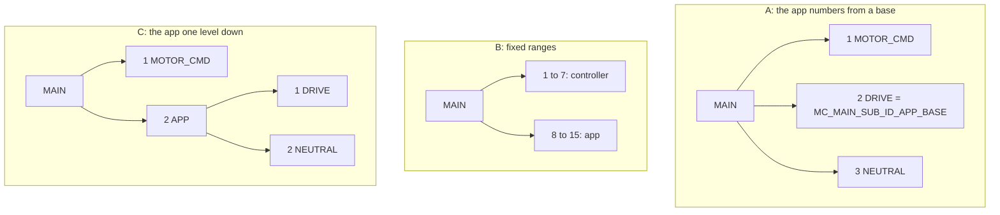

# SubStateIds

Allocate path ids to the motor's and Traction's sub-states, and give MAIN's depth-1 id space one owner so the controller's and the app's ids cannot collide.

**Status**: open. The item moved from the open list in StateMachineOverview on 2026-11-20 and here on 2026-11-22.
It waits on the owner's choice of how MAIN's id space is split; the motor's sub-states can be numbered independently.
It blocks the Quick Stop Active report in [SafeStopGaps.md](SafeStopGaps.md). The app decodes these ids
(`MOTOR_VAR_SUB_STATE`, `MOT_VAR_SYSTEM_SUB_STATE`, `TRACTION_VAR_STATE_ID`), so every allocation also needs the app
mirror. The outcome lands in each parent's header and in
[StateMachineOverview.exp.md](../../Motor/StateMachineOverview.exp.md).

## Context

- `State_PathId_T` ([State_PathId.h](../../Framework/StateMachine/State_PathId.h)) packs the path into 4-bit fields
  × 8 levels, with the root in the lowest nibble.
  - Each level holds 15 ids.
  - At depth ≥ 1, id 0 means "no sub-state", so a sub-state id space starts at 1.
  - A sub-state id is unique only among its siblings.
- 23 motor sub-states and both Traction states set only `.Depth0`, their root's id. They report their root, and each
  is marked "sub-state id not yet allocated":

| Parent | Sub-states with no id | Defined in |
|---|---|---|
| `MOTOR_STATE_OPEN_LOOP` | 13 | Motor_OpenLoop.c (3), Motor_Encoder.c (7), Motor_Sensorless.c (3) |
| `MOTOR_STATE_CALIBRATION` | 6 | Motor_ADC.c, Motor_Encoder.c (2), Motor_Hall.c, Motor_SinCos.c, Motor_CalibrationElectrical.c |
| `MOTOR_STATE_INTERVENTION` | 2, plus 1 at depth 2 | Motor_Intervention.c: `TORQUE_ZERO`, `SPEED_ZERO`; `SAFE_STOP` under `SPEED_ZERO` |
| `MOTOR_STATE_PASSIVE` | 1 | Motor_Sensorless.c |
| `MC_STATE_MAIN` | 2 | MotorController_Traction.c: `DRIVE`, `NEUTRAL` |

  OPEN_LOOP's 13 children fit the 15 a level holds, with 2 left.
- **The collision in MAIN.**
  - `MotorController_MainSubStateId_T`
    ([MotorController_StateMachine.h:66](../../Motor/MotorController/MotorController_StateMachine.h#L66)) has
    `NONE` = 0 and `MOTOR_CMD` = 1.
  - `Traction_StateId_T` ([MotorController_Traction.h:60](../../Motor/MotorController/Traction/MotorController_Traction.h#L60))
    has `DRIVE` = 0 (next to a commented-out `= _MC_STATE_ID_END`) and `NEUTRAL` = 1.
  - Allocated as they stand, `DRIVE` would read as the bare MAIN and `NEUTRAL` as `MOTOR_CMD`.
- The header names `MotorController_App_T` ([MotorController_App.h](../../Motor/MotorController/MotorController_App.h))
  as the place for a base or range. It holds `PROC_ANALOG_USER`, `INIT` and `ENTER_MAIN` today. `PATH_ID` sits in a
  `const State_T` initializer, so the base must be a constant expression, such as an enum value or a macro. A field
  read from the app table cannot be used.
- The precedent shape is `MotorController_LockSubStateId_T`. `MC_STATE_LOCK_CALIBRATE_ADC` uses
  `.Depth1 = MC_LOCK_SUB_ID_CALIBRATE_ADC`.

## Design

Three ways to give MAIN's depth-1 space one owner:



C adds an `APP` state under MAIN. Traction's states then take `P_PARENT = APP` and `DEPTH = 2`, and the app owns its
own namespace.

## Sketch

```c
/* MotorController_StateMachine.h, under A */
typedef enum MotorController_MainSubStateId
{
    MC_MAIN_SUB_ID_NONE,
    MC_MAIN_SUB_ID_MOTOR_CMD,
    MC_MAIN_SUB_ID_APP_BASE,
}
MotorController_MainSubStateId_T;

/* MotorController_Traction.h, under A */
typedef enum Traction_StateId { TRACTION_STATE_ID_DRIVE = MC_MAIN_SUB_ID_APP_BASE, TRACTION_STATE_ID_NEUTRAL, } Traction_StateId_T;

/* Motor: one enum per parent, 0 the bare parent (the LOCK shape) */
typedef enum Motor_InterventionSubStateId { MOTOR_INTERVENTION_SUB_ID_NONE, MOTOR_INTERVENTION_SUB_ID_TORQUE_ZERO, MOTOR_INTERVENTION_SUB_ID_SPEED_ZERO, } Motor_InterventionSubStateId_T;

.PATH_ID = { .Depth0 = MOTOR_STATE_ID_INTERVENTION, .Depth1 = MOTOR_INTERVENTION_SUB_ID_SPEED_ZERO, .Depth2 = MOTOR_SPEED_ZERO_SUB_ID_SAFE_STOP },
```

Under A, `TRACTION_VAR_STATE_ID` values shift (`DRIVE` = 2), so the app mirror changes with them.

## Done already

- The framework is in place: `State_PathId_T`, `StateMachine_GetPathId`, `State_IsPathIdValid`.
- LOCK's sub-states and `MC_STATE_MAIN_MOTOR_CMD` carry ids.
- Every state without an id is marked "sub-state id not yet allocated".

## Open for you

**MAIN's depth-1 id space**

- [ ] A: the controller's enum ends in an app base, and the app numbers from it
- [ ] B: fixed ranges, controller 1 to 7 and app 8 to 15
- [ ] C: the app mounted one level down, under its own MAIN sub-state

**Motor sub-state numbering**

- [ ] one enum per parent, with every child numbered there (13 under OPEN_LOOP)
- [ ] per sensor module: ids are unique within a parent among one sensor's states, and the app decodes them together
  with the sensor mode

- Notes: `____`
