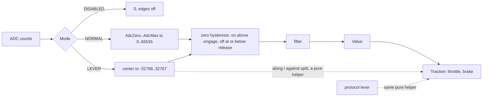

# UserAInModes

Give `UserAIn` a mode enum, starting with `DISABLED` and `LEVER`, and make hysteresis on the zero a `UserAIn` option, so analog inputs carry their own noise handling and the lever split for every drive mode.

**Status**: deferred 2026-11-23 by the owner ("hold off on hysteresis"). Unblocked by the owner's answers below. The
outcome lands in [UserAIn.h](../../Transducer/UserIn/UserAIn.h) / [UserAIn.c](../../Transducer/UserIn/UserAIn.c), a new
`UserAIn.md` sheet beside them, and the lever helper's removal from
[Traction.h](../../Motor/MotorController/Traction/Traction.h).

## Context

**Why.** A throttle held at its low point after a controller reset can start the motor without a release.

- `Drive_Entry` syncs `DriveCmd` to the present input, so a throttle already held at entry gives no start edge
  ([MotorController_Traction.c](../../Motor/MotorController/Traction/MotorController_Traction.c), `Drive_Entry`).
- The reading is valid long before the controller leaves `INIT`. In analog input mode the inputs are captured every 1 ms
  in every state, converted every `MOTOR_CONTROLLER_ANALOG_USER_DIVIDER` (15 ms), and Traction's edge detector runs in
  `INIT` and `STANDBY` too ([MotorController_Thread.h](../../Motor/MotorController/MotorController_Thread.h),
  `_MotorController_ProcAnalogUser`). A longer init wait changes nothing.
- The hole is the zero. `Traction_Input_EvaluateCmd` reads any `ThrottleValue > 0` as `THROTTLE`, and `UserAIn` maps
  every ADC count above `AdcZero` to a value above 0. Without an edge pin, or with its switch closed while the reading
  sits on `AdcZero`, ADC noise crosses the zero and each 0 → value crossing is a fresh start edge.
- With an edge pin enabled (`UseEdgePin`), the value reads 0 until the switch closes, so the switch is the engage edge.
  A throttle whose rest voltage sits above `AdcZero` then steps from 0 to its rest reading when the switch closes; the
  hysteresis does not cover that case.

**Why in `UserAIn`, not Traction.**

- Traction also takes protocol values directly (`MotorController_Traction_VarId_Set`), which are exact. The noise is
  the analog input's, which is also why Traction has no filter.
- The same input will feed other drive modes later (Servo), so hysteresis belongs with the input.

**`UserAIn` today** ([UserAIn.h](../../Transducer/UserIn/UserAIn.h)):

- Config: `AdcZero`, `AdcMax`, `UseEdgePin`; `IsEnabled`, `Threshold`, `FilterShift` and `Hysteresis` are commented
  out.
- State: `Value` (filtered, `[0:65535]`), `ValuePrev`, `RawValue_Adcu`, `Units` (the `AdcZero`/`AdcMax` linear map).
- `_UserAIn_IsOn`: `Value > 0`. The edges compare `Value` with `ValuePrev` against 0.
- Unipolar only. The one signed input, the lever, arrives by protocol (`MotorController_Traction_SetLever`) and Traction
  splits it itself.

**The lever split today** ([Traction.h](../../Motor/MotorController/Traction/Traction.h)):

- `Traction_LeverAlong(reference, lever)` is `clamp(reference · lever · 2, 0, 65535)`, the magnitude along a reference
  direction in the throttle/brake scale.
- `Traction_Input_ResolveLever` calls it twice: along the reference as throttle, against it as brake.
- Owner, 2026-11-23: this calculation belongs in `UserAIn`. A lever mode is the first mode to join `DISABLED`, which
  removes the need for the `IsEnabled` boolean.

**Precedent.** `UserDIn_Mode_T` is `{ USER_DIN_MODE_DISABLED, USER_DIN_MODE_NORMAL, … }`
([UserDIn.h](../../Transducer/UserIn/UserDIn.h)), with `UserDIn_Modal_IsDisable` as the enable test.

**Side defect.** `FilterValue` in [UserAIn.c](../../Transducer/UserIn/UserAIn.c) is
`(value + (prev << s)) >> (s + 1)`. Its weights are 1/2^(s+1) and 1/2, which sum to less than 1 for s ≥ 1, so the value
settles at value / 2^s: half the reading at s = 1. At s = 0 it is a correct 1/2 average. No consumer sets
`FILTER_SHIFT` today, so nothing reads wrong yet.

## Design



- The hysteresis state is `Value` itself: off while `Value` is 0, on otherwise. No new field.
- The split stays a pure function, so the protocol lever, which has no `UserAIn` instance, calls it too.

## Sketch

```c
typedef enum UserAIn_Mode
{
    USER_AIN_MODE_DISABLED,
    USER_AIN_MODE_NORMAL,   /* [AdcZero:AdcMax] to [0:65535], today's map */
    USER_AIN_MODE_LEVER,    /* centered, signed */
}
UserAIn_Mode_T;

typedef struct UserAIn_Config
{
    uint16_t AdcZero;
    uint16_t AdcMax;
    UserAIn_Mode_T Mode;    /* replaces the commented IsEnabled */
    uint16_t Hysteresis;    /* engage above, in Value units; 0 is today's behavior */
    bool UseEdgePin;
}
UserAIn_Config_T;

/* Hysteresis on the zero, keyed on the previous Value */
static inline uint16_t _UserAIn_ZeroHold(uint16_t prev, uint16_t value, uint16_t hysteresis) { return ((prev == 0U) && (value <= hysteresis)) ? 0U : value; }

/* The lever split, moved from Traction_LeverAlong. Pure: the protocol lever calls it without an instance */
static inline uint16_t UserAIn_LeverAlong(sign_t reference, int16_t lever) { return math_clamp((int32_t)reference * lever * 2, 0, UINT16_MAX); }

/* The filter with unit gain */
static inline uint16_t FilterValue(uint8_t shift, uint16_t prev, uint16_t value) { return ((uint32_t)value + ((uint32_t)prev << shift) - prev) >> shift; }
```

## Done already

- 2026-11-23: the analysis above, and the Traction split: `Traction.h` (input, config), `Motor_Traction.h` (one
  motor), `MotorController_Traction.c` (the leaves fan out over the motor table and keep the brake hold). It is
  independent of this block: the hysteresis and the lever split sit on the input side, in `Traction.h`.

## Open for you

Mode names:
- [ ] `DISABLED`, `NORMAL`, `LEVER`
- [ ] `DISABLED`, `UNIPOLAR`, `BIPOLAR`
- Notes: `____`

Hysteresis form:
- [ ] engage threshold only, release at 0 (the sketch)
- [ ] engage and release thresholds, both in config
- Notes: `____`

Lever center for an analog lever:
- [ ] a new `AdcCenter` config field
- [ ] the midpoint of `AdcZero` and `AdcMax`
- Notes: `____`

Filter defect:
- [ ] fix it on its own now
- [ ] fix it with this block
- Notes: `____`
