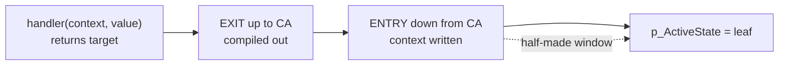
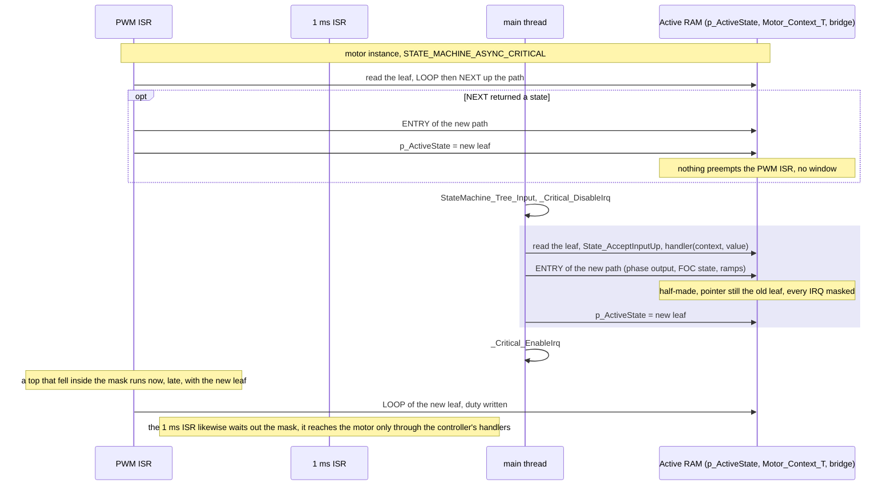
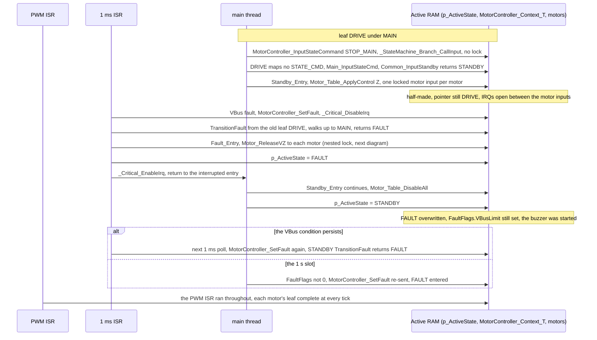
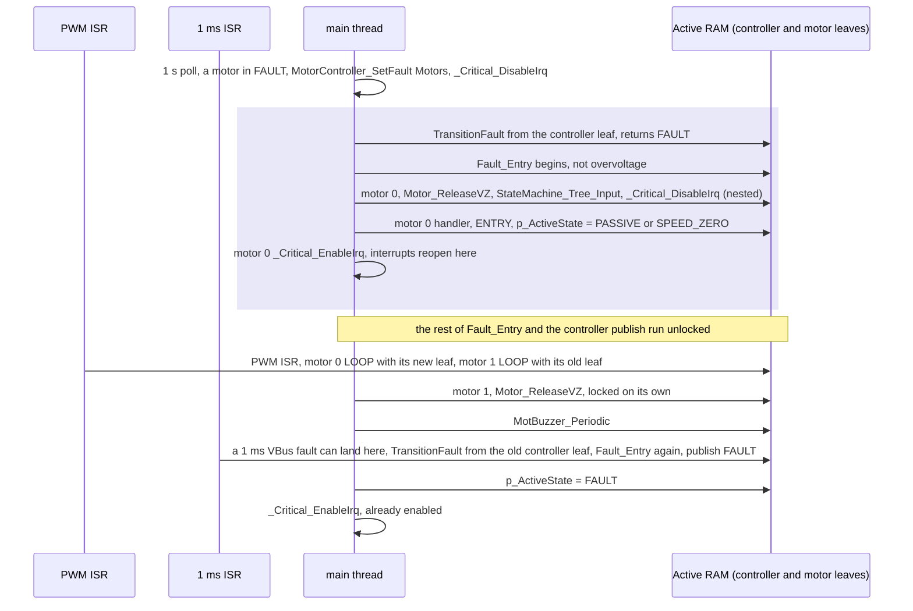
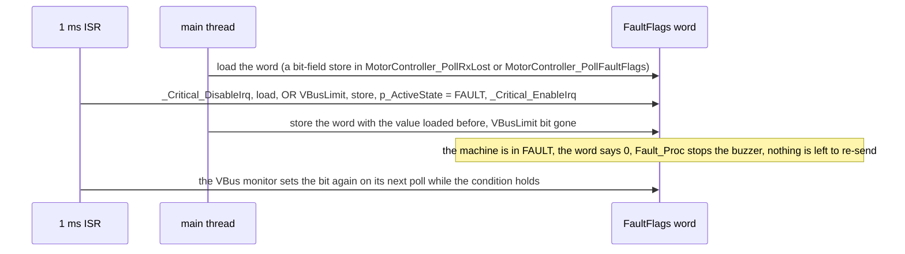

# Input vs LOOP under the lock

Where the periodic `LOOP` and the asynchronous inputs of the two built machine instances meet the one word they share,
`StateMachine_Active_T.p_ActiveState`, and the context their handlers write. Both instances build with
`STATE_MACHINE_ASYNC_CRITICAL`: the locked input paths mask every interrupt (`_Critical_DisableIrq`, PRIMASK) for the handler,
the entry walk and the publish, and unmask unconditionally (`_Critical_EnableIrq`). The engine's lock table is in
[Architecture.md](Architecture.md), Threads and the lock; the open decisions this sheet illustrates are
[0010 shared word writes](../../Docs/Decisions/0010_SharedWordWrites.md) and
[0011 lock nesting](../../Docs/Decisions/0011_StateMachineLockNesting.md). No fix is proposed here.

## The two instances as built

| | Motor (`MSM_MACHINE`, one per motor) | MotorController (`MCSM_MACHINE`) |
|---|---|---|
| `LOOP`, `NEXT`, transition | PWM ISR, every control cycle: `Motor_PWM_Thread` → `_Motor_StateMachine` → `_StateMachine_Branch_ProcSyncOutput`. `_StateMachine_AcquireAsyncIsr` is a no-op (`STATE_MACHINE_INPUT_MULTITHREADED` is not defined): the ISR never masks | main thread, the 1 ms slot of `MotorController_Main_Thread` → `_StateMachine_Branch_ProcSyncOutput`, unlocked |
| Actions | PWM ISR: `ON_SPEED` at the speed tick (`Motor_PollSpeed`), `ON_PHASE` at the phase-current completion; leaf only, no lock | none |
| Inputs, locked | main: `StateMachine_Tree_Input` (`Motor_Apply*`, `Motor_Calibration_Enter/Exit`, `Motor_OpenLoop_*`), `StateMachine_Tree_InvokeTransition` (`Motor_Enable`, `Motor_Disable`, the calibration and open-loop commands), `Motor_StateMachine_SetFault` (heat, 1 s). Also whichever thread runs the controller's `Fault_Entry`, `Standby_Entry`, `Lock_Entry`, `Main_Entry`, `Common_InputStandby` and the Traction handlers, since they send motor inputs | `MotorController_SetFault` / `ClearFault` → `StateMachine_Tree_InputAsyncTransition`: main (1 s monitors, the motor-fault poll, the flag re-send, the protocol's clear) and the 1 ms ISR (`_MotorController_VBus_Thread`); `MotorController_Lock_CalibrateAdc` → `StateMachine_Tree_InvokeTransition` |
| Inputs, unlocked | none | main: `_StateMachine_Branch_CallInput` direct, `MotorController_InputStateCommand` (`STATE_CMD`), `MotorController_InputLock` (`LOCK`), `_MotorController_Traction_ApplyCmd` (`APP_USER`) |
| Cross-thread pair | main input vs PWM `LOOP`: closed by the mask | 1 ms fault input vs main `LOOP` and main inputs: open, the main side holds no lock |

Transition order, both instances (`_StateMachine_TraverseTransitionTo`): handler returns the target; `EXIT` up to the common
ancestor (compiled out); `ENTRY` down; then `p_ActiveState = leaf`. The leaf is published last. From the first `ENTRY` write
to the publish the machine is half-made: the context already reflects the new state, the pointer still names the old leaf.
The flat path (`_StateMachine_TransitionTo`) orders the same way.

## Motor: a main-thread input against the PWM LOOP

The lock closes the window: a PWM top that falls inside it runs late, after the publish, and sees the new leaf. The ISR's own
transitions (a `NEXT`) are atomic by priority.

The motor's `ON_SPEED` and `ON_PHASE` actions run on the PWM thread and read the leaf without a lock; they are consistent
for the same reason the `LOOP` is.

## MotorController: the 1 ms fault input against an unlocked main-thread transition

The controller's state commands, lock commands, app inputs and its `LOOP`/`NEXT` transitions run on main with no lock. The
1 ms ISR's `MotorController_SetFault` masks interrupts for its own handler, but can land anywhere inside the main-thread
transition, including its half-made window. The handler then runs from the old leaf's table, and main's publish follows the
fault's.

The same shape covers the controller's `LOOP` (`Init_Next`, `Standby_Next` in `AUTO` mode, `EndCalibrateAdc`), `InputLock`
and the Traction handlers, all unlocked on main. The motors themselves are never half-made in this picture: each motor input
is its own locked region, and the PWM ISR sees each motor's leaf complete.

## MotorController: the nested release inside a locked input

A locked controller handler that sends a motor input nests two mask/unmask pairs. The inner unmask is unconditional, so the
rest of the outer handler and the outer publish run with interrupts open. The entries that nest: `Fault_Entry`
(`Motor_StateMachine_SetFault` or `Motor_ReleaseVZ` per motor), `Standby_Entry` and `Lock_Entry` (`Motor_Table_ApplyControl`,
`Motor_Table_DisableAll`, `Motor_Calibration_Enter`), `Main_Entry` (`Motor_Table_EnableAll`, `Motor_Table_ApplyControl`),
`Common_InputStandby`, and any Traction handler calling a `Motor_Apply*`. The nesting is observable only when the outer
handler itself holds the lock: a fault input from main or from the 1 ms ISR, or `MotorController_Lock_CalibrateAdc`.

When the outer input is the 1 ms ISR's own fault (`_MotorController_VBus_Thread`), `Fault_Entry` runs inside the ISR: the
inner release reopens interrupts to the PWM ISR for the rest of the entry, and the motor inputs it sends arrive from the
1 ms thread, each still locked on its own.

## The shared word (0010)

`MotorController_Context_T.FaultFlags` is written as bit fields by main (`MotorController_PollFaultFlags` at init and on a fault
clear, `MotorController_PollRxLost` every 1 ms in serial mode) and ORed by the 1 ms ISR's `TransitionFault` under the lock.
Each bit-field store is a load, mask, store of the whole word; the lock covers the ISR's side only.

The other two 0010 values, `Motor_Context_T.ISupplyLimits` (written on main or the 1 ms thread, read on the PWM speed tick)
and the PID gain pairs (protocol write on main, read in the PWM loops), cross threads outside the state machine and are not
drawn.

## Where the pointer and the context disagree

| Instance | Writer of the half-made window | Who can observe it | What they see |
|---|---|---|---|
| Motor | PWM `NEXT` transition | nobody: the ISR is the highest of the three and runs to completion | |
| Motor | main input, locked | nobody while masked; the PWM ISR after the publish | the new leaf, consistent |
| Motor | a controller handler's motor input, from main or the 1 ms ISR | as above, per motor | each motor consistent; the set of motors may be half-updated when the PWM ISR runs between two of them |
| MotorController | main `LOOP`/`NEXT`, `STATE_CMD`, `LOCK`, `APP_USER` (unlocked) | the 1 ms ISR's fault input | old leaf's table, new state's context; its publish is then overwritten by main's |
| MotorController | a locked fault input whose entry sends a motor input | the 1 ms ISR after the inner release (and the PWM ISR, which does not read this machine) | as above, for the tail of the entry |

## Sources

`_StateMachine_Lock.h` (`_StateMachine_AcquireAsyncIsr`, `_StateMachine_AcquireAsyncInput`, `_StateMachine_ReleaseAsyncInput`,
`_StateMachine_AcquireAsyncTransition`), `StateMachine.h` (`StateMachine_Tree_Input`, `StateMachine_Tree_InputAsyncTransition`,
`StateMachine_Tree_InvokeTransition`), `_StateMachine.c` (`_StateMachine_TransitionTo`), `_StateMachine_Tree.c`
(`_StateMachine_TraverseTransitionTo`, `_StateMachine_Branch_ProcSyncOutput`, `_StateMachine_Branch_CallInput`),
`_State_Node.c` (`State_TraverseEntryExit`, `ExitUp`, `EntryDown`), `System/Critical/Critical.h` (`_Critical_DisableIrq`,
`_Critical_EnableIrq`); Motor: `Motor_StateMachine.h` (`_Motor_StateMachine`, `Motor_StateMachine_SetFault`), `Motor_Thread.h`
(`Motor_PWM_Thread`, `Motor_PollSpeed`), `Motor_User.c`; MotorController: `MotorController_Thread.h`
(`MotorController_Main_Thread`, `MotorController_Timer1Ms_Thread`, `_MotorController_VBus_Thread`),
`MotorController_StateMachine.h` (`MotorController_InputStateCommand`, `MotorController_InputLock`, `MotorController_SetFault`),
`MotorController_StateMachine.c` (`TransitionFault`, `Fault_Entry`, `Standby_Entry`, `Lock_Entry`, `Main_Entry`,
`Common_InputStandby`, `MotorController_PollFaultFlags`), `MotorController.h` (`MotorController_PollRxLost`),
`Traction/MotorController_Traction.c` (`_MotorController_Traction_ApplyCmd`), `MotorController_Analog.c`
(`MotorController_Lock_CalibrateAdc`); Decisions 0010 and 0011.

## Not shown / open

- `STATE_MACHINE_ASYNC_SIGNAL` and the buffered `SetInput` / `SyncInputMask` path are not built by either instance and are
  not drawn.
- The encoder edge ISRs write sensor state, not either machine; they are outside this sheet.
- The relative priority of the PWM ISR, the 1 ms timer ISR and the main thread is the board's; the sheet assumes PWM above
  1 ms above main, which both built boards satisfy.
- Decision 0010 gives the flag re-send as 16 ms; `MotorController_Main_Thread` re-sends set `FaultFlags` in the 1 s slot
  (`MOTOR_CONTROLLER_MAIN_DIVIDER_1000`), while the VBus monitor itself re-detects every 1 ms.
- Whether a lost controller `FAULT` publish can leave a motor released under a live `MAIN` for longer than one re-send period
  was not traced through the app layer.
