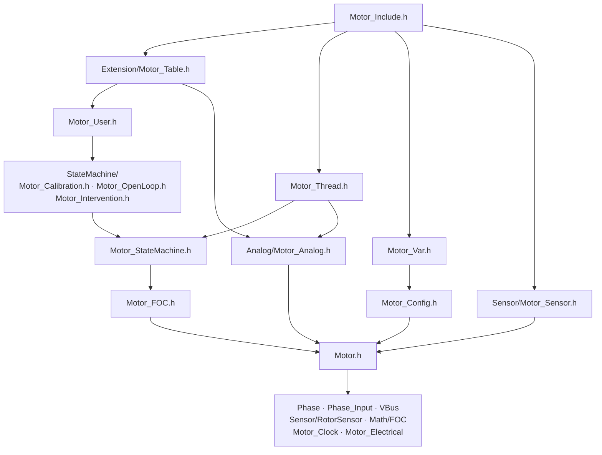
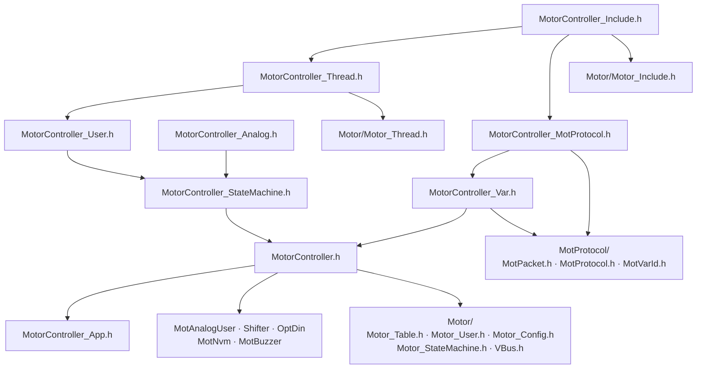

# Motor Header Dependencies

Include graph of the `Motor/Motor` and `Motor/MotorController` headers. Arrows point from a header to the headers it includes; edges implied by a longer path are omitted. Module-level dependencies are in [ARCHITECTURE.md](../../ARCHITECTURE.md).

## Motor

## MotorController

