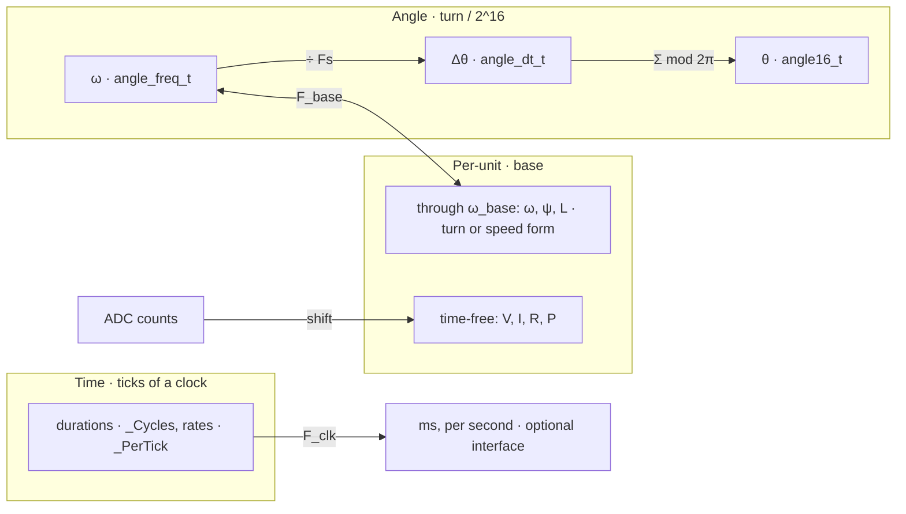

# Fixed-Point Quantities

A stored integer `n` stands for

    q = n · u / 2^k

`k` is the fraction bits and `u` the unit. The type names the representation (storage, `k`). The identifier suffix names the unit: `_Pu`, none for a plain ratio, `_Cycles`, `_PerTick`, `_Hz`, `AngleFreq`. Conversions read `to_of_from` (`angle_freq_of_rpm`).

Each quantity belongs to one family, by what fixes its unit:

| Family | Unit `u` | Fixed by | Holds | To SI |
|---|---|---|---|---|
| Per-unit | a base | board, motor, clock | V, I, P, Rs, L, ψ, ω_pu | × base, needs the base |
| Time | tick of a clock | the loop or timer, in Hz | durations, rates | one operation with F_clk |
| Angle | turn / 2^16 | constant | θ, ω, Δθ | constant |

Per-unit is the default for physical magnitudes. Time and angle are the exceptions. Angle has a universal unit. Time counts ticks of the loop or timer that runs it, and the clock's frequency in Hz reaches SI in one operation.

## Per-unit

### Bases

V_base and I_base are the sensor full scales, [Phase_Board_T] `V_MAX_VOLTS` and `I_MAX_AMPS`, so ADC → pu is a shift (`Phase_Analog_VPuOf`, `Phase_Analog_IPuOf`). Derived bases follow the defining equations, so the pu equations keep their SI form. A base is free of time, or carries time through ω_base.

#### Time-free

| Base | Definition | pu equation |
|---|---|---|
| V | sensor full scale | |
| I | sensor full scale | |
| R | V_base / I_base | v = Rs · i |
| P | (3/2) · V_base · I_base | p = v_d · i_d + v_q · i_q |

One form each, fixed by the board.

#### Through ω_base

A speed is angle per time, and ψ and L hold time in the numerator, so their bases include ω_base:

| Base | Definition | pu equation |
|---|---|---|
| ω | F_base · π / 2^15 [rad/s] | ω_pu = F / F_base |
| ψ | V_base / ω_base | v = ω · ψ |
| L | V_base / (ω_base · I_base) | v = ω · L · i |

ω_base anchors the time, to the control clock or to the motor, so each of these has two forms:

| Form | F_base [angle_freq_t] | ω_pu | Holds |
|---|---|---|---|
| Turn | Fs · 2^15, ω_base = π · Fs | Δθ [angle16/Ts] | identification, in samples; the observer gain; FOC decoupling |
| Speed | AngleFreqPerVolt · V_base · `MOTOR_SPEED_BASE_V_PU` | `Speed_Pu` | speed loop, limits |

- The turn form is time in ticks of Fs. Δθ_base = 2^15, a half turn, so ω_pu and Δθ are one integer, Q15 of π rad per tick.
- The speed form anchors to the motor and resolves k = Fs · 2^15 / F_base times finer.
- ψ and L move between forms by F_to / F_from (`pu_tau_rebase`), ω_pu by F_from / F_to.
- ψ and L are stored as rates, 1 / ψ [angle16/s / V] and 1 / L [angle16/s · A/V]. Each form is one division from the rate: x_pu = F_base / (rate · Z_base), Z_base = V_base for ψ and V_base / I_base for L (`psi_pu_of_angle_freq`, `l_pu_of_angle_freq`). ψ per volt and L per ohm are both [s/rad] (`angle_freq_of_s_per_rad`).

A product's unit is the product of the bases. It is valid when that product is in the set (ω_pu · ψ_pu → v_pu), and when factors through ω_base share a form. Motor bases and the speed base in detail: [Motor/Motor/Math/_.md](../../Motor/Motor/Math/_.md).

### Types

| Type | Storage, k | Range | Holds |
|---|---|---|---|
| `fract16_t` | int16, 15 | [-1, 1) | signals and state, saturating |
| `ufract16_t` | uint16, 15 | [0, 2) | magnitudes, limits |
| `accum32_t` | int32, 15 | [-65536, 65536) | intermediates; Rs, L, ψ, gains above 1.0 |
| `fract32_t` | int32, 31 | [-1, 1) | extended fraction |
| `uq16_t` | uint16, 16 | [0, 1) | percent16, ratios |
| `fract16e_t` | int16 mantissa, shift | mantissa / 2^shift | coefficients at a 32-bit product |

A float build ([real.h](../../Math/HAL/real.h)) changes this family alone, to value / base.

### Arithmetic

| Operation | Form | Bound | Code |
|---|---|---|---|
| add | Q15 + Q15 | one carry bit, held in accum32 | |
| multiply | (a · b) >> 15 | int32 product: one factor ≤ 2.0 | `fract16_mul` |
| wide multiply | (a · b) >> 15, int64 | SMULL on M4, `__aeabi_lmul` on M0+ | `accum32_mul` |
| per-target coefficient | wide on Thumb-2; `fract16e_mul` of `fract16e_k(a, m)` on Thumb-1 | \|a >> m\| < 2^15; m from the bound on a, at init | `fract16k_t`, `fract16k_mul` |
| coefficient | (m · b) >> shift | 32-bit product at full mantissa | `fract16e_mul` |
| divide | (a << 15) / b | a < 2.0; the caller guards b = 0 | `fract16_div` |
| store | clamp to ±FRACT16_MAX | symmetric, so −1 · −1 and abs fit | `fract16_sat` |

## Time

Time is a count of ticks of the loop or timer that runs it, with that clock's frequency in Hz: `MOTOR_CONTROL_FREQ` (Fs), `MOTOR_SPEED_LOOP_FREQ`, the 1 ms thread, the capture timers. A tick count is time normalized to the clock period.

| Quantity | Held as | To SI |
|---|---|---|
| clock | frequency [Hz] | |
| duration | ticks, `_Cycles` | n / F_clk |
| rate | per tick, `_PerTick` | r · F_clk |

- A clock is held as its frequency, not its period. Integer Hz is exact where the period is not (12 kHz is 83.3 µs), and each conversion is one operation.
- A tick count is a time only with its clock, so each field names its clock: `AlignTime_Cycles` at `MOTOR_CONTROL_FREQ`, `SpeedRampSlope_PuPerTick` at `MOTOR_SPEED_LOOP_FREQ`. A change of a loop rate rescales what is stored against it, as a change of V_base rescales pu.
- The loop uses ticks as held: a duration is a compare against a counter, a rate is the step (Ramp, Q30 per tick).
- ms and per second are an optional interface, in the Motor module for now (`Motor_Config_SetAlignTime_Millis`, `Motor_Config_SetSpeedRampSlope_RpmPerS`). Socket and the other modules come later.
- Speed is an angle quantity, held per second in [angle_freq_t]. Each consumer applies its own clock, Δθ = F / Fs in the control loop.

ψ and L hold time in the numerator. Stored as rates, 1 / ψ and 1 / L, the second is in the denominator at scale 1, as in [angle_freq_t]. Their turn form derives on init (Bases).

## Angle

### `angle16_t` — position

θ_n = θ · 2^16 / 2π, the binary angle: radians as an integer at 10430.4 per radian. Addition wraps mod 2π. Signed [-π, π) and unsigned [0, 2π) are one bit pattern. The top two bits are the quadrant, the next eight index the sine table.

Read as `fract16_t`, the same bits are θ / π: angle16 is Q15 of π rad. `FRACT16_PI` = π · 2^15 and `ANGLE16_PER_RADIAN` = 2^15 / π are reciprocal in Q30.

| Type | Storage, k | Unit | Holds |
|---|---|---|---|
| `angle16_t`, `uangle16_t` | int16, uint16; 16 | turn | position |
| `angle32_t` | uint32, 32 | turn | fine position, per-count factors |
| `rot32_t` | int32, 16 | turn | multi-turn position |
| [Angle_T] `.Angle`, `.Delta` | int32, 32 | turn, turn per tick | integrator |

### `angle_freq_t` — rate per second

    F = ω [rad/s] · 2^16 / 2π = f [Hz] · 2^16          [angle16/s], Q16.16 Hz

Bits [31:16] are whole turns per second, [15:0] the angle16 fraction.

- SI-shaped: θ_n(t) = θ_n(0) + F · t [s], with no constant. The 2π between ω and f is the turn, so Hz is the high half and π never appears inside the family.
- Views: Hz = F / 2^16, erpm = F · 60 / 2^16, rad/s = F · 2π / 2^16, Δθ = F / Fs.
- Range ±32768 Hz, ±1,966,080 erpm. LSB 1.53e-5 Hz = 9.59e-5 rad/s.
- 3000 rad/s = 477.46 Hz = 28,648 erpm → 31,291,135, 1.5% of the range.
- Nyquist at Fs is Fs · 2^15 (`angle_freq_nyquist`), in int32 for Fs ≤ 65,535 Hz.
- Per volt it is the motor constant, `AngleFreqPerVolt`: 11 bits at Kv 1 with 1 pole pair, 27 at Kv 10,000 with 7.

### `angle_dt_t` — rate per tick

    Δθ = F / Fs          [angle16/Ts]

F = Δθ · Fs is exact. int16 wraps at ±π per tick, Nyquist by construction.

- LSB Fs / 2^16: 0.305 Hz = 18.3 erpm at 20 kHz. [Angle_T] `.Delta` keeps 16 more bits, 4.7e-6 Hz.
- The control loop's form of F, derived from it: Δθ_base in [Angle_SpeedPuRef_T].

### Wrap in C

Unsigned arithmetic wraps by definition. A narrowing conversion to a signed type is implementation-defined; GCC reduces modulo 2^N, which `angle16_t` relies on. Signed `int32_t` overflow is undefined. Wrapping state accumulates as `uint32_t` (`angle32_t`) and projects to the signed type.

## Bridges

Constants appear only where families meet.

| Between | Constant | Fixed by | Applied |
|---|---|---|---|
| ADC ↔ V, I pu | shift | board: full scale = base | capture |
| ticks ↔ ms, per second | F_clk | build | optional interface |
| `angle_freq_t` ↔ `angle_dt_t` | Fs | build | init, capture |
| `angle_freq_t` ↔ ω_pu | F_base | motor config | [Angle_SpeedPuRef_T]: Δθ_base and its inverse, 32-bit products |
| rate ↔ turn or speed form | F_base / (rate · Z_base) | Fs, motor, board | init (`psi_pu_of_angle_freq`, `l_pu_of_angle_freq`) |
| angle16 ↔ rad | 2^15 / π | constant | SI boundary |
| pu ↔ V, A, Ω, H | bases | board, motor | user boundary |

### π

π enters where an SI quantity is per radian: rad/s views, ψ [V·s/rad], ω · L. `FRACT16_PI` (0x1921F) is π · 2^15 to −6.9e-6, about 17 bits.

### Time-derivative terms

d/dt over a tick is Δ · Fs, while ω_base is per radian, so a pu term with d/dt carries Fs / ω_base:

    v_pu = L_pu · (di_pu / dt) / ω_base = L_pu · Δi_pu · Fs / ω_base       per tick

In the turn form Fs / ω_base = 1 / π, so v_pu = L_turn · Δi_pu / π. Rotational terms need no factor, as ω_pu supplies ω_base: ω_pu · L_pu · i_pu, ω_pu · ψ_pu. π lands on the derivative side, off the FOC decoupling path. Identification multiplies it back (`l_pu_turn_of_step`, `l_pu_turn_of_rs_tau_cycles`). The rad form, ω_base = Fs, has Fs / ω_base = 1: v_pu = L_rad · Δi_pu (`motor_v_stator`).

## Rules

1. One family per stored quantity. SI units are views at the user boundary.
2. The suffix names the unit, the type names the representation.
3. Derived bases follow the defining equations.
4. Time is ticks of a named clock, the clock in Hz. ms and per second are an optional interface.
5. Values through ω_base combine within one form, and move between forms by F_to / F_from.
6. A stored pu value is relative by intent. A motor description is stored free of the motor-derived base.
7. A base bounds the reachable range of each `fract16_t` stored against it, otherwise `accum32_t`.
8. Saturate on store. `accum32_t` carries the pre-saturation value.
9. Wrap only in the angle family, in unsigned arithmetic or by narrowing.
10. π only at the radian. Derivative pu terms carry Fs / ω_base.
11. One truncation per conversion: constant divisors first, the variable divisor last. Write-back paths return the value written: a reciprocal pair inverts exactly while the stored side has the more bits (`angle_freq_of_l_pu`), a scale-down pair scales up to the midpoint. User views round to nearest (`kv_of_angle_freq`).
12. Constants are written in SI through macros the compiler folds (`ANGLE_FREQ`, `MOTOR_L_PU_TURN`). A pu macro returns the unscaled value, and the destination's literal macro applies the representation: `FRACT16`, `ACCUM32` for storage, Q15 in every build; `FRACT`, `ACCUM` at runtime. Runtime conversions are integer.
13. 64-bit division at init or the user boundary, not in the control loop.

## Viability

Viable. Each family's representation makes its native operation cheap:

| Family | Native operation | Cost here |
|---|---|---|
| Per-unit | normalize, multiply, saturate | ADC → pu a shift; a product MUL + shift; a known 1.0 bound |
| Time | count, compare | ticks are the count; SI is one operation with F_clk, at the interface |
| Angle | add mod 2π, look up sin/cos | the overflow is the modulo; the top bits are the index |

The split matches the float HAL: per-unit values become `float`, while angles and ticks stay integer, as wrap and counting are integer by nature.

| Alternative | Cost |
|---|---|
| Time on ω_base, t_base = 1 / ω_base | Derivative terms coherent, but every clock conversion carries ω_base and π, and a Kv change rescales every time constant |
| Radians in Q format | No free wrap, 2π inexact, range reduction before each lookup |
| Speed as integer rpm or rad/s | rpm is mechanical and /60; rad/s puts π in every conversion |
| Scaled SI integers for V, I (mV, mA) | ADC → value a multiply; each product its own constant; no saturation bound |

### Measured

| Check | Result |
|---|---|
| `angle_freq_t` range | ±32768 Hz, ±1.97 M erpm |
| `angle_freq_t` LSB | 9.59e-5 rad/s; relative 9.2e-4 at 1 erpm, 4.6e-8 at 20,000 erpm |
| Nyquist in int32 | Fs ≤ 65,535 Hz |
| `angle_dt_t` LSB, 20 kHz | 0.305 Hz, 18.3 erpm; `.Delta` 4.7e-6 Hz |
| `AngleFreqPerVolt` | 11–27 bits over Kv 1–10,000 |
| tick counts | uint32: 59.6 h at 20 kHz, 49.7 d at 1 kHz. uint16: 3.3 s, 65.5 s |
| `_PerTick` slope, Q30 | ≤ 1% truncation for full-scale ramps to 8.9 min at 20 kHz, 3.0 h at 1 kHz |
| L_turn · Δi_pu / v_L,pu | π exactly (80 µH, 94 V, 600 A, 20 kHz) |

### Findings

1. **Signed wrap, rule 9.** `Angle_Integrate` and `Angle_IntegrateStep` add `int32_t` `.Delta` into `int32_t` `.Angle`, overflowing every half turn. Undefined in C; the build is `-O3 -mcpu=cortex-m0plus` without `-fwrapv`. `AngleCounter_CaptureCount` already adds unsigned.

### Open

- Speed limits. `SpeedLimitForward_Pu` and `SpeedLimitReverse_Pu` follow the speed base, so writing Kv or pole pairs moves the limit in rpm. Relative by intent, or `angle_freq_t`?
- Speed above 1.0 pu. Resolve to 2.0 in `Angle_ResolveSpeed_Pu` as the counters do, or a base with headroom?
- PID. [PID_Config_T] stores `Ki` per second with its `SampleFreq`, the per-tick gain derived on init. Keep, or store per tick by rule 4?
- Wrap. `angle32_t` state (local), or `-fwrapv` (global, and it hides real overflow from UBSan)?

