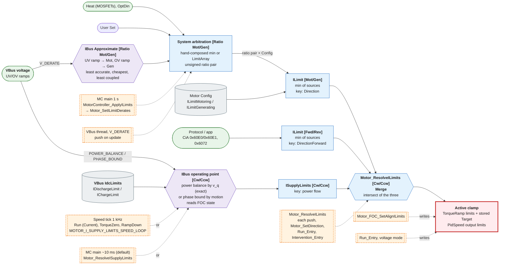
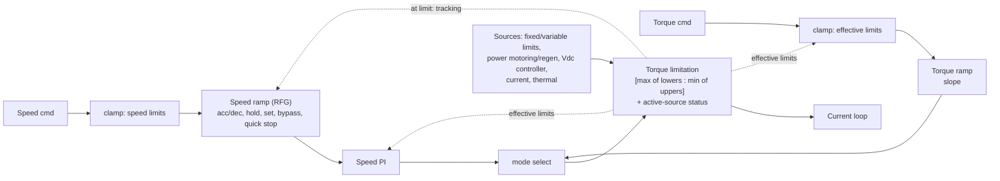

##

Green stadium: live limit source. Grey cylinder: stored config limit. Purple hexagon: frame conversion. Blue box: merge point. Red box: active clamp in the hot path. Amber dashed box: call site, with dotted edges meaning "invokes". Solid edges carry limit values.

##

