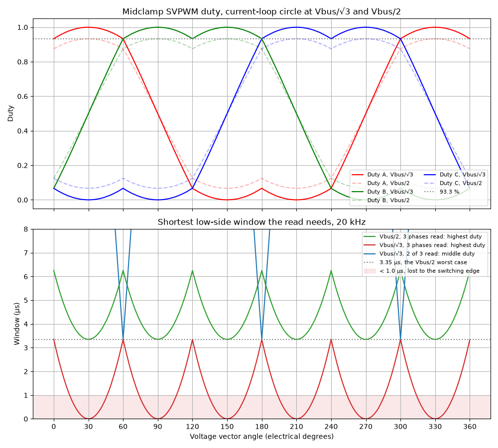
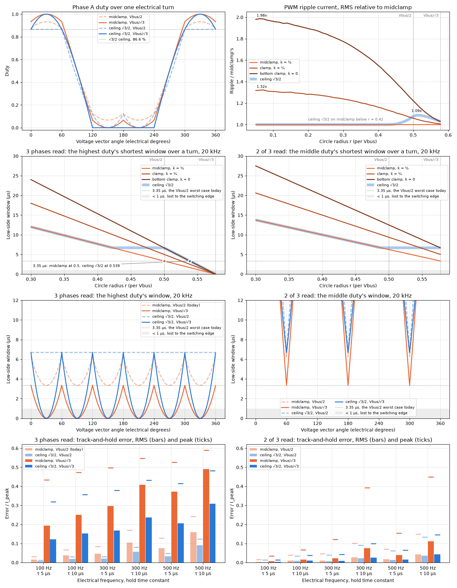

# Modulation Limit

The current loop's modulation limit is its v_dq circle radius, `FOC_V_CIRCLE_PER_V_BUS`. SVPWM is linear to Vbus/√3. A current sensor on the low side, a shunt or the low-side switch's R_DS(on), sees a phase only while its low side conducts, and that window can set a tighter limit. Zero-sequence placement is the lever. The PWM convention: [PwmConvention.md](PwmConvention.md). Where the sample sits in the period: [CurrentSampling.md](CurrentSampling.md). The q-axis band inside the circle: [VLimitPolicy.md](VLimitPolicy.md).

## The window sets the modulation limit

- A phase's current is read only in its low-side window, (1 − d)·T, centered on the counter top.
- Under midclamp SVPWM at radius r (|v|/Vbus), the highest phase duty reaches ½ + (√3/2)·r over the electrical cycle, and the middle one ½ + (3/4)·r.
- Nothing else in the output path limits duty, so the current loop's circle radius, `FOC_V_CIRCLE_PER_V_BUS`, is the modulation limit.
- Reading 3 phases at Vbus/√3, the top phase's window stays at or under 0.067·T for the 120° it is on top, and drops under 0.02·T for ±16° around each line-to-line peak.
- Reading 2 of 3, only the middle duty counts: at Vbus/√3 it is 93.3 %, the window that 3 phases have at Vbus/2.
- On a track-and-hold sensor, a phase read with too little window shows as a steady Id/Iq offset with 3× electrical ripple ([low_side_hold.py](Simulation/Svpwm/low_side_hold.py)).

Shortest window at 20 kHz, T = 50 µs, through the integer output path ([low_side_window.py](Simulation/Svpwm/low_side_window.py)):

| Placement, radius | 3 phases read | 2 of 3 read |
|---|---|---|
| midclamp, Vbus/2 (the default) | 3.35 µs | 6.25 µs |
| midclamp, 0.539·Vbus | 1.67 µs | 4.80 µs |
| midclamp, Vbus/√3 | 0 µs | 3.35 µs |
| ceiling √3/2, Vbus/2 | 6.70 µs | 6.70 µs |
| ceiling √3/2, 0.539·Vbus | 3.35 µs, for 0.3° of the turn | 6.70 µs |
| ceiling √3/2, Vbus/√3 | 0 µs | 6.70 µs |

Largest radius for a window w, as a fraction of T:

| Placement | Reading 3 phases |
|---|---|
| general clamp, k | (1 − w/(1 − k))/√3 |
| midclamp, k = ½ | (1 − 2w)/√3 |
| bottom clamp, k = 0 | (1 − w)/√3 |
| ceiling D | the bottom clamp's while D ≤ 1 − w, as √3/2 is for w up to 0.134; midclamp's past it |

**Don't raise `FOC_V_CIRCLE_PER_V_BUS` past the radius the sensor's shortest working window allows under the placement in use.**

## Options

Defined in the board's `Precompile.h`. The placement is selected in `Phase_WriteSvpwm` and `Phase_SvpwmVOut` (`Phase_Svpwm.h`), in the PWM write, so it applies whatever the capture path.

| Option | Default | What it does |
|---|---|---|
| `FOC_V_CIRCLE_PER_V_BUS` | `FRACT16_1_DIV_2` | The circle radius per Vbus, through `_FOC_VCircle`: `FOC_ProcIFeedback_Base`, `_Decouple`, `_BackLimit` and the field-weakening target `_FOC_VFieldWeakening`. Voltage mode, `Motor_FOC_ProcAngleV`, passes Vbus/√3 directly |
| `PHASE_ANALOG_I_SENSOR_LOW_SIDE` | off | Reads 2 of 3. `Motor_Analog_MarkI` converts every phase but `Phase_ReadDutyMax`, read before this cycle's write. `_Phase_Analog_SolveI` completes the third by i_a + i_b + i_c = 0 and sets the flags to ABC, so `FOC_CaptureIData`, `Motor_Sensorless_CaptureStator` and the IA/IB/IC vars still get a full set. Needs marked, per-channel conversion: a hardware sequence that converts all three can't leave one out |
| `PHASE_SVPWM_MIDCLAMP` | selected when no other is | `svpwm_midclamp`: the nulls shared equally |
| `PHASE_SVPWM_MIDCLAMP_CEILING` | off | `svpwm_midclamp_ceiling`: midclamp, with the zero sequence lowered until the highest duty is at or under `PHASE_SVPWM_DUTY_CEILING` (default `FRACT16_SQRT3_DIV_2`), never past the bottom clamp |
| `PHASE_SVPWM_CLAMP` | off | `svpwm_clamp` at a fixed `PHASE_SVPWM_CLAMP_K`, the share of the null time at O111, [0:32768]: 0, the default, is the bottom clamp; ½ midclamp; 1 the top clamp |
## Zero-sequence placement

- The zero sequence moves every phase's duty together. The line-to-line voltages, all the motor sees, are unchanged.
- **Lowering it adds the same low-side time to every phase.** Only the lowest phase's duty is there to give, and at Vbus/√3 that is 0 at each line-to-line peak. So reading 3 phases, no placement reaches Vbus/√3, and a top duty held to D reaches r = D/√3.
- General clamp, with spread = vMax − vMin and duty = v − vZero:

      vZero = k·(vMax − 1) + (1 − k)·vMin
      lowest duty    k·(1 − spread)
      highest duty   spread + k·(1 − spread),   the shortest low-side window (1 − k)·(1 − spread)·T

- `svpwm_clamp` at k = ½ is within 1 LSB of `svpwm_midclamp`.
- The ceiling is the general clamp with k solved per vector for the highest duty at D, k = (D − spread)/(1 − spread), held to [0, ½]. vZero is linear in k, so it holds vZero between midclamp's and the bottom clamp's instead, without the division: `math_clamp(vMax − D, midclamp, vMin)`. A spread past D takes the bottom clamp.
- At D = √3/2 the ceiling is midclamp below 0.423·Vbus, holds the top duty over the whole cycle from 0.488·Vbus, takes the bottom clamp at each line-to-line peak from Vbus/2, and over the whole cycle at Vbus/√3.
- PWM ripple current, RMS relative to midclamp at the same radius:

  | Radius | ceiling √3/2 | bottom clamp |
  |---|---|---|
  | below 0.42·Vbus | ×1.00 | ×1.90 at 0.2·Vbus |
  | Vbus/2 | ×1.08 | ×1.22 |
  | Vbus/√3 | ×1.03 | ×1.03 |

- A fixed k pays for its window at every radius; the ceiling pays only where the window needs it.
- The bottom clamp writes 0/0/0 for a zero command, which `Phase_ReadVOut` reports as V0. The ceiling never shifts a zero command.

From [low_side_zero_sequence.py](Simulation/Svpwm/low_side_zero_sequence.py). The ceiling over one cycle: [SVPWM_Ceiling.png](Simulation/Svpwm/SVPWM_Ceiling.png), from [svpwm_ceiling.py](Simulation/Svpwm/svpwm_ceiling.py); against r, [svpwm_ceiling_analysis.py](Simulation/Svpwm/svpwm_ceiling_analysis.py).

## The radius for a window: `svpwm_math.h`

The macros are constant expressions, for `FOC_V_CIRCLE_PER_V_BUS`, initializers and `static_assert`; the functions are their typed forms and return the same values. Both round down, so the window is kept.

| Form | Value |
|---|---|
| `SVPWM_MIDCLAMP_DUTY_PEAK(r)`, `svpwm_midclamp_duty_peak` | midclamp's highest duty at radius r, ½ + (√3/2)·r |
| `SVPWM_MIDCLAMP_RADIUS(dutyPeak)`, `svpwm_midclamp_radius` | its inverse, (2·dutyPeak − 1)/√3 |
| `SVPWM_MIDCLAMP_CEILING_RADIUS(dutyPeak, D)`, `svpwm_midclamp_ceiling_radius` | the same under the ceiling: dutyPeak/√3 for dutyPeak ≥ D, else midclamp's |
| `SVPWM_DUTY_PEAK_OF_WINDOW(Window, Period)` | the highest duty that leaves the window, 1 − Window/Period. Window and Period in one unit: ns, or timer ticks |
| `SVPWM_MIDCLAMP_RADIUS_OF_WINDOW(Window, Period)` | midclamp's radius for that window |
| `SVPWM_MIDCLAMP_CEILING_RADIUS_OF_WINDOW(Window, Period, D)` | the ceiling's |
| `SVPWM_CLAMP_RADIUS_OF_WINDOW(Window, Period, K)` | (1 − w/(1 − k))/√3, any k. Floating point, through `FRACT16()`: for constants only |

- At 20 kHz, the 3.35 µs midclamp leaves at Vbus/2: `SVPWM_MIDCLAMP_RADIUS_OF_WINDOW(3350U, 50000U)` is 16383, 1 LSB under ½. `SVPWM_MIDCLAMP_CEILING_RADIUS_OF_WINDOW(3350U, 50000U, FRACT16_SQRT3_DIV_2)` is 17651, 0.539·Vbus, +7.7 %.
- `FOC.h` includes `svpwm_math.h`, so `FOC_V_CIRCLE_PER_V_BUS` can be written in these terms. It can't see `PHASE_SVPWM_DUTY_CEILING`, so keep the ceiling argument equal to it.
- `FRACT16_SQRT3_DIV_2` and `FRACT16_1_DIV_SQRT3` are objects, which GCC folds only in initializers, so the macros round their own √3/2 and 1/√3 to the same values. An object passed as an argument keeps its comparison to run time at -O0.

