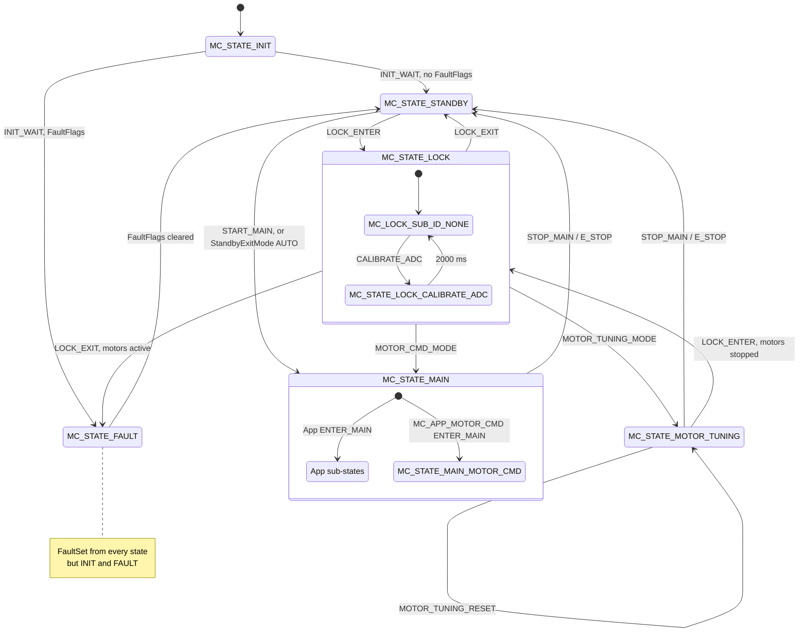
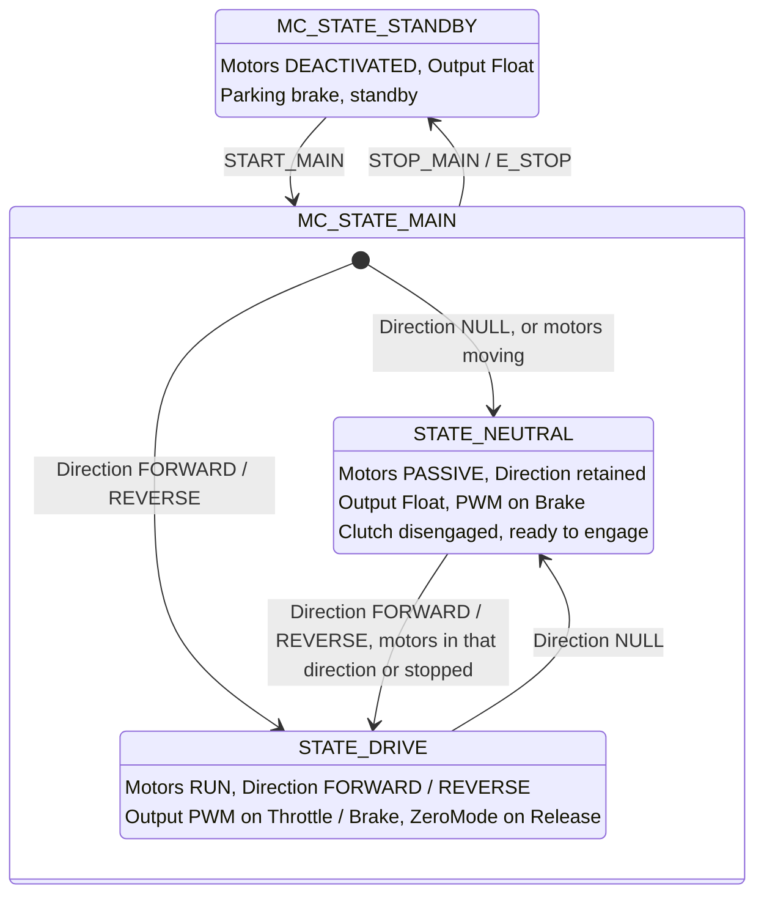
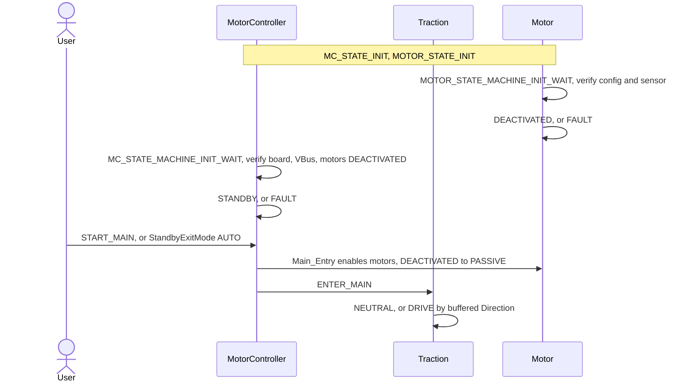
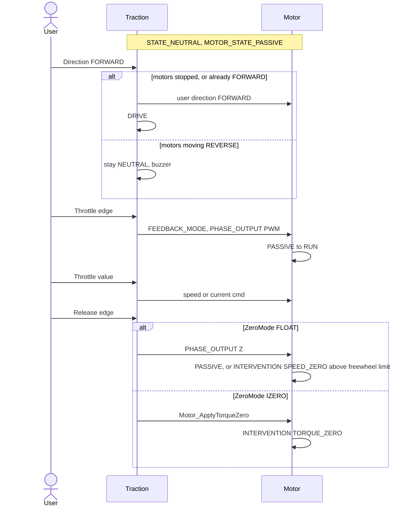
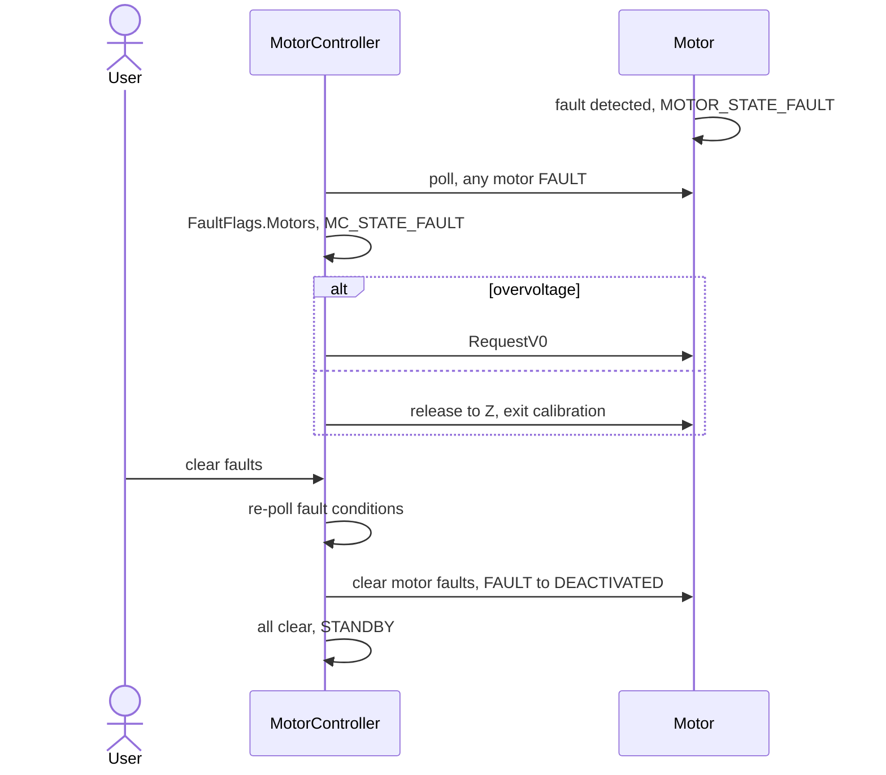

# MotorController State Machine

One `MCSM_MACHINE` holds the controller's root states, the sub-states the controller defines itself, and the app's
sub-states under `MC_STATE_MAIN`. Each motor runs its own machine, detailed in
[Motor_StateMachine.md](Motor_StateMachine.md). [StateMachineOverview.md](StateMachineOverview.md) has the overview,
the layer map and the design decisions.

## Threads

| What | Where | When |
|---|---|---|
| `LOOP`, then `NEXT`, leaf first | `MotorController_Main_Thread`, `_StateMachine_Branch_ProcSyncOutput` | every 1 ms |
| State, lock and app inputs | main thread, `_StateMachine_Branch_CallInput`: the handler and the transition run on the call, without a lock, on the proc's own thread | protocol requests; the app's analog input every 1 ms |
| Fault set and clear | `StateMachine_Tree_InputAsyncTransition`, from the main thread and from the 1 ms timer thread (VBus) | on detection |
| Monitors, the motor-fault poll, the fault re-send, digital-input commands | main thread | about every 1 s |

- A VBus fault set from the timer thread can be overwritten by a main-thread transition it interrupted. The 1 s
  poll re-sends any set `FaultFlags`, which re-enters `FAULT`.

## Root states

`MotorController_StateId_T`, with the sub-states the root defines itself.

- Leaving for a stationary state needs every motor `DEACTIVATED`, or `PASSIVE` at zero speed
  (`Common_IsStandbyReady`): `STOP_MAIN` / `E_STOP` from `MAIN` and `MOTOR_TUNING`, `LOCK_ENTER` from `STANDBY` and
  `MOTOR_TUNING`. A refused `STOP_MAIN` sounds the standby-error buzzer; a refused `LOCK_ENTER` returns `ERROR`. The
  entry's `Motor_Disable` takes a `PASSIVE` motor on to `DEACTIVATED`. `E_STOP` is the same as `STOP_MAIN` for now.
- `LOCK` commands are accepted at the bare `LOCK` only, not from a sub-state. `MOTOR_CMD_MODE` lands on
  `MC_STATE_MAIN_MOTOR_CMD`.
- `LOCK_EXIT` and fault clear always land in `STANDBY`, never live `MAIN`.

Each state bounds the motor states it allows.

| State | Entry | Motor states | Use |
|---|---|---|---|
| `INIT` | resets `SysTime_Millis`, short beep | `INIT`, `DEACTIVATED` | Boot |
| `STANDBY` | `Z` to every motor, then `Motor_Disable` | `DEACTIVATED` | Parking brake, standby. Phases off; app inputs buffered, not applied |
| `MAIN` | `Motor_Enable` every motor, then `0` (V0) | `PASSIVE`, `RUN`, `INTERVENTION`, `OPEN_LOOP` | Normal operation; the app's mounting point |
| `MAIN_MOTOR_CMD` | `0` (V0) | as `MAIN` | Direct motor commands, without an app |
| `MOTOR_TUNING` | `_Motor_ResetTuning` every motor: the PID gains reload from NVM | `PASSIVE`, `RUN` | Live PID tuning |
| `LOCK` | `Motor_Disable`, then `Motor_Calibration_Enter`, every motor; status OK; short beep | `CALIBRATION`; `DEACTIVATED` if moving at entry | Calibration, NVM save, reboot |
| `FAULT` | on overvoltage, `RequestV0` to every motor; else `Z` to every motor; periodic buzzer | `FAULT` for a motor fault; else released: `DEACTIVATED`, `PASSIVE`, `SPEED_ZERO` until stopped | Error handling. Buzzer until cleared |

### `INIT`

- Waits `MC_STATE_MACHINE_INIT_WAIT`: 1550 ms, so the 1 s ADC sampling runs once. A static assert keeps it longer
  than the motor's 1500 ms.
- Then `MotorController_PollFaultFlags` refreshes the monitor flags, and the checks run:
  - `InitCheck`: an invalid board (`Phase_Board_IsValid`), VBus config, VBus monitor config, or a disabled VBus
    monitor. The last three also set `VBusLimit`.
  - `Motors`: any motor not `DEACTIVATED`, from a motor fault or a boot into a spinning motor.
- No flag goes to `STANDBY`, else `FAULT`. `INIT` takes no input, `FAULT` included.

### `STANDBY`

- Accepts state commands and `LOCK_ENTER` only. `MOTOR_CMD` and `APP_USER` sink here: callers buffer their values
  (`Traction_Input_T`), and the app reads them when `MAIN` is entered.
- `START_MAIN` asks the app's `ENTER_MAIN` for the sub-state, from the buffered input. It may answer `NULL`, and
  `STANDBY` holds.
- `STOP_MAIN` / `E_STOP` re-enter `STANDBY` and latch `MANUAL`; its entry runs again.
- `LOCK_ENTER` goes to `LOCK` under the motor guard above. A motor `DEACTIVATED` passes at any speed.

The exit policy is `StandbyExitMode`, resolved at init by `MotorController_ResolveStandbyExitMode` from the input
topology. It is runtime-only and not persisted.

| Input topology | `StandbyExitMode` | `STANDBY` is left by |
|---|---|---|
| serial or CAN | `MANUAL` | `START_MAIN` from the master |
| analog, with a Standby input | `MANUAL` | the Standby input (`MOTOR_CONTROLLER_OPT_DIN_STANDBY`): falling edge `START_MAIN`, rising edge `STOP_MAIN` |
| analog, no Standby input | `AUTO` | `NEXT`, once no fault flag is set and every motor is at zero speed |

- An accepted `STOP_MAIN` / `E_STOP`, from `MAIN`, `MOTOR_TUNING` or `STANDBY` itself, latches `MANUAL`, so a host that
  sent it holds `STANDBY`, for `LOCK` access for example. Reboot restores the resolved mode.

### `MAIN`

- Entry enables every motor (`DEACTIVATED` → `PASSIVE`) and applies V0. The app's sub-state then sets its own
  output.
- `STOP_MAIN` / `E_STOP`, from `MAIN` or any sub-state, which leave the slot to `MAIN`: `STANDBY` under the motor
  guard above.
- `START_MAIN` at the bare `MAIN` enters the app's sub-state; elsewhere it is ignored.
- `MOTOR_CMD` and `APP_USER` sink at `MAIN`; sub-states handle them.
- `MAIN_MOTOR_CMD` is the sub-state of the default app (`MC_APP_MOTOR_CMD`) and the landing of `MOTOR_CMD_MODE`.
  Its `MOTOR_CMD` handler is empty: motor commands arrive as var writes, admitted by
  `MotorController_IsMotorCmdAccess`.

### `MOTOR_TUNING`

- A root state, not under `MAIN`, entered from `LOCK` by `MOTOR_TUNING_MODE`. Motor commands and PID I/O are
  admitted here.

| Lock id in `MOTOR_TUNING` | Effect | Status |
|---|---|---|
| `LOCK_ENTER` | to `LOCK` under the motor guard; the live gains stay in RAM for an NVM save | OK; ERROR if refused |
| `MOTOR_TUNING_MODE` | none: the mode is idempotent, a repeat keeps the session | OK |
| `MOTOR_TUNING_RESET` | re-enters `MOTOR_TUNING`, reloading the gains from NVM | OK |
| others | none | ERROR |

- `STOP_MAIN` / `E_STOP` go to `STANDBY` under the same motor guard as `MAIN`. An accepted exit discards the live
  gains; a refused one keeps them. `START_MAIN` is ignored.

### `LOCK`

`MotorController_LockId_T`, accepted at the bare `LOCK` only. From a sub-state every id returns `ERROR`.

| Id | Effect | Status | Next |
|---|---|---|---|
| `LOCK_ENTER` | none | OK | — |
| `LOCK_EXIT`, every motor `DEACTIVATED` or `CALIBRATION`, in any mix | `Motor_Calibration_Exit` to every motor | OK | `STANDBY` |
| `LOCK_EXIT`, a motor in any other state | `Motors` set | ERROR | `FAULT` |
| `NVM_SAVE_CONFIG` | VBus monitor paused; `MotNvm_SaveConfigAll_Blocking`, which blocks with IRQs disabled; monitor resumed; `Motor_Reinit` every motor | OK, the save's result in `NvmStatus` | — |
| `NVM_RESTORE_CONFIG` | not implemented | ERROR | — |
| `CALIBRATE_ADC` | `Motor_Analog_Calibrate` every motor: the phase-current zeros, 2000 ms | OK | `MC_STATE_LOCK_CALIBRATE_ADC` |
| `CALIBRATE_SENSOR` | reserved | ERROR | — |
| `REBOOT` | `HAL_Reboot`; no return | — | — |
| `MOTOR_CMD_MODE` | `Motor_Calibration_Exit` to every motor | OK | `MC_STATE_MAIN_MOTOR_CMD` |
| `MOTOR_TUNING_MODE` | `Motor_Calibration_Exit` to every motor | OK | `MOTOR_TUNING` |
| `MOTOR_TUNING_RESET` | not applicable here | ERROR | — |

- `MC_STATE_LOCK_CALIBRATE_ADC` averages the throttle and brake inputs for 2000 ms, past the motors' calibration,
  writes their `AdcZero`, sets the status to 0 and returns to the bare `LOCK`. `MotorController_Lock_CalibrateAdc`
  enters it alone, as a command on `LOCK`.
- `MotorController_IsLockOpComplete` is true at the bare `LOCK` with every motor's calibration complete.
- Every lock input sets `LockOpStatus`; `MotorController_InputLock` returns it.

### `FAULT`

- Entry on overvoltage sets `RequestV0` on every motor, so each enters `FAULT` and holds V0. Otherwise every motor
  gets `Z`, which also takes `CALIBRATION` to `PASSIVE`; a motor in `FAULT` keeps its own output. The buzzer sounds
  periodically.
- `LOOP` stops the buzzer once no flag remains.
- A set ORs the flags and stays.
- A clear (`MotorController_ClearFault`) removes its flags and stops the buzzer. If none remain:
  1. An invalid board sets `InitCheck` again; only a reset clears it.
  2. The monitor flags are re-polled (`MotorController_PollFaultFlags`).
  3. Every motor is cleared (`Motor_StateMachine_TryClearFaultAll`). `Motors` stays set if any motor stays in
     `FAULT`.
  4. No flag left goes to `STANDBY`.
- `NVM_SAVE_CONFIG` is accepted, without pausing the VBus monitor or re-initializing the motors; other lock ids are
  ignored.

### Inputs

| `MotorController_StateInput_T` | Value | Handled by |
|---|---|---|
| `FAULT` | `MotorController_FaultCmd_T` set / clear deltas | every state but `INIT` |
| `LOCK` | `MotorController_LockId_T` | `STANDBY` (`LOCK_ENTER`), `MOTOR_TUNING`, `LOCK`; `FAULT` takes `NVM_SAVE_CONFIG` only |
| `STATE_CMD` | `MotorController_StateCmd_T`: `START_MAIN`, `STOP_MAIN`, `E_STOP` | `STANDBY`, `MAIN` and its sub-states, `MOTOR_TUNING` |
| `MOTOR_CMD` | — | `MAIN_MOTOR_CMD`, empty handler; sinks in `STANDBY` and `MAIN` |
| `APP_USER` | the app's input id, `Traction_StateInput_T` | app sub-states only; sinks in `STANDBY` and `MAIN` |

## Faults

`MotorController_FaultFlags_T`. Monitors only set flags; a flag latches until a clear, and the clear re-polls the
monitors. `RxLost` is the exception: it follows the socket.

| Flag | Set by | Thread |
|---|---|---|
| `VBusLimit` | VBus over or under voltage; the `INIT` VBus checks | 1 ms timer |
| `PcbOverheat`, `MosfetsOverheat` | the heat monitors | main, 1 s |
| `VAccsLimit`, `VAnalogLimit` | the accessory and analog supply monitors | main, 1 s |
| `Motors` | any motor in `FAULT`; `INIT` with a motor not `DEACTIVATED`; a clear that leaves a motor in `FAULT`; `LOCK_EXIT` with a motor out of `DEACTIVATED` / `CALIBRATION` | main, 1 s |
| `RxLost` | serial input mode: written every 1 ms from the main socket's Rx-lost status; while set, every motor gets `Motor_ApplySafeStop` | main, 1 ms |
| `InitCheck` | the `INIT` checks; an invalid board again on a clear | main |

- A motor fault reaches the controller's `FAULT` on the next 1 s poll; `RxLost` likewise, through the re-send.

## Write admission

`CheckInputPolicy` in `MotorController_Var.c`. The motor machine gates outputs; the controller gates writes by
state ([0001](../../Docs/Decisions/0001_ParameterWriteAdmission.md)).

| Var group | Admitted in |
|---|---|
| Motor user control and setpoint | `MAIN_MOTOR_CMD` or `MOTOR_TUNING`, serial or CAN input mode |
| Motor state and open-loop commands | `MAIN_MOTOR_CMD` or `MOTOR_TUNING` (`MotorController_IsMotorCmdAccess`) |
| Motor calibration, Hall and encoder commands | `LOCK` |
| PID tuning I/O | `MOTOR_TUNING` |
| Config: motor, sensor, heat and voltage monitor, analog user, general, communication, Traction; NVM memory read and write | `LOCK` or `FAULT` (`MotorController_IsConfig`) |
| General user input | serial or CAN input mode, any state |
| Traction control | `Config.InitMode` Traction, serial or CAN input mode, any state |

## Interface

| Function | Sends |
|---|---|
| `MotorController_InputStateCommand`, `MotorController_EnterMain`, `MotorController_ExitMain` | `STATE_CMD` |
| `MotorController_InputLock`, `MotorController_EnterLockState`, `MotorController_ExitLockState` | `LOCK`; returns `LockOpStatus` |
| `MotorController_SaveConfig_Blocking` | `LOCK` `NVM_SAVE_CONFIG`; returns `NvmStatus` |
| `MotorController_SetFault`, `MotorController_ClearFault`, `MotorController_TryClearFaultAll` | `FAULT` |
| `MotorController_ForceDisableControl` | every motor force-disabled, unchecked by the machines, then `STOP_MAIN` |
| `MotorController_CallSystemCmd` | the protocol's system commands: clear fault, force disable, lock input and its status, state command, Rx watchdog, beep |

- Queries: `MotorController_GetStateId`; `MotorController_GetPathId`, the unambiguous form, since a sub-state id is
  unique only among its siblings; `MotorController_GetMainSubstateId`, `MotorController_GetLockSubstateId`;
  `MotorController_IsStandby` (`STANDBY`), `MotorController_IsFault`, `MotorController_IsLock`,
  `MotorController_IsConfig` (`LOCK` or `FAULT`), `MotorController_IsTuning`, `MotorController_IsMotorCmdState`,
  `MotorController_IsMotorCmdAccess`, `MotorController_IsLockOpComplete`.

## Behaviors to know

- A motor moving at `LOCK` entry stays `DEACTIVATED` while the others enter `CALIBRATION`. Calibration commands are
  transition commands on `CALIBRATION`, so they skip it, and `CALIBRATE_ADC` still reports `OK`. After
  `MOTOR_CMD_MODE` the `MAIN` entry enables it; after `MOTOR_TUNING_MODE` it stays `DEACTIVATED` under `MOTOR_TUNING`.
- In Traction, `ZeroMode` `ZERO` in speed mode keeps the motors in `RUN` at zero speed, energized, unlike the brake
  hold, which hands over to `PASSIVE` at zero.

## App sub-states: Traction

`Traction_StateId_T`, mounted under `MC_STATE_MAIN`. Inputs are `Traction_StateInput_T`, read from the buffered
`Traction_Input_T`.

- The app is `MC_APP_TRACTION`, a `MotorController_App_T` (`ENTER_MAIN`, `PROC_ANALOG_USER`, `INIT`) chosen at
  compile time through `MotorController_T.P_APP`.
- `STATE_NEUTRAL` and `STATE_DRIVE` are private to `MotorController_Traction.c` and report `MAIN` as their path id.
  `MotorController_Traction_GetStateId` returns their `Traction_StateId_T` for the var interface.
- Every input arrives as `MC_STATE_INPUT_APP_USER` with a `Traction_StateInput_T` value; the handler reads its
  operand from `Traction_Input_T`. State commands pass up to `MAIN`.

| State | Entry | Motor direction | Motor states | Accepted inputs |
|---|---|---|---|---|
| `STANDBY` | — | `NULL` | `DEACTIVATED` | none applied, all buffered |
| `STATE_NEUTRAL` | `Z` to every motor | retained | `PASSIVE`; `RUN`, `INTERVENTION` while braking | `DIRECTION`, `DRIVE_CMD` (release, brake), `BRAKE_VALUE`. Throttle and lever have no effect |
| `STATE_DRIVE` | syncs `DriveCmd` to the present input; applies the buffered direction to every motor | `FORWARD` / `REVERSE` | `PASSIVE`, `RUN`, `INTERVENTION` | `DIRECTION` (`NULL` only), `DRIVE_CMD`, `THROTTLE_VALUE`, `BRAKE_VALUE`, `LEVER_DIRECTION`, `LEVER_VALUE` |

- `ENTER_MAIN`, from `STANDBY` or the bare `MAIN`: any motor moving gives `NEUTRAL`; otherwise the buffered
  direction decides, `NULL` → `NEUTRAL`, `FORWARD` / `REVERSE` → `DRIVE`.
- A throttle held while `DRIVE` is entered gives no start edge: the motor stays `PASSIVE` until the throttle is
  released and pressed again.
- `DRIVE` keeps the output it was entered with: V0 from `STANDBY`, through the `MAIN` entry, or float from
  `NEUTRAL`.
- Direction is buffered in `Traction_Input_T` independent of state. `FORWARD` / `REVERSE` are the user frame,
  mapped to `CW` / `CCW` by the motor's `DirectionForward` calibration.
- `MotorController_Traction_GetDirection` reports `NULL` in `NEUTRAL`, else the motors' common user direction, or
  `NULL` if they differ.

### Direction changes

| From | Input | Motors | Result |
|---|---|---|---|
| `STANDBY` | `START_MAIN` | moving | `NEUTRAL` |
| `STANDBY` | `START_MAIN`, direction `NULL` | stopped | `NEUTRAL` |
| `STANDBY` | `START_MAIN`, `FORWARD` / `REVERSE` | stopped | `DRIVE`, direction applied on entry |
| `NEUTRAL` | `FORWARD` / `REVERSE` | already in that direction, at any speed | `DRIVE` |
| `NEUTRAL` | `FORWARD` / `REVERSE` | stopped | direction applied, `DRIVE` |
| `NEUTRAL` | `FORWARD` / `REVERSE` | moving the other way | stays `NEUTRAL`; the direction must be sent again once stopped |
| `NEUTRAL` | `NULL` | any | `NEUTRAL` re-entered, floating again |
| `DRIVE` | `NULL` | any | `NEUTRAL`, direction retained |
| `DRIVE` | `FORWARD` / `REVERSE` | any | no change |
| `DRIVE` | lever engaged from release | stopped | the lever's direction applied |

- A direction command that does not take effect blinks the buzzer (`MotorController_Traction_ApplyDirectionCmd`).
  The shifter path sends a direction only when it changes, and does not blink.
- The motor checks zero speed again before applying a direction.

### Throttle, brake, release

`Traction_Cmd_T` is evaluated from the input values: a brake above 0 wins, then a throttle above 0, else release. A
change of command is an edge and sends `DRIVE_CMD`, which starts a mode; values in between send `THROTTLE_VALUE` or
`BRAKE_VALUE`, which set the command.

| Edge | `DRIVE` | `NEUTRAL` |
|---|---|---|
| `THROTTLE` | the feedback mode by `Traction_ThrottleMode_T`, then `PWM`: `PASSIVE` → `RUN`; `Z` for a mode with no command | ignored |
| `BRAKE` | the feedback mode by `Traction_BrakeMode_T`, then `PWM`; `Z` for a mode with no command | as `DRIVE` |
| `RELEASE` | by `Traction_ZeroMode_T` | `Z` |

| Value | Command to every motor |
|---|---|
| throttle | `ThrottleValue / 2`: `Motor_SetSpeedMotoringCmd_Norm` in `SPEED`, `Motor_SetICmd_Norm` in `TORQUE` |
| brake | −`BrakeValue / 2` through `Motor_SetICmd_Norm` (`TORQUE`), then the brake hold |
| lever | signed, user forward frame: `Motor_SetSpeedCmd_Norm` in `SPEED`, `Motor_SetTorqueCmd_Norm` in `TORQUE` |

- Brake hold: opposing torque cannot hold standstill, because anti-plugging clamps it to short-circuit braking once
  the speed crosses zero. Once no motor turns along its direction, every motor gets `Motor_ApplySpeedZero` and holds
  zero speed; repeats are no-ops. Throttle resumes `RUN`; release acts by `ZeroMode`.

| `Traction_ThrottleMode_T` | Feedback mode |
|---|---|
| `SPEED` | `MOTOR_FEEDBACK_MODE_SPEED_CURRENT` |
| `TORQUE` | `MOTOR_FEEDBACK_MODE_CURRENT` |
| `VOLTAGE` | not implemented: the edge releases (`Z`), so the throttle does not drive |

| `Traction_BrakeMode_T` | Brake |
|---|---|
| `TORQUE` | current mode, an opposing current command, the brake hold |
| `PASSIVE` | the edge releases (`Z`): the motors stay released, braking is mechanical |
| `VOLTAGE` | not implemented: as `PASSIVE` |

| `Traction_ZeroMode_T` | Release in `DRIVE` |
|---|---|
| `FLOAT` | `Z`: `RUN` → `PASSIVE` within the freewheel limit, else `INTERVENTION` `SPEED_ZERO` |
| `IZERO` | `Motor_ApplyTorqueZero`: `RUN` → `INTERVENTION` `TORQUE_ZERO` |
| `REGEN` | not implemented: as `FLOAT` |
| `ZERO` | 0 through the throttle's setter, in the present feedback mode: in speed mode `RUN` brakes to standstill and holds it, in current mode zero current |

| `Traction_LeverMode_T` | Lever read against | Behavior |
|---|---|---|
| `BRAKE_TO_STOP` | the drive direction, or the lever's sign while none is set | along it throttles, against it brakes; reverses on an engage from release at standstill |
| `THROUGH_ZERO` | the lever's own sign | throttles along the lever with the value signed, continuous through zero speed; the motor bounds plugging |

- An engage, the lever leaving 0 from release, sends `LEVER_DIRECTION` first; `DRIVE` applies the lever's direction
  when every motor is stopped.

### User layer

| Function | Sends |
|---|---|
| `MotorController_Traction_ApplyDirectionCmd` | the direction, written then sent; blinks if it did not take |
| `MotorController_Traction_CaptureDirection` | the shifter's direction, on a change only |
| `MotorController_Traction_SetThrottle`, `MotorController_Traction_SetBrake` | one value: the edge if the command changed, else the value |
| `MotorController_Traction_SetRelease` | both values to 0, then the edge |
| `MotorController_Traction_SetThrottleBrake` | both values, the edge, then the active command's value |
| `MotorController_Traction_SetLever` | the engage, the lever resolved to throttle or brake, then as `SetThrottleBrake` with `LEVER_VALUE` in `THROUGH_ZERO` |
| `MotorController_Traction_ProcAnalogUser` | as `PROC_ANALOG_USER`: the shifter's direction, then throttle and brake, the brake fused with the switch brake |

- A throttle of 0 and a brake value written in one packet release the motor (`RUN` → `PASSIVE`) and start `RUN`
  again, possibly before any `PASSIVE` tick refreshes the back-EMF capture. `RUN` entry then matches against the
  last capture.

## Sequences

### Startup

### Drive

### Fault

The fault sequence shows the intent. Today a motor already in `FAULT` takes the calibration exit as an entry; see
[Behaviors to know](#behaviors-to-know).
