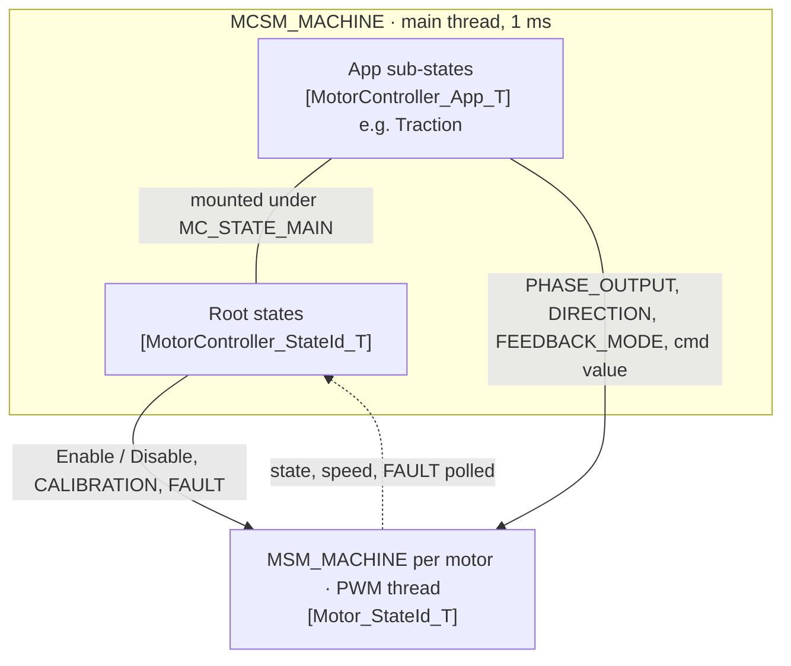
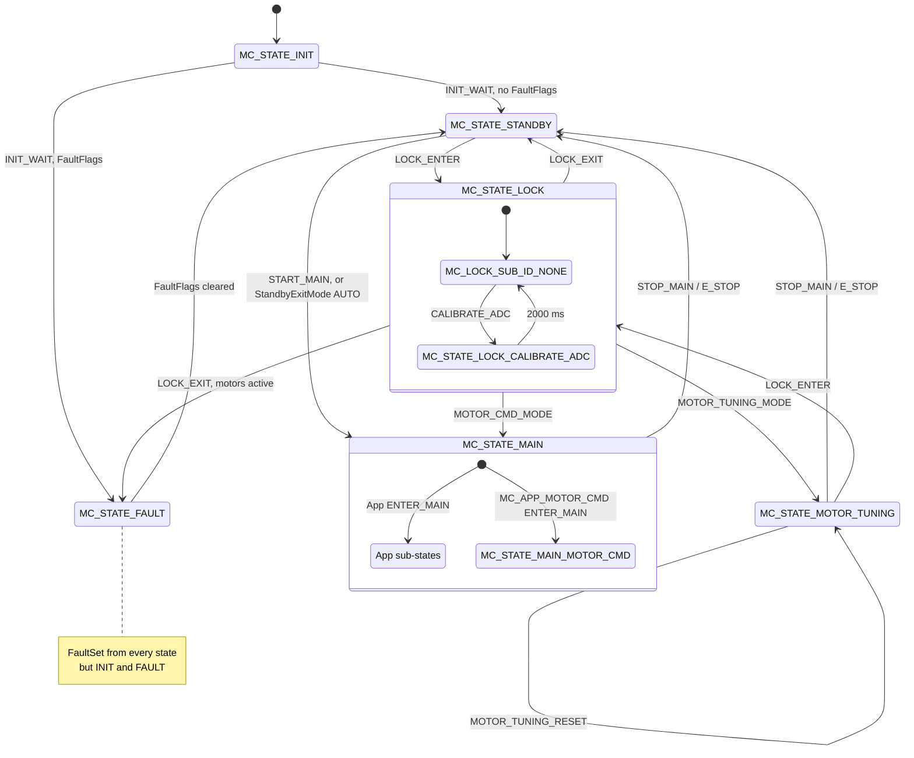
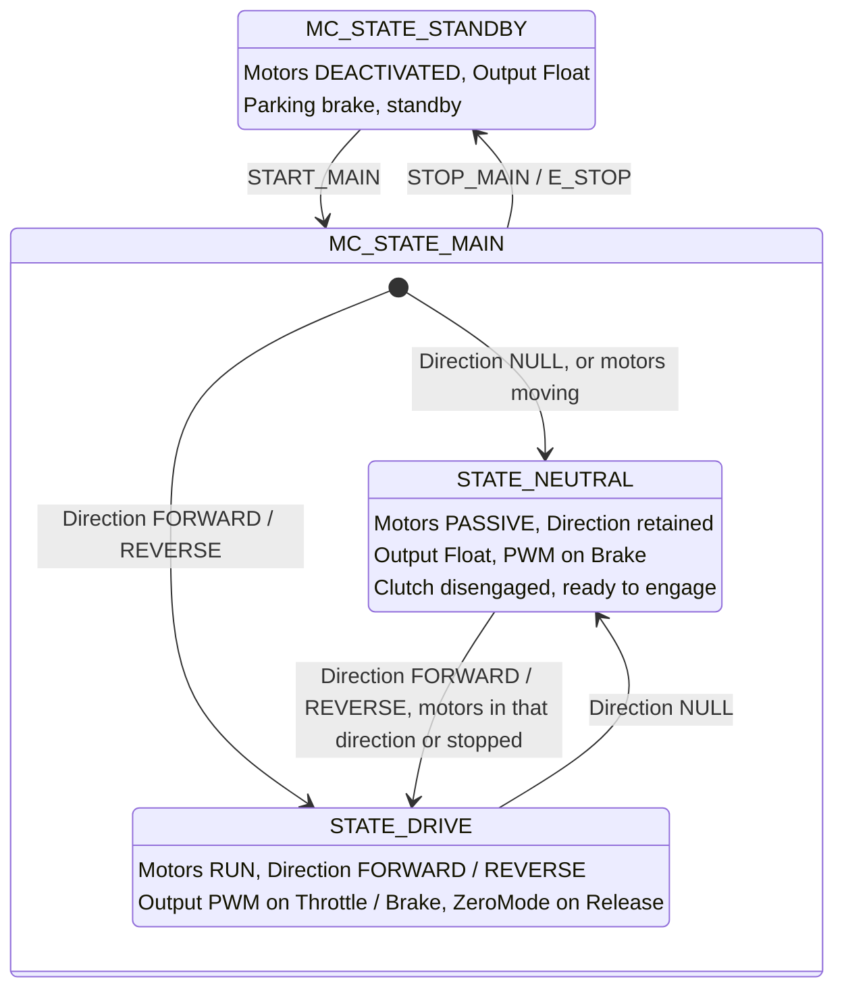
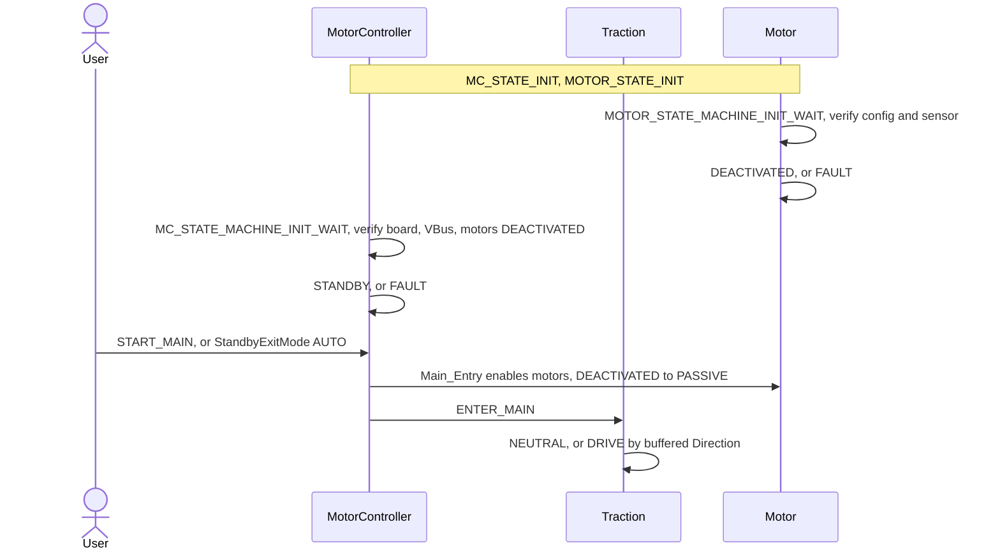
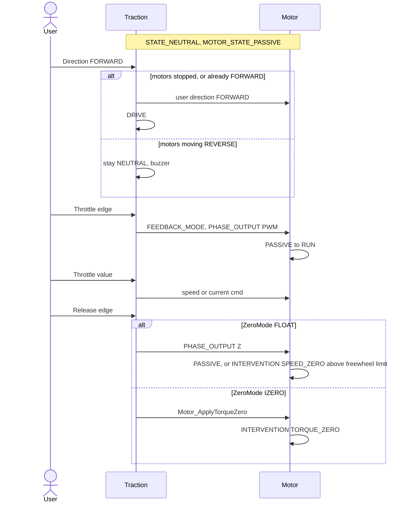
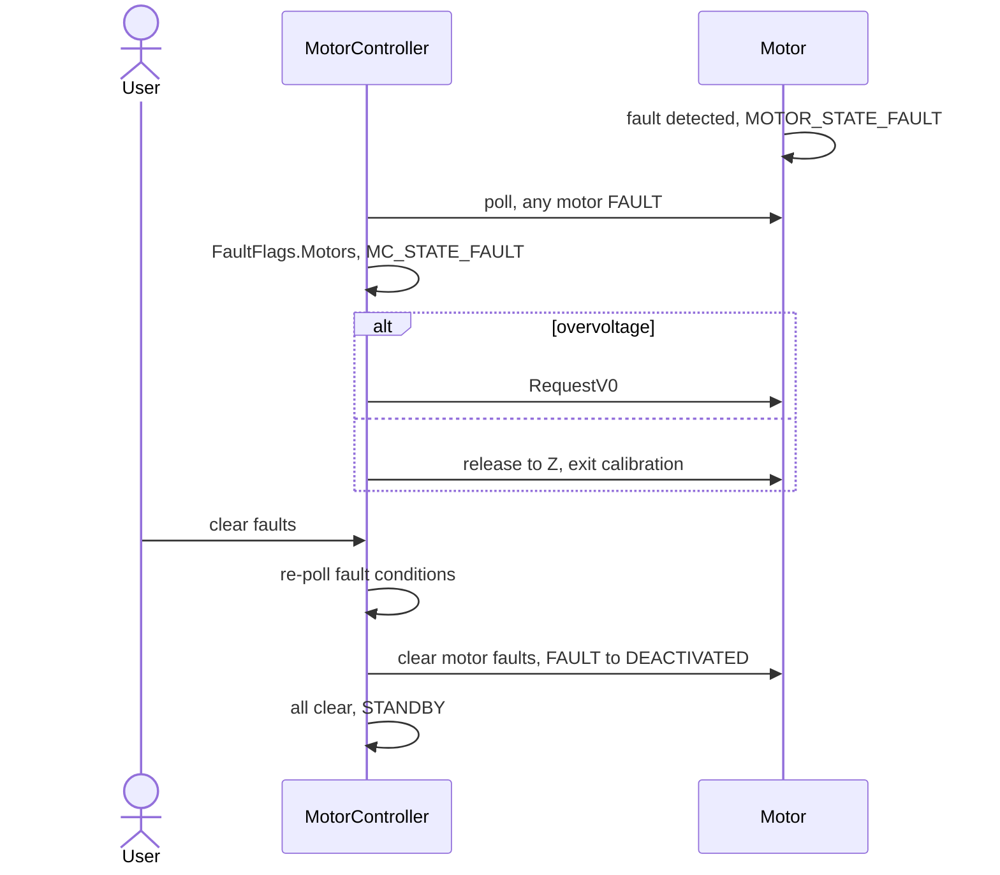

# MotorController State Machine

Hierarchical state machines in three layers. The MotorController machine holds the system states and the app's
sub-states; each motor runs its own machine, detailed in [Motor_StateMachine.md](Motor_StateMachine.md).
[Conventional_StateMachine.md](Conventional_StateMachine.md) is the industry reference.

## Layers

| Layer | Owns | Does not know |
|---|---|---|
| Motor | commutation, feedback loops, speed estimation, motor faults, direction CW / CCW / NULL | STANDBY, NEUTRAL, DRIVE |
| MotorController | boot, multi-motor coordination, system faults, STANDBY, LOCK (calibration, NVM), motors DEACTIVATED ⇄ PASSIVE | app states and inputs |
| App | NEUTRAL / DRIVE, FORWARD / REVERSE, throttle / brake mapping, release behavior, direction-change checks, motors PASSIVE ⇄ RUN | |

The app is not a separate machine. Its states are sub-states of [MC_STATE_MAIN], run by [MCSM_MACHINE] on the same
thread, and its inputs arrive as [MC_STATE_INPUT_APP_USER].

Each [State_T] maps input ids to handlers in its transition table. An empty slot defers to the parent state.

## Design Rules

The root machine does not know app-specific states or inputs. [MC_STATE_STANDBY] belongs to the root;
an app mounts its sub-states under [MC_STATE_MAIN] through [MotorController_App_T] `ENTER_MAIN`.

- A new state is justified by a different safety envelope, not a different purpose.
- One-shot automated procedures get a state; interactive parameter adjustment does not.
- Orthogonal concerns get orthogonal mechanisms — e.g. what control structure is running vs. what input source is connected.
- Lock is for operations the operator must commit to and acknowledge as risky, outside normal operation.
- The operator use case does not conflate with the system's state.

## Root States

[MotorController_StateId_T], with the sub-states the root defines itself.

- STOP_MAIN / E_STOP leaves MAIN and MOTOR_TUNING only once every motor is DEACTIVATED, or PASSIVE at zero speed. Otherwise the buzzer sounds and the state holds.
- LOCK commands are accepted at the bare LOCK only, not from a sub-state. MOTOR_CMD_MODE lands on [MC_STATE_MAIN_MOTOR_CMD].
- LOCK_EXIT and fault clear always land in STANDBY, never live MAIN.

| [MotorController_StateInput_T] | Handled by |
|---|---|
| FAULT | every state but INIT. [MotorController_FaultCmd_T] set / clear deltas |
| LOCK | STANDBY, MOTOR_TUNING, LOCK; FAULT accepts NVM save only. [MotorController_LockId_T] |
| STATE_CMD | STANDBY, MAIN, MOTOR_TUNING. [MotorController_StateCmd_T] START_MAIN, STOP_MAIN, E_STOP |
| MOTOR_CMD | [MC_STATE_MAIN_MOTOR_CMD] |
| APP_USER | app sub-states only |

Each state bounds the motor states it allows.

| State | Motor states | Use |
|---|---|---|
| INIT | INIT, DEACTIVATED | Boot. Waits for sensors, verifies board and VBus config; any motor not DEACTIVATED is a fault |
| STANDBY | DEACTIVATED | Parking brake, standby. Phases off; app inputs buffered, not applied |
| MAIN | PASSIVE, RUN, INTERVENTION, OPEN_LOOP | Normal operation. Entry enables the motors |
| MOTOR_TUNING | PASSIVE, RUN | Live PID tuning. Exit to STANDBY discards the live gains; LOCK keeps them for NVM save |
| LOCK | DEACTIVATED, CALIBRATION | Calibration, NVM save, reboot |
| FAULT | FAULT on overvoltage, otherwise released to Z | Error handling. Buzzer until cleared |

## App Sub-States: Traction

[Traction_StateId_T], mounted under [MC_STATE_MAIN]. Inputs are [Traction_StateInput_T], read from the buffered
[Traction_Input_T].

| State | Motor direction | Motor states | Accepted inputs |
|---|---|---|---|
| STANDBY | NULL | DEACTIVATED | none applied, all buffered |
| STATE_NEUTRAL | retained | PASSIVE, RUN while braking | Direction, Brake. Throttle has no effect |
| STATE_DRIVE | FORWARD / REVERSE | PASSIVE, RUN, INTERVENTION | Direction NULL, Throttle, Brake, Lever |

Direction is buffered in [Traction_Input_T] independent of state. FORWARD / REVERSE are the user frame, mapped to
CW / CCW by the motor's `DirectionForward` calibration.

### Direction Changes

| From | Input | Motors | Result |
|---|---|---|---|
| STANDBY | START_MAIN | moving | NEUTRAL |
| STANDBY | START_MAIN, Direction NULL | stopped | NEUTRAL |
| STANDBY | START_MAIN, Direction FORWARD / REVERSE | stopped | DRIVE, direction applied on entry |
| NEUTRAL | FORWARD / REVERSE | already in that direction | DRIVE |
| NEUTRAL | FORWARD / REVERSE | stopped | apply direction, DRIVE |
| NEUTRAL | FORWARD / REVERSE | moving the other way | stay NEUTRAL until stopped |
| DRIVE | NULL | any | NEUTRAL, direction retained |
| DRIVE | FORWARD / REVERSE | any | no change |
| DRIVE | Lever engaged from release | stopped | apply the lever's direction |

A direction command that does not take effect blinks the buzzer. The Motor checks zero speed again before applying
a direction.

### Throttle, Brake, Release

Edges of [Traction_Cmd_T] start a mode; values in between set the command.

| Cmd | Motor |
|---|---|
| THROTTLE | Feedback mode by [Traction_ThrottleMode_T], PHASE_OUTPUT PWM: PASSIVE → RUN |
| BRAKE | By [Traction_BrakeMode_T]: current feedback, PWM, opposing current cmd. INTERVENTION SPEED_ZERO holds zero speed once no motor advances |
| RELEASE | By [Traction_ZeroMode_T], below |

| [Traction_ZeroMode_T] | Motor |
|---|---|
| FLOAT | PHASE_OUTPUT Z: RUN → PASSIVE within the freewheel speed limit, else INTERVENTION SPEED_ZERO |
| IZERO | RUN → INTERVENTION TORQUE_ZERO |
| REGEN | not implemented |
| ZERO | setpoint zero, no state change |

## Sequences

### Startup

### Drive

### Fault

