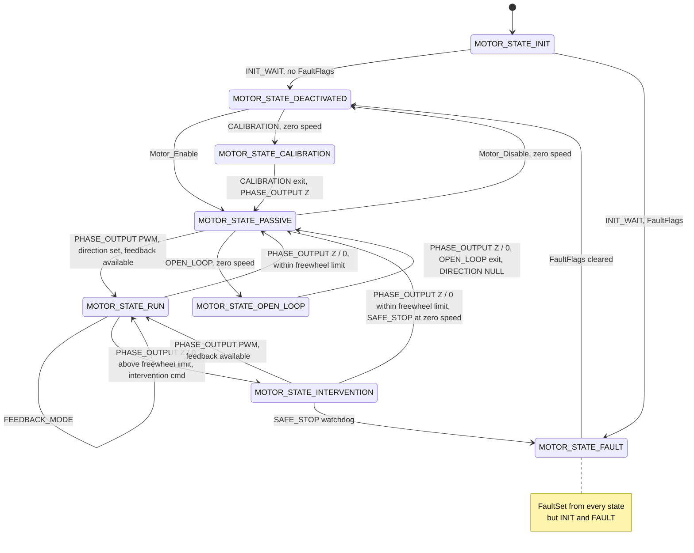
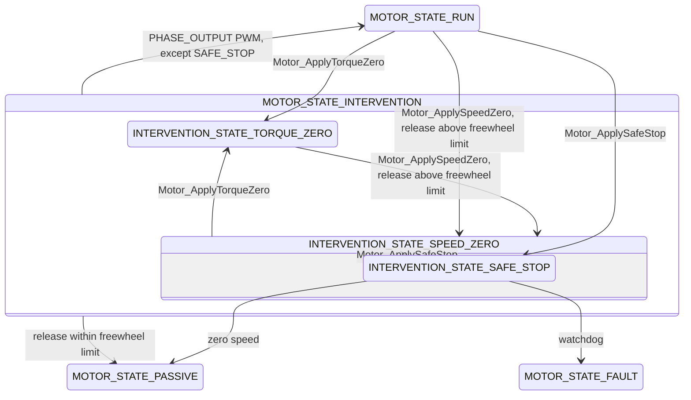

# Motor State Machine

One `MSM_MACHINE` per motor, on the engine in [Framework/StateMachine](../../Framework/StateMachine/Architecture.md).
States run on the PWM thread; inputs arrive from the main thread. The machine knows nothing of `STANDBY`,
`NEUTRAL`, `DRIVE` or the other motors. [MotorController_StateMachine.md](MotorController_StateMachine.md) covers
the layers above; [StateMachineOverview.md](StateMachineOverview.md) has the overview and the design decisions.

Phase output values, `Phase_VOutMode_T`, are written by their suffix: `Z` floats every phase, `0` turns every low
side on (V0), `PWM` drives the bridge. T0 is 50 % duty on every phase (`Phase_ActivateT0`).

## Threads

| What | Where | When |
|---|---|---|
| `LOOP`, then `NEXT`, leaf first | `Motor_PWM_Thread` → `_Motor_StateMachine` | every PWM period, 20 kHz |
| `ON_SPEED` action | `Motor_PollSpeed`, after the speed capture | the speed tick, 1 kHz (`MOTOR_SPEED_LOOP_FREQ`) |
| `ON_PHASE` action | `_Motor_OnIabc_Thread`, at the PWM ISR's priority | each completed phase-current set |
| Inputs | main thread, `StateMachine_Tree_Input` | the handler and the transition run on the call |
| Transition commands | main thread, `StateMachine_Tree_InvokeTransition` | on the call |

- The PWM ISR captures the rotor angle and the speed tick, then runs the state machine. With
  `MOTOR_I_FEEDBACK_FIRST` the speed tick runs after the state machine, so the `LOOP`'s duty write still makes the
  load point. Each period then counts one tick of `ControlTimerBase`; states reset it on entry and time against it.
- Under `STATE_MACHINE_ASYNC_CRITICAL` an input masks IRQs for its handler and transition, so the PWM ISR never
  runs between the old state's exit and the new state's entry. Without a lock define the engine is lock-free, and
  `Motor_StateMachine.h` stops the build: the engine runs the new entry before it moves the leaf, so a PWM ISR in
  between would run the old `LOOP` once more, and a `RUN` duty write would overwrite a `FAULT` entry's V0.
- Actions reach the active leaf only. `ON_PHASE` is mapped only with `MOTOR_I_FEEDBACK_ON_PHASE`.

## States

`Motor_StateId_T`

Not drawn: the sensor start-up chains hand `OPEN_LOOP` to `RUN`; `SPEED_ZERO` ends in `PASSIVE`; Hall and
encoder procedures, and encoder start-up, enter `FAULT` from their sub-states. All are in the sections below.

| State | Entry | `LOOP` | Phase output |
|---|---|---|---|
| `INIT` | resets `SysTime_Millis` | — | unchanged |
| `DEACTIVATED` | float, duties to 50 %, feedback state cleared, direction `NULL`, timer reset | captures the back-EMF angle (`Motor_FOC_ProcCaptureAngleVBemf`) | float |
| `PASSIVE` | float within the freewheel limit, else V0; feedback state cleared; timer reset | captures the back-EMF angle, so `RUN` can resume at speed | float or V0 |
| `RUN` | resolves the current and speed limits, then matches the loops to the present output | the current loop on the speed loop's output, or on `UserCmd`; writes the duty | PWM |
| `INTERVENTION` | resolves the current limits, matches the current loop and the output | in the sub-state | PWM |
| `OPEN_LOOP` | V0, feedback state cleared | in the sub-state | V0 until a sub-state drives |
| `CALIBRATION` | V0, feedback state cleared, timer reset | in the sub-state | V0 until a sub-state drives |
| `FAULT` | V0 if `RequestV0` is set or above the freewheel limit, else float | — | V0 or float |

- `INIT` waits `MOTOR_STATE_MACHINE_INIT_WAIT` (1500 ms, so the 1 s speed and heat polls run twice). Then
  `Motor_ValidateConfig` limits the align voltage and field weakening, `Motor_IsConfigValid` failing sets
  `InitCheck`, `RotorSensor_VerifyCalibration` failing sets `PositionSensor`, and `Motor_PollFaultFlags` refreshes
  the rest. Any flag goes to `FAULT`, else `DEACTIVATED`. `INIT` takes no input.
- `DEACTIVATED` is the quiescent gateway: phases off, direction `NULL`, nothing runs until an explicit transition.
  It is reached from `INIT`, from `FAULT` once cleared, and from `PASSIVE` by `Motor_Disable`. It is the only door
  to `CALIBRATION`.
- `PASSIVE` is freewheel or hold. `Z` floats only within the freewheel limit; above it V0 stays. `0` applies V0 at
  any speed. `PWM` starts `RUN` when a direction is set and the active sensor reports feedback
  (`RotorSensor_IsFeedbackAvailable`); otherwise it is ignored.
- `RUN` entry matches against the previous output. From float, the voltage is matched to the captured back-EMF
  (`Motor_FOC_MatchVFreewheel`) and the bridge starts at T0. From any other output (V0 in `PASSIVE`, or driven, from
  `INTERVENTION` or `RUN` re-entering itself), the voltage state is matched to the present output
  (`Motor_FOC_MatchVOutput`). The current loop is then matched (`Motor_FOC_MatchTorqueIState`). In speed mode the
  speed loop is seeded with the torque ramp's output and `UserCmd` is set to the present speed.
- `RUN` re-enters itself on `FEEDBACK_MODE`, so entry re-matches the loops without passing through `PASSIVE`.
- `INTERVENTION` runs the current loop whatever `FeedbackMode` says; its sub-state picks the reference.
  `FEEDBACK_MODE` is stored, and `RUN` applies it on resume.
- `OPEN_LOOP` is align, start-up and open-loop run, entered from `PASSIVE` at zero speed only. `PWM` does not resume
  `RUN` from it; a sensor chain hands off to `RUN` itself.
- `CALIBRATION` holds V0 between procedures. Each procedure is a sub-state that returns to the bare `CALIBRATION`
  when done.
- `FAULT` latches `Motor_FaultFlags_T`; see [Faults](#faults).

**Phase output ownership.** A state whose `LOOP` produces a voltage writes its duty there, right after computing it
(`Motor_FOC_WriteDuty`). Hold states (`DEACTIVATED`, `PASSIVE`, `FAULT`, the bare `OPEN_LOOP` and `CALIBRATION`)
write nothing, so the V0 or float set on entry holds. The PWM thread writes no duty.

**Freewheel limit.** `Motor_IsSpeedFreewheelLimitRange`: |speed| below the rated speed (`Motor_SpeedRated_Pu`,
where the back-EMF reaches the nominal voltage). Above it a floating bridge rectifies the back-EMF into the bus, so
`PASSIVE` and `FAULT` hold V0 instead, and a release decelerates through `SPEED_ZERO`.

## Inputs

`Motor_StateInput_T`. An unmapped input is ignored (—). Sub-states map nothing of their own except `SAFE_STOP`, so
they take their root's handlers.

| State | `FAULT` | `PHASE_OUTPUT` | `FEEDBACK_MODE` | `DIRECTION` | `OPEN_LOOP` | `CALIBRATION` | `INTERVENTION` |
|---|---|---|---|---|---|---|---|
| `INIT` | — | — | — | — | — | — | — |
| `DEACTIVATED` | set → `FAULT` | — | stored | stored | — | → `CALIBRATION` at zero speed; `NULL` ignored | — |
| `PASSIVE` | set → `FAULT` | `PWM` → `RUN`; `Z`, `0` set the output | stored | stored at zero speed | → branch at zero speed; `NULL` ignored | — | — |
| `RUN` | set → `FAULT` | `Z`, `0` release | stored, re-enters `RUN` | — | — | — | → target |
| `TORQUE_ZERO`, `SPEED_ZERO` | set → `FAULT` | `Z`, `0` release; `PWM` → `RUN` | stored | — | — | — | → target |
| `SAFE_STOP` | set → `FAULT` | `Z`, `0` → `PASSIVE` at zero speed; `PWM` refused | stored | — | — | — | refused |
| `OPEN_LOOP` | set → `FAULT` | `Z`, `0` → `PASSIVE` | stored | at zero speed: `NULL` → `PASSIVE`, else stored | branch; `NULL` → `PASSIVE` | — | — |
| `CALIBRATION` | set → `FAULT` | `Z` floats → `PASSIVE`; `0`, `PWM` hold V0 | — | stored at zero speed | — | branch; `NULL` → `PASSIVE` | — |
| `FAULT` | set accumulates; clear → `DEACTIVATED` once none remain | — | — | — | — | — | — |

- Release: `Z` or `0` goes to `PASSIVE` within the freewheel limit, else to `INTERVENTION_STATE_SPEED_ZERO`. In
  `SPEED_ZERO` a release above the limit re-enters `SPEED_ZERO`, which re-seeds its speed loop.
- `PWM` from `TORQUE_ZERO` or `SPEED_ZERO` resumes `RUN` when the sensor reports feedback.
- `FEEDBACK_MODE` stores a `Motor_FeedbackMode_T`. `Motor_ApplyFeedbackMode` sends only current modes, and only on a
  change: `RUN` runs the current loop in every mode, so a voltage `UserCmd` would be read as a current.
- `DIRECTION` stores a `Motor_Direction_T` (`CW`, `CCW`, `NULL`); other values are ignored. See
  [Direction](#direction).
- Branch entry (`OPEN_LOOP`, `CALIBRATION`, `INTERVENTION`): the value is a `State_T *`. A pointer whose `P_TOP` is
  the branch's root enters that sub-state directly, running the root's entry first.
- `NULL` is the exit (`Motor_OpenLoop_Exit`, `Motor_Calibration_Exit`). Inside `OPEN_LOOP` or `CALIBRATION`, its
  own input with `NULL` leaves for `PASSIVE`, the root's pointer re-enters the bare root, and any other pointer leaves
  for `PASSIVE`. Every state outside the branch ignores `NULL`.
- `PASSIVE` takes `OPEN_LOOP` with any other pointer than an `OPEN_LOOP` leaf as an entry to the bare `OPEN_LOOP`.
- `CALIBRATION` in `DEACTIVATED` (zero speed) ignores which pointer it carries and enters the bare `CALIBRATION`; a
  sub-state pointer does not reach the sub-state from there.
- `INTERVENTION` takes only a pointer into its own branch; others are ignored. A target already on the active branch
  is a no-op, so repeated requests hold without re-entry.
- `FAULT` carries a `Motor_FaultCmd_T`: set and clear deltas in one value. Outside `FAULT` only the set half applies.

### Transition commands

A `StateMachine_TransitionCmd_T` names its start state, and acts only while that state is the leaf or an ancestor
of it.

| Function | From | To |
|---|---|---|
| `Motor_Enable` | `DEACTIVATED` | `PASSIVE` |
| `Motor_Disable` | `PASSIVE`, zero speed | `DEACTIVATED` |
| sub-state commands | `OPEN_LOOP`, `CALIBRATION`, `PASSIVE` | [Sub-states](#sub-states) |

### Actions

`Motor_StateAction_T`: per-state hooks, never a transition. Other states map none.

| Leaf | `ON_SPEED` | `ON_PHASE` |
|---|---|---|
| `RUN` | `Motor_FOC_CaptureVSpeed`, `Motor_FOC_ProcILimits`, `Motor_ResolveSpeedLimits`, then the speed loop in speed mode | `Motor_FOC_ProcTorqueFeedback` |
| `TORQUE_ZERO` | `Motor_FOC_CaptureVSpeed`, `Motor_FOC_ProcILimits` | `Motor_FOC_ProcTorqueFeedback` |
| `SPEED_ZERO`, `SAFE_STOP` | `Motor_FOC_CaptureVSpeed`, `Motor_FOC_ProcILimits`, then the speed loop toward zero | `Motor_FOC_ProcTorqueFeedback` |

The current limits resolve before the speed loop, which clamps against them.

### Interface

| Function | Sends |
|---|---|
| `Motor_ActivateControl` | `PHASE_OUTPUT` `PWM` |
| `Motor_ReleaseVZ`, `Motor_ReleaseV0`, `Motor_ApplyControlState` | `PHASE_OUTPUT` `Z`, `0`, any value |
| `Motor_ApplyFeedbackMode` | `FEEDBACK_MODE`, current modes only, on a change |
| `Motor_ApplyVirtualDirection` | `DIRECTION`, on a change |
| `Motor_ApplyUserDirection` | `DIRECTION`, the user direction times `Config.DirectionForward` |
| `Motor_ApplyTorqueZero`, `Motor_ApplySpeedZero`, `Motor_ApplySafeStop` | `INTERVENTION` with the sub-state |
| `Motor_OpenLoop_Enter`, `Motor_OpenLoop_Exit`, `Motor_OpenLoop_EnterBranch` | `OPEN_LOOP` with the root, `NULL`, a sub-state |
| `Motor_Calibration_Enter`, `Motor_Calibration_Exit` | `CALIBRATION` with the root, `NULL` |
| `Motor_StateMachine_SetFault`, `Motor_StateMachine_ClearFault` | `FAULT` with a set, a clear delta |
| `Motor_StateMachine_TryClearFaultAll` | `FAULT` clearing every flag; returns whether the motor left `FAULT` |
| `Motor_ForceDisableControl` | not checked by the machine: floats the bridge, sends `Z`, clears the feedback state |

- Command values bypass the machine. The `Motor_Set*Cmd*` setters write `UserCmd` in any state, and the active
  state reads it. The sign is in one of two frames: along or against the motor's direction (`Motor_SetICmd`,
  `Motor_SetVoltageCmd`, the `Motoring` setters), or the user forward frame (`Motor_SetTorqueCmd`,
  `Motor_SetSpeedCmd`).
- Queries: `Motor_GetStateId` (the root), `Motor_GetPathId` (the full path; sub-states carry no ids yet and report
  their root), `Motor_IsState`, `Motor_IsFault`, `Motor_Calibration_IsComplete`.
- `Motor_IsConfig` (`DEACTIVATED`, `CALIBRATION`, `FAULT`) is still defined but gates nothing. Write admission is the
  controller's ([0001](../../Docs/Decisions/0001_ParameterWriteAdmission.md)).

## Direction

Direction does not drive transitions. `RUN`, `Motor_OpenLoop_StartRunChain` and `Motor_Sensorless_StartRunChain`
require one, but setting one does not start the motor, so a layer above can store a direction while it holds its
own safe state. `DEACTIVATED` resets it to `NULL`.

| State | `DIRECTION` |
|---|---|
| `DEACTIVATED` | applied at any speed |
| `PASSIVE`, `CALIBRATION` | applied at zero speed |
| `OPEN_LOOP` | applied at zero speed; `NULL` leaves for `PASSIVE` |
| `INIT`, `RUN`, `INTERVENTION`, `FAULT` | ignored |

- `Motor_SetDirection` writes `Motor_Context_T.Direction`, limits the FOC voltage to that half-plane, which blocks
  plugging, and re-zeroes the sensor's initial state. Readers go through `Motor_Direction`.
- User `FORWARD` / `REVERSE` map to `CW` / `CCW` through `Config.DirectionForward` (`Motor_ApplyUserDirection`).
  `MOTOR_DIRECTION_FORWARD` and `MOTOR_DIRECTION_REVERSE` are aliases of `CCW` and `CW`.

## Faults

| `Motor_FaultFlags_T` | Set by |
|---|---|
| `Overheat` | `Motor_Heat_Thread`. `Motor_PollFaultFlags` writes it 0, so a clear always removes it |
| `PositionSensor` | `INIT`, sensor calibration not verified. Hall table invalid, encoder homing out of travel, encoder start-up validation: each also enters `FAULT`. SinCos verify after its calibration: flag only |
| `InitCheck` | `INIT`, config invalid |
| `RequestV0` | the controller on overvoltage. Non-latching, held by the requester; the controller's clear removes it |
| `SafeStopTimeout` | `SAFE_STOP`'s watchdog, with its transition to `FAULT`. After `RequestV0`, so the earlier bits keep their place |

- Set: every state but `INIT` and `FAULT` ORs the set delta and enters `FAULT` if any flag is set. In `FAULT` a set
  accumulates.
- Clear: only `FAULT` applies it. It removes the delta, re-polls (`Motor_PollFaultFlags`), and leaves for
  `DEACTIVATED` once no flag remains.
- Flags alone are inert outside `INIT`: the transition into `FAULT` is what stops the motor. A procedure that finds
  a fault sets the flag and returns `FAULT` itself.
- `FAULT` refuses `CALIBRATION`: entering it would leave `FAULT` with the flags still set. Calibration commands are
  admitted in the controller's `LOCK` only, which is reached after a clear.

## Intervention

Motor-level supervisor: active control with the user's command taken out of the loop.

| Sub-state | Entry | Reference | Ends | `PWM` |
|---|---|---|---|---|
| `TORQUE_ZERO` (ZTC) | timer reset | `UserCmd` in current mode, 0 in any other mode, generating side only (`_Motor_GeneratingOnly`) | never on its own | resumes `RUN` |
| `SPEED_ZERO` | speed loop seeded from the torque ramp, for a bumpless start; timer reset | speed loop toward zero | `PASSIVE` at zero speed | resumes `RUN` |
| `SAFE_STOP` (SS1), child of `SPEED_ZERO` | timer reset | `SPEED_ZERO`'s loop, which runs under it | `PASSIVE` at zero speed; `FAULT` with `SafeStopTimeout` after `MOTOR_INTERVENTION_SAFE_STOP_WATCHDOG` (200 000 ticks, 10 s) | refused |

- `SAFE_STOP` entered from `RUN` runs `SPEED_ZERO`'s entry first; entered from `SPEED_ZERO` it continues the ramp in
  progress. It refuses every `INTERVENTION` target, since re-entry would restart the watchdog, and accepts a
  release only at zero speed.
- `TORQUE_ZERO` and `SPEED_ZERO` swap on `Motor_ApplyTorqueZero` / `Motor_ApplySpeedZero`, and either goes to
  `SAFE_STOP` on `Motor_ApplySafeStop`.
- `TORQUE_ZERO` does not escalate to `SPEED_ZERO`; that would change what Traction's `IZERO` release does.
- Callers: Traction's brake hold (`SPEED_ZERO`), Traction's release in `ZeroMode` `IZERO` (`TORQUE_ZERO`), the
  controller on serial Rx loss (`SAFE_STOP`).

## Sub-states

Sub-states are `const State_T` in the file that owns them, mounted on a published root. None carries a sub-state
id yet.

### `OPEN_LOOP`

| Sub-states | File | Entered by | Does | Ends |
|---|---|---|---|---|
| `OPEN_LOOP_STATE_ANGLE_ALIGN` | `Motor_OpenLoop.c` | `Motor_OpenLoop_SetAngleAlign`, `Motor_OpenLoop_SetAngleAlign_Phase` | T0, then the align command at the set angle (`Motor_FOC_ProcAlignCmd`) | `OPEN_LOOP` inputs |
| `OPEN_LOOP_STATE_START_UP_ALIGN` → `OPEN_LOOP_STATE_RUN` | `Motor_OpenLoop.c` | `Motor_OpenLoop_StartRunChain`, direction set | V0, start-up align for `Config.AlignTime_Cycles`, then the open-loop angle ramp | `OPEN_LOOP` inputs |
| `SENSORLESS_ALIGN` → `SENSORLESS_START_UP` | `Motor_Sensorless.c` | `Motor_Sensorless_StartRunChain`, direction set, sensorless the active sensor | V0, start-up align for `AlignTime_Cycles` with the observer converging; then the open-loop ramp, the observer's PLL seeded at the ramp's angle | `RUN` on the observer's lock |
| `START_UP` → `START_UP_ALIGN` → `START_UP_VALIDATE_ALIGN` → `START_UP_VALIDATE_CLOSED_LOOP` | `Motor_Encoder.c` | `Motor_Encoder_StartUpChain`, a command on `PASSIVE`, at zero speed | align until the shaft settles and capture the encoder zero; open-loop run for twice the align time; closed loop for twice the align time | `RUN`; `FAULT` with `PositionSensor` if the encoder did not move, or on a speed / voltage polarity mismatch |
| `ALIGN` → `VALIDATE_ALIGN` → `VALIDATE_CLOSED_LOOP` | `Motor_Encoder.c` | `Motor_Encoder_StartAlignZero`, `Motor_Encoder_StartValidateAlign`, `Motor_Encoder_StartValidateClosedLoop` | the same steps, each startable alone | the bare `OPEN_LOOP`; `FAULT` as above |

- Commands on `OPEN_LOOP` with no sub-state: `Motor_OpenLoop_SetPhaseOutput` clears the feedback state and sets the
  phase output without leaving `OPEN_LOOP`; `Motor_OpenLoop_SetJog` does nothing yet. `Motor_OpenLoop_SetPhaseAlign`
  is declared, not defined.
- `Motor_OpenLoop_StartRunChain` exists only with `MOTOR_OPEN_LOOP_RUN_ENABLE` or in a debug build. Its
  `OPEN_LOOP_STATE_RUN` stays open loop. The encoder sub-states, here and under `CALIBRATION`, exist only with
  `MOTOR_SENSOR_ENCODER_ENABLE`.
- The handoffs to `RUN` clear `FeedbackMode.OpenLoop`. `RUN` reads the angle from the active sensor, which the
  observer or the encoder already publishes.
- `Motor_Sensor_StartUpState` names the selected sensor's start-up chain, for an entry by `PWM` in `PASSIVE`; that
  path is commented out and the function has no caller.

### `CALIBRATION`

| Sub-states | File | Entered by | Does | Ends |
|---|---|---|---|---|
| `CALIBRATION_STATE_ELECTRICAL` | `Motor_CalibrationElectrical.c` | `Motor_Calibration_StartElectrical` | Rs, Ld, Lq at standstill: align 500 ms, Rs 200 ms, Ld step 50 ms, Lq by 1 kHz injection 50 ms; commits to `Config.Electrical` and re-inits the FOC parameters; ramps down 100 ms | the bare `CALIBRATION` |
| `CALIBRATION_STATE` | `Motor_Analog.c` | `Motor_Analog_Calibrate` | T0, averages each phase's ADC for 2000 ms into `Config.IabcZeroRef_Adcu` | float; the bare `CALIBRATION` |
| `CALIBRATION_STATE_HALL` | `Motor_Hall.c` | `Motor_Hall_Calibrate`, `Motor_Hall_Cmd` | six current-mode align vectors (A, −C, B, −A, C, −B), reading the Hall state at each | float, voltage limit back to no direction; the bare `CALIBRATION`, or `FAULT` with `PositionSensor` on an invalid table |
| `CALIBRATION_STATE_SIN_COS` | `Motor_SinCos.c` | `Motor_SinCos_Calibrate`, `Motor_SinCos_Cmd` | voltage align on A, captures the angle offset; on −C (+120°), captures the positive direction | float; the bare `CALIBRATION`, `PositionSensor` set if the verify fails |
| `STATE_ENCODER_HOMING_ALIGN` → `STATE_ENCODER_HOMING` | `Motor_Encoder.c` | `Motor_Encoder_StartHoming`, the `CALIBRATION` input with the leaf | align until settled, capture the zero; then a voltage sweep at the align voltage until the index | float; the bare `CALIBRATION` on the index, `FAULT` with `PositionSensor` when the travel budget is spent |

- Commands on `CALIBRATION` (`StateMachine_TransitionCmd_T`) enter the first four from the bare root or any
  sibling. `Motor_Encoder_StartHoming` sends the input instead, which reaches the leaf only once the motor is in
  `CALIBRATION`.
- `Motor_Calibration_IsComplete` tests for the bare `CALIBRATION`, the state every procedure returns to.
- `Motor_Calibration_StartElectrical` exists only with `MOTOR_CALIBRATION_ELECTRICAL_ENABLE` or in a debug build.
  Homing (`Motor_Calibration_StartHome`) and tuning sub-states are stubbed out.
- Encoder homing is described in [Encoder_Reference.md](../../Transducer/Encoder/Encoder_Reference.md).

## Behaviors to know

- Standstill tests are exact: `Motor_IsSpeedZero` is speed `== 0`.
- A release and a new `PWM` in one main-thread sequence, such as a packet with throttle 0 then a brake value, may
  run no `PASSIVE` tick. `RUN` then enters from float against the last back-EMF capture, which is empty if none
  completed.
