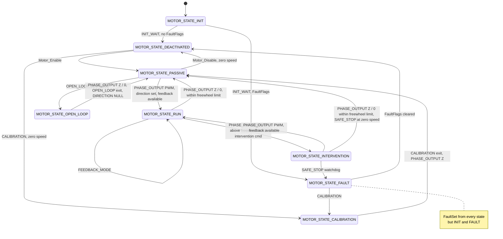
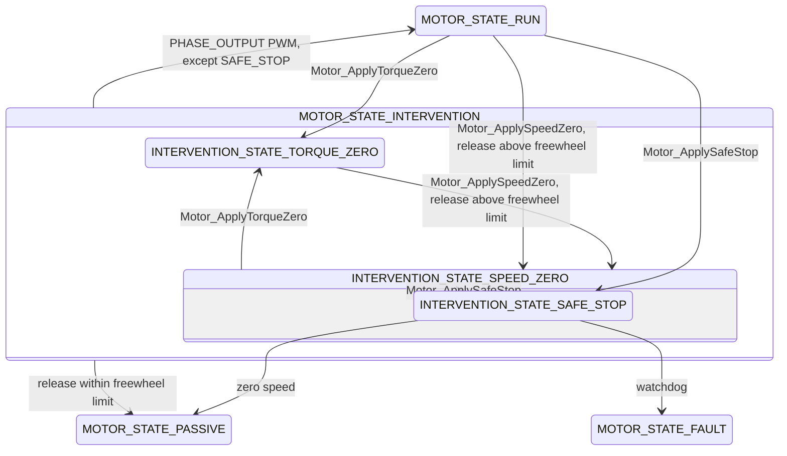

# Motor State Machine

One [MSM_MACHINE] per motor. States run on the PWM thread; inputs arrive from the main thread. This layer knows
nothing of STANDBY, NEUTRAL or DRIVE — [MotorController_StateMachine.md](MotorController_StateMachine.md) covers the
layers above.

## States

[Motor_StateId_T]

| State | Phase output | Feedback | Description |
|---|---|---|---|
| INIT | unchanged | Off | Waits for speed and heat sensors, validates config and sensor calibration |
| DEACTIVATED | Float | Off, BEMF angle captured | Quiescent gateway. Direction NULL, config writable |
| PASSIVE | Float within the freewheel speed limit, else V0 | Off, BEMF angle captured for resume | Freewheel or hold |
| RUN | PWM | Current or voltage loop, optional speed loop, by [Motor_FeedbackMode_T] | Active control. Entry matches loop state to the output for a bumpless resume |
| INTERVENTION | PWM | Current loop regardless of FeedbackMode | Motor-level supervisor, below |
| OPEN_LOOP | V0, PWM in sub-states | Cleared | Align, start-up, open-loop run |
| CALIBRATION | V0, PWM in sub-states | Cleared | Sensor and parameter calibration. Config writable |
| FAULT | V0 on RequestV0 or above the freewheel limit, else Float | Off | Latched [Motor_FaultFlags_T]. Config writable |

The freewheel speed limit is where floating the phases is still safe. Above it, a release actively ramps down instead.

## Inputs

[Motor_StateInput_T]

| Input | Value | Effect |
|---|---|---|
| FAULT | [Motor_FaultCmd_T] set / clear deltas | Set enters FAULT from any state but INIT. Clear in FAULT returns to DEACTIVATED once every flag clears |
| PHASE_OUTPUT | [Phase_VOutMode_T] | PWM runs from PASSIVE or INTERVENTION. Z / 0 releases RUN, INTERVENTION, OPEN_LOOP; Z releases CALIBRATION |
| FEEDBACK_MODE | [Motor_FeedbackMode_T] | Stored in DEACTIVATED, PASSIVE, OPEN_LOOP, INTERVENTION. RUN re-enters to rematch its loops |
| DIRECTION | [Motor_Direction_T] | Applied in DEACTIVATED, and at zero speed in PASSIVE, OPEN_LOOP, CALIBRATION. Ignored in RUN, INTERVENTION, FAULT |
| OPEN_LOOP | sub-state pointer | Enters from PASSIVE at zero speed. NULL exits to PASSIVE |
| CALIBRATION | sub-state pointer | Enters from DEACTIVATED at zero speed, or from FAULT. NULL exits to PASSIVE |
| INTERVENTION | sub-state pointer | Enters from RUN or INTERVENTION. A target already on the active branch is a no-op. SAFE_STOP rejects. Sent by Motor_ApplyTorqueZero, Motor_ApplySpeedZero, Motor_ApplySafeStop |

Transition commands act only from a named start state.

| Function | From | To |
|---|---|---|
| Motor_Enable | DEACTIVATED | PASSIVE |
| Motor_Disable | PASSIVE, zero speed | DEACTIVATED |

[Motor_StateAction_T] are per-state hooks, not transitions: ON_SPEED runs the speed loop tick, ON_I_LIMITS re-resolves
current limits.

### Direction

Direction does not drive transitions. A direction is required to leave PASSIVE for RUN, but setting one does not
start the motor, so a layer above can store a direction while holding its own safe state. DEACTIVATED resets it to
NULL. Setting the direction also limits the FOC voltage output to that direction. User FORWARD / REVERSE map to
CW / CCW through `Config.DirectionForward` (`Motor_ApplyUserDirection`).

## Intervention

| Sub-state | Control | Resume |
|---|---|---|
| TORQUE_ZERO (ZTC) | Current loop, generating current only | PHASE_OUTPUT PWM |
| SPEED_ZERO | Speed loop to zero speed | PHASE_OUTPUT PWM |
| SAFE_STOP (SS1) | SPEED_ZERO's loop, watchdog to FAULT | rejected |

## Sub-States

| Sub-state | Parent | Entered by | Exits |
|---|---|---|---|
| OPEN_LOOP_STATE_ANGLE_ALIGN | OPEN_LOOP | Motor_OpenLoop_SetAngleAlign | OPEN_LOOP inputs |
| OPEN_LOOP_STATE_START_UP_ALIGN | OPEN_LOOP | Motor_OpenLoop_StartRunChain, direction set | OPEN_LOOP_STATE_RUN after `AlignTime_Cycles` |
| OPEN_LOOP_STATE_RUN | OPEN_LOOP | START_UP_ALIGN | OPEN_LOOP inputs |
| CALIBRATION_STATE_ELECTRICAL | CALIBRATION | Motor_Calibration_StartElectrical | CALIBRATION once Rs, Ld, Lq are measured |

ADC and sensor calibrations mount their own CALIBRATION sub-states in `Motor_Analog`, `Motor_Encoder`, `Motor_Hall`
and `Motor_SinCos`. Encoder homing is described in [Encoder_Reference.md](../../Transducer/Encoder/Encoder_Reference.md).
