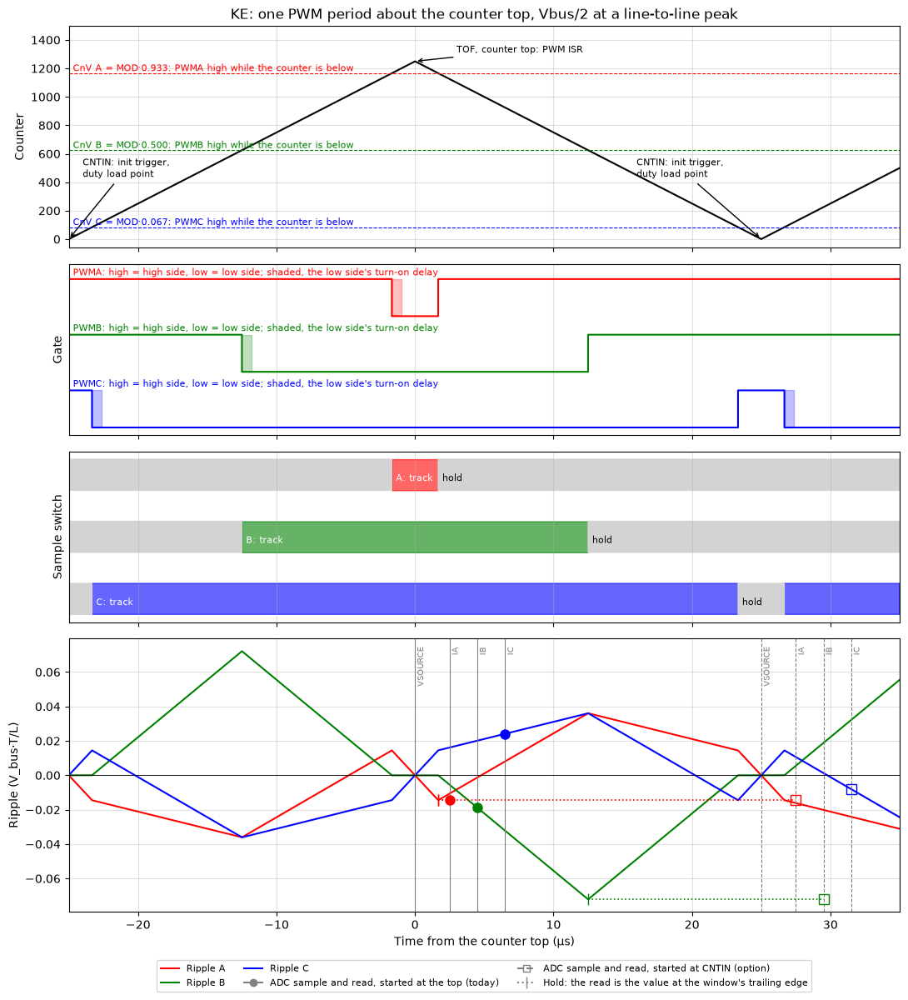

# PWM Convention

The convention the motor layer writes duties in, and the counter events it relies on. Where the phase-current sample sits in the period: [CurrentSampling.md](CurrentSampling.md). The modulation limit a low-side sensor sets: [ModulationLimit.md](ModulationLimit.md).

## Duty

- The duty d is the share of the period a phase's channel is high. High commands the high side; the low side conducts the rest, less dead time. The driver or a complementary channel makes the complement.
- A higher phase voltage gives a higher duty (`svpwm_midclamp`, `Phase_WriteSvpwm`).
- `PWM_DUTY_MAX` is 32768. CnV = `PERIOD_TICKS`·d/32768 (`_PWM_DutyTicksOf`). Nothing else in the output path limits duty.
- Center-aligned, high-true: the channel is high while the counter is below CnV, for d·T centered on the counter bottom. The low side conducts for (1 − d)·T, centered on the counter top.
- On the FTM: `CPWMS` in `HAL_PWM_InitModule`, `ELSB` in `HAL_PWM_InitChannel`. `POL` stays 0 under FOC; only the six-step modes in `Phase_Polar.c` set it.

| State | Duties | Bridge |
|---|---|---|
| `Phase_ActivateV0` | 0/0/0 | every low side on: the terminals are shorted to the negative rail, and every low-side window is the whole period |
| `Phase_ActivateT0` | 50 % | the state `Motor_Analog_Calibrate` measures the zero offsets in |
| floating (`Phase_IsFloat`) | outputs off | neither side; the marks set V instead of I |

## Sign

- Phase current is positive from the inverter into the motor.
- A low-side sensor sees that current as a falling voltage, −i·R across the low-side R_DS(on) or shunt. `PHASE_ANALOG_I_SENSOR_INVERT` maps it back (`PHASE_ANALOG_I_POLARITY` −1). Define it where the sensor's output falls as that current rises.

## Counter events

| Counter | Bridge | Event |
|---|---|---|
| top, MOD → MOD − 1 | every low side on, O000: the center of every low-side window | TOF (`TOIE`): the PWM interrupt, which runs `Motor_PWM_Thread` |
| bottom, CNTIN | every high side on, O111: the center of every high pulse | the init trigger (`INITTRIGEN`); the duty load point |

- The counter runs CNTIN → MOD → CNTIN, 2·MOD ticks per period.
- `HAL_PWM_InitModule` sets `SYNCMODE`, `SWWRBUF` and both loading points (`CNTMIN`, `CNTMAX`). Duties written after the top load at the bottom, if they are written within T/2.
- The low-side window around the next top then runs wholly at the new duties. The high pulse at the bottom is split: old duty, then new.

## One period

| PWMx | Conducting | Phase node |
|---|---|---|
| high | high side | +Vbus |
| low | low side, about 0.7 µs after the falling edge | −i·R_DS(on) |
| either, Pin ENx low | neither | floats |

From [pwm_sample_timing.py](Simulation/pwm_sample_timing.py): a KE0x FTM at 20 kHz (MOD 1250), midclamp at Vbus/2 at a line-to-line peak, duties 0.933 / 0.500 / 0.067. Time 0 is the counter top.

- **Counter.** Each phase's CnV = MOD·d. The channel is high while the counter is below CnV, so the highest duty has the highest CnV and the shortest low pulse.
- **Gates.** Every high pulse is centered on the bottom and every low pulse on the top. The low-side windows here are 3.35, 25 and 46.7 µs. The shaded strip after each falling edge is the low side's turn-on delay, dead time plus the driver's own (0.68 µs in the example). Until the low side is on, the phase node is switching, not at −i·R: the window's usable part starts after it.
- **Window.** The low side conducts, and a low-side sensor sees the phase, only in the window. The panel labels it as a track-and-hold switch: it tracks in the window and holds outside it. A shunt has no hold; outside the window it carries nothing of that phase.
- **Ripple.** Each phase's PWM ripple current against its period average, in V_bus·T/L. By symmetry every phase crosses its average at both counter extremes, the center of each low-side window and of each high pulse. The ripple's extremes are at the switching edges.
- So a read at the top lands on the period average, and each µs away from it adds ripple. The highest duty's window is the shortest: it opens last and closes first.
- The markers are the reads of two ADC starts: at the top, labelled "today", and at the bottom, labelled "option". A dotted line runs back to the trailing edge a hold froze at. Which start the code uses, and what each reads: [CurrentSampling.md](CurrentSampling.md).
