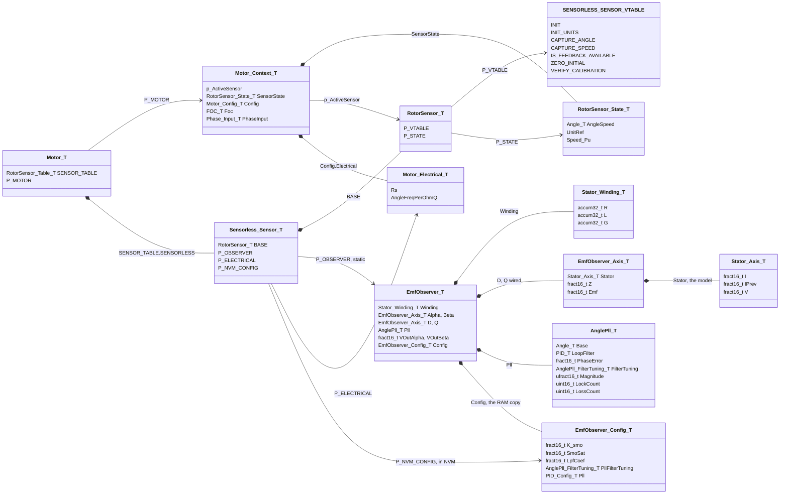
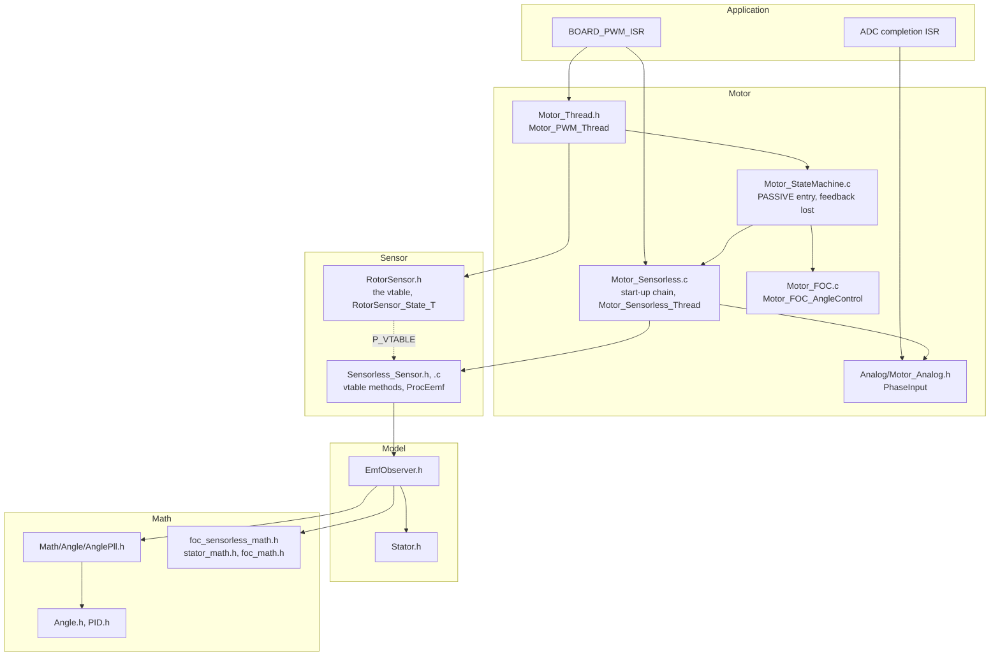
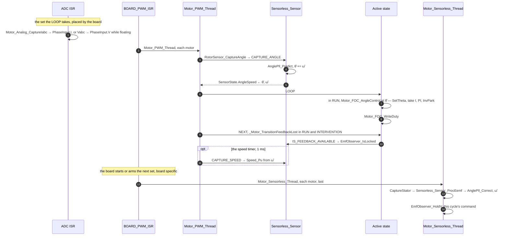
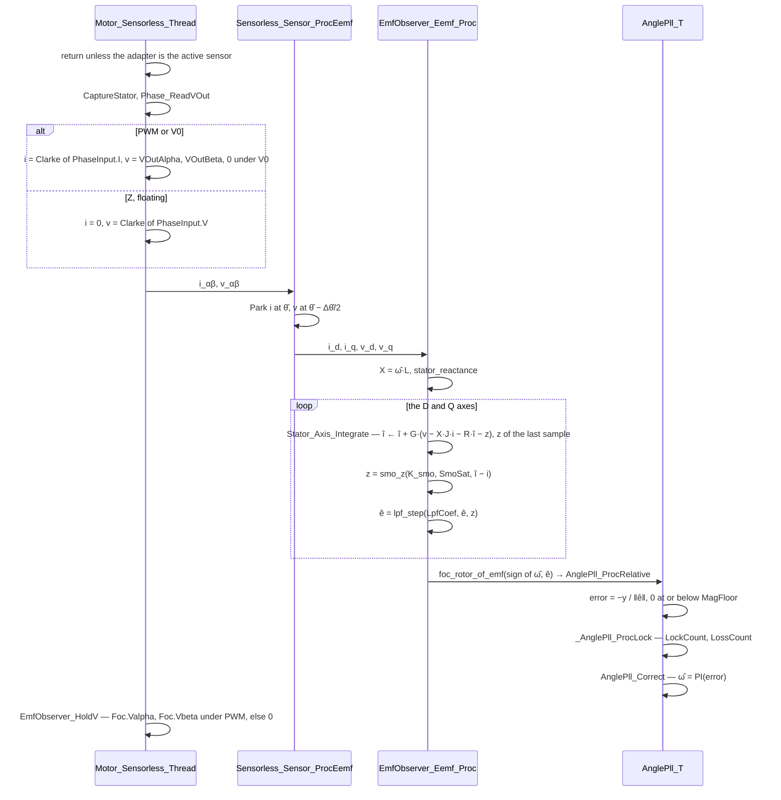
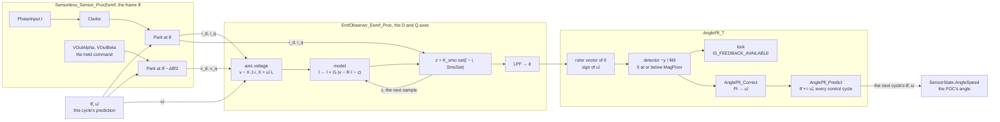
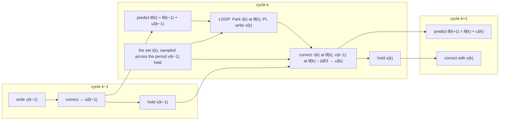
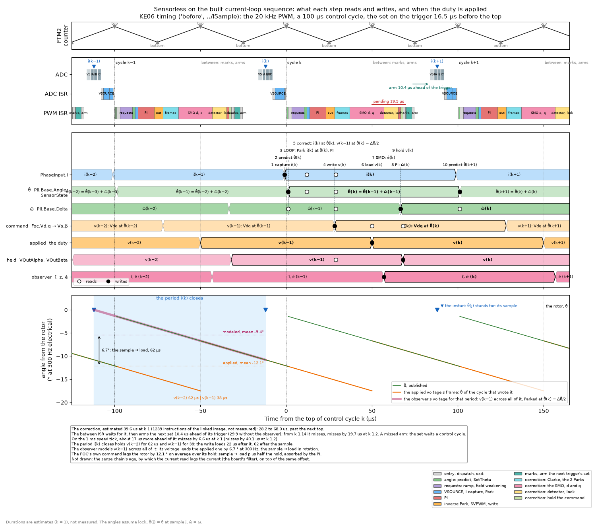
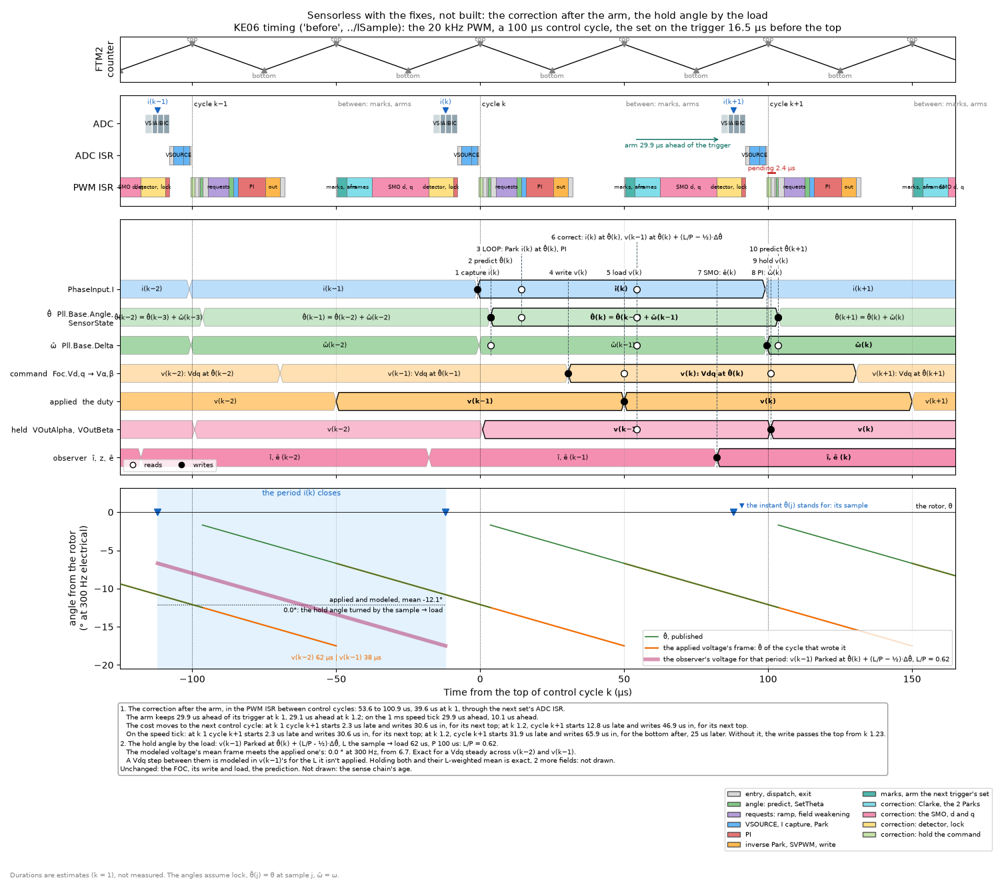
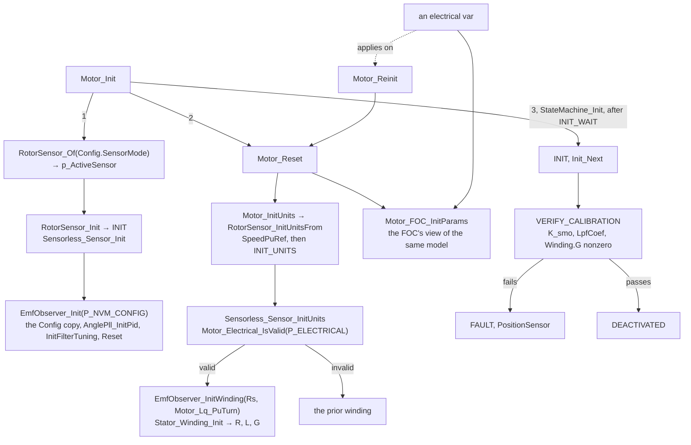
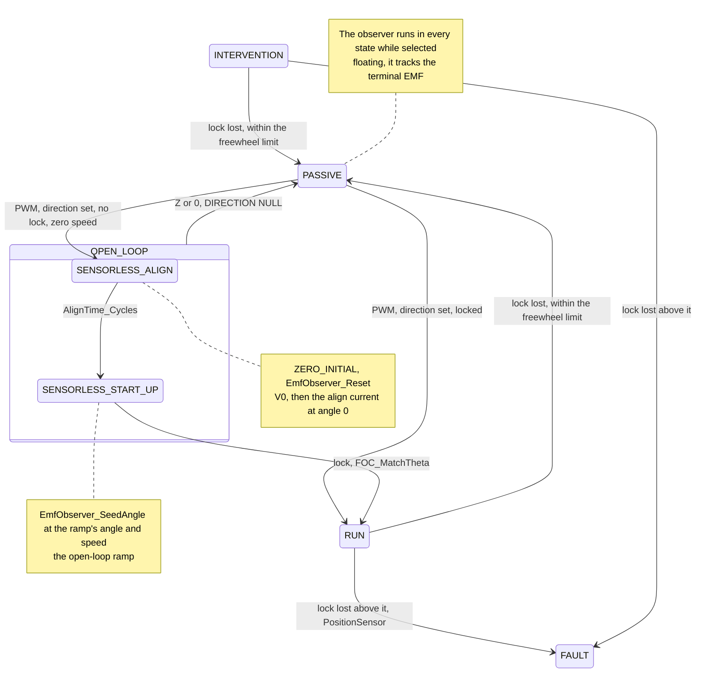

Vgeometry # Sensorless

The rotor angle from the stator's EMF: the extended-EMF sliding-mode observer (`EmfObserver_T`, `Model/EmfObserver.h`) behind the `RotorSensor_T` interface (`Sensorless_Sensor_T`, `Sensor/Sensorless/Sensorless_Sensor.h`), and its start-up chain (`Sensor/Sensorless/Motor_Sensorless.c`).

| | |
|---|---|
| Selected by | `Config.SensorMode` = `ROTOR_SENSOR_ID_SENSORLESS`, in a build with `MOTOR_SENSOR_SENSORLESS_ENABLE`. Takes effect on reboot: `Motor_Init` sets `p_ActiveSensor` |
| Predict | Every control cycle, at `CAPTURE_ANGLE`: θ̂ += ω̂ (`AnglePll_Predict`), then published to `RotorSensor_State_T.AngleSpeed` |
| Correct | Every control cycle, after the write: `Motor_Sensorless_Thread`, from the application's `BOARD_PWM_ISR`. Corrects ω̂ only (`AnglePll_Correct`); the next predict carries it into θ̂. About 40 µs on KE06, estimated: [Timeline](#timeline) |
| Front end | EEMF SMO in the frame θ̂ (`EmfObserver_Eemf_Proc`): i Parked at θ̂, the held command at θ̂ − Δθ̂/2, as if applied across the whole period the sample closes. It is applied from its load: [Timeline](#timeline) |
| Inputs | The set the LOOP took: I while driven, V while floating (`Motor_ADC_MarkPhases`). The command held after the last write (`EmfObserver_HoldV`) |
| Plant | `Stator_Winding_T` from `Config.Electrical`: Rs, Lq on both axes, at `INIT_UNITS` on `Motor_Reset`. An electrical var reaches the FOC at once, the winding on `Motor_Reinit` |
| Tuning | `EmfObserver_Config_T` from NVM (`P_NVM_CONFIG`). Default `EMF_OBSERVER_CONFIG_DEFAULT(VBus, v_max, I, i_max, Freq)`, Freq the control frequency. Vars are read only |
| Feedback | `IS_FEEDBACK_AVAILABLE` is the lock: ‖ê‖ above `MagFloor` and the error within `LockErrTol` for `LockHoldCount` corrections, held through `LossHoldCount` |
| Calibrated | `K_smo`, `LpfCoef`, `Winding.G` nonzero, else `INIT` → `FAULT` with `PositionSensor` |
| Rates | Predict, correct, lock counts and the PLL PI at the control frequency (`Config.Pll.SampleFreq`); the model's G per control cycle (the turn base); `CAPTURE_SPEED` at `MOTOR_SPEED_LOOP_FREQ` |
| Not wired | `Motor_Sensorless_StartRunChain` (a command entry), the αβ SMO (`EmfObserver_AlphaBeta_Proc`, `_ProcHeld`) and the voltage model (`EmfObserver_VModel_Proc`) |
| Not measured | No hardware run, no plant simulation of this wiring. `K_smo`, `SmoSat` and the PLL gains are not tuned per motor. The correction's duration is an instruction-count estimate |

## Structure

The observer is allocated by the table entry (`SENSORLESS_SENSOR_INIT`), so `Motor_Context_T` carries none of it. `RotorSensor_State_T` is shared by every sensor of the motor.

## One control cycle

The correction is off the write's deadline: the FOC already Parked the sample at the θ̂ this cycle published, the frame the correction Parks it in.

## The correction

| `Phase_ReadVOut` | The analog thread marks | i | v |
|---|---|---|---|
| `PHASE_VOUT_PWM` | I | Clarke of `PhaseInput.I` | the held command, `VOutAlpha`, `VOutBeta` |
| `PHASE_VOUT_0` | I | Clarke of `PhaseInput.I` | 0: the EMF drives i through the shorted winding |
| `PHASE_VOUT_Z` | V | 0 | Clarke of `PhaseInput.V`: the terminals read the EMF |

The mode is the one the state left for the next period. On the cycle it changes, the correction misreads one sample.

## Signal flow

The prediction feeds both the FOC and the next correction's Parks: the loop closes through `AnglePll_T.Base`.

## Indices across cycles

## Timeline

What each step of control cycle k reads and writes, on the built current-loop sequence: KE06, the 20 kHz PWM, a 100 µs control cycle, the set on the trigger 16.5 µs before the top. The lanes are the values as they stand: a value lasts from its write to the next. Open circles read, filled ones write. The bottom panel puts the angles in the rotor's frame at 300 Hz electrical, locked: θ̂(j) stands for the rotor at sample j.

[Simulation/Sensorless/sensorless_sequence.py](Simulation/Sensorless/sensorless_sequence.py), on the ISample scheduler and its built sequence, with the prediction in place of the Hall capture and the correction added after the write. Durations are estimates at k = 1, the model's 32 ns per instruction; the board measured its code at about 1.2 times its estimates.

| Step | Reads | Writes | At, µs from the top |
|---|---|---|---|
| The ADC ISR captures | the set, sampled at −12 | `PhaseInput.I` ← i(k) | −1 |
| Predict, `CAPTURE_ANGLE` | θ̂(k−1), ω̂(k−1) | θ̂(k) | 1.2 |
| The LOOP: Park, PI | i(k), θ̂(k) | | 12 |
| Write | | v(k): Vdq(k) turned by θ̂(k) | 28.2 |
| Load, at the next top | v(k) | the duty, for 100 µs | 50 |
| Correct | i(k), θ̂(k), ω̂(k−1), the held v(k−1) | î, z, ê(k), then ω̂(k) | 28.2 to 66.7 |
| Hold | v(k) | `VOutAlpha`, `VOutBeta` | 68.0 |
| Predict, cycle k+1 | θ̂(k), ω̂(k) | θ̂(k+1) | 101.2 |

- **The correction runs past the next top.** About 1,240 instructions, 39.6 µs: the driven path's ~470, six 64-bit multiplies, three divides, two sine and cosine lookups, a square root and the PI. The PWM ISR between control cycles waits behind it, 19.5 µs, then arms the next set 10.4 µs ahead of its trigger, 29.9 without the observer. From k 1.14 the arm misses, and the set waits a control cycle. On the 1 ms speed tick, about 17 µs more ahead of it, it misses at k 1.
- **The held command is not the voltage across the period the sample closes.** The write loads at the next top, 62 µs after the sample, so that period holds v(k−2) for 62 µs and v(k−1) for 38. The correction pairs i(k) with v(k−1) across all of it. Its modeled voltage leads the applied one by the rotation in sample → load, ω·62 µs: 6.7° at 300 Hz. The hold angle θ̂ − Δθ̂/2 is right only for a command applied from the sample on.
- **The FOC's own command** lags the rotor by sample → load plus half the hold, 112 µs, 12.1° at 300 Hz, absorbed by the PI's integrators. The observer models half the hold, 50 µs.
- **Not drawn**: the sense chain's age, by which the current read lags the current, on top of the same offset.

### With the fixes, not built

The same timeline with both fixes, to compare:
1. **The correction after the arm.** At the 20 kHz PWM, the PWM ISR between control cycles runs it, after its marks and its arm. At the 10 kHz PWM, with one PWM ISR per control cycle, the arm already comes before it.
2. **The hold angle by the load.** v(k−1) is Parked at θ̂(k) + (L/P − ½)·Δθ̂, in place of θ̂(k) − Δθ̂/2. L is the time from sample to load, 62 µs; P is the control period, 100 µs.

[Simulation/Sensorless/sensorless_sequence_fixed.py](Simulation/Sensorless/sensorless_sequence_fixed.py), on the same model.

| | Built | With the fixes |
|---|---|---|
| The correction | 28.2 to 68.0 µs, in the control cycle's PWM ISR | 53.6 to 100.9 µs, in the between ISR, through the next set's ADC ISR |
| The between ISR | starts 19.5 µs late | on time |
| Its arm, ahead of the trigger, at k 1 / 1.2 | 10.4 µs / misses from k 1.14 | 29.9 / 29.1 µs |
| The same, on the 1 ms speed tick | misses / misses | 29.9 / 10.1 µs |
| The next control cycle starts late, at k 1 / 1.2 | 0 / 4.9 µs | 2.3 / 12.8 µs |
| The same, on the speed tick | 0 / 25.3 µs: loads at the bottom, 25 µs later | 2.3 / 31.9 µs: loads at the bottom, 25 µs later |
| Its write passes its top | at k 1.2 on the speed tick | from k 1.23; at k 1.2 on the speed tick |
| The modeled voltage against the applied one, 300 Hz | leads by 6.7° | 0.0° |

- **A missed arm costs a control cycle; a late write, half a PWM period.** The first fix trades one for the other, and moves the slack from the arm to the next cycle's write. Either way the correction's 40 µs is the cost; reusing the FOC's Park of i(k), which the LOOP already made at θ̂(k), would take off its Clarke, one Park and one sine and cosine.
- **The hold angle is exact for a Vdq steady across v(k−2) and v(k−1).** A Vdq step between them is modeled in v(k−1)'s for the L it isn't applied. Holding both commands and their L-weighted mean is exact for any Vdq, at 2 more fields. L/P belongs to the board's sequence.

## Init and selection

`RotorSensor_Init` runs before `Motor_Reset`, so the winding is resolved after the config copy and before `INIT` verifies it. `ZERO_INITIAL` (`EmfObserver_Reset`) clears the per-sample state and keeps the config and the winding.

## States

- `Motor_Sensor_StartUpState` returns `SENSORLESS_ALIGN` only while the adapter is the active sensor; `Config.SensorMode` can name it before the reboot that makes it so.
- The hand-off re-Parks the FOC's sample and command at θ̂ (`FOC_MatchTheta`), and `Run_Entry` seeds the loop and the torque ramp from them.
- Full state machine: [Motor_StateMachine.md](Motor_StateMachine.md).
- The math, drawn as geometry: [SensorlessMath.md](SensorlessMath.md).
