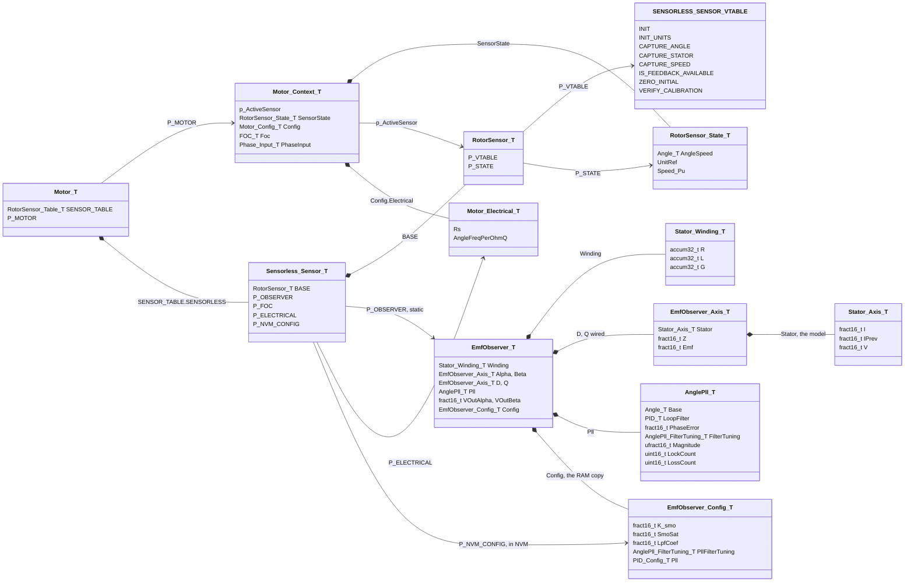
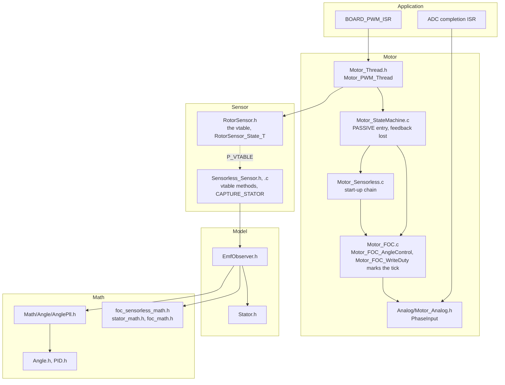
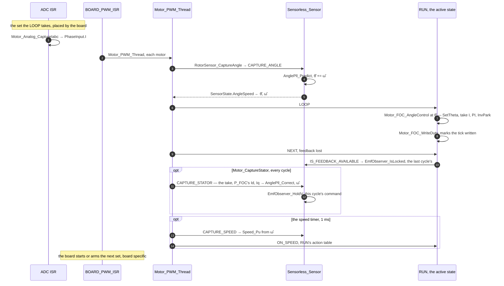
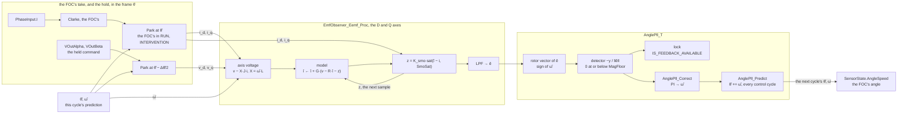
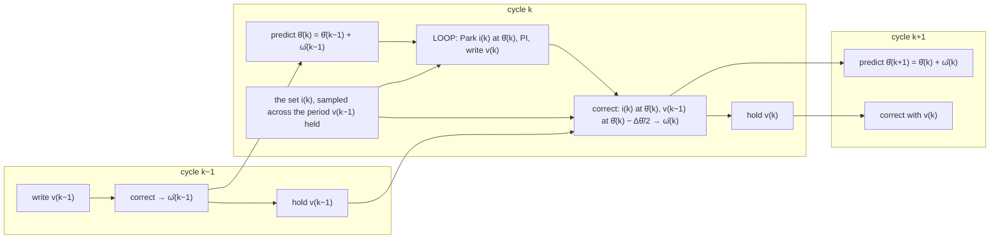
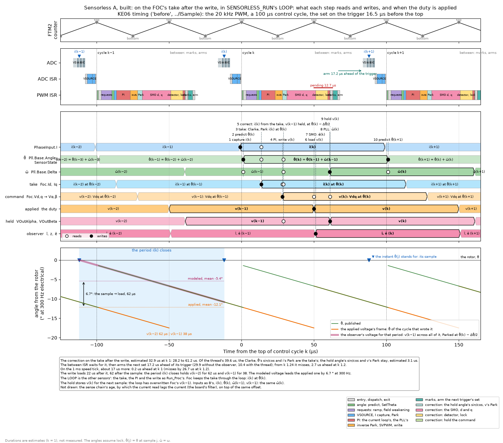
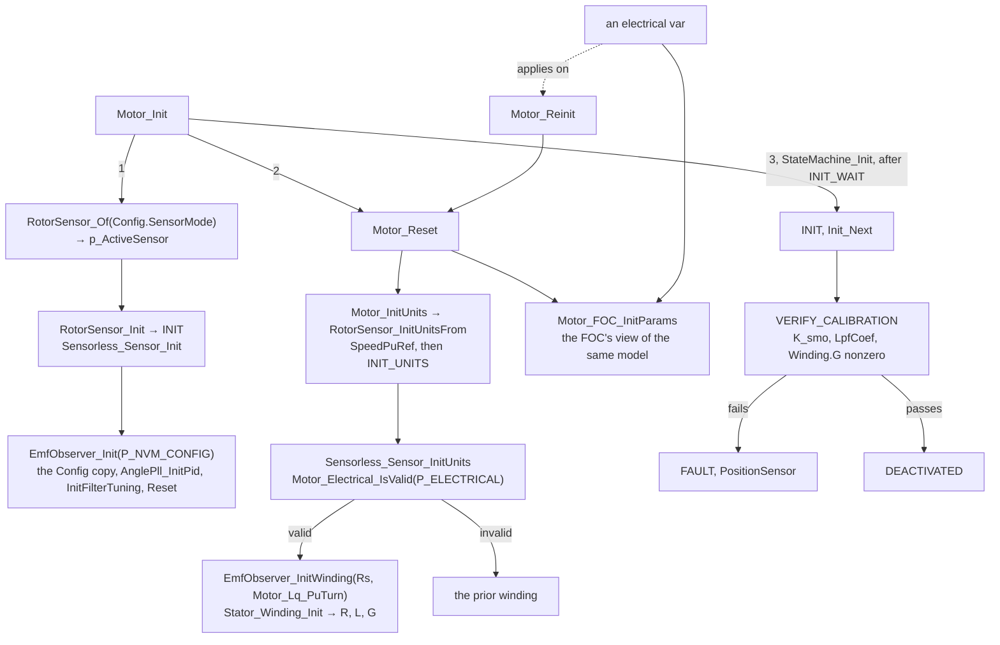
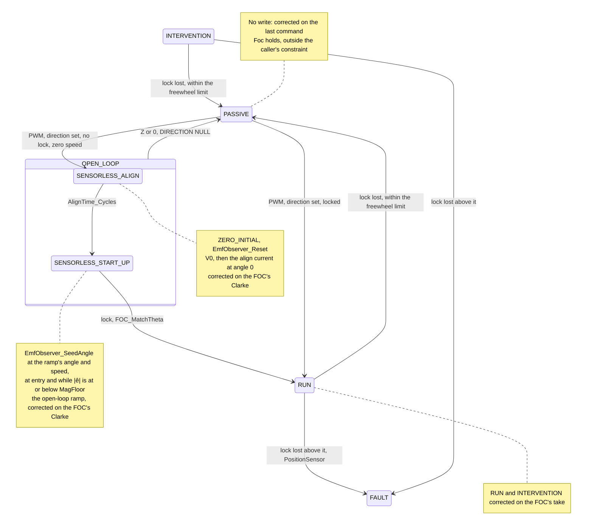
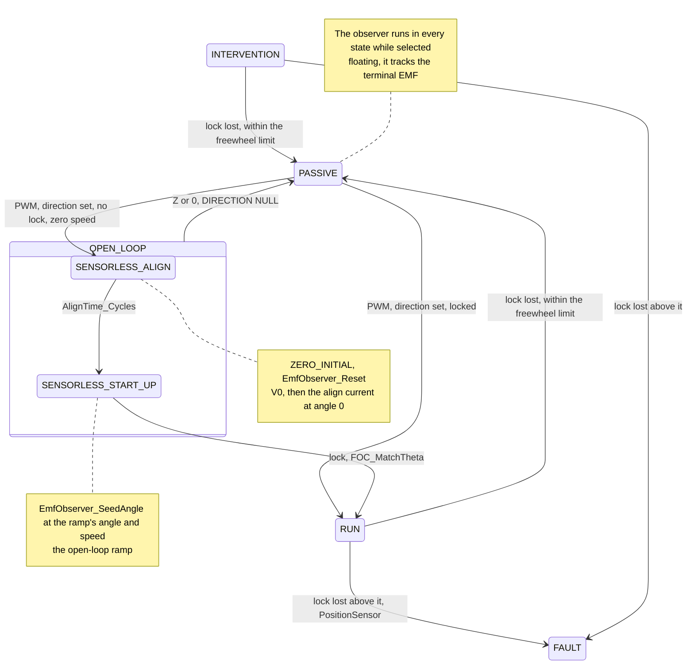

Vgeometry # Sensorless

The rotor angle from the stator's EMF: the extended-EMF sliding-mode observer (`EmfObserver_T`, `Model/EmfObserver.h`) behind the `RotorSensor_T` interface (`Sensorless_Sensor_T`, `Sensor/Sensorless/Sensorless_Sensor.h`), and its start-up chain (`Sensor/Sensorless/Motor_Sensorless.c`).

| | |
|---|---|
| Selected by | `Config.SensorMode` = `ROTOR_SENSOR_ID_SENSORLESS`, in a build with `MOTOR_SENSOR_SENSORLESS_ENABLE`. Takes effect on reboot: `Motor_Init` sets `p_ActiveSensor` |
| Predict | Every control cycle, at `CAPTURE_ANGLE`: θ̂ += ω̂ (`AnglePll_Predict`), then published to `RotorSensor_State_T.AngleSpeed` |
| Correct | Every control cycle a state wrote the FOC's command: the sensor's `CAPTURE_STATOR` (`Sensorless_Sensor_CaptureStator`), after the state machine (`Motor_CaptureStator` in `Motor_PWM_Thread`), every cycle; valid on a cycle the FOC wrote, the caller's constraint. i is the FOC's take, its Id, Iq: in the frame θ̂ where the FOC Parks at θ̂ (RUN, INTERVENTION); in the ramp's in the start-up chain. Corrects ω̂ only (`AnglePll_Correct`); the next predict carries it into θ̂. About 33 µs on KE06, estimated: [Timeline](#timeline) |
| States | `SENSORLESS_ALIGN`, `SENSORLESS_START_UP` under `OPEN_LOOP`, then `RUN`. RUN, INTERVENTION and the chain correct on their write; the other states on what `Foc` holds, outside the caller's constraint. [States](#states) |
| Front end | EEMF SMO in the frame θ̂ (`EmfObserver_Eemf_Proc`): i Parked at θ̂, the held command at θ̂ − Δθ̂/2, as if applied across the whole period the sample closes. It is applied from its load: [Timeline](#timeline) |
| Inputs | The FOC's take of the set the LOOP took, I while driven (`Motor_ADC_MarkPhases`). The command held after the last write (`EmfObserver_HoldV`) |
| Plant | `Stator_Winding_T` from `Config.Electrical`: Rs, Lq on both axes, at `INIT_UNITS` on `Motor_Reset`. An electrical var reaches the FOC at once, the winding on `Motor_Reinit` |
| Tuning | `EmfObserver_Config_T` from NVM (`P_NVM_CONFIG`). Default `EMF_OBSERVER_CONFIG_DEFAULT(VBus, v_max, I, i_max, Freq)`, Freq the control frequency. Vars are read only |
| Feedback | `IS_FEEDBACK_AVAILABLE` is the lock: ‖ê‖ above `MagFloor` and the error within `LockErrTol` for `LockHoldCount` corrections, held through `LossHoldCount` |
| Calibrated | `K_smo`, `LpfCoef`, `Winding.G` nonzero, else `INIT` → `FAULT` with `PositionSensor` |
| Rates | Predict, correct, lock counts and the PLL PI at the control frequency (`Config.Pll.SampleFreq`); the model's G per control cycle (the turn base); `CAPTURE_SPEED` at `MOTOR_SPEED_LOOP_FREQ` |
| Not wired | `Motor_Sensorless_StartRunChain` (a command entry), the correction between the take and the PI (`Motor_Sensorless_ProcTorqueReq`, form B), the αβ SMO (`EmfObserver_AlphaBeta_Proc`, `_ProcHeld`) and the voltage model (`EmfObserver_VModel_Proc`) |
| Not measured | No hardware run, no plant simulation of this wiring. `K_smo`, `SmoSat` and the PLL gains are not tuned per motor. The correction's duration is an instruction-count estimate |

## Structure



The observer is allocated by the table entry (`SENSORLESS_SENSOR_INIT`), so `Motor_Context_T` carries none of it. `RotorSensor_State_T` is shared by every sensor of the motor.



## One control cycle



The correction is off the write's deadline: the FOC already Parked the sample at the θ̂ this cycle published, the frame the correction Parks it in. The start-up chain and INTERVENTION run the same order. Hall, Encoder and SinCos define `CAPTURE_STATOR` empty (`RotorSensor_CaptureStatorNone`).

## The correction

```mermaid
sequenceDiagram
    participant S as Motor_CaptureStator
    participant M as Sensorless_Sensor_CaptureStator
    participant A as EmfObserver_Eemf_ProcHeld
    participant O as EmfObserver_Eemf_Proc
    participant P as AnglePll_T

    S->>M: CAPTURE_STATOR, P_FOC the motor's Foc
    M->>A: Foc.Id, Foc.Iq, the take; the held VOutAlpha, VOutBeta
    A->>A: Park v at θ̂ − Δθ̂/2
    A->>O: i_d, i_q, v_d, v_q
    O->>O: X = ω̂·L, stator_reactance
    loop the D and Q axes
        O->>O: Stator_Axis_Integrate — î ← î + G·(v − X·J·i − R·î − z), z of the last sample
        O->>O: z = smo_z(K_smo, SmoSat, î − i)
        O->>O: ê = lpf_step(LpfCoef, ê, z)
    end
    O->>P: foc_rotor_of_emf(sign of ω̂, ê) → AnglePll_ProcRelative
    P->>P: error = −y / ‖ê‖, 0 at or below MagFloor
    P->>P: _AnglePll_ProcLock — LockCount, LossCount
    P->>P: AnglePll_Correct — ω̂ = PI(error)
    M->>M: EmfObserver_HoldV — Foc.Valpha, Foc.Vbeta
```

| State | The FOC's angle | i | v |
|---|---|---|---|
| RUN, INTERVENTION | θ̂ | the take, `Foc.Id`, `Iq`: the FOC's Clarke, sine and cosine, and Park | the held command, `VOutAlpha`, `VOutBeta` |
| `SENSORLESS_ALIGN`, `SENSORLESS_START_UP` | the ramp's | the take, in the ramp's frame: θ̂'s while re-seeded, off θ̂ by the load angle once \|ê\| holds above the floor | the held command |
| Any other state that writes through `Motor_FOC_WriteDuty`: open loop, calibration | its own | the take, in its frame | the held command |
| PASSIVE, floating | θ̂, the V capture's | 0: the V capture clears I, none flows | the measured terminal voltage, `FOC_CaptureVBemfData` writes `Valpha`, `Vbeta`: the EMF |
| PASSIVE, shorted (V0) | θ̂, the I capture's | the current the EMF drives, `FOC_CaptureIData` | 0: the I capture clears V, the terminals at 0 |
| DEACTIVATED | none | 0, the feedback clear | 0, the feedback clear |
| FAULT | none | the last, not cleared | the last, not cleared |

Id, Iq are θ̂'s only where the FOC Parked at θ̂, and only without `FOC_I_SAMPLE_DELAY` (with it, at θ̂ − ω·delay). Elsewhere the observer reads them in the FOC's frame. Parking Iα, Iβ at θ̂ (`EmfObserver_ParkI`) is correct in every state, at a sine and cosine and a Park more; it waits for the sample delay's work. A cycle that writes drives PWM, so the set is I and v is the command.

## Signal flow



The prediction feeds both the FOC and the next correction's Parks: the loop closes through `AnglePll_T.Base`.

## Indices across cycles



## Timeline

What each step of control cycle k reads and writes in RUN, on the built current-loop sequence: KE06, the 20 kHz PWM, a 100 µs control cycle, the set on the trigger 16.5 µs before the top. The lanes are the values as they stand: a value lasts from its write to the next. Open circles read, filled ones write. The bottom panel puts the angles in the rotor's frame at 300 Hz electrical, locked: θ̂(j) stands for the rotor at sample j.



[Simulation/Sensorless/sensorless_sequence.py](Simulation/Sensorless/sensorless_sequence.py), on the ISample scheduler and its built sequence, with the prediction in place of the Hall capture and the correction after the write. Durations are estimates at k = 1, the model's 32 ns per instruction; the board measured its code at about 1.2 times its estimates.

| Step | Reads | Writes | At, µs from the top |
|---|---|---|---|
| The ADC ISR captures | the set, sampled at −12 | `PhaseInput.I` ← i(k) | −1 |
| Predict, `CAPTURE_ANGLE` | θ̂(k−1), ω̂(k−1) | θ̂(k) | 1.2 |
| The take: Clarke, Park | i(k), θ̂(k) | `Foc.Id`, `Iq` ← i(k) at θ̂(k) | 12 |
| PI, write | the take | v(k): Vdq(k) turned by θ̂(k) | 28.2 |
| Correct | the take, θ̂(k), ω̂(k−1), the held v(k−1) | î, z, ê(k), then ω̂(k) | 28.2 to 61 |
| Load, at the next top | v(k) | the duty, for 100 µs | 50 |
| Hold | v(k) | `VOutAlpha`, `VOutBeta` | 61.2 |
| Predict, cycle k+1 | θ̂(k), ω̂(k) | θ̂(k+1) | 101.2 |

- **The correction runs past the next top.** 32.9 µs: the SMO, the detector and the PLL as counted on the removed thread's 1,239 instructions, and the hold angle's sine and cosine and v's Park, 3.1 µs estimated. The FOC's take supplies the rest: its Clarke, θ̂'s sine and cosine, and i's Park. The PWM ISR between control cycles waits behind it, 12.7 µs, then arms the next set 17.2 µs ahead of its trigger, 29.9 without the observer, 10.4 with the thread. From k 1.24 the arm misses, and the set waits a control cycle. On the 1 ms speed tick, about 17 µs more, it is 0.2 µs ahead at k 1 and misses at k 1.2.
- **The held command is not the voltage across the period the sample closes.** The write loads at the next top, 62 µs after the sample, so that period holds v(k−2) for 62 µs and v(k−1) for 38. The correction pairs i(k) with v(k−1) across all of it. Its modeled voltage leads the applied one by the rotation in sample → load, ω·62 µs: 6.7° at 300 Hz. The hold angle θ̂ − Δθ̂/2 is right only for a command applied from the sample on.
- **The FOC's own command** lags the rotor by sample → load plus half the hold, 112 µs, 12.1° at 300 Hz, absorbed by the PI's integrators. The observer models half the hold, 50 µs.
- **Not drawn**: the sense chain's age, by which the current read lags the current, on top of the same offset.

### Fixes, not built

Two fixes were drawn on the removed thread ([sensorless_sequence_fixed.py](Simulation/Sensorless/sensorless_sequence_fixed.py)):
1. **The correction after the arm.** At the 20 kHz PWM, the PWM ISR between control cycles runs it, after its marks and its arm: on the thread, the arm 29.9 µs ahead at k 1 and 1.2, and the next control cycle's write past its top from k 1.23. In the LOOP, the correction precedes the arm wherever the arm follows the PWM thread; moving it after the arm takes it out of the state again.
2. **The hold angle by the load.** v(k−1) is Parked at θ̂(k) + (L/P − ½)·Δθ̂, in place of θ̂(k) − Δθ̂/2. L is the time from sample to load, 62 µs; P is the control period, 100 µs. It applies to the built form as is, and closes the 6.7°.

- **A missed arm costs a control cycle; a late write, half a PWM period.** The first fix trades one for the other, and moves the slack from the arm to the next cycle's write.
- **The hold angle is exact for a Vdq steady across v(k−2) and v(k−1).** A Vdq step between them is modeled in v(k−1)'s for the L it isn't applied. Holding both commands and their L-weighted mean is exact for any Vdq, at 2 more fields. L/P belongs to the board's sequence.

## Init and selection



`RotorSensor_Init` runs before `Motor_Reset`, so the winding is resolved after the config copy and before `INIT` verifies it. `ZERO_INITIAL` (`EmfObserver_Reset`) clears the per-sample state and keeps the config and the winding.

## States



- `Motor_Sensor_StartUpState` returns `SENSORLESS_ALIGN` only while the adapter is the active sensor; `Config.SensorMode` can name it before the reboot that makes it so.
- The hand-off re-Parks the FOC's sample and command at θ̂ (`FOC_MatchTheta`), and `Run_Entry` seeds the loop and the torque ramp from them. The lock it reads is the last cycle's: the correction runs after the state machine.
- **No reliable catch-spin.** In PASSIVE the observer corrects on i = 0 and the last RUN command held in `Foc.Valpha`, `Vbeta`: ê reads that command, the lock drops after `LossHoldCount`, and ω̂, the speed feedback, drifts on it. A PWM request then waits on a speed that is not the rotor's. The acquisition procedure's DETECT phase replaces this.
- `SENSORLESS_RUN`, the alternate RUN for form B, is kept commented out in `Motor_Sensorless.c`.
- Full state machine: [Motor_StateMachine.md](Motor_StateMachine.md).
- The math, drawn as geometry: [SensorlessMath.md](SensorlessMath.md).
- Why the observer has its shape, the float-plant findings, the options not built, the Open list: [Sensorless.exp.md](Sensorless.exp.md).
