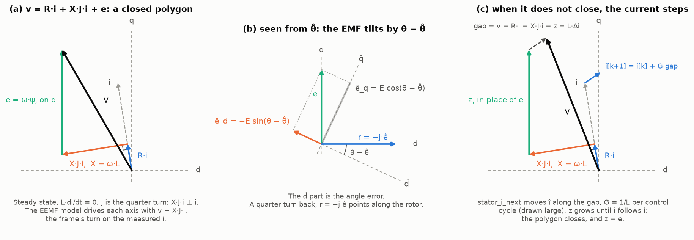
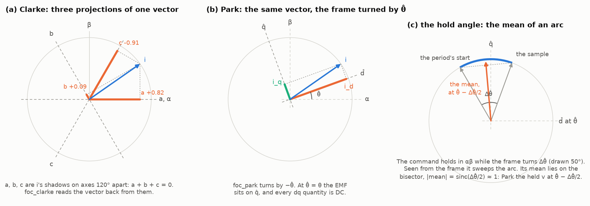
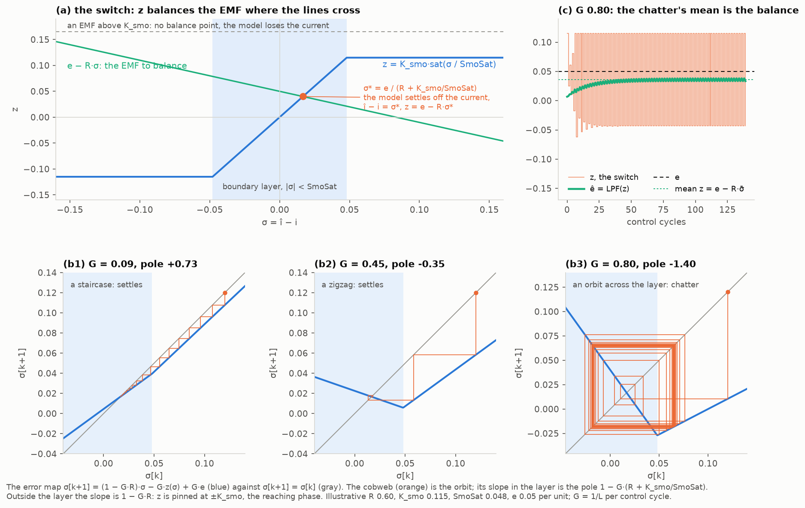
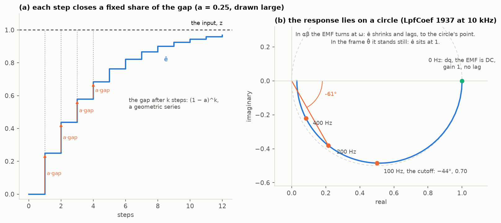
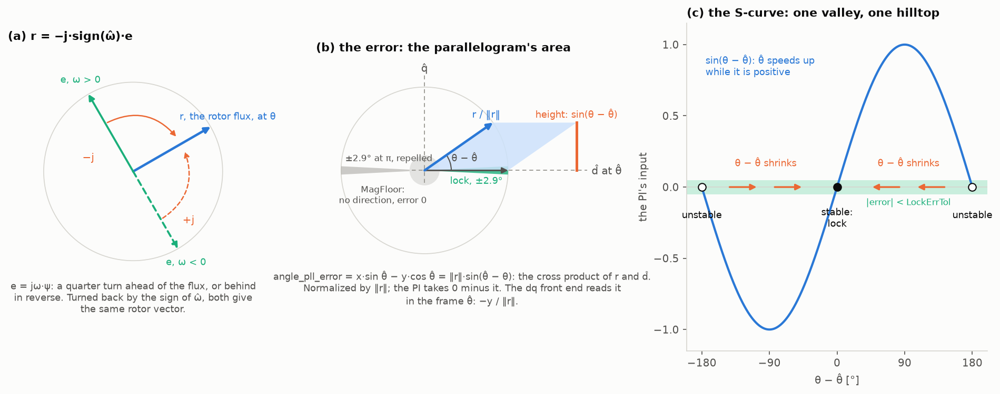
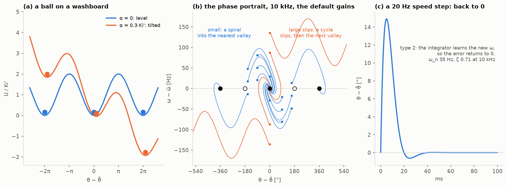

# Sensorless math, as geometry

The math under `EmfObserver_T` and `AnglePll_T`, drawn as shapes. The call sequence and the structure are in [Sensorless.md](Sensorless.md). Figures: [Simulation/Sensorless/sensorless_geometry.py](Simulation/Sensorless/sensorless_geometry.py), on a float mirror of the C functions, [sensorless_model.py](Simulation/Sensorless/sensorless_model.py). Per unit; values illustrative unless named from `EMF_OBSERVER_CONFIG_DEFAULT`.

| Component | Equation | Shape | Code |
|---|---|---|---|
| Stator | v = R·i + L·di/dt + X·J·i + e, in the rotor's frame; X = ω·L, J the quarter turn | A closed polygon of voltages; when it doesn't close, the gap is L·Δi | `stator_i_next`, `Stator_Axis_Integrate` |
| Frames | i_dq = e^(−jθ̂)·i_αβ | Clarke: three projections of one vector. Park: the frame turned by θ̂ | `foc_clarke`, `foc_park` |
| Hold angle | v_dq = Park(v_αβ, θ̂ − Δθ̂/2) | The mean of an arc | `EmfObserver_ParkHold` |
| SMO switch | σ = î − i, z = K_smo·sat(σ / SmoSat) | A ramp clipped into plateaus; it balances the EMF where it crosses e − R·σ | `smo_sigma`, `smo_z` |
| SMO step | σ' = (1 − G·R)·σ − G·z(σ) + G·e | A cobweb: staircase, zigzag or orbit, by the pole 1 − G·(R + K_smo/SmoSat) | `_EmfObserver_ProcSmo` |
| LPF | ê ← ê + a·(z − ê) | A geometric series; the response on a circle | `lpf_step` |
| Rotor vector | r = −j·sign(ω̂)·ê | A quarter turn back | `foc_rotor_of_emf` |
| Detector | ‖r‖·sin(θ̂ − θ) = x·sin θ̂ − y·cos θ̂ | The parallelogram of r and d̂ | `angle_pll_error`, `angle_pll_normalize` |
| Lock | ‖ê‖ > `MagFloor`, \|error\| < `LockErrTol`, for `LockHoldCount` corrections | An annular sector around d̂ | `_AnglePll_ProcLock` |
| PLL | Δ'' + Kp'·cos Δ·Δ' + Ki'·sin Δ = α, Δ = θ − θ̂ | A ball on a washboard | `AnglePll_Correct`, `AnglePll_Predict` |

- **The PLL at the default gains**, the loop alone, with no LPF in it, from the script's printout:

  | Correction rate | ω_n | ζ | Ki', the steepest electrical acceleration it holds |
  |---|---|---|---|
  | 10 kHz | 35 Hz | 0.71 | 49,348 rad/s², 7.9 kHz/s |
  | 20 kHz | 50 Hz | 1.00 | 98,696 rad/s², 15.7 kHz/s |

  Kp and Ki act per correction, and ω̂ is an angle per control cycle, so both terms scale with the rate: the default's "crossover ≈ 100 Hz" holds at 20 kHz; at 10 kHz it is 50 Hz.
- **LpfCoef** for ~100 Hz: 1937 at 10 kHz, 998 at 20 kHz.
- **Not measured**: the figures run float, with no fixed-point replay. The SMO values are illustrative: R 0.6, K_smo 0.115, SmoSat 0.048, e 0.05 per unit.

## The stator: a closed polygon

- Kirchhoff's voltage law in vectors: each drop is a side, tip to tail, and v closes the polygon. R·i lies along i. X·J·i, the speed voltage, is i turned a quarter turn and scaled by X. e = ω·ψ stands on q.
- From θ̂ the polygon is the same, turned by θ − θ̂. The EMF gains a d̂ part, −E·sin(θ − θ̂): the angle error the observer reads.
- When the polygon doesn't close, the gap is L·Δi, and the current moves along it, G = 1/L of it per control cycle (`stator_i_next`). The observer draws the same polygon with z in place of e, and z settles where the model's polygon closes on the measured current.

## Frames: projections, a turn, an arc

- Clarke reads three shadows of one vector, on axes 120° apart. They sum to zero, so two carry the vector.
- Park reads the vector from a frame turned by θ̂. At θ̂ = θ the EMF stands on q̂ and every dq quantity is DC, which is why the dq front end's LPF costs no lag.
- The held command is fixed in αβ while the frame turns Δθ̂ across the period. From the frame it sweeps an arc, whose mean lies on the bisector. Parking the held v at θ̂ − Δθ̂/2 takes that mean; the shrink, sinc(Δθ̂/2), is negligible at a few degrees. The arc assumes the command applied from the sample on; on the built sequence it loads 62 µs later: [Sensorless.md](Sensorless.md#timeline), Timeline.

## The SMO: a switch, its balance point, its orbit

- z is a ramp clipped into plateaus at ±K_smo. The model settles where z meets the EMF it stands in for, e − R·σ: σ* = e / (R + K_smo/SmoSat), inside the boundary layer. The offset grows with the layer's width; it is the î − i that crosses through X when the EEMF couples on î, the reason it couples on the measured i.
- An EMF above the plateau has no crossing: the model loses the current. Hence K_smo above the peak EMF.
- The error map's cobweb shows each step. Its slope in the layer is the pole 1 − G·(R + K_smo/SmoSat):
  - positive: a staircase that settles;
  - between −1 and 0: a zigzag that settles;
  - below −1: an orbit straddling the layer, the discrete chatter.

  Outside the layer z is pinned, and σ walks in with slope 1 − G·R: the reaching phase.
- Under chatter, the mean of z is still the balance, e − R·σ̄: the equivalent control. The LPF recovers it.

## The LPF: a geometric series and a circle

- Each step closes the share a of the remaining gap, so the gap shrinks as (1 − a)^k: an exponential, built from similar steps.
- The response, a / (1 − (1 − a)·e^(−jωT)), traces a circle through 0 and 1. The point at ω is the output: its distance the gain, its angle the lag.
- In αβ the EMF turns at ω, so ê lands on the circle, shrunk and late: at 200 Hz through the 100 Hz filter, 0.44 at −61°. In the frame θ̂ the EMF stands still, and ê sits at 1.

## The detector: a quarter turn and an area

- e leads the flux by a quarter turn, or trails it in reverse. −j·sign(ω̂) turns it back onto the rotor either way.
- The error is the cross product of r and d̂: the parallelogram's area, for unit vectors its height, sin(θ − θ̂). Dividing by ‖r‖ removes the EMF's size, so the loop gain holds across speed.
- Below `MagFloor` the vector has no direction, and the error reads 0. Lock is the annular sector beyond the floor, within ±asin(`LockErrTol`) of d̂ (±2.9° at 0.05). The mirrored sector at π reads a small error too, but the loop is repelled from it, and a pass doesn't last `LockHoldCount`.
- The S-curve, sin(θ − θ̂), has one valley at 0 and one hilltop at ±180°.

## The PLL: a ball on a washboard

- The discrete loop, in continuous time: Δ'' + Kp'·cos Δ·Δ' + Ki'·sin Δ = α, with Kp' = Kp·Freq and Ki' = Ki·Freq² in rad per control cycle, α the electrical acceleration. A damped pendulum: the integrator is gravity, the proportional term friction, and the friction turns negative past ±90°.
- The energy is U = Ki'·(1 − cos Δ) − α·Δ, a washboard. Acceleration tilts it: the ball rests off center, at asin(α/Ki'). Past α = Ki' no valley is left, and the loop slips cycles.
- The phase portrait, at 10 kHz with the default gains: small errors spiral into the nearest valley. Large slips cross hilltops first, then settle a whole cycle off, the same angle.
- A speed step: the loop is type 2, so the integrator learns the new ω and the error returns to 0.
