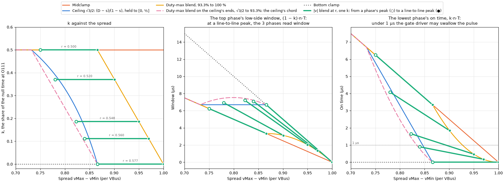

### The ceiling against a blend on |v|, not applied

Per vector, every placement splits the null time n = 1 − spread between the lowest duty b and the top phase's window n − b:

    midclamp                     b = n/2
    ceiling D                    b = clamp(n − (1 − D), 0, n/2)
    |v| blend                    b = k(|v|)·n, one k for the whole turn

- The motor doesn't see any of this. Its windings, a star with the neutral floating, see only the line-to-line voltages, which are the same for every placement; the zero sequence moves only the neutral point. A placement changes things per phase: the low-side windows, the ripple, which phases switch, and the pulse widths.
- Any k that falls continuously to 0 passes through a band where the lowest duty, b, stays under 1 µs. The gate driver's 520 ns dead time doesn't turn the high side on for a pulse that short.
  - Per turn, the band is a band of |v| and covers most of the turn there. The |v| blend's band sits where field weakening holds |v| on a Vbus/√3 circle, 0.95/√3 = 0.548·Vbus: 240° of the turn, and 360° at 0.56.
  - Per vector, the band is a band of spread, so at any one radius it covers part of the turn. The ceiling's is near Vbus/2: 148° at 0.50. At 0.548 the ceiling clamps a phase at 0 % for 291° of the turn and has narrow pulses for 34°.
- No dead-time compensation is configured. The FTM dead time is 0; the gate driver inserts its own. Each switching phase already carries an error of about ±DT/T, ±1 % of Vbus, set by the current's direction. A pulse the driver swallows stays inside that band; for one current direction it shrinks the error to the pulse width. Narrow pulses therefore cost switching events for little voltage and add no new distortion. A clamped phase has neither.

From [low_side_zero_sequence_blend.py](low_side_zero_sequence_blend.py).

#### The two blends in detail

The model is [svpwm_blend.py](svpwm_blend.py): `svpwm_clamp` fed each blend's k. It draws each blend's duties, zero sequence and k over one cycle at six radii: [SVPWM_Blend_Magnitude.png](SVPWM_Blend_Magnitude.png). The sweep over the radius is in [svpwm_blend_analysis.py](svpwm_blend_analysis.py). It prints these checks: the two k agree at each line-to-line peak, so the 3-phases-read window is the same; Each figure below comes from its own `svpwm_blend_<plot>.py`:

- k against the radius: one value over the cycle for the |v| blend [SVPWM_Blend_K.png](SVPWM_Blend_K.png)
- Where in a sector each blend lowers the zero sequence: the |v| blend most at the phase peaks [SVPWM_Blend_Shift.png](SVPWM_Blend_Shift.png)
- Each duty's range over a cycle against the radius, with midclamp's peaks. [SVPWM_Blend_Duty.png](SVPWM_Blend_Duty.png)
- k, the top window and the lowest phase's on time per vector, against the spread. Each per-vector placement is a curve; the |v| blend at one radius is a segment from a phase's peak to a line-to-line peak. [SVPWM_Blend_Schedule.png](SVPWM_Blend_Schedule.png)

