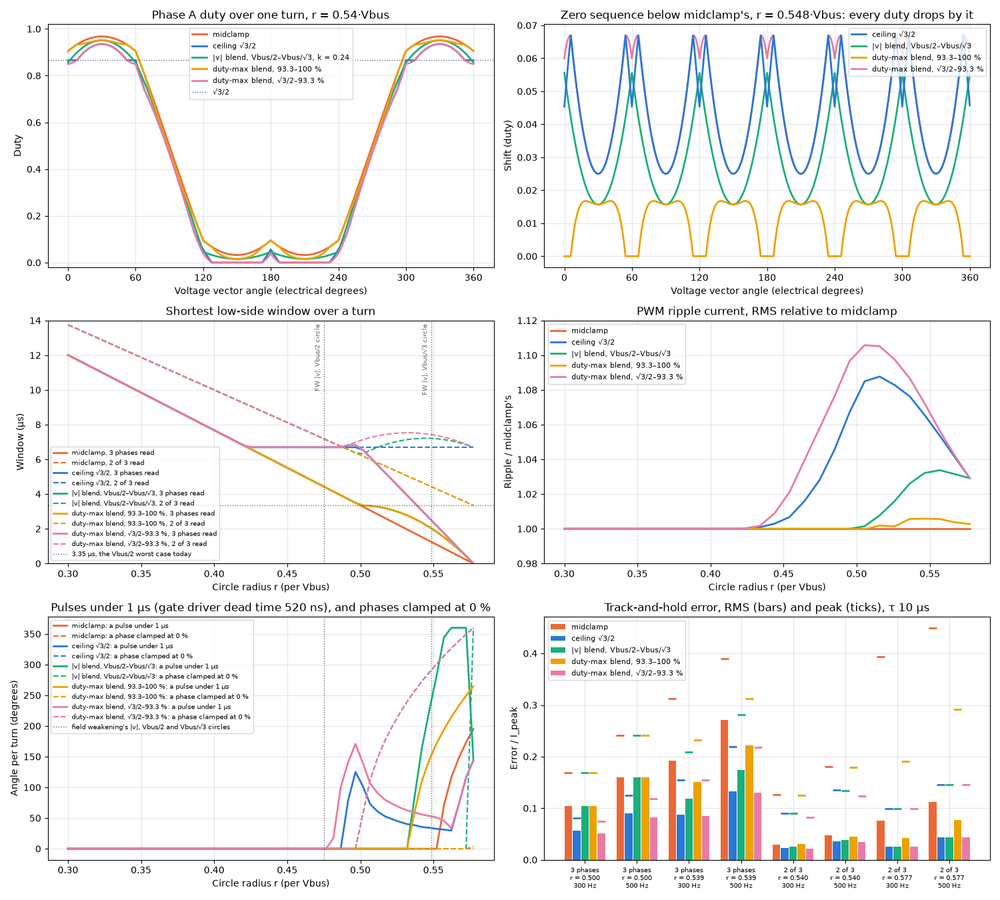
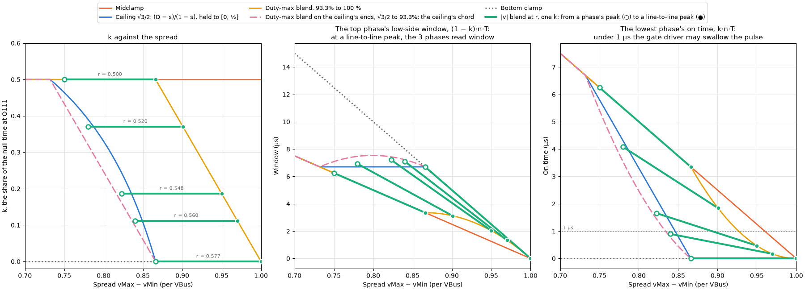

### The ceiling against a blend on |v| or on the duty max, evaluated 2026-10-25, not applied

A blend is midclamp up to a threshold, then k falls linearly to 0, the bottom clamp. On |v|, it runs from |v| = Vbus/2 (√3/2 of the linear limit) to Vbus/√3, with one k per turn: `svpwm_clamp` fed k(|v|). On the duty max, it runs on midclamp's highest duty at each vector, ½ + spread/2, which comes from the `vMax` and `vMin` every placement already finds. That moves k within the turn, as the ceiling does.

Per vector, every placement splits the null time n = 1 − spread between the lowest duty b and the top phase's window n − b:

    midclamp                     b = n/2
    ceiling D                    b = clamp(n − (1 − D), 0, n/2)
    duty-max blend, 93.3–100 %   b = min(n/2, (2 + √3)·n²),  vZero = max(midclamp's, vMin − (2 + √3)·n²)
    |v| blend                    b = k(|v|)·n, one k for the whole turn

- **At the line-to-line peak, the duty max is the magnitude.** Midclamp's highest duty over a turn is ½ + (√3/2)·|v|, so the |v| blend's ends, Vbus/2 and Vbus/√3, are a duty max of 93.3 % and 100 %. With those ends, both blends give the same k at each line-to-line peak. Between peaks the duty max falls to ½ + ¾·r at the sector boundary, and the duty-max blend returns to midclamp there.
- **Reading 3 phases, the duty-max blend matches the |v| blend's window for less ripple.** The shortest window falls at the line-to-line peak, so at every radius it equals the |v| blend's: 3.35 µs at Vbus/2, 2.03 µs at 0.548. The blend also needs no |v|.
  - Ripple is at most ×1.006, against ×1.034.
  - At 0.548 it has narrow pulses for 152° of the turn, against 240°. No phase is clamped below Vbus/√3.
  - At 0.539 it tracks worse: 0.232 / 0.150, against 0.209 / 0.118. The |v| blend's shift away from the peaks lengthens the other windows the hold sees.
  - Neither blend starts below Vbus/2, so neither changes today's radius. The ceiling halves the error at Vbus/2, 0.081 / 0.056, and at 0.539 it tracks at 0.155 / 0.087.
- **Reading 2 of 3, the duty-max blend gains nothing.** The kept phases' shortest window is at the sector boundary. There the top two duties tie and the duty max is at its lowest, ½ + ¾·r, at most 93.3 % over the linear range, so k stays ½.
  - The window is midclamp's at every radius: 4.43 µs at 0.548, against 7.21 µs (|v| blend) and 6.70 µs (ceiling).
  - At Vbus/√3 it tracks at 0.191 / 0.042, against 0.099 / 0.026.
  - The |v| blend puts most of its shift at the sector boundary. With one k over the turn, the shift (½ − k)·(1 − spread) is largest where the spread is smallest.
- **Lowering the ends to serve 2 of 3 lands on the ceiling.** Reaching k = 0 at the sector boundary at Vbus/√3 needs the end at a duty max of 93.3 %. Started where the ceiling starts, at √3/2, the blend runs between the ceiling's own ends, spread 2·(√3/2) − 1 to √3/2.
  - Between those ends the ceiling's k, (√3/2 − spread)/(1 − spread), is concave, and the blend's linear k is its chord. So the blend lowers the zero sequence further at every vector in between.
  - It tracks slightly better: 0.074 / 0.051 against 0.081 / 0.056 at Vbus/2, 0.082 / 0.022 against 0.090 / 0.023 reading 2 of 3 at 0.54, and the same at Vbus/√3. For 2 of 3 it keeps 7.1–7.5 µs, against 6.70 µs.
  - It pays ×1.103 ripple, against ×1.078, and has narrow pulses for 188° of the turn, against 148°, at Vbus/2.
  - The ceiling is the least shift that holds the top duty to D. Any per-vector schedule that also holds it lowers the zero sequence at least as far.
- None of them jumps: the largest duty step between angles 0.01° apart is 0.018 % or less. The ceiling and the duty-max blends add slope corners in the zero sequence, up to 30 a turn, where their ramp starts inside the turn; the |v| blend keeps midclamp's 6.
- The motor doesn't see any of this. Its windings, a star with the neutral floating, see only the line-to-line voltages, which are the same for every placement; the zero sequence moves only the neutral point. A placement changes things per phase: the low-side windows, the ripple, which phases switch, and the pulse widths.
- Any k that falls continuously to 0 passes through a band where the lowest duty, b, stays under 1 µs. The gate driver's 520 ns dead time doesn't turn the high side on for a pulse that short.
  - Per turn, the band is a band of |v| and covers most of the turn there. The |v| blend's band sits where field weakening holds |v| on a Vbus/√3 circle, 0.95/√3 = 0.548·Vbus: 240° of the turn, and 360° at 0.56.
  - Per vector, the band is a band of spread, so at any one radius it covers part of the turn. The ceiling's is near Vbus/2: 148° at 0.50. At 0.548 the ceiling clamps a phase at 0 % for 291° of the turn and has narrow pulses for 34°.
  - The 93.3–100 % duty-max blend's b falls to 0 as n², so its band is wide: from 93° at 0.54 to 265° at Vbus/√3.
- No dead-time compensation is configured. The FTM dead time is 0; the gate driver inserts its own. Each switching phase already carries an error of about ±DT/T, ±1 % of Vbus, set by the current's direction. A pulse the driver swallows stays inside that band; for one current direction it shrinks the error to the pulse width. Narrow pulses therefore cost switching events for little voltage and add no new distortion. A clamped phase has neither.
- Outcome: the duty max can drive the shift, and the ceiling already takes it from there, as `vMax − D`. What a blend adds, one k per turn and so a shift at the sector boundary for 2 of 3, needs |v|: either 2/3·Σv² from the three phases, or |v_dq| from FOC, which `FOC_ProcIdFieldWeakening` already computes each cycle.

From [low_side_zero_sequence_blend.py](low_side_zero_sequence_blend.py).

#### The two blends in detail

The model is [svpwm_blend.py](svpwm_blend.py): `svpwm_clamp` fed each blend's k. It draws each blend's duties, zero sequence and k over one cycle at six radii: [SVPWM_Blend_Magnitude.png](SVPWM_Blend_Magnitude.png) and [SVPWM_Blend_DutyMax.png](SVPWM_Blend_DutyMax.png). The sweep over the radius is in [svpwm_blend_analysis.py](svpwm_blend_analysis.py). It prints these checks: the two k agree at each line-to-line peak, so the 3-phases-read window is the same; the duty-max blend's 2-of-3 window is midclamp's; and its lowest duty is min(n/2, (2 + √3)·n²). Each figure below comes from its own `svpwm_blend_<plot>.py`:

- k against the radius: one value over the cycle for the |v| blend, a range for the duty-max blend and the ceiling. [SVPWM_Blend_K.png](SVPWM_Blend_K.png)
- Where in a sector each blend lowers the zero sequence: the |v| blend most at the phase peaks, the duty-max blend only around the line-to-line peak. [SVPWM_Blend_Shift.png](SVPWM_Blend_Shift.png)
- Each duty's range over a cycle against the radius, with midclamp's peaks. [SVPWM_Blend_Duty.png](SVPWM_Blend_Duty.png)
- k, the top window and the lowest phase's on time per vector, against the spread. Each per-vector placement is a curve; the |v| blend at one radius is a segment from a phase's peak to a line-to-line peak, and the duty-max blend passes through each segment's line-to-line end. [SVPWM_Blend_Schedule.png](SVPWM_Blend_Schedule.png)

