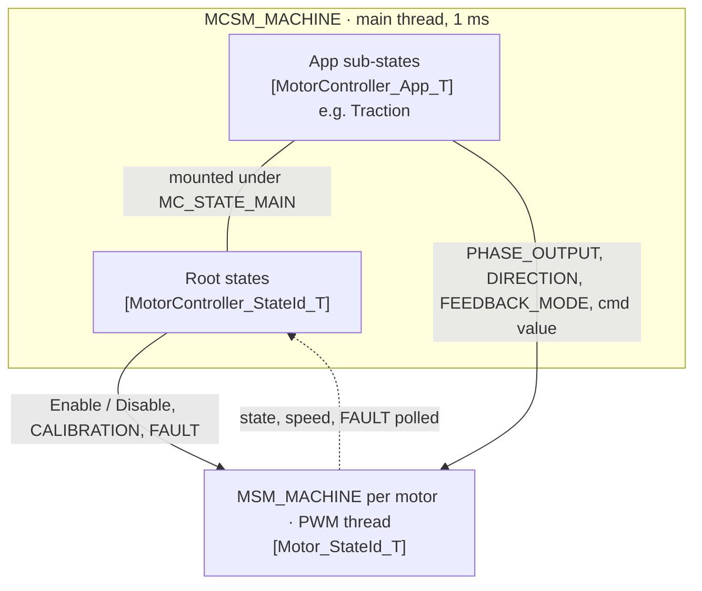

# Motor Control State Machines

Motor control runs two hierarchical state machines on one engine,
[Framework/StateMachine](../../Framework/StateMachine/Architecture.md): an `MSM_MACHINE` per motor, and one
`MCSM_MACHINE` for the controller, which holds the system states and, under `MC_STATE_MAIN`, the app's sub-states.
This page is the overview and the design decisions. The detail is in:

- [Motor_StateMachine.md](Motor_StateMachine.md): each motor state, input, action, fault and sub-state.
- [MotorController_StateMachine.md](MotorController_StateMachine.md): the controller's states, lock operations,
  faults and write admission, and the Traction app.

## Layers

| Layer | Owns | Does not know |
|---|---|---|
| Motor | the phase output and what gates it, the feedback loops, speed estimation, start-up and calibration procedures, motor faults, direction `CW` / `CCW` / `NULL` | `STANDBY`, `NEUTRAL`, `DRIVE`; the other motors |
| MotorController | boot, multi-motor coordination, system faults, `STANDBY`, `LOCK` (calibration, NVM), live tuning, write admission, motors `DEACTIVATED` ⇄ `PASSIVE` | app states and inputs |
| App, e.g. Traction | `NEUTRAL` / `DRIVE`, `FORWARD` / `REVERSE`, the throttle, brake and lever mapping, release behavior, direction-change checks, motors `PASSIVE` ⇄ `RUN` and the brake hold | |

| Machine | Proc | Inputs |
|---|---|---|
| `MSM_MACHINE` | PWM thread, 20 kHz; actions on the 1 kHz speed tick and on each phase-current sample | main thread, applied on the call under the engine's lock |
| `MCSM_MACHINE` | main thread, 1 ms | main thread, applied on the call, no lock needed; fault sets also from the 1 ms timer thread |

- The app is not a separate machine. Its states are sub-states of `MC_STATE_MAIN`, run by `MCSM_MACHINE` on the
  same thread, and its inputs arrive as `MC_STATE_INPUT_APP_USER`.
- Each motor runs on its own. The controller reaches them all through `Motor_Table_T`: a command goes to every
  motor, and a guard requires every motor.

## Across the layers: Traction

| Controller | App | Motor states | Motor direction | Phase output |
|---|---|---|---|---|
| `STANDBY` | — | `DEACTIVATED` | `NULL` | float |
| `MAIN` | `NEUTRAL` | `PASSIVE`; `RUN`, `INTERVENTION` while braking | retained | float; PWM while braking |
| `MAIN` | `DRIVE` | `PASSIVE`, `RUN`, `INTERVENTION` | `FORWARD` / `REVERSE` | V0 or float at rest; PWM on throttle and brake; release by `ZeroMode` |
| `LOCK` | — | `CALIBRATION` | `NULL` | V0 |
| `FAULT` | — | `FAULT` | as it was | V0 on overvoltage or above the freewheel limit, else float |

- Direction has two frames. The user frame, `FORWARD` / `REVERSE`, is what Traction buffers and sends. The motor
  maps it to `CW` / `CCW` through `Config.DirectionForward`; `Motor_Context_T.Direction` and the FOC voltage
  half-plane hold the result.
- Commands go down as inputs. The controller and the app never set a motor's state; they send motor inputs
  (`PHASE_OUTPUT`, `DIRECTION`, `FEEDBACK_MODE`, `INTERVENTION`, `CALIBRATION`, `FAULT`) and transition commands
  (`Motor_Enable`, `Motor_Disable`), and the motor's own guards decide. Command values (`UserCmd`) bypass both
  machines; the active motor state reads them.
- Status goes up by polling. Controller guards read every motor's state and speed when an input arrives. Motor
  faults reach the controller on its 1 s poll.

| Interlock | Enforced by |
|---|---|
| `RUN` needs a direction and live sensor feedback | motor, `PASSIVE` |
| A direction changes only at zero speed | Traction (`NEUTRAL`, lever engage), then the motor again (`PASSIVE`, `OPEN_LOOP`, `CALIBRATION`); `RUN` and `INTERVENTION` ignore it |
| Asking for the opposite direction while moving keeps `NEUTRAL` and blinks the buzzer | Traction |
| A release above the freewheel limit decelerates instead of floating | motor, `RUN` and `INTERVENTION` |
| Leaving `MAIN` or `MOTOR_TUNING` needs every motor `DEACTIVATED`, or `PASSIVE` at zero speed | controller |
| `LOCK` from `STANDBY` needs every motor `DEACTIVATED`; `CALIBRATION` needs zero speed | controller, motor |
| `LOCK` exit and fault clear land in `STANDBY`, never live `MAIN` | controller |
| Boot faults if any motor is not `DEACTIVATED` once its init is done | controller, `INIT` |
| A throttle held while `DRIVE` is entered does not start the motor | Traction |
| Serial input loss safe-stops every motor, then faults | controller |
| A motor fault stops that motor at once; the controller follows within 1 s | motor, controller |

## Engine conventions both machines rely on

From [Architecture.md](../../Framework/StateMachine/Architecture.md):

- One leaf pointer per machine; the active states are the leaf and its parents. No orthogonal regions, no history.
- A handler returns `NULL` to stay, which may still change context (an internal transition); the current state, to
  re-enter it; or another state, to exit up to the common ancestor and enter down from it.
- Inputs walk from the leaf to the root. An unmapped slot defers to the parent. A child that maps an input and
  returns `NULL` refuses it for its whole branch.
- `NEXT` is the clock transition, run after `LOOP`, leaf first: while a node's `NEXT` returns `NULL`, its parent's
  `LOOP` and `NEXT` run in the same cycle. That is how `SAFE_STOP` runs `SPEED_ZERO`'s loop.
- Actions (`P_ACTION_TABLE`) reach the leaf only; a child that needs its parent's action shares the table.
- Sub-states are `const State_T` in the file that owns them, with `P_TOP` set to a published root. The machine
  definition does not list them.
- `EXIT` is compiled out (`STATE_MACHINE_EXIT_FUNCTION_ENABLE` is not defined), so transition work is in `ENTRY`.
  Returning from a leaf to its own root does not re-run the root's `ENTRY`.
- A sub-state id is unique only among its siblings; `*_GetPathId` packs the whole path, 4 bits per level.

## Design decisions

### State design rules

- A new state is justified by a different safety envelope, not a different purpose.
- One-shot automated procedures get a state; interactive parameter adjustment does not.
- Orthogonal concerns get orthogonal mechanisms: what control structure is running is a separate concern from
  what input source is connected. So the feedback mode is data (`Motor_FeedbackMode_T`), not a state, and so are the
  input source (`Config.InputMode`) and the `STANDBY` exit policy (`StandbyExitMode`).
- `LOCK` is for operations the operator must commit to and acknowledge as risky, outside normal operation.
- The operator's use case does not conflate with the system's state.

### Controller

- **The root does not know app states or inputs.** An app mounts its sub-states under `MC_STATE_MAIN` through
  `MotorController_App_T`: `ENTER_MAIN` picks the entry sub-state, `PROC_ANALOG_USER` maps the analog inputs,
  `INIT` loads its config. Its inputs share one id, `MC_STATE_INPUT_APP_USER`, whose value is the app's own enum.
  The app runs in the controller's machine rather than a nested one, so its sub-states inherit `MAIN`'s handlers
  for state commands and faults. A nested machine on a narrower context (`Motor_Table_T`) would give the app its
  own input alphabet; it remains the alternative. The app is chosen at compile time (`P_APP`), in a shape that
  allows a runtime choice later.
- **One parked state.** `STANDBY` belongs to the root, so every app shares it.
- **Inputs are buffered, not events.** The user may select a direction while parked; the controller stores it, and
  entering `MAIN` uses it. A direction selection does not cause a transition. `STANDBY` accepts state commands
  only: motor and app inputs are buffered by their callers and consumed when `MAIN` is entered.
- **Safe landings.** `LOCK` exit and fault clear always land in `STANDBY`, never in live `MAIN`, and `MAIN` is left
  only with the motors stopped.
- **Exit policy as data.** The `STANDBY` exit policy, `StandbyExitMode`, is runtime data resolved at init from the
  input topology. That keeps the input mode and the Park input out of the machine. An explicit park latches
  `MANUAL`, so a host that parked holds `STANDBY`; a reboot restores the resolved mode.
- **Write admission belongs to the controller** ([0001](../../Docs/Decisions/0001_ParameterWriteAdmission.md)).
  Whether a write is safe now is lifecycle reasoning that applies to any parameter, so the controller decides it
  from its own state. The motor machine gates outputs, the electrical hazard, and nothing else.

### Motor

- **Direction does not drive transitions.** A layer above must be able to store a direction while it holds its own
  safe state: a state is left on the loss of any one condition, but entering one can take more than one. So setting
  a direction never starts the motor; `PWM` does, given a direction and feedback. `DEACTIVATED` resets the
  direction. `NULL` could double as a disable, but no other value could act as an enable, so it does not.
- **Intervention is a motor-level supervisor**: active control on its own path, with the user's command taken out
  of the loop. Its states are named by the quantity forced to zero, not by the mechanism; `SPEED_RAMP_ZERO` was
  rejected because the ramp's slope is a parameter. The nearest standard stop functions:

| Here | Nearest standard stop function |
|---|---|
| `PASSIVE`, floating | Safe Torque Off (IEC 61800-5-2), without a safety-rated channel |
| `PASSIVE` or `FAULT` holding V0 above the freewheel limit | active short circuit |
| `SPEED_ZERO` | CiA 402 Halt: decelerate, stay enabled, resumable |
| `SAFE_STOP` | SS1-d (IEC 61800-5-2), CiA 402 Quick Stop option 1; no safety-rated monitoring channel |
| `TORQUE_ZERO` | none: it never converges, it inhibits motoring |

- **The freewheel limit is the rated speed**, where the back-EMF reaches the nominal voltage. Below it a floating
  bridge is safe; above it the back-EMF rectifies into the bus, uncontrolled. So above it a release decelerates
  through `SPEED_ZERO`, and `PASSIVE` and `FAULT` hold V0.
- **Fault is an ordinary root**, not the engine's fault-state template. Its input carries the set and clear deltas
  in one value (`Motor_FaultCmd_T`, `MotorController_FaultCmd_T`), so no caller reads, modifies and passes back the
  whole flag word. Flags alone are inert outside `INIT`: the transition into `FAULT` is what stops the motor, so a
  procedure that finds a fault returns `FAULT` itself. A clear re-polls the conditions before leaving.
- **Each driving state writes its own duty**, in its `LOOP`, right after computing it. Hold states write nothing,
  and the PWM thread writes no duty. A thread-level write had overwritten V0 with the last vector, so a `FAULT`
  entry above rated speed re-applied the last `RUN` voltage; deciding in the thread by reading the duty back is
  racy, since a duty written in the same ISR loads only at the next load point.
- **Bumpless entry.** `RUN` and `INTERVENTION` resolve their limits first, then match the loops to the present
  output. A feedback-mode change re-enters `RUN` instead of passing through `PASSIVE`, so the loops re-match
  without coasting.
- **Feedback mode as data.** `RUN` reads the feedback mode; open loop is a branch of its own (`OPEN_LOOP`). `RUN`
  runs the current loop in every mode, so voltage modes are not sent.

### Inputs and threads

- **One input per subtree.** A sub-state entered from many sources is reached through its subtree's input, which
  carries a `State_T *` (`OPEN_LOOP`, `CALIBRATION`, `INTERVENTION`). The tree does the acceptance: sources that
  share a parent take the parent's handler, which checks `P_TOP`, and an exception overrides at the child
  (`SAFE_STOP` refuses). A target already on the active branch is a no-op, so repeated requests hold without
  re-entry; the brake hold sends `Motor_ApplySpeedZero` with every brake value. Rejected:
  - engine-iterated source lists of `StateMachine_TransitionCmd_T`: acceptance moves out of the states, exclusions
    must be listed, and every handler needs a repeat guard;
  - a request enum: it only renames the sub-states. Inside the firmware the pointer is the id; enums belong at the
    wire, as the var ids;
  - a whitelist of pointers: it loses to the structural `P_TOP` check;
  - one generic target-state input for every subtree: it brings the whitelist back into `PASSIVE` and
    `DEACTIVATED`.
- **Transition commands for single sources.** A `StateMachine_TransitionCmd_T` names its start state, acts only
  while that state is on the active path, and needs no input id. `Motor_Enable`, `Motor_Disable`, and every
  procedure started from inside its branch use one.
- **The controller's inputs run on its proc thread**, so they need no lock. The motor's inputs cross from the main
  thread to the PWM thread, so they apply under the engine's lock: `STATE_MACHINE_ASYNC_CRITICAL` masks IRQs for
  the handler and the transition, and the PWM ISR never runs between an exit and an entry. A fault set from the
  controller's 1 ms timer thread can be lost to a transition it interrupted; the 1 s re-send of the latched flags
  covers it.
- **Motors are polled, not notified.** A motor stops on its own fault at once; the controller's poll only moves the
  system state.

### Layering

- **The app sends the motor signed commands in the motor's frames and never sets its state.** The motor owns
  continuity through zero speed: its direction limits the voltage to a half-plane, which blocks plugging. How much
  plugging to allow near zero is the motor's to decide, behind the same contract.

## Open and deferred

- **Direction end state**, deferred 2026-10-17. The direction stays a selectable lock: `Motor_SetDirection` writes
  the field and the FOC voltage half-plane. A symmetric voltage limit plus a window around the back-EMF is the
  likely end; the arming gates, the motoring / generating key and `Motor_UserMotoringOf` must stop reading the
  direction first. See [VLimitPolicy.md](VLimitPolicy.md).
- **Sub-state ids.** The motor's sub-states and Traction's states carry no ids yet and report their root.
  `MAIN`'s depth-1 id space is shared by `MotorController_MainSubStateId_T` and the app's ids, which can collide;
  `MotorController_App_T` is where a base or range would be allocated.
- **Safe stop gaps.** Against SS1 and Quick Stop, `SAFE_STOP` ends in `PASSIVE`, not a restart-interlocked state
  like CiA 402 Switch On Disabled; its standstill test is exact zero; and without sub-state ids a CiA 402 adapter
  cannot report Quick Stop Active.
- **Output image.** A buffered phase-output image, written by the states and transferred by the PWM thread as the
  only register writer, was considered and deferred.

Ideas from the first draft, not designed: app modes such as crawl, sport, eco and hill hold; per-motor traction
control and torque vectoring; automated parking; launch control.
