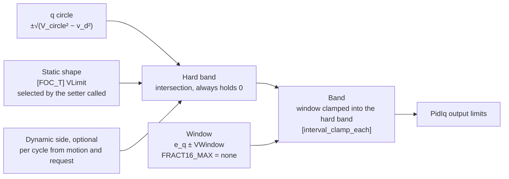

# V Limit Policy

The q-axis voltage band of the current loop: where [FOC_T] `VLimit` lets v_q go each cycle, and what that does to current control. Not wired yet. The pieces live in `Motor/Motor/Math/foc_math.h` and `Motor/Motor/Math/FOC.h`.

## Composition

- [foc_vq_band]: circle ∩ static shape, then the window clamped in.
- [_foc_vdynamicband]: the same, with a dynamic side intersected into the hard band.
- Every shape and side holds 0, so the hard band is never empty.
- The window can miss the circle above base speed. Clamping each bound in, rather than intersecting, then gives the circle edge nearest the back-EMF.

## How a v_q band becomes current control

In steady state `i_q = (v_q − e_q) / |Z|`, with `e_q` the back-EMF (ω·ψ + ω·L_d·i_d) and `|Z| = R` at stall.

- So a v_q band maps to a reachable i_q band: `[(low − e_q) / |Z| : (high − e_q) / |Z|]`.
- A request outside it saturates the loop. The current is then set by `e_q`, not by the request or the I limits.

Every behavior below follows from that one relation. The examples use KMC's 90 mΩ.

## Static shapes

Selected by which setter the caller uses. No enum.

| Setter | Shape | Forward motion (e_q > 0) | Rollback against a forward request (e_q < 0) |
|---|---|---|---|
| [FOC_SetVAntiPlugging] (direction lock) | Half-plane along the locked direction | Braking reaches at most \|e_q\|/\|Z\|, fading to nothing at zero speed | Forward i_q ≥ \|e_q\|/R. Holds by plug braking at low speed. Past R·I_limit (18 V at 200 A) the current is \|e_q\|/\|Z\|, outside the I limits |
| [FOC_SetVSymmetric] | Full circle | Any i_q within the I limits | Any i_q within the I limits |
| [FOC_SetVSymmetric] + [FOC_SetVWindow] | Full circle, window around e_q | Any i_q, and \|i_q\| ≤ w/\|Z\| even if the loop stops tracking | Same |
| [0:0] | Closed | v_q = 0: short-circuit current \|e_q\|/\|Z\| | Same |

## Dynamic sides

Evaluated per cycle from the motion and the request:
- **Motion** is sign(ω·ψ); [_foc_vmotion_sign] falls back to the request at standstill.
- **Request** is sign(i_q).
- **Braking** means the request opposes the motion; **coast** means no request while moving.

Measured per case:

| Case | [_foc_vnoplugging] | [_foc_vbrakeoverlay] | [_foc_vregenonly] | [_foc_vpluggingonly] |
|---|---|---|---|---|
| Motoring | Motion side | Both | Both | Against motion |
| Braking, including rollback against the request | Motion side | Motion side | Motion side | Against motion |
| Coast | Motion side | Both | Motion side | Against motion |
| Standstill with a request | Request side | Both | Request side | Closed |
| Standstill, no request | Closed | Both | Closed | Closed |

## Behaviors compared

| Policy | Braking current | Hill hold (rollback against the request) | Through zero speed | Zero-speed noise |
|---|---|---|---|---|
| Direction lock | Regen only, ≤ \|e_q\|/\|Z\| | Plug-holds, then unenforced past R·I_limit | Braking fades; reversing needs a Direction change | None, static |
| Symmetric | Any, within the I limits | Holds at any rollback speed | Braking continues into reverse; command policy must stop it | None |
| Symmetric + window | Any, and ≤ w/\|Z\| as a backstop | Holds while R·i_q ≤ w | As symmetric | None |
| [_foc_vnoplugging] | Regen only, ≤ \|e_q\|/\|Z\| | Rolls back until \|e_q\| = R·I_hold (100 A hold: 9 V) | Side follows the request at standstill, so it reverses with the request | Side flips with the sign of ω·ψ |
| [_foc_vbrakeoverlay] | Regen only, ≤ \|e_q\|/\|Z\| | As noplugging | Both sides at standstill | Flips only for a braking request |
| [_foc_vregenonly] | Regen only, ≤ \|e_q\|/\|Z\| | As noplugging | As noplugging | As noplugging |
| [_foc_vpluggingonly] | At least \|e_q\|/\|Z\|: never less, outside the I limits once \|e_q\|/\|Z\| > I_limit | Holds, the same as the forward lock | Brakes to zero, then closed | Side flips with the sign of ω·ψ |

Notes:
- **noplugging, brakeoverlay and regenonly differ only outside braking.**
  - noplugging also holds motoring and coast to the motion's side.
  - brakeoverlay leaves motoring, coast and standstill unrestricted.
  - regenonly leaves motoring unrestricted, and holds coast and standstill.
  - In steady state motoring never needs v_q opposite e_q. The difference is the transient room to pull current down quickly when a motoring request drops.
- **pluggingonly is a low-speed brake.** It can't produce less braking than \|e_q\|/\|Z\|. It's valid only while \|e_q\| < R·I_limit, unless the window bounds it.
- **Motion-keyed sides need a deadband.** The sign of ω·ψ toggles with sensor noise near zero, and each toggle flips the half-plane. The motion key should come from [hysteresis_sign], which needs its previous sign held in state.

## Wiring, when taken up

- Initialize `Foc.VWindow` to FRACT16_MAX. Zero, the init value, pins v_q to e_q.
- Replace the `vqBand` lines in `FOC_ProcIFeedback_Base` and `FOC_ProcIFeedback_Decouple` with [FOC_VqBand], or [_foc_vdynamicband] when a dynamic side is in use. The side needs i_q's request and ω·ψ, both available there.
- Hold the motion key's previous sign for [hysteresis_sign].
- Readers of Direction that aren't about the lock move first. The list is in the Direction end-state note: arming, Mot/Gen key, TorqueZero filter, readbacks, [Motor_IsSpeedAligned], and the motoring command frame.
