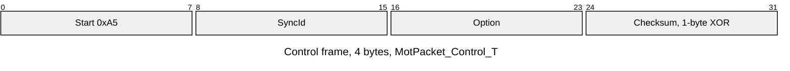
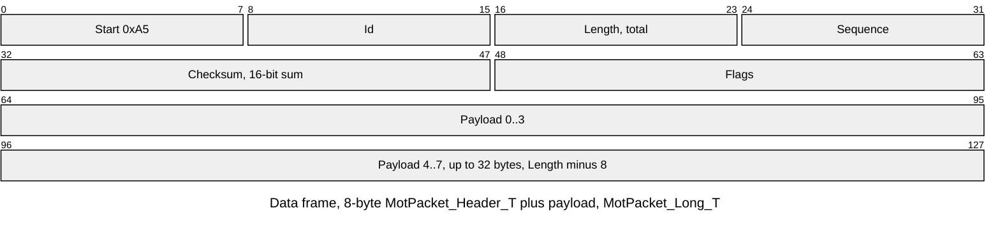
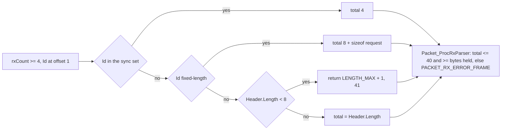

# MotPacket Frame

The two wire shapes of the MotPacket codec (`MOT_PACKET_CODEC`), what each check covers, how the wire length field relates to the engine's payload length, which ids have a fixed size, and the bounds the receive parser applies. Board-agnostic: the codec is bound per socket; nothing here depends on the transport.

## Shapes

Which shape a frame has is a function of its Id alone. `MotPacket_ParseLength` answers it on Rx (frame size), `IsSyncShape` on Tx and for `Meta` extraction. Both lists must agree; a disagreement is what `PROTOCOL_CHECK_RX_FRAME_CONSISTENCY` would catch, and it is compiled out by default.

Offsets 0 and 1 coincide in both shapes, so `Meta.Id` is read from offset 1 before the shape is known.

## What the check covers

| Shape | Field | Covers | Built by | Verified on Rx |
|---|---|---|---|---|
| Control | `Checksum`, 1 byte at offset 3 | `Start ^ SyncId ^ Option` | `MotPacket_BuildControl` | No. `MotProtocol_IsRxValid` returns true for any 4-byte frame |
| Data | `Checksum`, 16 bits at offsets 4..5 | Byte sum of offsets 0..3 and 6..Length−1: Start, Id, Length, Sequence, Flags, Payload. The field itself is skipped | `MotPacket_BuildHeader` → `MotPacket_Checksum` → `Packet_Checksum(frame, Length, offsetof Checksum, 2)` | Yes, over the bytes the parser collected (`MotProtocol_IsRxValid`) |

`Packet_Checksum` takes the "bytes before and after the field" form when the frame extends past the field (total > 6) and the trailer form otherwise. With a data total of at least 8 enforced below, a data frame always takes the first form, so no span is negative.

## `Header.Length` and `Meta.Length`

| | `MotPacket_Header_T.Length` (wire) | `Packet_Meta_T.Length` (engine, handlers) |
|---|---|---|
| Meaning | Total bytes on the wire, header included | Payload bytes only |
| Control frame | No field. The size, 4, comes from the id | 0 |
| Data frame, Rx | Read by `MotPacket_ParseLength` to size the frame | `Header.Length − 8`, written by `MotProtocol_ParseRxHeader`; `Sequence`, `Flags` copied, `Source`/`Dest` untouched |
| Data frame, Tx | `payload + 8`, written by `MotPacket_BuildHeader`; `Sequence` echoes the request's (`Meta.Sequence`, carried Rx→Tx by the engine; 0 when answering a control frame), `Flags` written 0 | Set by the handler; `MotProtocol_BuildTxHeader` converts |
| Range | 8..40 accepted | 0..32, `MOT_PACKET_PAYLOAD_LENGTH_MAX` |

The conversion happens only in the codec. A handler sees `Meta.Length` and `Packet_PayloadOf(buffer, FRAME_FORMAT)`, where the row's `FRAME_FORMAT` is `MOT_FRAME_SYNC` (header 4) or `MOT_FRAME_DATA` (header 8), both with `BODY_LENGTH` 0, variable.

## Ids and their shape

Sync shape, 4 bytes, no payload. The set in `IsSyncShape` and the sync cases of `MotPacket_ParseLength`:

| Id | Value | Role |
|---|---|---|
| `MOT_PACKET_PING` | 0xA0 | Request. Bound to `Ping`, which answers with `SYNC_ACK`, also sync shape |
| `MOT_PACKET_SYNC_ACK` | 0xA2 | Codec `ACK_ID`, `PACKET_CLASS_ACK` |
| `MOT_PACKET_SYNC_NACK` | 0xA3 | Codec `NACK_ID` |
| `MOT_PACKET_SYNC_ABORT` | 0xA4 | Codec `ABORT_ID`; also `MOT_PACKET_DATA_MODE_ABORT` |
| `MOT_PACKET_PING_ALT` | 0xAA | Sync shape, no handler in the controller table |
| `MOT_PACKET_PING_BOOT` | 0xAB | Sync shape, no handler in the controller table |

Fixed-length data ids. `MotPacket_ParseLength` returns the total from the id; the `Length` byte on the wire does not size the frame for these:

| Id | Value | Request total | Request payload | Response payload (handler `Meta.Length`) | Response total |
|---|---|---|---|---|---|
| `MOT_PACKET_STOP_ALL` | 0x00 | 8 | `MotPacket_StopReq_T`, 0 | `MotPacket_StopResp_T`, 2 | 10 |
| `MOT_PACKET_VERSION` | 0x01 | 8 | `MotPacket_VersionReq_T`, 0 | `MotPacket_VersionResp_T`, 12 | 20 |
| `MOT_PACKET_CALL` | 0xC0 | 16 | `MotPacket_CallReq_T`, 8 | `MotPacket_CallResp_T`, 6 | 14 |
| `MOT_PACKET_FIXED_VAR_READ` | 0xB1 | 12 | `MotPacket_VarReadFixedReq_T`, 4 | `MotPacket_VarReadFixedResp_T`, 4, as returned by `MotorController_ReadVar` | 12 |
| `MOT_PACKET_FIXED_VAR_WRITE` | 0xB2 | 16 | `MotPacket_VarWriteFixedReq_T`, 8 | `MotPacket_VarWriteFixedResp_T`, 1, as returned by `MotorController_WriteVar` | 9 |

Variable-length data ids. The wire `Length` sizes the frame:

| Id | Value | Request payload, max | Response payload |
|---|---|---|---|
| `MOT_PACKET_VAR16_READ` | 0xB3 | 16 × `uint16_t` id, 32 B | up to 16 × `uint16_t` |
| `MOT_PACKET_VAR16_WRITE` | 0xB4 | 8 × {id, value}, 32 B | 8 status bytes |
| `MOT_PACKET_VAR32_READ` | 0xB5 | 8 × `MotPacket_VarReadFixedReq_T`, 32 B | up to 8 × `uint32_t` |
| `MOT_PACKET_VAR32_WRITE` | 0xB6 | 4 × `MotPacket_VarWriteFixedReq_T`, 32 B | 4 status bytes |
| `MOT_PACKET_MEM_READ` | 0xD1 | `MotPacket_MemReadReq_T`, 8 B | up to 32 B, `Size` clamped |
| `MOT_PACKET_MEM_WRITE` | 0xD2 | `MotPacket_MemWriteReq_T`, 8 + 16 B | `MotPacket_MemWriteResp_T`, 2 |
| `MOT_PACKET_DATA_MODE_READ` 0xDA, `_WRITE` 0xDB, `_ERASE` 0xDC, `_DATA` 0xDD | | `MotPacket_DataModeReq_T`, 12 B; `_DATA` up to 32 B | `MotPacket_DataModeResp_T`, 2. Bound only under `MOTOR_CONTROLLER_FLASH_LOADER_ENABLE`; `_ERASE` only in the flash loader's own table |

Unbound values: `MOT_PACKET_PING_RESP` 0xA1 (neither sync nor fixed, see below), `MOT_PACKET_SYNC_RESV` 0xA5 (the start byte). Any id without a row is nacked by `Protocol_StartRequest` and counted in `Stat.NoHandler`.

## Parser bounds

| Constant | Value | Effect |
|---|---|---|
| `LENGTH_MIN` | 4, `sizeof(MotPacket_Control_T)` | Bytes collected after the start byte before `PARSE_RX_LENGTH` is first asked. A data id's `Length` byte, offset 2, is already in hand, so the answer comes on the first call |
| `LENGTH_MAX` | 40, `MOT_PACKET_LENGTH_MAX` | The frame buffer; `Packet_ProcRxParser` refuses a resolved length above it, `PACKET_RX_ERROR_FRAME` |
| `MOT_PACKET_PAYLOAD_LENGTH_MAX` | 32 | `LENGTH_MAX − 8` |
| `START_ID`, `START_ID_LENGTH` | 0xA5, 1 | One-byte delimiter; a non-matching byte is discarded and the scan restarts |
| `CONTROL_FRAME_LENGTH` | 4 | `Protocol_TxControl` builds ack, nack and abort on a stack frame of `PACKET_CONTROL_LENGTH_MAX` |
| `RX_TIMEOUT` | `MOT_PACKET_RX_TIMEOUT`, 1000 ticks of the socket's `P_TIMER` | A frame stalled part way is dropped and nacked, `Stat.RxTimeouts` |

How a data id's wire `Length` is admitted:

| `Header.Length` on a data id | `MotPacket_ParseLength` | Outcome |
|---|---|---|
| 0..7 | 41, `LENGTH_MAX + 1` | `PACKET_RX_ERROR_FRAME`: nack, `Stat.FrameErrors`. Before this guard a total of 4..7 wrapped the checksum span and the `Meta.Length` subtraction |
| 8 | 8 | Header only, `Meta.Length` 0 |
| 9..40 | the value | Payload `Length − 8` |
| 41..255 | the value | Above `LENGTH_MAX`: `PACKET_RX_ERROR_FRAME` |

`MotProtocol_ParseRxHeader` repeats the `< 8` test and writes `Meta.Length` 0 for it. On a variable-length id that branch is unreachable once the parser accepted the frame; a fixed-length id, sized from the id, still reaches it when its wire `Length` byte is under 8, and then gets `Meta.Length` 0 instead of a wrapped value.

Sources: `MotPacket.h` (`MotPacket_Id_T`, `MotPacket_Control_T`, `MotPacket_Header_T`, `MotPacket_Long_T`, the payload structs, `MOT_PACKET_LENGTH_MIN`, `MOT_PACKET_LENGTH_MAX`, `MOT_PACKET_PAYLOAD_LENGTH_MAX`); `MotPacket.c` (`MotPacket_Checksum`, `MotPacket_BuildControl`, `MotPacket_BuildHeader`, `IsSyncShape`, `MotPacket_ParseLength`, `MotProtocol_IsRxValid`, `MotProtocol_ParseRxHeader`, `MotProtocol_BuildTxHeader`, `MOT_FRAME_SYNC`, `MOT_FRAME_DATA`, `MOT_PACKET_CODEC`); `Framework/Protocol/Packet.h` (`Packet_Meta_T`, `Packet_FrameFormat_T`, `Packet_Codec_T`, `Packet_Checksum`, `Packet_PayloadOf`, `Packet_IsFrameConsistent`); `Framework/Protocol/Packet_RxParser.h` (`Packet_ProcRxParser`, `Packet_ProcRxTimeout`); `Framework/Protocol/Protocol.h` (`Protocol_ProcRxFrame`, `Protocol_TxControl`, `Protocol_StartRequest`, `PROTOCOL_CHECK_RX_FRAME_CONSISTENCY`); `MotorController/MotorController_MotProtocol.c` (`MOTOR_CONTROLLER_MOT_PROTOCOL_REQ_TABLE`, `Ping`, the response lengths).

## Not shown / open

- The control frame's XOR byte is built on Tx and never checked on Rx: `MotProtocol_IsRxValid` accepts every 4-byte frame.
- `MOT_PACKET_PING_RESP` 0xA1 has no shape. Arriving, it takes the data default: its byte 2 is read as `Length`, so a 4-byte ping response from a peer is refused as a short data frame.
- For the fixed-length ids the frame is sized from the id, but `Meta.Length` still comes from the wire `Length` byte. A sender that writes a disagreeing `Length` reaches the handler with the wrong payload length unless `PROTOCOL_CHECK_RX_FRAME_CONSISTENCY` is built.
- `Sequence` and `Flags` are carried into `Meta` and written 0 on Tx; their use is a handler's choice and none in the controller table reads them.
- A response takes the request row's `FRAME_FORMAT` unless `RESP_ID` names another (`Protocol_ReqRespId`); `Ping`'s `SYNC_ACK` reply is the only sync-shaped response.
- The `MotPacket_Short_T` prefix form and `MotPacket_Fixed64_T` are commented out; `MotPacket_Prefix_T` remains in the union, unused by the codec.
