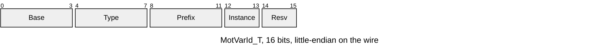
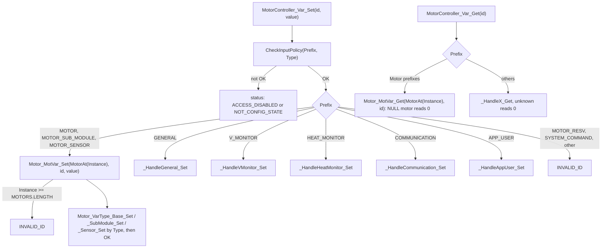

# MotVarId Address Space

One row per (Prefix, Type) of `MotVarId_T`: the Get and Set handler the id reaches, the write admission `CheckInputPolicy` applies before the Set, the instance range, and whether the host application's hand-written `mot_var_id.dart` carries the matching base enum in the same order. Reads are never gated; every status below is a Set status. Derived from the code as it stands; the Dart column compares against the hand-written file only, not the generated bindings.

## The id

Dart names the same fields `Base`, `InnerType`, `OuterType`, `Instance`, `Alt`. `MOT_VAR_ID_TYPE_ID(Prefix, Type)` is the 8-bit key `CheckInputPolicy` and `Motor_MotVar_CheckSet` switch on. Every Type enum is `static_assert`ed to fit the nibble.

## Dispatch

Admission predicates, `MotorController_StateMachine.h`:

| Predicate | Definition | Status on refusal |
|---|---|---|
| IsConfig | root state LOCK or FAULT | `MOT_VAR_STATUS_ERROR_NOT_CONFIG_STATE` |
| IsLock | root state LOCK | `NOT_CONFIG_STATE` |
| IsMotorCmdAccess | branch MAIN_MOTOR_CMD active, or IsTuning | `MOT_VAR_STATUS_ERROR_ACCESS_DISABLED` |
| IsTuning | leaf MOTOR_TUNING | `ACCESS_DISABLED` |
| ProtocolControl | `Config.InputMode` is SERIAL or CAN (`IsProtocolControlMode`) | `ACCESS_DISABLED` |
| TractionMode | `MotorController_AppTable_Mode` is MAIN_MODE_TRACTION | `ACCESS_DISABLED` |
| none | the (Prefix, Type) has no case: the Set runs | |

Instance: 2 bits, 0..3. "motor" means `Instance < MOTORS.LENGTH`, else Get reads 0 and Set returns `INVALID_ID`. "—" means the handler ignores it.

Dart column: **in-step** same members in the same order; **lags** the C enum grew past the Dart one, trailing members named; **renamed** same order, a member's name differs; **missing** no Dart enum for a C enum that exists; **n/a** no base enum on either side.

## Prefix MOTOR (0), `Motor_VarType_Base_T`

| Type | Get | Set | Admission | Instance | C base enum | Dart |
|---|---|---|---|---|---|---|
| 0 USER_OUT | `_Motor_Var_UserOut_Get` | none; returns OK | none | motor | `Motor_Var_UserOut_T` 14 | in-step |
| 1 USER_CONTROL | `_Motor_Var_UserControl_Get` | `_Motor_Var_UserControl_Set`; the three limits have no setter | ProtocolControl and IsMotorCmdAccess | motor | `Motor_Var_UserControl_T` 6 | in-step |
| 2 USER_SETPOINT | 0 | `_Motor_Var_UserSetpoint_Set`; ANGLE no setter | ProtocolControl and IsMotorCmdAccess | motor | `Motor_Var_UserSetpoint_T` 6 | in-step |
| 3 STATE_CMD | 0 | `_Motor_Var_StateCmd_Call` | IsMotorCmdAccess | motor | `Motor_Var_StateCmd_T` 6 | in-step |
| 4 OPEN_LOOP_CMD | 0 | `_Motor_Var_OpenLoopCmd_Call`; PHASE_ALIGN no call | IsMotorCmdAccess | motor | `Motor_Var_OpenLoopCmd_T` 6 | in-step |
| 5 CALIBRATION_CMD | 0 | `_Motor_Var_CalibrationCmd_Call`; PID_TUNING no call | IsLock | motor | `Motor_Var_CalibrationCmd_T` 5 | in-step |
| 6 CMD_RESV | 0 | none; OK | none | — | — | n/a |
| 7 CONFIG_CALIBRATION | `_Motor_Var_ConfigCalibration_Get` | `_Motor_Var_ConfigCalibration_Set` | IsConfig | motor | `Motor_Var_ConfigCalibration_T` 10 | in-step |
| 8 CONFIG_ACTUATION | `_Motor_Var_ConfigActuation_Get` | `_Motor_Var_ConfigActuation_Set` | IsConfig | motor | `Motor_Var_ConfigActuation_T` 14 | in-step |
| 9 CONFIG_PID | `_Motor_Var_ConfigPid_Get` | `_Motor_Var_ConfigPid_Set` | IsConfig | motor | `Motor_Var_ConfigPid_T` 8 | in-step |
| 10 CONFIG_DEBUG | `_Motor_Var_ConfigDebug_Get`, 3 of 8 bases answered | none; OK | IsConfig, on a type with no setter | motor | `Motor_Var_ConfigDebug_T` 8 | lags: `MOTOR_VAR_V_SPEED_REF_VOLTS` |
| 11 CONFIG_ELECTRICAL | `_Motor_Var_ConfigElectrical_Get` | `Motor_Var_ConfigElectrical_Set`, then `Motor_FOC_InitParams` | IsConfig | motor | `Motor_Var_ConfigElectrical_T` 6 | in-step |
| 12 CONFIG_ELECTRICAL_PU | `_Motor_Var_ConfigElectricalPu_Get` | `_Motor_Var_ConfigElectricalPu_Set`, then `Motor_FOC_InitParams` | IsConfig | motor | `Motor_Var_ConfigElectrical_T`, same shape | missing |
| 13 CONFIG_RESV | 0 | none; OK | none | — | — | n/a |

## Prefix MOTOR_SUB_MODULE (1), `Motor_VarType_SubModule_T`

| Type | Get | Set | Admission | Instance | C base enum | Dart |
|---|---|---|---|---|---|---|
| 0 BOARD_CONST | `Motor_Var_Board_Get`; V_MAX_ADCU, I_MAX_ADCU read 0 | none; OK | none | — (static board constants) | `Motor_Var_Board_T` 13 | in-step |
| 1 ROTOR_OUT | `_Motor_Var_Rotor_Get` on `p_ActiveSensor` | none; OK | none | motor | `Motor_Var_Rotor_T` 5 | in-step |
| 2 PHASE | 0, getter commented out | none; OK | none | — | — | n/a |
| 3 PHASE_INPUT | `Phase_Input_Var_Get` | none; OK | none | motor | `Phase_InputVar_T` 6 | in-step |
| 4 HEAT_MONITOR_OUT | `HeatMonitor_VarId_Get` | none; OK | none | motor | `Monitor_VarId_T` 2 | in-step |
| 5 HEAT_MONITOR_CONFIG | `HeatMonitor_ConfigId_Get` | `HeatMonitor_ConfigId_Set`, re-derives the limit scale | IsConfig | motor | `Monitor_ConfigId_T` 5 | in-step |
| 6 THERMISTOR_CONFIG | `HeatMonitor_Thermistor_ConfigId_Get` | `HeatMonitor_Thermistor_ConfigId_Set` | IsConfig | motor | `Thermistor_ConfigId_T` 11 | in-step |
| 7 PID_TUNING_IO | `_Motor_Var_PidTuning_Get`, live PID values | `_Motor_Var_PidTuning_Set`, live and Config | IsTuning | motor | `Motor_Var_ConfigPid_T`, shared | in-step |
| 8 FOC_OUT | `FOC_Var_Get` | none; OK | none | motor | `Motor_Var_Foc_T` 11 | in-step |
| 9 FOC_CONFIG | 0, reserved | none; OK | none | — | — | n/a |
| 10 FOC_SENSORLESS | `EmfObserver_GetVar` on the SENSOR_TABLE entry; `MOTOR_SENSOR_SENSORLESS_ENABLE` | none; OK | none | motor | `EmfObserver_Var_T` 14 | in-step; Dart keeps the `FOC_SENSORLESS_VAR_` prefix |
| 11 FOC_SENSORLESS_CONFIG | `EmfObserver_Config_Get` | no case in `Motor_VarType_SubModule_Set`: the write is dropped, OK | IsConfig | motor | `EmfObserver_ConfigVar_T` 7 | lags: `EMF_OBSERVER_CONFIG_VAR_EMF_FLOOR` |

## Prefix MOTOR_SENSOR (2), `Motor_VarType_Sensor_T`

| Type | Get | Set | Admission | Instance | C base enum | Dart |
|---|---|---|---|---|---|---|
| 0 HALL_STATE | `Hall_VarId_Get` | none; OK | none | motor | `Hall_VarId_T` 2 | in-step |
| 1 HALL_CONFIG | `_Hall_ConfigId_Get` | `_Hall_ConfigId_Set` | IsConfig | motor | `Hall_ConfigId_T` 6 | in-step |
| 2 HALL_CMD | 0 | `Motor_Hall_Cmd`: every Base runs `Motor_Hall_Calibrate`; refused unless the Hall sensor is selected and valid | IsLock | motor | none, `int` | Dart-only `Motor_Hall_Cmd`, 1 member |
| 3 ENCODER_STATE | `Encoder_VarId_Get`; `MOTOR_SENSOR_ENCODER_ENABLE` | none; OK | none | motor | `Encoder_VarId_T` 14 | lags: 9 members after `COUNTER_D`; renamed: Dart `ENCODER_VAR_FREQ_D`, C `ENCODER_VAR_FREQ` |
| 4 ENCODER_CONFIG | `_Encoder_ConfigId_Get`; `MOTOR_SENSOR_ENCODER_ENABLE` | `_Encoder_ConfigId_Set` | IsConfig | motor | `Encoder_ConfigId_T` 7 | in-step |
| 5 ENCODER_CMD | 0 | none; OK | IsLock | motor | — | n/a |

## Prefix MOTOR_RESV (3)

Get reads 0, Set returns `INVALID_ID`. No Type enum, no Dart enum.

## Prefix GENERAL (4), `MotorController_VarType_General_T`

| Type | Get | Set | Admission | Instance | C base enum | Dart |
|---|---|---|---|---|---|---|
| 0 GENERAL_USER_OUT | `MotorController_Var_Output_Get`; STATUS_FLAGS reads 0 | `READ_ONLY` | none | — | `MotorController_Var_Output_T` 7 | in-step |
| 1 GENERAL_USER_IN | 0 | `MotorController_Var_Input_Set`, body commented out | ProtocolControl | — | `MotorController_Var_Input_T` 4 | in-step |
| 2 GENERAL_CONFIG | `MotorController_Config_Get` | `MotorController_Config_Set`; BUZZER_FLAGS_ENABLE not implemented | IsConfig | — | `MotorController_Var_Config_T` 6 | in-step |
| 3 GENERAL_DEBUG | `MotorController_Var_OutputDebug_Get` | `READ_ONLY` | none | — | `MotorController_Var_OutputDebug_T` 9 | in-step |
| 4 GENERAL_BOARD_CONST | `MotorController_InstancesRef_Get` | `READ_ONLY` | none | — | `MotorController_Var_Board_T` 9 | in-step |
| 5 ANALOG_USER_VAR_OUT | `MotAnalogUser_VarId_GetAsInput` | `READ_ONLY` | none | — | `MotAnalogUser_VarId_T` 8 | in-step |
| 6 ANALOG_USER_CONFIG | `MotAnalogUser_ConfigId_Get` | `MotAnalogUser_ConfigId_Set` | IsConfig | — | `MotAnalogUser_ConfigId_T` 9 | in-step |
| 7 OPT_DIN_CONFIG | `OptDin_ConfigId_Get`; AUTO_STANDBY_ON_STOP reads 0 | `OptDin_ConfigId_Set` | IsConfig | — | `OptDin_ConfigId_T` 5 | renamed: Dart `..._AUTO_PARK_ON_STOP`, C `..._AUTO_STANDBY_ON_STOP` |
| 8 USER_DIN_STATE | `UserDIn_Var_GetInstance` | `READ_ONLY` | none | `Instance < MOT_USER_DIN_COUNT`, else 0 | `UserDIn_VarId_T` 2 | in-step |
| 9 USER_DIN_CONFIG | `UserDIn_Config_GetInstance` | `UserDIn_Config_SetInstance` | IsConfig | `Instance < MOT_USER_DIN_COUNT`, else dropped, OK | `UserDIn_ConfigId_T` 3 | in-step |
| 10 USER_AIN_STATE | 0, commented out | `READ_ONLY` | none | — | — | n/a |
| 11 USER_AIN_CONFIG | 0, commented out | no case: `INVALID_ID` | IsConfig | — | `UserAIn_ConfigId_T` 3 | missing |

## Prefix V_MONITOR (5), `MotorController_VarType_VMonitor_T`

| Type | Get | Set | Admission | Instance | C base enum | Dart |
|---|---|---|---|---|---|---|
| 0 VBUS_OUT | `VBus_VarId_Get` | `READ_ONLY` | none | — | `VBus_VarId_T` 3 | renamed: Dart `VBUS_VAR_ID_VALUE`, C `VBUS_VAR_ID_VBUS_FRACT16` |
| 1 VBUS_CONFIG | `VBus_ConfigId_Get` | `VBus_PauseMonitor`, `VBus_Config_Set`, `VBus_Reinit`, `VBus_ResumeMonitor` | IsConfig | — | `VBus_ConfigId_T` 6 | in-step |
| 2 V_MONITOR_VBUS_STATE | `RangeMonitor_VarId_Get` on `MonitorState` | `READ_ONLY` | none | — | `RangeMonitor_VarId_T` 2 | in-step |
| 3 V_MONITOR_VBUS_CONFIG | `RangeMonitor_ConfigId_Get` | pause, `RangeMonitor_ConfigId_Set`, `VBus_Reinit`, resume | IsConfig | — | `RangeMonitor_ConfigId_T` 7 | in-step |
| 4 V_MONITOR_VBUS_VDIVIDER | `VBus_BoardId_Get`, the board const R1, R2 | `READ_ONLY` | none | — | `VDivider_ConfigId_T` 2 | in-step |
| 5 V_MONITOR_ACCS_STATE | `VMonitor_VarId_Get` on V_ACCESSORIES | `READ_ONLY` | none | — | `RangeMonitor_VarId_T` | in-step |
| 6 V_MONITOR_ACCS_CONFIG | `VMonitor_ConfigId_Get` | `VMonitor_ConfigId_Set`, then `RangeMonitor_InitFrom` | IsConfig | — | `RangeMonitor_ConfigId_T` | in-step |
| 7 V_MONITOR_ACCS_VDIVIDER | `VMonitor_VDivider_ConfigId_Get` | `READ_ONLY` | none | — | `VDivider_ConfigId_T` | in-step |
| 8 V_MONITOR_ANALOG_STATE | `VMonitor_VarId_Get` on V_ANALOG | `READ_ONLY` | none | — | `RangeMonitor_VarId_T` | in-step |
| 9 V_MONITOR_ANALOG_CONFIG | `VMonitor_ConfigId_Get` | `VMonitor_ConfigId_Set` | IsConfig | — | `RangeMonitor_ConfigId_T` | in-step |
| 10 V_MONITOR_ANALOG_VDIVIDER | `VMonitor_VDivider_ConfigId_Get` | `READ_ONLY` | none | — | `VDivider_ConfigId_T` | in-step |

## Prefix HEAT_MONITOR (6), `MotorController_VarType_HeatMonitor_T`

| Type | Get | Set | Admission | Instance | C base enum | Dart |
|---|---|---|---|---|---|---|
| 0 PCB_STATE | `HeatMonitor_VarId_Get` on HEAT_PCB | `READ_ONLY` | none | — | `Monitor_VarId_T` 2 | in-step |
| 1 PCB_CONFIG | `HeatMonitor_ConfigId_Get` | `HeatMonitor_ConfigId_Set` | IsConfig | — | `Monitor_ConfigId_T` 5 | in-step |
| 2 PCB_THERMISTOR | `HeatMonitor_Thermistor_ConfigId_Get` | `READ_ONLY` | none | — | `Thermistor_ConfigId_T` 11 | in-step |
| 3 MOSFETS_STATE | `HeatMonitor_Group_VarId_Get` | `READ_ONLY` | none | — | `Monitor_VarId_T` | in-step |
| 4 MOSFETS_CONFIG | `HeatMonitor_Group_ConfigId_Get` | `HeatMonitor_Group_ConfigId_Set` | IsConfig | — | `Monitor_ConfigId_T` | in-step |
| 5 MOSFETS_INSTANCE_STATE | `HeatMonitor_GroupInstance_VarId_Get` | `READ_ONLY` | none | `Instance < HEAT_MOSFETS.COUNT`, else 0 | `Monitor_VarId_T` | in-step |
| 6 MOSFETS_INSTANCE_THERMISTOR | `HeatMonitor_GroupInstance_ThermistorConfigId_Get` | `READ_ONLY` | none | `Instance < HEAT_MOSFETS.COUNT`, else 0 | `Thermistor_ConfigId_T` | in-step |

## Prefix COMMUNICATION (7), `MotorController_VarType_Communication_T`

| Type | Get | Set | Admission | Instance | C base enum | Dart |
|---|---|---|---|---|---|---|
| 0 SOCKET_STATE | 0 | `READ_ONLY` | none | — | — | n/a |
| 1 SOCKET_CONFIG | `Socket_ConfigId_Get` | `Socket_ConfigId_Set` | IsConfig | `Instance < PROTOCOL_COUNT`, else 0 or dropped, OK | `Socket_ConfigId_T` 5 | in-step |
| 2 CAN_STATE | 0 | `READ_ONLY` | none | — | — | n/a |
| 3 CAN_CONFIG | `CAN_ConfigId_Get`; `MOTOR_CONTROLLER_CAN_ENABLE` | `CAN_ConfigId_Set` | IsConfig | `Instance < CAN_SOCKET_COUNT`, else 0 or dropped | `CAN_ConfigId_T` 8 | missing |
| 4 CIA_402_STATE | 0, no case | `READ_ONLY` | none | — | — | Type missing in Dart |
| 5 CIA_402_CONFIG | 0, no case | none; OK | none | — | — | Type missing in Dart |

## Prefix SYSTEM_COMMAND (8)

No handler: Get reads 0, Set returns `INVALID_ID`. The Dart prefix enum lists it; neither side has a Type enum.

## Prefix APP_USER (9), `MotorController_VarType_AppUser_T`

| Type | Get | Set | Admission | Instance | C base enum | Dart |
|---|---|---|---|---|---|---|
| 0 TRACTION_CONTROL | `MotorController_Traction_VarId_Get` | `MotorController_Traction_VarId_Set` | TractionMode and ProtocolControl | — | `Traction_VarId_T` 6 | lags: `TRACTION_VAR_COMMAND`, `_STATE_ID`, `_LEVER` |
| 1 TRACTION_CONFIG | `MotorController_Traction_ConfigId_Get` | `MotorController_Traction_ConfigId_Set` | IsConfig | — | `Traction_ConfigId_T` 4 | lags: `TRACTION_CONFIG_LEVER_MODE` |

## Type and Prefix enums in Dart

| C enum | Members | Dart |
|---|---|---|
| `MotVarId_Prefix_T` | 10 | in-step |
| `Motor_VarType_Base_T` | 14 | in-step |
| `Motor_VarType_SubModule_T` | 12 | in-step |
| `Motor_VarType_Sensor_T` | 6 | in-step |
| `MotorController_VarType_General_T` | 12 | in-step |
| `MotorController_VarType_VMonitor_T` | 11 | in-step |
| `MotorController_VarType_HeatMonitor_T` | 7 | in-step |
| `MotorController_VarType_Communication_T` | 6 | lags: `MOT_VAR_TYPE_CIA_402_STATE`, `_CIA_402_CONFIG` |
| `MotorController_VarType_AppUser_T` | 2 | in-step |
| `MotVarId_Status_T` | 8 + `RESERVED` 0xFF | in-step for the 8 |

Sources: `MotVarId.h` (`MotVarId_T`, the Prefix and Type enums, `MOT_VAR_ID_TYPE_ID`, `MotVarId_Status_T`); `MotorController/MotorController_Var.c` (`MotorController_Var_Get`, `MotorController_Var_Set`, `CheckInputPolicy`, `IsProtocolControlMode`, `MotorAt`, `SocketAt`, `CanAt`, `_HandleGeneral_Get/Set`, `_HandleVMonitor_Get/Set`, `_HandleHeatMonitor_Get/Set`, `_HandleCommunication_Get/Set`, `_HandleAppUser_Get/Set`, `MotorController_Var_Output_Get`, `MotorController_Config_Get/Set`, `MotorController_InstancesRef_Get`); `MotorController/MotorController_StateMachine.h` (`MotorController_IsConfig`, `IsLock`, `IsTuning`, `IsMotorCmdAccess`); `Motor_MotVar.c` (`Motor_MotVar_Get/Set`, `Motor_VarType_Base_Get/Set`, `Motor_VarType_SubModule_Get/Set`, `Motor_VarType_Sensor_Get/Set`, `Motor_MotVar_CheckSet`); `Motor/Motor_Var.c`, `Motor_Var.h`, `Motor_Config.h` (the Motor base enums and accessors); `Motor/Sensor/Hall/Motor_Hall.c` (`Motor_Hall_Cmd`); the module headers that define `*_VarId_T` and `*_ConfigId_T` (`RotorSensor.h`, `Phase_Input.h`, `FOC.h`, `EmfObserver.h`, `Hall.h`, `Encoder.h`, `Monitor.h`, `RangeMonitor.h`, `Thermistor.h`, `VDivider.h`, `VBus.h`, `VBus_Config.h`, `VMonitor.h`, `HeatMonitor.h`, `Socket.h`, `CAN.h`, `OptDin.h`, `UserDIn.h`, `UserAIn.h`, `MotorController_AnalogUser.h`, `Traction.h`); the host application's hand-written `mot_var_id.dart`.

## Not shown / open

- A Motor-prefix write to a read-only Type returns OK: `Motor_MotVar_Set` has no `READ_ONLY` path, unlike the controller-side handlers. `Motor_MotVar_CheckSet`, which classifies them, is not wired.
- FOC_SENSORLESS_CONFIG passes IsConfig and then has no setter case: the observer's tuning cannot be written through the var path.
- USER_AIN_CONFIG passes IsConfig and then returns `INVALID_ID`: both accessors are commented out.
- `CheckInputPolicy` keys on (Prefix, Type) only. A Motor-prefix id with an out-of-range Instance passes the policy and fails later in `Motor_MotVar_Set`.
- `Resv` (Dart `Alt`) is unused on both sides.
- Rows list what a Set reaches, not what each Base inside it does; the base-level no-ops are named where the accessor has them.
- The CiA 402 Types have no handler on either side of the controller; the CAN rows exist only under `MOTOR_CONTROLLER_CAN_ENABLE`.
