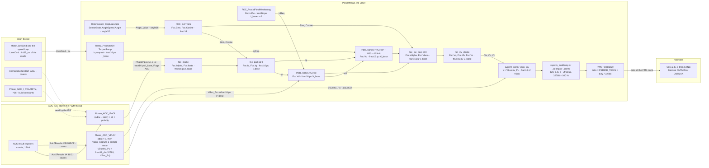

# Control Cycle Data Flow

One control cycle of the current loop, from the ADC's counts to the PWM compare registers, one lane per thread: which `FOC_T` / `Motor_Context_T` field holds each value and in what unit. The units are [FixedPoint.md](../../Docs/Conventions/FixedPoint.md)'s: counts, fract16 pu of a base, angle16, duty as fract16 of the period, timer ticks. Which thread owns each field across the boundary: [ThreadOwnership.md](../ThreadOwnership.md). The limits that bound the PI: [LimitChain.md](LimitChain.md). The sample's timing: [CurrentSampling.md](ADC/CurrentSampling.md).

## Flow

The torque path as `Run_Proc` runs it (`Motor_FOC_ProcTorqueReq` → `_Motor_FOC_ProcTorqueReq` → `Motor_FOC_AngleControl`, then `Motor_FOC_WriteDuty`). The requests step first, then the angle, the take, the PI, the inverse transforms and the write.

The field-weakening request steps on the V the previous cycle wrote (`FOC_GetVMagnitude` of `Foc.Vd`, `Foc.Vq`), one cycle of V → idReq latency; it is drawn as a source rather than a feedback edge. `Foc.Valpha`, `Foc.Vbeta`, `Foc.Va..Vc` hold the last write until `FOC_ProcInvClarkePark` runs; the sensorless observer reads the αβ pair after the state machine (`Motor_CaptureStator`).

## Fields and units

| Step | Function | Holder | Type, unit | Thread |
|---|---|---|---|---|
| sample | the board's completion map | `Adc0Results[]`, `ADC_T.P_CHANNEL_RESULTS` | `adc_result_t`, counts 0..4095 | ADC ISR |
| current to pu | `Phase_ADC_IPuOf`: (adcu − `Config.IabcZeroRef_Adcu`) × `PHASE_ADC_I_PU_PER_ADCU` (16) × `PHASE_ADC_I_POLARITY` (−1 under `PHASE_ADC_I_SENSOR_INVERT`) | `PhaseInput.I.A/B/C`, `Flags` = ABC | `fract16_t` pu of I_base (`I_MAX_AMPS`, 2048 counts full scale) | ADC ISR, one struct store |
| bus to pu | `Phase_ADC_VPuOf` (× 8), `VBus_Capture` (mean with the last), `fract16_div(32768, VBus_Pu)` | `VBus_T.VBus_Pu`, `VBusInv_Pu` | `ufract16_t` pu of V_base; `accum32_t` 1/pu | ADC ISR |
| request | `Ramp_ProcNextOf(&TorqueRamp, UserCmd or PidSpeed output)` | `TorqueRamp.Accumulator` | `fract16_t` pu I_base (V_base in voltage mode) | PWM |
| d request | `FOC_ProcIdFieldWeakening(vBus)` | `Foc.IdFw` | `fract16_t` pu I_base, in [−IdLimit, 0] | PWM |
| angle | `RotorSensor_CaptureAngle`, `Angle_Value` | `SensorState.AngleSpeed.Angle` | angle32 held, angle16 read | PWM |
| rotation | `FOC_SetTheta` → `fract16_vector` | `Foc.Sine`, `Foc.Cosine` | `fract16_t` | PWM |
| Clarke | `foc_clarke(ia, ib, ic)` | `Foc.Ialpha`, `Foc.Ibeta` | `fract16_t` pu I_base, saturated | PWM |
| Park | `foc_park(α, β, sin, cos)`, then the sample-delay Park under `FOC_I_SAMPLE_DELAY` | `Foc.Id`, `Foc.Iq` | `fract16_t` pu I_base | PWM |
| d PI | `PID_CaptureOutputLimits(±vCircle)`, `PID_ProcPI(Id, idReq)`; vCircle = `VBus_Pu` × `FOC_V_CIRCLE_PER_V_BUS` | `Foc.Vd`, `PidId` state | `fract16_t` pu V_base | PWM |
| q PI | `foc_q_circle_limit(vCircle, Vd)`, ∩ `Foc.VLimit`, `PID_ProcPI(Iq, iqReq)` | `Foc.Vq`, `PidIq` state | `fract16_t` pu V_base | PWM |
| inverse Park | `foc_inv_park(Vd, Vq, sin, cos)` | `Foc.Valpha`, `Foc.Vbeta` | `fract16_t` pu V_base | PWM |
| inverse Clarke | `foc_inv_clarke(α, β)` | `Foc.Va`, `Foc.Vb`, `Foc.Vc` | `fract16_t` pu V_base | PWM |
| normalize | `svpwm_norm_vbus_inv(VBusInv_Pu, v)`: v × (1/VBus) | locals in `Phase_WriteSvpwm` | `fract16_t` fraction of VBus | PWM |
| zero sequence | `svpwm_midclamp`, `_ceiling(PHASE_SVPWM_DUTY_CEILING)` or `_clamp(PHASE_SVPWM_CLAMP_K)` by `PHASE_SVPWM_*` | `struct svpwm_abc` | `ufract16_t` duty, `PWM_DUTY_MAX` 32768 = 100 % | PWM |
| compare | `PWM_WriteDuty` → `_PWM_DutyTicksOf`: `PERIOD_TICKS` × duty / 32768 → `HAL_PWM_WriteDuty` | `CnV` | ticks of the FTM clock | PWM |
| load | `_Phase_SyncPwmDuty` → `HAL_PWM_SyncModuleDuty`: SWSYNC with CNTMIN and CNTMAX loading points | FTM buffers | — | hardware |

The voltage path (`Motor_FOC_ProcAngleV`, built only with `MOTOR_VOLTAGE_CONTROL_MODE_ENABLE`) replaces the two PIs with `FOC_ProcVControl`: vq clamped into `VLimit`, then the circle at VBus/√3, the same inverse transforms and write. Passive and Deactivated run the capture side only, V while floating (`FOC_ProcVBemfClarkePark` into `Valpha`, `Vbeta`, `Vd`, `Vq`), I while shorted.

## Not shown / open

- The speed loop feeding `UserCmd`'s place (`Motor_ProcSpeedControlOf` on the speed tick) and the limit bands' sources: [LimitChain.md](LimitChain.md).
- The `FOC_I_SAMPLE_DELAY` Park offset and the decouple feedforward (`FOC_DECOUPLE_ENABLE`): neither built.
- The 2-of-3 current capture (`PHASE_ADC_I_SENSOR_LOW_SIDE`, `_Phase_ADC_SolveI`): not supported by the boards' completion maps.
- The six-step path (`Phase_Polar.c`).
- Per-board bases (I_MAX_AMPS, V_MAX_VOLTS, PERIOD_TICKS) are the board's `Phase_Board_T` and `Board.h`.
