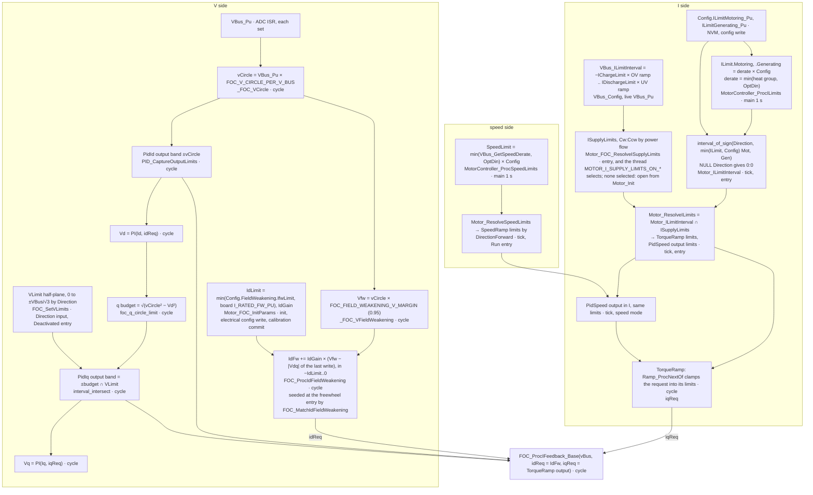

# Limit Chain

The whole chain in one picture: the V side (the modulation circle, the d band, the q budget, the VLimit half-plane, the PidIq band, the field-weakening target and `IdFw`) and the I side (motoring and generating by Direction, the supply window by the sign of v_q, the torque ramp's limits), meeting at the current PI. Each node says where and how often it is re-evaluated, and the preset macros that select its variant. The pieces' own sheets: [ILimitsRouting.md](../MotorController/ILimitsRouting.md) (the I sources and their routing), [VLimitPolicy.md](Math/VLimitPolicy.md) (the q band's shapes), [ModulationLimit.md](Math/ModulationLimit.md) (the circle radius and the sensing window), [LimitPhysics.md](Math/LimitPhysics.md) (which bound binds where). Rates: "cycle" is the control cycle, "tick" the 1 ms speed tick, "entry" a state ENTRY (`Run_Entry`, `Intervention_Entry`, the encoder start-up), "input" a state-machine input on the main thread.

## The chain

The V side's output bands are recomputed inside the PI call every cycle, so a change of VBus or Vd reaches the q band the same cycle. The I side's resolve is a tick and entry event: a changed `ILimit`, `Config` limit or `ISupplyLimits` reaches `TorqueRamp` on the next speed tick, and the ramp then slews the request at `TorqueRampSlope_PuPerTick` (Decision 0006, limits on the input).

## Where each node is re-evaluated

| Node | Function | Context | Rate |
|---|---|---|---|
| `VBus_Pu` | `VBus_ADC_Capture` | ADC ISR | every set, the control cycle |
| vCircle, PidId band, q budget, PidIq band | `FOC_ProcIFeedback_Base` | PWM, the LOOP | every cycle |
| `Foc.VLimit` | `FOC_SetVLimits` ← `Motor_SetDirection` | main under the lock (DIRECTION input handlers of Deactivated, Passive, OpenLoop, Calibration); `Deactivated_Entry` (NULL) | on the input |
| Vfw, `IdFw` | `_Motor_FOC_ProcIdReq` → `FOC_ProcIdFieldWeakening` | PWM, before the take | every cycle; seed on `Motor_FOC_MatchVFreewheel` at the floating → Run entry |
| `IdLimit`, `IdGain` | `Motor_FOC_InitParams` | main (`Motor_Reset`, the electrical config vars); PWM (the electrical calibration's commit) | on write |
| `ILimit` pair | `MotorController_ProcILimits` → `Motor_SetILimitDerates` | main, the 1 s block | 1 s |
| `Motor_ILimitInterval`, `Motor_ResolveILimits` | `Run_OnSpeed` (through `Motor_ResolveFeedbackLimits`), `TorqueZero_CaptureSpeed`, `SpeedZero_CaptureSpeed`; `Run_Entry`, `Intervention_Entry`, the encoder start-up entry | PWM speed tick; the entry's context | 1 ms, and on entry |
| `ISupplyLimits` | `Motor_FOC_ResolveISupplyLimits` | entry under every selection; then `_ON_SPEED`: the speed tick (`Motor_FOC_ResolveISupplyLimitsOnSpeed`); `_ON_VBUS`: the 1 ms ISR (`_MotorController_VBus_Thread`); `_ON_MAIN`: main's 1 ms block (`MotorController_Main_Thread`); none: never after `Motor_Init`'s open window | 1 ms, or never |
| `VBus_ILimitInterval` | `VBus_IDischargeLimit_Pu`, `VBus_IChargeLimit_Pu` | inside the supply resolve | with it |
| TorqueRamp clamp | `Ramp_ProcNextOf` | PWM, the LOOP | every cycle |
| PidSpeed output limits | `_Motor_ApplyILimits` | with `Motor_ResolveILimits` | tick, entry |
| SpeedLimit pair, SpeedRamp limits | `MotorController_ProcSpeedLimits`; `Motor_ResolveSpeedLimits` | main 1 s; PWM speed tick and `Run_Entry` | 1 s; 1 ms |
| voltage-mode TorqueRamp limits | `Motor_ResolveVLimits` (the VLimit half-plane in V) | `Run_Entry`, `Run_OnSpeed` through `Motor_ResolveFeedbackLimits`, voltage modes only | tick, entry |

`Motor_FOC.h`'s comment places `_ON_MAIN` in the 16 ms block; the code runs it in the 1 ms block.

## Presets

| Macro | Default | Variants | Node |
|---|---|---|---|
| `FOC_V_CIRCLE_PER_V_BUS` | `FRACT16_1_DIV_2` | any radius up to 1/√3; the sensing window bounds it, ModulationLimit.md | vCircle, Vfw |
| `FOC_FIELD_WEAKENING_V_MARGIN` | 0.95 | — | Vfw |
| `MOTOR_FOC_FIELD_WEAKENING_ENABLE` / `_DISABLE` | enabled | disabled: idReq = 0, no seed | `IdFw` |
| `FOC_DECOUPLE_ENABLE` / `_DISABLE` | disabled | enabled: `FOC_ProcIFeedback_Decouple`, the feedforward subtracted from both bands, Vd clamped to ±vCircle after the sum | PidId, PidIq bands |
| `VBUS_I_LIMIT_POWER_BALANCE` / `_PHASE_BOUND` / `_V_DERATE` | POWER_BALANCE | exact i_q window at (v_d, i_d, v_q) / 2/√3·I_dc circle keyed by the speed sign / UV and OV ramps on the Config limits keyed by Direction | `ISupplyLimits` law |
| `MOTOR_I_SUPPLY_LIMITS_ON_SPEED` / `_ON_VBUS` / `_ON_MAIN` | none | the resolving thread; none also compiles the entry resolve out, so the window stays `interval_symmetric(0, FRACT16_MAX)` from `Motor_Init` | `ISupplyLimits` rate |
| `PHASE_SVPWM_MIDCLAMP` / `_MIDCLAMP_CEILING` / `_CLAMP` | MIDCLAMP | the zero-sequence placement at the write; not a limit itself, it sets the low-side window the radius is chosen against (`PHASE_SVPWM_DUTY_CEILING`, `PHASE_SVPWM_CLAMP_K`) | the radius |
| `MOTOR_VOLTAGE_CONTROL_MODE_ENABLE` | off | on: the voltage modes run `Motor_FOC_ProcAngleV`, TorqueRamp limits in V from `Motor_ResolveVLimits` | TorqueRamp |

Of the two presets in the tree, one selects `_ON_MAIN` with `POWER_BALANCE`, `MIDCLAMP_CEILING` and a 0.54 radius; the other selects none of the `MOTOR_I_SUPPLY_LIMITS_ON_*`, so its window never closes.

## Sources

`Motor/Motor/Math/FOC.h` (`_FOC_VCircle`, `FOC_ProcIFeedback_Base`, `_Decouple`, `FOC_SetVLimits`, `_FOC_VFieldWeakening`, `FOC_ProcIdFieldWeakening`, `FOC_MatchIdFieldWeakening`), `Math/foc_math.h` (`foc_q_circle_limit`, `foc_iq_limits`, `foc_iq_phase_limits`), `Motor_FOC.c` (`_Motor_FOC_ProcTorqueReq`, `Motor_FOC_ResolveISupplyLimits`, `Motor_VBusILimits_*`, `Motor_FOC_MatchVFreewheel`), `Motor_FOC.h` (`_Motor_FOC_ProcIdReq`, `Motor_FOC_ResolveISupplyLimitsOnEntry`, `_OnSpeed`), `Motor.h` (`Motor_ILimitInterval`, `_Motor_ResolveILimits`, `_Motor_ApplyILimits`, `Motor_GetVLimitsAntiPlugging`), `Motor.c` (`Motor_ResolveILimits`, `Motor_ResolveVLimits`, `Motor_ResolveFeedbackLimits`, `Motor_SetDirection`, `Motor_SetILimitDerates`, `Motor_FOC_InitParams`, `Motor_Init`), `Motor_StateMachine.c` (`Run_Entry`, `Run_OnSpeed`, `Intervention_Entry`), `StateMachine/Motor_Intervention.c`, `Sensor/Encoder/Motor_Encoder.c`, `VBus/VBus.h` (`VBus_ILimitInterval`, the derate ramps, `VBus_GetSpeedDerate`), `VBus/VBus_FOC.h` (`VBus_FOC_IqLimits`, `_IqPhaseLimits`, `_IqDerateLimits`), `MotorController/MotorController.c` (`MotorController_ProcILimits`, `_ProcSpeedLimits`), `MotorController_Thread.h` (the `_ON_VBUS` and `_ON_MAIN` call sites), `Phase/Phase_Svpwm.h`, `Math/Ramp/Ramp.h` (`Ramp_SetLimits`), `Math/PID/PID.c` (`PID_CaptureOutputLimits`, the dynamic integral clamp).

## Not shown / open

- `ILimit.Forward` / `.Reverse` and the protocol's directional limits (CiA 0x60E0/0x60E1): stored at FRACT16_MAX, no resolve reads them.
- The q band's window form (`FOC_VqBand`, `VWindow`) and the dynamic sides: designed, not wired (VLimitPolicy.md).
- `Motor_ResolveAlignILimits`: unused; the align clamps its own request.
- The rollback case where the half-plane pins v_q at 0 and the current leaves every I limit: LimitPhysics.md.
- The supply window's torn store across threads and its 1 ms operating-point sample: ThreadOwnership.md, Decision 0010.
- The circle-hit indicator and the `IdFw` var the runtime plots want: no var exists.
