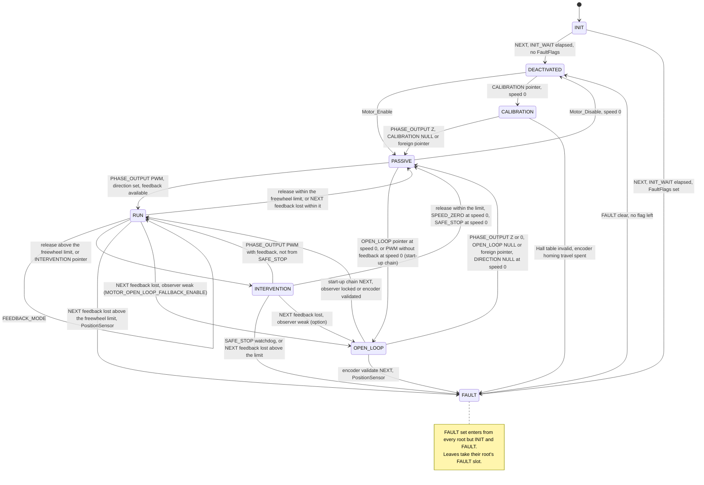
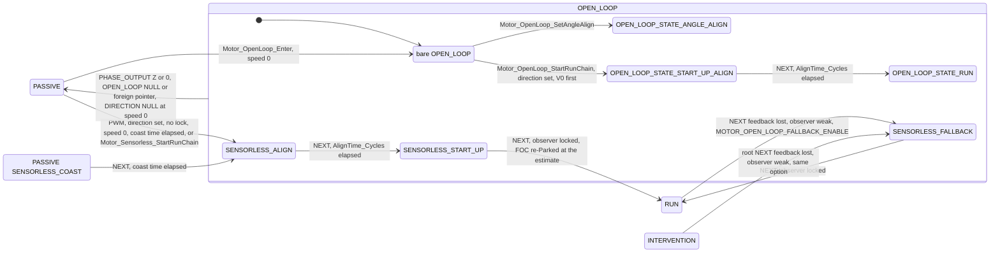
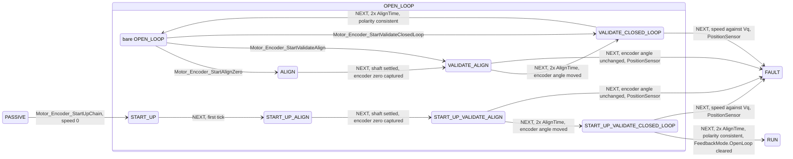
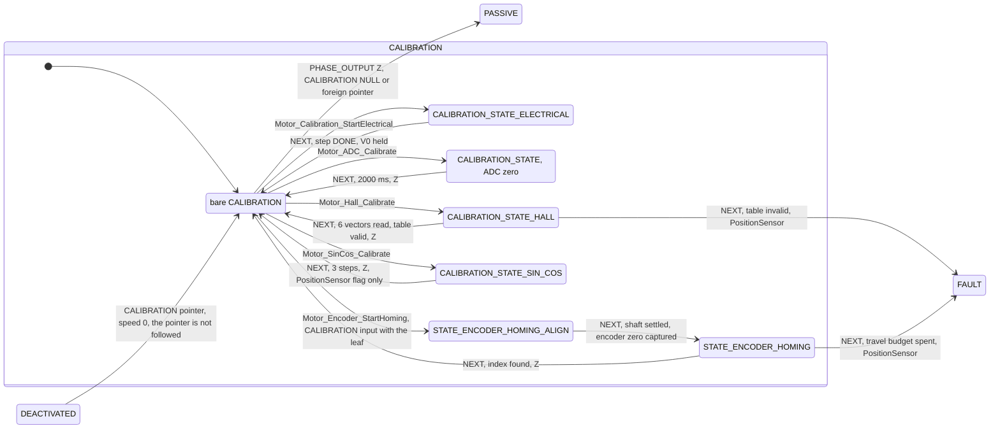

# Motor State Tree

Every state of one motor's `MSM_MACHINE`, roots and leaves, with each hand-off and what each state owns: the full tree
that [Motor_StateMachine.md](Motor_StateMachine.md) draws at the root level only. Derived from the state definitions and
the engine's walk; the engine itself is in [Framework/StateMachine/Architecture.md](../../Framework/StateMachine/Architecture.md),
the thread picture in [InputVsLoop.md](../../Framework/StateMachine/InputVsLoop.md). Leaves are `const State_T` private to
the file that owns them; none carries a sub-state id yet, so `Motor_GetPathId` reports the root while a leaf is active.

Phase output values are written by suffix: `Z` floats every phase (`Phase_Deactivate`), `V0` turns every low side on
(`Phase_ActivateV0`), `T0` is 50 % duty on every phase (`Phase_ActivateT0`), `PWM` drives the bridge. "Release" is
`PHASE_OUTPUT` `Z` or `0`. "Freewheel limit" is `Motor_IsSpeedFreewheelLimitRange`. "Speed 0" is `Motor_IsSpeedZero`,
an exact test. "Lock" / "feedback" is `RotorSensor_IsFeedbackAvailable`: Hall and SinCos always true, the encoder once
aligned, the observer while locked.

## The engine's walk, as the motor uses it

| Step | Thread | Function | Order |
|---|---|---|---|
| `LOOP`, `NEXT` | PWM, every control cycle (`MOTOR_CONTROL_FREQ`) | `_Motor_StateMachine` → `_StateMachine_Branch_ProcSyncOutput` → `State_TransitionOfOutputUp` | leaf first: each node's `LOOP`, then its `NEXT`, up to the root; the walk stops at the first `NEXT` that returns a state. A node without `LOOP` skips it; a leaf without `NEXT` falls through to its parent's |
| transition | the thread that produced it | `_StateMachine_TraverseTransitionTo` → `State_TraverseEntryExit` | `EXIT` up to the common ancestor (compiled out: `STATE_MACHINE_EXIT_FUNCTION_ENABLE` is not set and no motor state defines one), `ENTRY` down from it, then `p_ActiveState = leaf` |
| inputs | main, on the call | `StateMachine_Tree_Input` → `State_AcceptInputUp` | leaf first; the first non-`NULL` table slot handles the input, even when it returns `NULL` (no transition). A leaf with an empty table inherits |
| commands | main, on the call | `StateMachine_Tree_InvokeTransition` | legal while `P_START` is the leaf or one of its ancestors |
| actions | PWM, at the speed tick (`ON_SPEED`, `MOTOR_SPEED_LOOP_FREQ`) and the phase-current completion (`ON_PHASE`, `MOTOR_I_FEEDBACK_ON_PHASE` only) | `_StateMachine_ActionInput` | the leaf's `P_ACTION_TABLE` only; no walk |

What a `NEXT` return runs, by where it points (`State_CommonAncestorOf`):

| Return | Examples | Common ancestor | Runs |
|---|---|---|---|
| own root | ADC, Hall, SinCos, homing, electrical → `MOTOR_STATE_CALIBRATION`; encoder `VALIDATE_CLOSED_LOOP` → `MOTOR_STATE_OPEN_LOOP`; `SENSORLESS_COAST` → `MOTOR_STATE_PASSIVE` | the root | the leaf is left; the root's `ENTRY` does not re-run, so the leaf's last output stands: float after ADC, Hall, SinCos and homing, V0 after electrical |
| another root | `SENSORLESS_START_UP` → `RUN`; `SPEED_ZERO` → `PASSIVE`; `SAFE_STOP` → `FAULT` | `NULL` | the target root's `ENTRY` |
| a leaf of another root | `SENSORLESS_COAST` → `SENSORLESS_ALIGN`; `RUN` → `SENSORLESS_FALLBACK`, `TORQUE_ZERO` | `NULL` | the target root's `ENTRY`, then the leaf's |
| a sibling leaf | `SENSORLESS_ALIGN` → `SENSORLESS_START_UP`; `TORQUE_ZERO` ↔ `SPEED_ZERO` | the shared root | the new leaf's `ENTRY` only |
| a child | `SPEED_ZERO` → `SAFE_STOP` | `SPEED_ZERO` | `SAFE_STOP`'s `ENTRY` only; the ramp in progress continues |
| itself | `SPEED_ZERO` on a release above the limit; `RUN` on `FEEDBACK_MODE` | the parent | `ENTRY` re-runs |
| `NULL` | `TORQUE_ZERO`'s `NEXT`, every bare root | — | the walk continues to the parent's `LOOP` and `NEXT` |

## Roots

`Motor_StateId_T`. Leaves take their root's input table unless they map a slot of their own (three do: see the matrix).



## PASSIVE and INTERVENTION, with RUN

`SENSORLESS_COAST` (`Motor_Sensorless.c`) is `PASSIVE`'s only leaf. `TORQUE_ZERO`, `SPEED_ZERO` and `SPEED_ZERO`'s child
`SAFE_STOP` (`Motor_Intervention.c`) are `INTERVENTION`'s. "Bare" is the root active with no leaf.

```mermaid
stateDiagram-v2
    direction LR
    state "RUN" as RUN
    state "FAULT" as FAULT
    state "OPEN_LOOP SENSORLESS_ALIGN" as SL_ALIGN
    state PASSIVE {
        direction TB
        state "bare PASSIVE" as P_BARE
        state "SENSORLESS_COAST" as COAST
        [*] --> P_BARE
        P_BARE --> COAST: PWM, direction set, no lock, speed 0, PASSIVE younger than MOTOR_SENSORLESS_COAST_CYCLES
        COAST --> P_BARE: NEXT direction NULL, or PHASE_OUTPUT Z or 0
    }
    state INTERVENTION {
        direction TB
        state "TORQUE_ZERO" as TZ
        state SPEED_ZERO {
            state "bare SPEED_ZERO" as SZ
            state "SAFE_STOP" as SS
            SZ --> SS: Motor_ApplySafeStop
        }
        TZ --> SZ: Motor_ApplySpeedZero, or release above the freewheel limit
        SZ --> TZ: Motor_ApplyTorqueZero
        TZ --> SS: Motor_ApplySafeStop
        SZ --> SZ: release above the freewheel limit, ENTRY re-runs
    }
    COAST --> RUN: NEXT, observer locked
    COAST --> SL_ALIGN: NEXT, coast time elapsed
    P_BARE --> RUN: PWM, direction set, feedback available
    P_BARE --> SL_ALIGN: PWM, direction set, no lock, speed 0, coast time already elapsed
    RUN --> TZ: Motor_ApplyTorqueZero
    RUN --> SZ: Motor_ApplySpeedZero, or release above the freewheel limit
    RUN --> SS: Motor_ApplySafeStop
    TZ --> RUN: PWM, feedback available
    SZ --> RUN: PWM, feedback available
    TZ --> P_BARE: release within the freewheel limit
    SZ --> P_BARE: release within the freewheel limit, or NEXT speed 0
    SS --> P_BARE: NEXT speed 0, or release at speed 0
    SS --> FAULT: NEXT, ControlTimerBase past MOTOR_INTERVENTION_SAFE_STOP_WATCHDOG, SafeStopTimeout
    INTERVENTION --> P_BARE: root NEXT, feedback lost within the limit
    INTERVENTION --> FAULT: root NEXT, feedback lost above the limit, PositionSensor
```

- `RUN` → `TORQUE_ZERO` / `SPEED_ZERO` / `SAFE_STOP` runs `Intervention_Entry` first (limits, torque ramp to Iq, V to the
  present output), then the leaf's. Entering `SAFE_STOP` from `RUN` also runs `SpeedZero_Entry`; from `SPEED_ZERO` it does not.
- `TransitionIntervention` (`RUN` and the `INTERVENTION` root) refuses a pointer whose `P_TOP` is not `INTERVENTION`,
  and returns `NULL` for a target already on the active branch: repeats hold without re-entry.
- The root's `NEXT`, `_Motor_TransitionFeedbackLost`, runs after a leaf's `NEXT` returns `NULL`: in `TORQUE_ZERO` every
  tick, in `SPEED_ZERO` and `SAFE_STOP` while speed is not 0. With `MOTOR_OPEN_LOOP_FALLBACK_ENABLE` it goes to
  `SENSORLESS_FALLBACK` first when `Motor_Sensor_FallbackState` names it.

## OPEN_LOOP: generic and sensorless chains

Leaves in `Motor_OpenLoop.c` and `Motor_Sensorless.c`. The commands on `OPEN_LOOP` (`StateMachine_TransitionCmd_T` with
`P_START` the root) are legal from the bare root and from any of its leaves; the diagram draws them from the bare root once.



- `Passive_InputOpenLoop` takes a pointer whose `P_TOP` is `OPEN_LOOP` straight to that leaf (root `ENTRY` first), any
  other non-`NULL` pointer to the bare root, `NULL` and a moving motor not at all. `OpenLoop_InputOpenLoop` adds the exit:
  `NULL` and a foreign pointer leave for `PASSIVE`, the root pointer re-enters the bare root.
- `Motor_Sensor_StartUpState` names the chain `PASSIVE` enters on `PWM` without feedback: `SENSORLESS_COAST` or
  `SENSORLESS_ALIGN` when the sensorless adapter is the active sensor, `NULL` for every other sensor.
- `ANGLE_ALIGN` and `OPEN_LOOP_STATE_RUN` have no `NEXT`: they leave on the root's inputs only.
- `Motor_OpenLoop_SetPhaseOutput` and `Motor_OpenLoop_SetJog` are commands on the root that return `NULL`: no leaf.

## OPEN_LOOP: encoder chains

`Motor_Encoder.c`, built with `MOTOR_SENSOR_ENCODER_ENABLE`. Two copies of one align, validate-open-loop, validate-closed-loop
sequence: the start-up chain hands to `RUN`, the single-step chain returns to the bare root.



- "Shaft settled": `PollAlignSettled`, the align timer elapsed with no restart; any measured encoder speed restarts it.
- The encoder is not in `Motor_Sensor_StartUpState`: `PWM` in `PASSIVE` before the encoder is aligned is ignored. The chain
  starts by `Motor_Encoder_StartUpChain` only, a command on `PASSIVE`.

## CALIBRATION

Leaves in `Motor_CalibrationElectrical.c`, `Motor_ADC.c`, `Motor_Hall.c`, `Motor_SinCos.c`, `Motor_Encoder.c`. Four are
entered by commands on the root (legal from the bare root or any sibling), homing by the `CALIBRATION` input carrying the leaf.



- `Deactivated_InputCalibration` enters the bare root for any non-`NULL` pointer; `Calibration_InputCalibration` follows a
  pointer whose `P_TOP` is `CALIBRATION` to its leaf, re-enters the bare root for the root pointer, and leaves for `PASSIVE`
  on `NULL` or a foreign pointer.
- Returning to the bare root does not re-run `Calibration_Entry`: after ADC, Hall, SinCos and homing the bridge is floating,
  after electrical it holds V0. `Calibration_InputControl` restores V0 on `0` or `PWM`.
- `Motor_Calibration_IsComplete` is "the bare root is the leaf".

## Responsibility matrix

Columns: what `ENTRY` writes to the bridge, which timer it resets (`CTB`: `ControlTimerBase`, by `Motor_ResetControlTimer`;
`T=`: `CONTROL_TIMER`, `TimerT`), what it matches or seeds; what `LOOP` produces and whether it writes a duty
(`yes`: `Motor_FOC_WriteDuty` every cycle, `tick`: a direct phase write on the timer tick, `no`); `NEXT`'s condition and
target; the leaf's `ON_SPEED` and `ON_PHASE` actions; the input slots the state maps itself. An empty cell is "nothing".
`ON_PHASE` exists only with `MOTOR_I_FEEDBACK_ON_PHASE`.

### Roots

| State | ENTRY output | ENTRY timer | ENTRY matches / seeds | LOOP | Duty | NEXT → target | ON_SPEED | ON_PHASE | Inputs mapped |
|---|---|---|---|---|---|---|---|---|---|
| `INIT` | | | `SysTime_Millis = 0` | | no | `SysTime` past `MOTOR_STATE_MACHINE_INIT_WAIT`: `Motor_ValidateConfig`; `InitCheck`, `PositionSensor` (`RotorSensor_VerifyCalibration`), `Motor_PollFaultFlags`; any flag → `FAULT`, else `DEACTIVATED` | | | none: every slot `NULL` |
| `DEACTIVATED` | Z, duties written 50 % | CTB | feedback state cleared, `Direction` `NULL` | `Motor_FOC_ProcCaptureAngleVBemf` | no | | | | `FAULT`; `FEEDBACK_MODE`, `DIRECTION` stored (any speed); `CALIBRATION` non-`NULL` pointer → bare `CALIBRATION` at speed 0; `OPEN_LOOP` accepted, no effect |
| `PASSIVE` | Z within the freewheel limit, else V0 | CTB | feedback state cleared | capture the back-EMF angle | no | | | | `FAULT`; `PHASE_OUTPUT` (`Z` floats within the limit, `0` V0, `PWM` → `RUN` with direction and feedback, else the start-up chain at speed 0, else nothing); `FEEDBACK_MODE` stored; `DIRECTION` stored at speed 0; `OPEN_LOOP` pointer at speed 0; `CALIBRATION` `NULL` |
| `RUN` | T0 when entered from Z, else unchanged | | `Motor_FOC_ResolveISupplyLimitsOnEntry`, `Motor_ResolveFeedbackLimits`, `Motor_ResolveSpeedLimits`; from Z `Motor_FOC_MatchVFreewheel` (the captured back-EMF), else `Motor_FOC_MatchVOutput`; torque ramp to Iq (`Motor_FOC_MatchTorqueIState`), or Vq in a voltage mode; speed mode: speed loop seeded from the ramp, `UserCmd` = speed; else `UserCmd` = ramp output | `Motor_FOC_ProcTorqueReq(req)`, or `Motor_FOC_ProcAngleV` in a voltage mode; req = `PidSpeed` output in speed mode, else `UserCmd` | yes | `_Motor_TransitionFeedbackLost`: feedback available → stay; else fallback leaf (option) → within the limit `PASSIVE` → else `FAULT`, `PositionSensor` | `Run_OnSpeed`: `Motor_FOC_CaptureVSpeed`, `Motor_FOC_ResolveISupplyLimitsOnSpeed`, `Motor_ResolveFeedbackLimits`, `Motor_ResolveSpeedLimits`, the speed loop in speed mode | `Motor_FOC_ProcIFeedback` | `FAULT`; `FEEDBACK_MODE` stored, re-enters `RUN`; `PHASE_OUTPUT` `Z`, `0` → `PASSIVE` within the limit, else `SPEED_ZERO`; `INTERVENTION` pointer; `CALIBRATION`, `OPEN_LOOP` `NULL`; `DIRECTION` unmapped |
| `INTERVENTION` (root) | | | `Motor_FOC_ResolveISupplyLimitsOnEntry`, `Motor_ResolveILimits`, `Motor_FOC_MatchTorqueIState`, `Motor_FOC_MatchVOutput` | empty | no | `_Motor_TransitionFeedbackLost`, after the leaf's `NEXT` | | | `FAULT`; `PHASE_OUTPUT` (`Z`, `0` → `PASSIVE` within the limit, else `SPEED_ZERO`; `PWM` → `RUN` with feedback); `FEEDBACK_MODE` stored (field write, applied by `Run_Entry`); `INTERVENTION` pointer |
| `OPEN_LOOP` (root) | V0 | | feedback state cleared | empty | no | | | | `FAULT`; `PHASE_OUTPUT` `Z`, `0` → `PASSIVE`; `FEEDBACK_MODE` stored; `OPEN_LOOP` pointer (`NULL` → `PASSIVE`, root → re-enter, own leaf → leaf, other → `PASSIVE`); `DIRECTION` at speed 0 (`NULL` → `PASSIVE`, else stored); `CALIBRATION` `NULL` |
| `CALIBRATION` (root) | V0 | CTB | feedback state cleared | empty | no | | | | `FAULT`; `PHASE_OUTPUT` (`Z` floats → `PASSIVE`; `0`, `PWM` V0, stay); `CALIBRATION` pointer (as `OPEN_LOOP`); `DIRECTION` at speed 0; `FEEDBACK_MODE`, `OPEN_LOOP` `NULL` |
| `FAULT` | V0 with `RequestV0` or above the freewheel limit, else Z | | | empty | no | | | | `FAULT` (set accumulates; clear removes, `Motor_PollFaultFlags`, no flag left → `DEACTIVATED`); `CALIBRATION`, `DIRECTION` `NULL` |

### Leaves of PASSIVE and INTERVENTION

| Leaf | ENTRY output | ENTRY timer | ENTRY matches / seeds | LOOP | Duty | NEXT → target | ON_SPEED | ON_PHASE | Inputs mapped (overrides) |
|---|---|---|---|---|---|---|---|---|---|
| `SENSORLESS_COAST` | none, `PASSIVE`'s output stands | none, CTB counts on from `PASSIVE`'s entry | | none; `PASSIVE`'s LOOP runs after `Coast_Next` returns `NULL` | no | direction `NULL` → bare `PASSIVE`; observer locked → `RUN`; CTB ≥ `MOTOR_SENSORLESS_COAST_CYCLES` → `SENSORLESS_ALIGN` | | | `PHASE_OUTPUT`: `Z` floats within the limit → bare `PASSIVE`; `0` V0 → bare `PASSIVE`; `PWM` stay |
| `TORQUE_ZERO` | | CTB | | `Motor_FOC_ProcTorqueReq(_Motor_GeneratingOnly(UserICmd))` | yes | always `NULL`, the root's feedback-lost runs every cycle | `Motor_FOC_CaptureVSpeed`, `Motor_FOC_ResolveISupplyLimitsOnSpeed`, `Motor_ResolveILimits` | `Motor_FOC_ProcTorqueFeedback` | none, the root's |
| `SPEED_ZERO` | | CTB | speed loop seeded from the torque ramp (`Motor_MatchSpeedTorqueState`) | `Motor_FOC_ProcTorqueReq(PidSpeed output)` | yes | speed 0 → `PASSIVE` | as `TORQUE_ZERO`, then `Motor_ProcSpeedControlOf(0)` | `Motor_FOC_ProcTorqueFeedback` | none: an empty table, the root's |
| `SAFE_STOP` (child of `SPEED_ZERO`) | | CTB | | none; `SPEED_ZERO`'s LOOP runs after `SafeStop_Next` returns `NULL` | via `SPEED_ZERO` | speed 0 → `PASSIVE`; CTB > `MOTOR_INTERVENTION_SAFE_STOP_WATCHDOG` (10 s of control cycles) → `FAULT`, `SafeStopTimeout` | `SPEED_ZERO`'s table | `SPEED_ZERO`'s table | `PHASE_OUTPUT`: `Z`, `0` → `PASSIVE` at speed 0, else refused; `PWM` refused. `INTERVENTION` refused |

### Leaves of OPEN_LOOP

| Leaf | ENTRY output | ENTRY timer | ENTRY matches / seeds | LOOP | Duty | NEXT → target | ON_SPEED | ON_PHASE | Inputs mapped |
|---|---|---|---|---|---|---|---|---|---|
| `OPEN_LOOP_STATE_ANGLE_ALIGN` | T0 | | `Motor_FOC_StartAlignCmd`; `OpenLoopAngle` set by the command | `Motor_FOC_ProcAlignCmd` | yes | none | | | none |
| `OPEN_LOOP_STATE_START_UP_ALIGN` | V0, by the command handler before the transition | T=`AlignTime_Cycles` | `Motor_FOC_StartStartUpAlign` | `Motor_FOC_ProcStartUpAlign` | yes | timer → `OPEN_LOOP_STATE_RUN` | | | none |
| `OPEN_LOOP_STATE_RUN` | | | `Motor_FOC_StartOpenLoop` | `Motor_FOC_ProcOpenLoop` | yes | none | | | none |
| `SENSORLESS_ALIGN` | V0 | T=`AlignTime_Cycles` | `Motor_FOC_StartStartUpAlign` (angle 0, current feedback), observer reset (`RotorSensor_ZeroInitial`) | `Motor_FOC_ProcStartUpAlign` | yes | timer → `SENSORLESS_START_UP` | | | none |
| `SENSORLESS_START_UP` | | | `Motor_FOC_StartOpenLoop`; PLL seeded at the ramp's angle and speed | `Motor_FOC_ProcOpenLoop`; re-seeds the PLL while the observer is indeterminate | yes | observer locked → `RUN`: `FOC_MatchTheta` at the estimate, `FeedbackMode.OpenLoop` cleared | | | none |
| `SENSORLESS_FALLBACK` | | | `OpenLoopAngle` = the observer's angle, speed ramp = speed feedback, I ramp = min(`OpenLoopRampIFinal_Pu`, `Motor_ILimitMotoring`) × `Direction` | `SENSORLESS_START_UP`'s | yes | `SENSORLESS_START_UP`'s | | | none |
| `START_UP` (encoder) | | | | none | no | → `START_UP_ALIGN` on the first cycle | | | none |
| `START_UP_ALIGN` (encoder) | | T=`AlignTime_Cycles`, restarted on measured motion | `Motor_FOC_StartStartUpAlign` | `Motor_FOC_ProcStartUpAlign` | yes | settled → `OpenLoopAngle` zeroed, `Encoder_CaptureAlignZero` → `START_UP_VALIDATE_ALIGN` | | | none |
| `START_UP_VALIDATE_ALIGN` | | T=2×`AlignTime_Cycles` | `Encoder_MT_SetInitial`, `Motor_FOC_StartOpenLoop`, the encoder angle recorded | `Motor_FOC_ProcOpenLoop` | yes | timer: angle unchanged → `FAULT`, `PositionSensor`; else → `START_UP_VALIDATE_CLOSED_LOOP` | | | none |
| `START_UP_VALIDATE_CLOSED_LOOP` | | T=2×`AlignTime_Cycles` | `Motor_FOC_ResolveISupplyLimitsOnEntry`, `Motor_ResolveILimits`, `Motor_FOC_MatchTorqueIState`, `Motor_FOC_MatchVOutput` | `Motor_FOC_ProcAngleControl` | yes | timer → `RUN` (`FeedbackMode.OpenLoop` cleared, `Encoder_CompleteAlignValidate`); before it, speed sign against `Vq` → `FAULT`, `PositionSensor` | | | none |
| `ALIGN`, `VALIDATE_ALIGN`, `VALIDATE_CLOSED_LOOP` (encoder) | as the `START_UP_` leaf of the same step | | | | | `ALIGN` → `VALIDATE_ALIGN`; `VALIDATE_ALIGN` → `VALIDATE_CLOSED_LOOP` or `FAULT`; `VALIDATE_CLOSED_LOOP` → bare `OPEN_LOOP` or `FAULT` | | | none |

### Leaves of CALIBRATION

| Leaf | ENTRY output | ENTRY timer | ENTRY matches / seeds | LOOP | Duty | NEXT → target | ON_SPEED | ON_PHASE | Inputs mapped |
|---|---|---|---|---|---|---|---|---|---|
| `CALIBRATION_STATE_ELECTRICAL` | V0 | CTB | feedback state cleared; scratch zeroed; `IdBias` = `_Motor_GetIAlign`, `Vhfi` = VBus/10, `VdStep` = VBus/20 | by stage: ALIGN 500 ms and RS 200 ms `Motor_FOC_ProcAngleAlign(0, IdBias)`; LD 50 ms and LQ 50 ms `Motor_FOC_ProcAngleFeedforwardV`; COMMIT `Config.Electrical`, `Motor_FOC_InitParams`; RAMPDOWN 100 ms `Motor_FOC_ProcAngleAlign(0, 0)`; DONE V0 | yes, except COMMIT and DONE | step DONE → bare `CALIBRATION`, V0 held | | | none |
| `CALIBRATION_STATE` (ADC zero) | T0 | T=2000 ms one-shot | filters zeroed, the Iabc set marked | averages the three counts when the set lands, marks the next | no, T0 holds | timer elapsed → `Config.IabcZeroRef_Adcu`, Z → bare `CALIBRATION` | | | none |
| `CALIBRATION_STATE_HALL` | V0 | T=`AlignTime_Cycles` | step 0, feedback state cleared, `FOC_SetVLimits` forward half-plane, `Hall_StartCalibrate` | `Motor_FOC_ProcAngleAlign` at the step's vector (A, −C, B, −A, C, −B); on the tick `Hall_CalibrateState`, ramp to 0, step + 1 | yes | step 6: Z, `FOC_SetVLimits` `SIGN_ZERO`, `PositionSensor` = table invalid → `FAULT`, else bare `CALIBRATION` | | | none |
| `CALIBRATION_STATE_SIN_COS` | V0 | T=`AlignTime_Cycles` | `CalibrationStateIndex` 0 | on the tick: `Phase_Align_V` A; capture the angle offset, `Phase_Align_V` −C; capture the CCW sign, Z | tick | index ≥ 3 → `PositionSensor` = verify failed, flag only → bare `CALIBRATION` | | | none |
| `STATE_ENCODER_HOMING_ALIGN` | | T=`AlignTime_Cycles`, restarted on motion | `Motor_FOC_StartStartUpAlign` | `Motor_FOC_ProcStartUpAlign` | yes | settled → `OpenLoopAngle` zeroed, `Encoder_CaptureAlignZero` → `STATE_ENCODER_HOMING` | | | none |
| `STATE_ENCODER_HOMING` | T0 | T=`AlignTime_Cycles` | `Encoder_StartHoming`, `OpenLoopAngle` zeroed | on the tick: integrate the homing delta × `PolePairs`, `Motor_FOC_ProcAngleFeedforwardV` at `_Motor_GetVAlign`, `Encoder_ProcHoming` | tick | index found → Z → bare `CALIBRATION`; travel spent → Z, `PositionSensor` → `FAULT` | | | none |

## Entry points

| Leaf | Entered by | Where it must be sent from |
|---|---|---|
| `SENSORLESS_COAST`, `SENSORLESS_ALIGN` | `PHASE_OUTPUT` `PWM` on `PASSIVE` (`Motor_Sensor_StartUpState`); `Motor_Sensorless_StartRunChain` (`Motor_OpenLoop_EnterBranch`, `SENSORLESS_ALIGN` directly) | `PASSIVE`, speed 0, direction set, the sensorless adapter active |
| `OPEN_LOOP_STATE_ANGLE_ALIGN`, `OPEN_LOOP_STATE_START_UP_ALIGN` | `Motor_OpenLoop_SetAngleAlign`, `Motor_OpenLoop_SetAngleAlign_Phase`; `Motor_OpenLoop_StartRunChain` (`MOTOR_OPEN_LOOP_RUN_ENABLE` or a debug build) | the `OPEN_LOOP` branch |
| encoder `START_UP`; `ALIGN`, `VALIDATE_ALIGN`, `VALIDATE_CLOSED_LOOP` | `Motor_Encoder_StartUpChain` (on `PASSIVE`); `Motor_Encoder_StartAlignZero`, `Motor_Encoder_StartValidateAlign`, `Motor_Encoder_StartValidateClosedLoop` (on `OPEN_LOOP`) | `PASSIVE` at speed 0; the `OPEN_LOOP` branch |
| `TORQUE_ZERO`, `SPEED_ZERO`, `SAFE_STOP` | `Motor_ApplyTorqueZero`, `Motor_ApplySpeedZero`, `Motor_ApplySafeStop`; a release above the freewheel limit (`SPEED_ZERO`) | `RUN` or the `INTERVENTION` branch; `SAFE_STOP` refuses |
| `CALIBRATION_STATE_ELECTRICAL`, `CALIBRATION_STATE`, `CALIBRATION_STATE_HALL`, `CALIBRATION_STATE_SIN_COS` | `Motor_Calibration_StartElectrical` (`MOTOR_CALIBRATION_ELECTRICAL_ENABLE` or a debug build), `Motor_ADC_Calibrate`, `Motor_Hall_Calibrate` / `Motor_Hall_Cmd`, `Motor_SinCos_Calibrate` / `Motor_SinCos_Cmd` | the `CALIBRATION` branch |
| `STATE_ENCODER_HOMING_ALIGN` | `Motor_Encoder_StartHoming`: the `CALIBRATION` input with the leaf | the `CALIBRATION` branch; from `DEACTIVATED` it lands on the bare root |

## Sources

`Motor_StateMachine.c` (roots, `TransitionFault`, `TransitionIntervention`, `_Motor_TransitionFeedbackLost`),
`Motor_StateMachine.h` (`_Motor_StateMachine`, `Motor_Enable`, `Motor_Disable`, the fault inputs), `Motor_Thread.h`
(`Motor_PWM_Thread`, `Motor_PollSpeed`), `StateMachine/Motor_Intervention.c`, `StateMachine/Motor_OpenLoop.c`,
`StateMachine/Motor_CalibrationElectrical.c`, `ADC/Motor_ADC.c`, `Sensor/Motor_Sensor.c` (`Motor_Sensor_StartUpState`,
`Motor_Sensor_FallbackState`), `Sensor/Sensorless/Motor_Sensorless.c`, `Sensor/Sensorless/Sensorless_Sensor.c`
(`IS_FEEDBACK_AVAILABLE`), `Sensor/Encoder/Motor_Encoder.c`, `Sensor/Encoder/Encoder_Sensor.c`, `Sensor/Hall/Motor_Hall.c`,
`Sensor/Hall/Hall_Sensor.h`, `Sensor/SinCos/Motor_SinCos.c`, `Sensor/SinCos/SinCos_Sensor.c`, `Motor_User.c` (the
`Motor_Apply*` inputs), `Motor.h` (`Motor_IsSpeedZero`, `Motor_IsSpeedFreewheelLimitRange`, `Motor_ActivatePassiveOutput`);
engine: `Framework/StateMachine/_State_Node.c` (`State_TransitionOfOutputUp`, `State_AcceptInputUp`, `State_CommonAncestorOf`,
`State_TraverseEntryExit`), `_StateMachine_Tree.c` (`_StateMachine_Branch_ProcSyncOutput`, `_StateMachine_TraverseTransitionTo`),
`_State.h` (`State_TransitionOfOutput`, `State_AcceptInput`).

## Not shown / open

- `STATE_MACHINE_EXIT_FUNCTION_ENABLE` is off and no motor state defines `EXIT`; the `EXIT` column is therefore omitted.
- `ON_PHASE` is drawn from the action tables only; the thread that raises it is the board's phase-current completion and
  is not in this tree. The option is off unless the board defines `MOTOR_I_FEEDBACK_ON_PHASE`.
- `TORQUE_ZERO`'s `PWM` handler comment says it "may run without feedback"; the root's `NEXT` leaves it on feedback loss.
  Drawn as the code runs.
- `Motor_Sensorless_StartRunChain`, `Motor_Encoder_StartUpChain`, `Motor_Encoder_StartAlignZero`,
  `Motor_Encoder_StartValidateAlign`, `Motor_Encoder_StartValidateClosedLoop` and `Motor_Encoder_StartHoming` have no
  caller in the library or the board tree; the chains they start are drawn as defined.
- `CALIBRATION_STATE_SIN_COS` sets `PositionSensor` without entering `FAULT`; Hall and homing enter it. Drawn as coded.
- `Motor_Calibration_StartHome`, the tuning leaves and `OPEN_LOOP_STATE_PHASE_ALIGN` are stubs or commented out: not drawn.
- `SENSORLESS_RUN` (sequence B) is commented out: not drawn.
- The cycle count behind `AlignTime_Cycles`, `MOTOR_SENSORLESS_COAST_CYCLES` (1000 ms) and the watchdog depends on the
  board's `MOTOR_CONTROL_FREQ`; the sheet gives the time.
