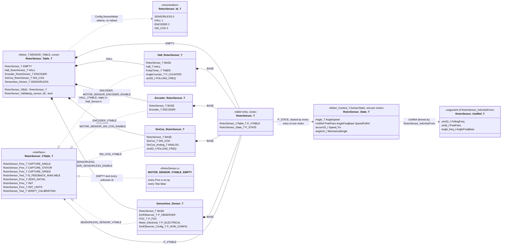
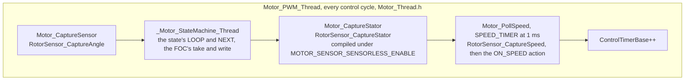
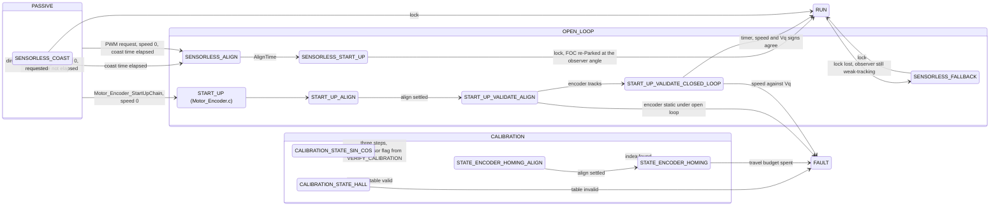

# RotorSensor interface

The rotor angle sensor interface `RotorSensor_T`: its vtable, state and registry, the four sensors that implement it (Hall, Encoder, SinCos, Sensorless), what each does in each operation, and the order the motor calls them. Board-agnostic; which sensors a board compiles and wires is the board's sheet. The sensorless entry in depth: [Sensorless.md](Sensorless/Sensorless.md).

## Interface, state, registry, implementations

- `RotorSensor_T` is the base: first member of every sensor, no back pointer. `P_STATE` is the motor's `SensorState`, so every entry of one motor publishes into the same `AngleSpeed` and `Speed_Pu`; only the active sensor is ever called.
- No NULL checks: every slot of a vtable is filled, a sensor that reads the rotor directly sets `CAPTURE_STATOR` to `RotorSensor_CaptureStatorNone`.
- `RotorSensor_Of` returns `EMPTY` for an id whose entry is not compiled: feedback never available, no start-up chain, the motor stays in PASSIVE on a PWM request.

## What the motor calls, in order

| Caller | Operation | Where |
|---|---|---|
| `Motor_Init` | `RotorSensor_Of(Config.SensorMode)` → `p_ActiveSensor`, then `RotorSensor_Init` → `INIT`, `_RotorSensor_Reset` | Motor.c |
| `Motor_Reset` → `Motor_InitUnits` | `RotorSensor_InitUnitsFrom` with PollingFreq = `MOTOR_CONTROL_FREQ`, PolePairs, AngleFreqBase → derives `UnitRef.SpeedPuRef`, then `INIT_UNITS` | Motor.c |
| `Motor_SetDirection` | `ZERO_INITIAL` | Motor.c |
| `Init_Next` | `VERIFY_CALIBRATION` → `FaultFlags.PositionSensor`; false sends INIT to FAULT | Motor_StateMachine.c |
| `Passive_InputControl`, PWM request | `IS_FEEDBACK_AVAILABLE` → RUN; else at speed 0 `Motor_Sensor_StartUpState` (the sensor's chain, NULL where none) | Motor_StateMachine.c, Motor_Sensor.c |
| RUN and INTERVENTION `NEXT` | `_Motor_TransitionFeedbackLost`: `IS_FEEDBACK_AVAILABLE`; lost → `Motor_Sensor_FallbackState` under `MOTOR_OPEN_LOOP_FALLBACK_ENABLE`, else PASSIVE within the freewheel limit, FAULT above it | Motor_StateMachine.c |
| `Intervention_InputControl`, PWM request | `IS_FEEDBACK_AVAILABLE` → RUN | Motor_StateMachine.c |
| Sensor chains | `ZERO_INITIAL` at `Align_Entry` (sensorless); `IS_FEEDBACK_AVAILABLE` in `Coast_Next`, `StartUp_Next`; `VERIFY_CALIBRATION` at `Calibration_End` (SinCos) | Motor_Sensorless.c, Motor_SinCos.c |
| Protocol | `_Motor_Var_Rotor_Get`: electrical angle, delta, speed, mechanical angle, direction from `P_STATE` | RotorSensor.h |

## Operation by sensor

| Operation | Hall (`Hall_Sensor.h`) | Encoder (`Encoder_Sensor.c`) | SinCos (`SinCos_Sensor.c`) | Sensorless (`Sensorless_Sensor.c`) | EMPTY |
|---|---|---|---|---|---|
| `INIT` | `Hall_Init`, `PulseTimer_Init`, extended watch-stop 500 ms | `Encoder_MT_Init_InterruptQuadrature`, `Encoder_EnableQuadratureMode` | `SinCos_Init` | `EmfObserver_Init` from `P_NVM_CONFIG`; per-tick state cleared | no-op |
| `INIT_UNITS` | `AngleCounter_InitFrom`: 6 counts per electrical revolution at `POLLING_FREQ`, electrical base (`_ElSpeed`; a `_MechSpeed` variant exists, not in the vtable) | encoder `Config.AngleFreqBase` = base / PolePairs (mechanical revolution), `Encoder_MT_InitUnits` | `SinCos_Config_SetAngleRatio(PolePairs)` | `EmfObserver_InitWinding(Rs, Lq)` while the model is valid; invalid keeps the prior winding | no-op |
| `CAPTURE_ANGLE` (control tick) | on a Hall edge: `PulseTimer_CaptureCount`, snap the counter to the sector angle, sector limits; else `AngleCounter_Interpolate`; publish `Angle` | `MechanicalAngle` = count angle × direction ref; `Angle` = × PolePairs; no interpolation | ADC sin, cos → `SinCos_CaptureAngle` → electrical; `Delta` = wrapped difference; `MechanicalAngle` | `AnglePll_Predict` (θ̂ += ω̂); publish `Angle`, `Delta` through the 2-sample filter | no-op |
| `CAPTURE_STATOR` (after the state machine) | none | none | none | `EmfObserver_Eemf_ProcHeld(Id, Iq)` with the held v(k−1), then `EmfObserver_HoldV(Vα, Vβ)` | no-op |
| `CAPTURE_SPEED` (1 ms) | `PulseTimer_CaptureFreq` (decays without pulses), `AngleCounter_ResolveAngleDelta` → `Delta`, `Speed_Pu`, both 2-sample filtered | `Encoder_MT_CaptureFreqD`, `ResolveInterpolation`, `Speed_Pu`, `Angle_CaptureSpeed_Pu`, `Encoder_PollIndexCapture` | `Angle_ResolveSpeed_Pu` from `Delta`, 2-sample filtered | `Angle_ResolveSpeed_Pu`, 0 while `EmfObserver_IsIndeterminate` (|ê| at the floor); 2-sample filtered | no-op |
| `IS_FEEDBACK_AVAILABLE` | true | `Encoder_IsAligned` (ALIGNED or better) | true | `EmfObserver_IsLocked` | false |
| `ZERO_INITIAL` | `Hall_ZeroInitial`, zero the counter, seed it with the sector centre and its limits, `PulseTimer_SetInitial` | `Encoder_MT_SetInitial`: pulse and speed state only, the position reference survives | one capture, `Angle` set, `Angle_StopDelta`, `Speed_Pu` 0 | `EmfObserver_Reset`: per-sample state; config and winding kept | no-op |
| `VERIFY_CALIBRATION` | `Hall_IsCalibrationTableValid` | true, stub | `Max_Adcu > Min_Adcu` and `ElectricalRotationsRatio > 0` | `K_smo != 0`, `LpfCoef != 0`, `Winding.G != 0` | false |
| Start-up chain (`Motor_Sensor_StartUpState`) | NULL | NULL from the table; `Motor_Encoder_GetStartUpState` returns START_UP but is reached only by the `Motor_Encoder_StartUpChain` command | NULL | `Motor_Sensorless_StartUpState`: SENSORLESS_COAST under PASSIVE until the coast time, then SENSORLESS_ALIGN → SENSORLESS_START_UP → RUN | NULL |
| Fallback (`Motor_Sensor_FallbackState`) | NULL | NULL | NULL | SENSORLESS_FALLBACK while `EmfObserver_IsWeak` | NULL |
| Calibration sub-state (under CALIBRATION) | CALIBRATION_STATE_HALL: six current-aligned vectors A, −C, B, −A, C, −B, `Hall_CalibrateState` at each `AlignTime`; an invalid table → FAULT | STATE_ENCODER_HOMING_ALIGN → STATE_ENCODER_HOMING: align, then index search; timeout → FAULT | CALIBRATION_STATE_SIN_COS: V-align A → `AngleOffset`, −C → `CcwPositive`; `VERIFY_CALIBRATION` at the end | none, tuning comes from NVM | none |
| Open-loop sub-states (under OPEN_LOOP) | none | ALIGN → VALIDATE_ALIGN → VALIDATE_CLOSED_LOOP (commands); START_UP → START_UP_ALIGN → START_UP_VALIDATE_ALIGN → START_UP_VALIDATE_CLOSED_LOOP → RUN | none | SENSORLESS_ALIGN, SENSORLESS_START_UP, SENSORLESS_FALLBACK | none |
| Command entry | `Motor_Hall_Calibrate`, `Motor_Hall_Cmd` | `Motor_Encoder_StartHoming`, `_StartAlignZero`, `_StartValidateAlign`, `_StartValidateClosedLoop`, `_StartUpChain` | `Motor_SinCos_Calibrate`, `_Cmd` | `Motor_Sensorless_StartRunChain` (ALIGN at once, no coast) | |
| Peripheral collaborators | `Hall_T` pins, `PulseTimer_T` on a board timer, `AngleCounter_T` | `Encoder_T`: counter or emulated pins A, B, Z | `SinCos_Analog_T`: 2 ADC conversions, marked by `SinCos_RotorSensor_MarkAnalog` | none: `FOC_T` and `Motor_Electrical_T` of the same motor | |

## Sensor-owned sub-states and their roots

The command-only encoder states ALIGN, VALIDATE_ALIGN and VALIDATE_CLOSED_LOOP mirror the START_UP_* chain and return to OPEN_LOOP instead of RUN. Every sub-state reports its root's id (`PATH_ID.Depth0`); sub-state ids are not allocated.

## Not shown / open

- `RotorSensor_Table.h` turns `MOTOR_SENSOR_HALL_ENABLE` on when neither it nor `MOTOR_SENSOR_ENCODER_DISABLE` is defined; the second test reads as if `MOTOR_SENSOR_HALL_DISABLE` were meant. `RotorSensor_Of`'s HALL case and `ROTOR_SENSOR_ENABLED.HALL` are unconditional: the table has no build without Hall.
- `Motor_Sensor.h` defines table init macros for EMPTY, HALL, ENCODER and SENSORLESS only; an application's `MOTOR_SENSOR_TABLE_INIT_SIN_COS` has no definition, and `Motor_Sensor.h` does not include `Motor_SinCos.h`. `MOTOR_SENSOR_SIN_COS_ENABLE` is not buildable through the table as written.
- The encoder start-up chain is not in `Motor_Sensor_StartUpState` (its declaration is commented in `Motor_Encoder.h`); the encoder's direction calibration (`StartDirection`, `ProcDirection`) has no state wrapping it; its `VERIFY_CALIBRATION` is a `true` stub.
- `HALL_VTABLE` is `static` in a header, one copy per translation unit that includes it; the other three vtables are `extern const`.
- `Motor_CaptureStator` is compiled only under `MOTOR_SENSOR_SENSORLESS_ENABLE` (`Motor_Thread.h`), although every vtable fills the slot.
- Hall ISR mode (`MOTOR_HALL_MODE_ISR`, `Hall_CaptureAngle_ISR` through `Motor_HallEncoder.h`) and the mechanical-speed Hall units (`Hall_RotorSensor_InitUnits_MechSpeed`) exist and are not selected by any vtable or board.
- Sequence B of the sensorless correction (between the take and the loop) and SENSORLESS_RUN are commented out in `Motor_Sensorless.c`; form A, `CAPTURE_STATOR` after the state machine, is what is built.
- The `TIMER` member of `RotorSensor_T` and the `DirectionErrorCount` reset are commented out.
