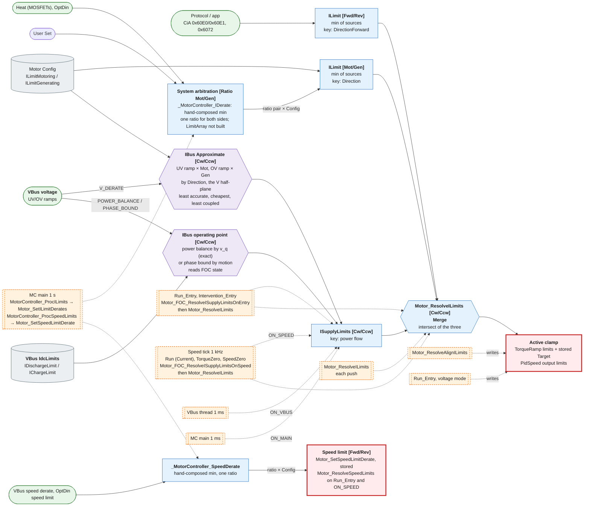

##

Green stadium: live limit source. Grey cylinder: stored config limit. Purple hexagon: frame conversion. Blue box: merge point. Red box: active clamp in the hot path. Amber dashed box: call site, with dotted edges meaning "invokes". Solid edges carry limit values.

One of [MOTOR_I_SUPPLY_LIMITS_ON_SPEED], [MOTOR_I_SUPPLY_LIMITS_ON_VBUS], [MOTOR_I_SUPPLY_LIMITS_ON_MAIN] selects the thread that resolves [ISupplyLimits] periodically, with [Motor_FOC_ResolveISupplyLimits]: the speed tick, the 1 ms VBus thread, or the 1 ms block of [MotorController_Main_Thread]. There is no default. Entry resolves it under every selection, so a state starts on a window keyed by its own Direction. With none selected nothing resolves it, and [ISupplyLimits] stays open from [Motor_Init].

The system arbitration is a hand-composed min ([_MotorController_IDerate]: the MOSFET heat derate and the OptDin torque limit); the LimitArray form is commented out in [MotLimits.h] and [MotorController.c]. The speed derate ([_MotorController_SpeedDerate]: the bus derate and the OptDin speed limit) rides the same 1 s call and reaches [Motor_ResolveSpeedLimits] on [Run_Entry] and the speed tick. It bounds the speed, not the current, and is drawn for the shared call site only.

