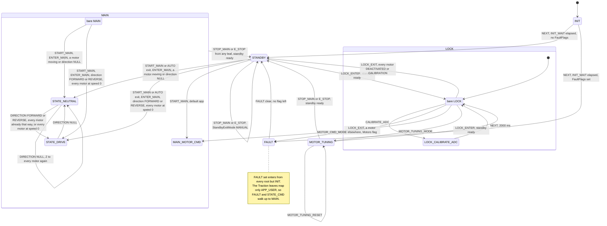
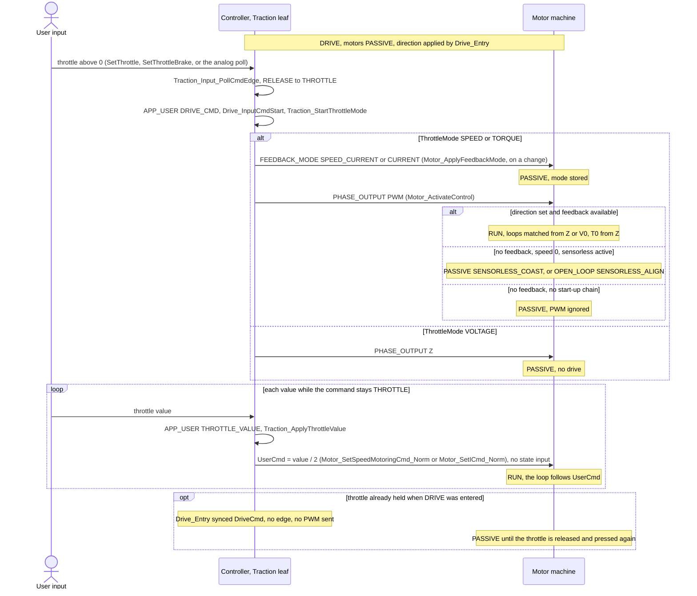
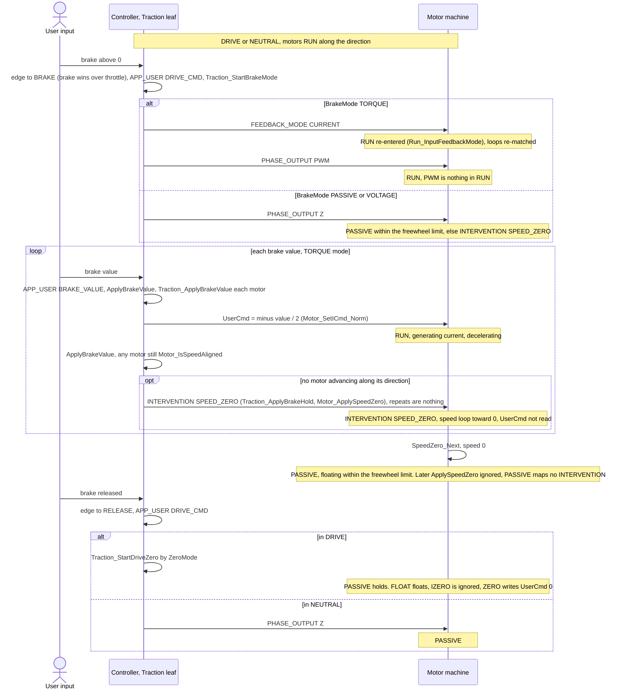
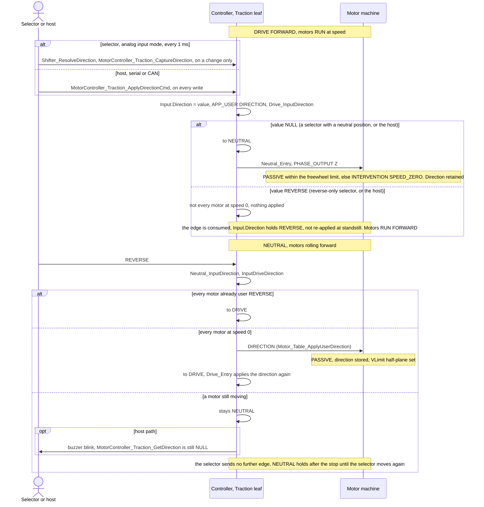
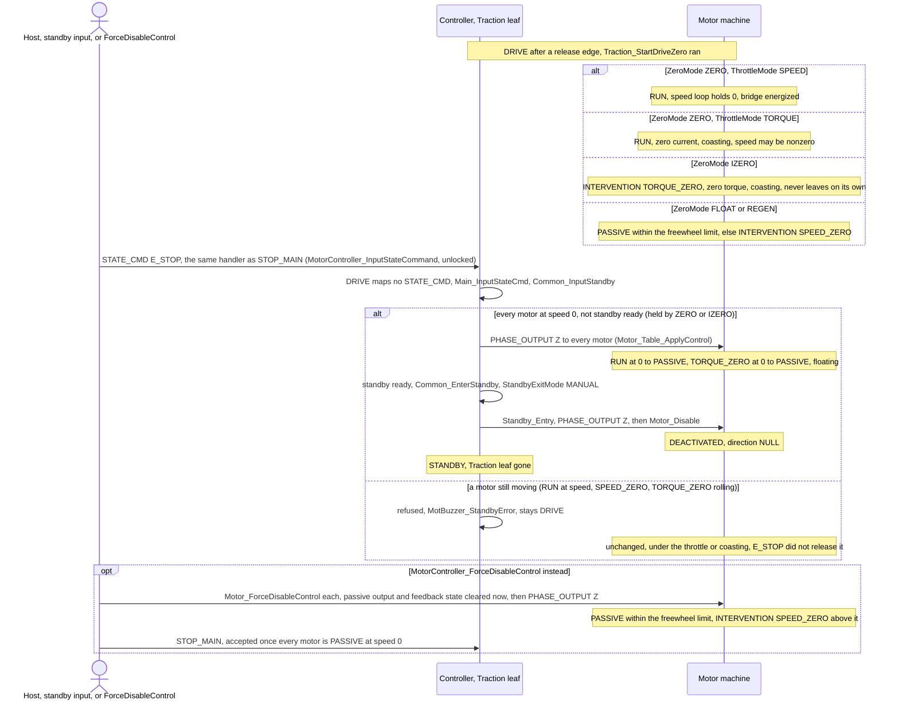
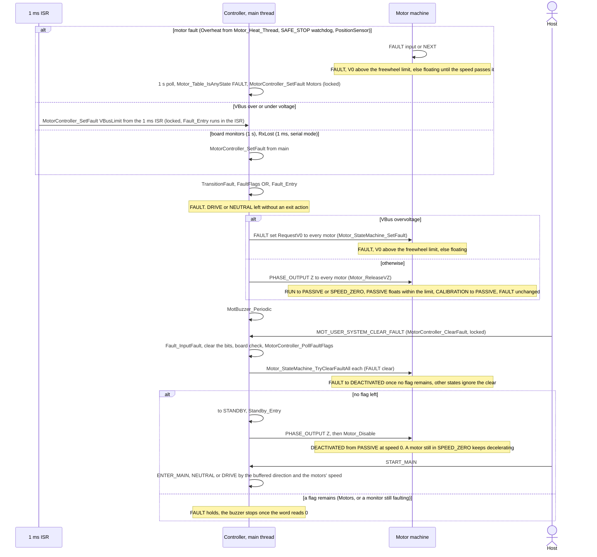

# MotorController with Traction

The controller tree with the Traction leaves in one picture, and the cross-layer sequences: what each Traction input sends to
the motor machines and the motor state after each step. The controller's root states, lock ids, fault flags and write
admission are in [MotorController_StateMachine.md](../MotorController_StateMachine.md); the motor side in
[Motor_StateTree.md](../../Motor/Motor_StateTree.md). Direction values are the user frame, `FORWARD` / `REVERSE` / `NULL`, mapped to
the motor's `CW` / `CCW` by `Config.DirectionForward` in `Motor_ApplyUserDirection`. "Standby ready" is
`Common_IsStandbyReady`: every motor `DEACTIVATED`, or every motor `PASSIVE` at speed 0.

Traction's own functions (`Traction.c`) act on one motor, through the motor's interface. The leaves run them over the motor
table and keep the decisions that read every motor: the brake hold once no motor advances (`ApplyBrakeValue`), a direction
change at standstill (`Motor_Table_IsEverySpeedZero`).

## Tree

`STATE_NEUTRAL` and `STATE_DRIVE` (`MotorController_Traction.c`) mount under `MC_STATE_MAIN` beside `MC_STATE_MAIN_MOTOR_CMD`;
`MC_STATE_LOCK_CALIBRATE_ADC` (`MotorController_Analog.c`) under `MC_STATE_LOCK`. Which leaf `START_MAIN` lands on is the
app's `ENTER_MAIN`: `MC_APP_TRACTION` answers `NEUTRAL` or `DRIVE`, the default app `MAIN_MOTOR_CMD`.

| Leaf | ENTRY | Own input slots | Motor states while active |
|---|---|---|---|
| `STATE_NEUTRAL` | `PHASE_OUTPUT` `Z` to every motor | `APP_USER`: `DIRECTION`, `DRIVE_CMD` (release → `Z`, brake → `Traction_StartBrakeMode`, throttle ignored), `BRAKE_VALUE`; throttle and lever values ignored | `PASSIVE`; `RUN`, `INTERVENTION` while braking; direction retained |
| `STATE_DRIVE` | `Traction_Input_PollCmd` (syncs `DriveCmd`, no edge), `Motor_Table_ApplyUserDirection` with the buffered direction | `APP_USER`: `DIRECTION` (`NULL` → `NEUTRAL`; `FORWARD` / `REVERSE` applied at standstill only), `DRIVE_CMD`, `THROTTLE_VALUE`, `BRAKE_VALUE`, `LEVER_DIRECTION` (at standstill), `LEVER_VALUE` | `PASSIVE`, `RUN`, `INTERVENTION`, the start-up chain under `OPEN_LOOP` |
| `MAIN_MOTOR_CMD` | `PHASE_OUTPUT` `0` | `MOTOR_CMD`, empty handler | as `MAIN` |
| `LOCK_CALIBRATE_ADC` | averaging started | none | `CALIBRATION` leaf `CALIBRATION_STATE` (ADC zero) |

## Cross-layer table

Every motor-facing call the Traction leaves and the controller roots make, the motor input it becomes, and what each motor
state does with it. "ignored" is an unmapped slot or a handler that returns `NULL` without effect.

| Caller | Motor call | Motor input | `PASSIVE` | `RUN` | `TORQUE_ZERO`, `SPEED_ZERO` | `SAFE_STOP` | `OPEN_LOOP` branch | `DEACTIVATED`, `CALIBRATION`, `FAULT` |
|---|---|---|---|---|---|---|---|---|
| `Drive_Entry`; `Neutral_InputDirection` at standstill; `Drive_InputDirection`, `Drive_InputLeverDirection` at standstill | `Motor_Table_ApplyUserDirection` → `Motor_ApplyVirtualDirection`, on a change | `DIRECTION` | stored at speed 0, VLimit half-plane set | ignored | ignored | ignored | at speed 0: `NULL` → `PASSIVE`, else stored | `DEACTIVATED` stores at any speed; `CALIBRATION` at speed 0; `FAULT` ignores |
| `Traction_StartThrottleMode`, `Traction_StartBrakeMode`, each motor | `Motor_ApplyFeedbackMode`, on a change | `FEEDBACK_MODE` | stored | stored, `RUN` re-entered, loops re-matched | stored, applied by `Run_Entry` on resume | as its parent | stored | `DEACTIVATED` stores; `CALIBRATION`, `FAULT` ignore |
| `Traction_StartThrottleMode` (`SPEED`, `TORQUE`), `Traction_StartBrakeMode` (`TORQUE`), each motor | `Motor_ApplyControlState` `PWM` | `PHASE_OUTPUT` `PWM` | → `RUN` with direction and feedback; the start-up chain at speed 0 without feedback; else nothing | nothing | → `RUN` with feedback | refused | nothing | `CALIBRATION` V0; others ignore |
| `Neutral_Entry`, `Neutral_InputCmdStart` release, `Traction_StartDriveZero` `FLOAT` / `REGEN`, `Traction_Start*Mode` `VOLTAGE` / `PASSIVE`, `Common_InputStandby`, `Standby_Entry`, `Fault_Entry` (`Motor_ReleaseVZ`) | `Motor_Table_ApplyControl` `Z`; `Motor_ApplyControlState` `Z` from the `Traction_` functions, each motor | `PHASE_OUTPUT` `Z` | floats within the freewheel limit | → `PASSIVE` within the limit, else `SPEED_ZERO` | → `PASSIVE` within the limit, else `SPEED_ZERO` (re-entry) | → `PASSIVE` at speed 0, else refused | → `PASSIVE` | `CALIBRATION` floats → `PASSIVE`; `DEACTIVATED`, `FAULT` ignore |
| `Main_Entry`, `MotorCmd_Entry` | `Motor_Table_ApplyControl` `0` | `PHASE_OUTPUT` `0` | V0 | as `Z` | as `Z` | as `Z` | → `PASSIVE` | `CALIBRATION` V0; others ignore |
| `ApplyBrakeValue` once no motor `Motor_IsSpeedAligned`, then `Traction_ApplyBrakeHold` (`TORQUE`) each motor | `Motor_ApplySpeedZero` | `INTERVENTION` `SPEED_ZERO` | ignored | → `SPEED_ZERO` | → `SPEED_ZERO`; nothing when already active | refused | ignored | ignored |
| `Traction_StartDriveZero` `IZERO` | `Motor_ApplyTorqueZero` | `INTERVENTION` `TORQUE_ZERO` | ignored | → `TORQUE_ZERO` | → `TORQUE_ZERO`; nothing when already active | refused | ignored | ignored |
| `MotorController_Main_Thread`, serial `RxLost` | `Motor_ApplySafeStop` | `INTERVENTION` `SAFE_STOP` | ignored | → `SAFE_STOP` | → `SAFE_STOP` | refused | ignored | ignored |
| `Traction_ApplyThrottleValue`, `Traction_ApplyBrakeValue`, `Traction_ApplyLeverValue`, `Traction_StartDriveZero` `ZERO` | `Motor_SetSpeedMotoringCmd_Norm`, `Motor_SetICmd_Norm`, `Motor_SetSpeedCmd_Norm`, `Motor_SetTorqueCmd_Norm` | none: `UserCmd` written in any state | held; `Run_Entry` overwrites it from the matched ramp | followed by the loop | `TORQUE_ZERO` takes the generating half; `SPEED_ZERO` ignores | ignored | ignored | held |
| `Main_Entry` | `Motor_Table_EnableAll` (`Motor_Enable`) | command on `DEACTIVATED` | | | | | | `DEACTIVATED` → `PASSIVE` |
| `Standby_Entry`, `Lock_Entry` | `Motor_Table_DisableAll` (`Motor_Disable`) | command on `PASSIVE` | → `DEACTIVATED` at speed 0 | | | | | |
| `Lock_Entry` | `Motor_Calibration_Enter` | `CALIBRATION` root pointer | ignored (`NULL` slot) | ignored | ignored | ignored | ignored | `DEACTIVATED` at speed 0 → bare `CALIBRATION`; `CALIBRATION` re-enters the bare root; `FAULT` ignores |
| `LOCK_EXIT`, `MOTOR_CMD_MODE`, `MOTOR_TUNING_MODE` | `Motor_Calibration_Exit` | `CALIBRATION` `NULL` | ignored | ignored | ignored | ignored | ignored | `CALIBRATION` → `PASSIVE`; others ignore |
| `Fault_Entry` on overvoltage | `Motor_StateMachine_SetFault` `RequestV0` | `FAULT` set | → `FAULT`, V0 above the freewheel limit, else float | → `FAULT` | → `FAULT` | → `FAULT` | → `FAULT` | `DEACTIVATED`, `CALIBRATION` → `FAULT`; `FAULT` accumulates |
| `Fault_InputFault` clear | `Motor_StateMachine_TryClearFaultAll` | `FAULT` clear | ignored | ignored | ignored | ignored | ignored | `FAULT` → `DEACTIVATED` once no flag remains |

## Sequences

Participants: the user input (analog poll every 1 ms, or a protocol write), the controller machine with its Traction leaf, the
motor machine. A note under the motor is its state after the step.

### Throttle press

### Brake to hold

### Direction change at speed

### E_STOP under ZeroMode ZERO and IZERO

### Fault

## Not shown / open

- The lever path (`MotorController_Traction_SetLever`, `LEVER_DIRECTION` on engage, `LEVER_VALUE` in `THROUGH_ZERO`) is
  in the cross-layer table only.
- `E_STOP` runs the same handler as `STOP_MAIN`: it does not release a moving motor. `MotorController_ForceDisableControl`
  is the path that does, outside the controller machine.
- A reversal requested while rolling is consumed (`Drive_InputDirection`, `InputDriveDirection`) and not re-applied at
  standstill; the selector path sends only on a change, so a reverse-only selector held in `REVERSE` does not reverse until
  it is moved again. The host path re-sends on every write.
- The brake hold ends in `PASSIVE`, floating within the freewheel limit, not held: the hold is the `SPEED_ZERO` phase.
- A throttle held through `Drive_Entry` gives no edge; the motor stays `PASSIVE` until the throttle is released.
- The fault clear lands in `STANDBY` on `FaultFlags` alone; a motor still in `SPEED_ZERO` at that moment keeps decelerating
  under `STANDBY`.
- The `AUTO` standby exit (analog, no standby input) and `MotorController_StandbyPin` edges are drawn as `START_MAIN` /
  `STOP_MAIN` only.
- Which thread `Fault_Entry` runs on, and the lock it holds while it sends the motor inputs, is in
  [InputVsLoop.md](../../../Framework/StateMachine/InputVsLoop.md).
