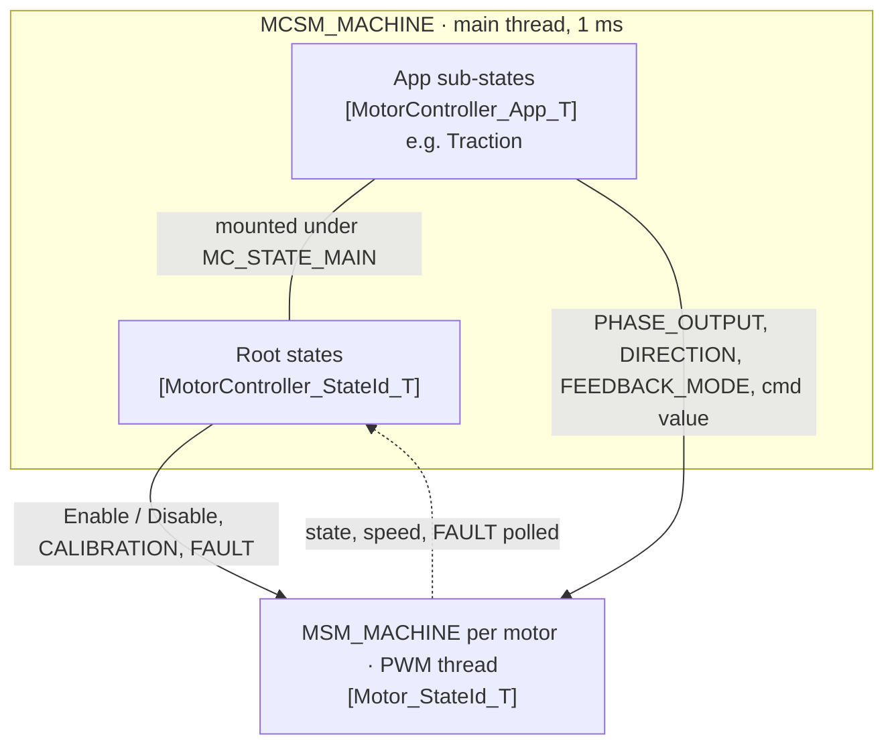
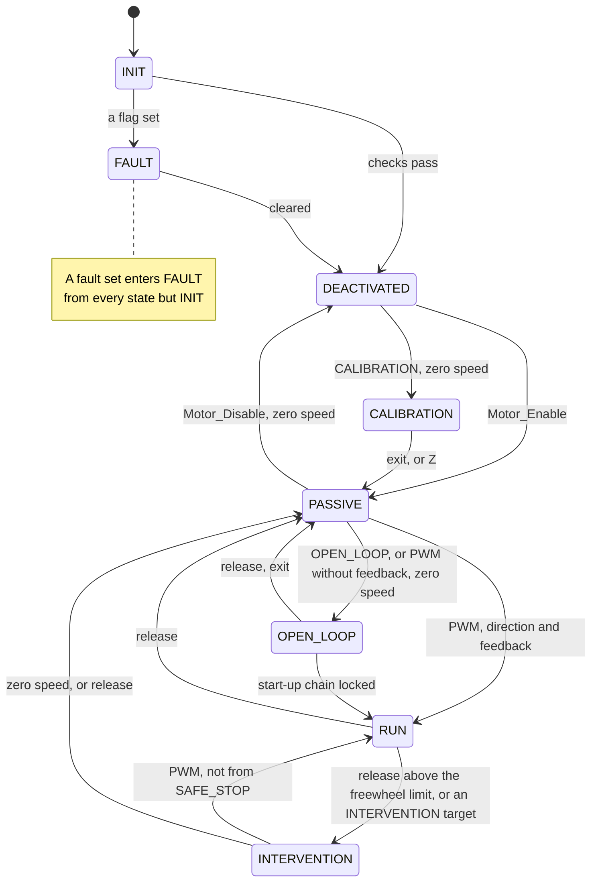
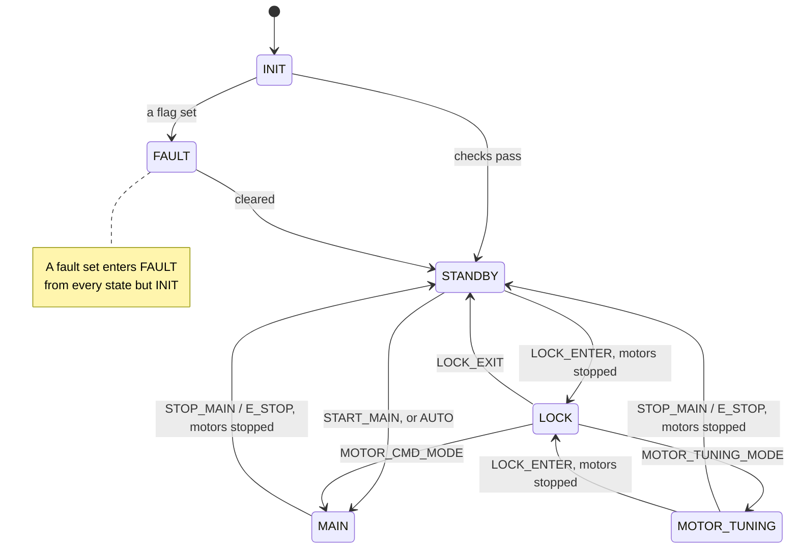

# Motor Control State Machines

The quick reference. Motor control runs two hierarchical state machines on one engine,
[Framework/StateMachine](../Framework/StateMachine/Architecture.md): an `MSM_MACHINE` per motor, and one
`MCSM_MACHINE` for the controller, which holds the system states and, under `MC_STATE_MAIN`, the app's sub-states.
The detail is in:

- [Motor_StateMachine.md](Motor/Motor_StateMachine.md): each motor state, input, action, fault and sub-state;
  [Motor_StateTree.md](Motor/Motor_StateTree.md): every leaf, each hand-off and what each state owns.
- [MotorController_StateMachine.md](MotorController/MotorController_StateMachine.md): the controller's states, lock
  operations, faults and write admission, and the Traction app.
- [StateMachineOverview.exp.md](StateMachineOverview.exp.md): the engine conventions both machines rely on, and the
  design decisions.

State names drop their prefix (`MC_STATE_`, `MOTOR_STATE_`, `INTERVENTION_STATE_`, `STATE_`). Phase output: `Z`
floats every phase, `0` turns every low side on (V0), `PWM` drives the bridge. The freewheel limit
(`Motor_IsSpeedFreewheelLimitRange`) is the speed above which a floating bridge rectifies the back-EMF into the bus:
above it the hold states apply V0 and a release decelerates. Zero speed is an exact test.

## Layers



| Layer | Owns | Does not know |
|---|---|---|
| Motor | the phase output and what gates it, the feedback loops, speed estimation, start-up and calibration procedures, motor faults, direction `CW` / `CCW` / `NULL` | `STANDBY`, `NEUTRAL`, `DRIVE`; the other motors |
| MotorController | boot, multi-motor coordination, system faults, `STANDBY`, `LOCK` (calibration, NVM), live tuning, write admission, motors `DEACTIVATED` ⇄ `PASSIVE` | app states and inputs |
| App, e.g. Traction | `NEUTRAL` / `DRIVE`, `FORWARD` / `REVERSE`, the throttle, brake and lever mapping, release behavior, direction-change checks, motors `PASSIVE` ⇄ `RUN` and the brake hold | |

| Machine | Proc | Inputs |
|---|---|---|
| `MSM_MACHINE` | PWM thread, 20 kHz; actions on the 1 kHz speed tick and on each phase-current sample | main thread, applied on the call under the engine's lock |
| `MCSM_MACHINE` | main thread, 1 ms | main thread, applied on the call, no lock needed; fault sets also from the 1 ms timer thread |

- The app is not a separate machine. Its states are sub-states of `MC_STATE_MAIN`, run by `MCSM_MACHINE` on the
  same thread, and its inputs arrive as `MC_STATE_INPUT_APP_USER`.
- Each motor runs on its own. The controller reaches them all through `Motor_Table_T`: a command goes to every
  motor, and a guard requires every motor.
- Commands go down as inputs. The controller and the app never set a motor's state; they send motor inputs and
  transition commands, and the motor's own guards decide. Command values (`UserCmd`) bypass both machines; the
  active motor state reads them.
- Status goes up by polling. Controller guards read every motor's state and speed when an input arrives. Motor
  faults reach the controller on its 1 s poll.

## The tree

Roots at the first level, sub-states below; `→` is a chain the sub-states run on their own. Names are shortened,
and some sub-states exist only under a build option: [Motor_StateTree.md](Motor/Motor_StateTree.md) has them all.

```text
MCSM_MACHINE · one per controller · main thread, 1 ms
├── INIT                 boot checks: board, VBus, every motor DEACTIVATED
├── STANDBY              parked: motors DEACTIVATED, direction NULL, float
├── MAIN                 motors enabled, V0 on entry
│   ├── MAIN_MOTOR_CMD   direct motor commands: the default app, and LOCK's MOTOR_CMD_MODE
│   ├── NEUTRAL          Traction: float, brake only, direction retained
│   └── DRIVE            Traction: FORWARD / REVERSE, throttle, brake, release
├── MOTOR_TUNING         live PID writes with the motors running
├── LOCK                 motors CALIBRATION: calibration, NVM save, reboot
│   └── CALIBRATE_ADC    throttle and brake zeros, 2000 ms
└── FAULT                latched flags, buzzer until cleared

MSM_MACHINE · one per motor · PWM thread, 20 kHz
├── INIT                 1.5 s, then the config and sensor checks
├── DEACTIVATED          float, direction NULL; the only door to CALIBRATION
├── PASSIVE              float, or V0 above the freewheel limit
│   └── SENSORLESS_COAST holds a PWM request until PASSIVE has lasted 1 s
├── RUN                  closed loop
├── INTERVENTION         active control, the user's command out of the loop
│   ├── TORQUE_ZERO      inhibits motoring; never ends on its own
│   └── SPEED_ZERO       decelerates, then PASSIVE at zero speed
│       └── SAFE_STOP    SPEED_ZERO's loop, PWM refused, FAULT after 10 s
├── OPEN_LOOP            entered at zero speed; V0 until a sub-state drives
│   ├── ANGLE_ALIGN · START_UP_ALIGN → OPEN_LOOP_STATE_RUN
│   ├── SENSORLESS_ALIGN → SENSORLESS_START_UP → RUN · SENSORLESS_FALLBACK → RUN
│   └── encoder START_UP → … → RUN · ALIGN → VALIDATE_ALIGN → VALIDATE_CLOSED_LOOP
├── CALIBRATION          V0 on entry; each procedure returns to the bare root
│   └── ELECTRICAL · ADC zero · HALL · SIN_COS · ENCODER_HOMING_ALIGN → ENCODER_HOMING
└── FAULT                float, or V0 above the freewheel limit
```

## Motor



| State | Is | Phase output |
|---|---|---|
| `INIT` | waits 1.5 s, then checks the config and the sensor calibration; takes no input | unchanged |
| `DEACTIVATED` | quiescent: nothing runs until `Motor_Enable` or `CALIBRATION`; direction reset to `NULL` | float |
| `PASSIVE` | freewheel or hold; captures the back-EMF angle so `RUN` can resume at speed | float; V0 above the freewheel limit, or on `0` |
| `RUN` | the current loop, on the speed loop's output or on `UserCmd`, by `FeedbackMode` | PWM |
| `INTERVENTION` | the current loop on the sub-state's reference, whatever `FeedbackMode` says | PWM |
| `OPEN_LOOP` | align, start-up and open-loop run; the sensor chains hand off to `RUN` | V0 until a sub-state drives |
| `CALIBRATION` | one procedure at a time | V0; after a procedure, what it left |
| `FAULT` | latches `Motor_FaultFlags_T`: `Overheat`, `PositionSensor`, `InitCheck`, `RequestV0`, `SafeStopTimeout` | float; V0 above the freewheel limit |

- Release is `Z` or `0`: `PASSIVE` within the freewheel limit, else `SPEED_ZERO`.
- Feedback lost in `RUN` or `INTERVENTION`: the sensor's fallback where it has one (sensorless, as a build option),
  else `PASSIVE` within the freewheel limit, else `FAULT` with `PositionSensor`.
- A fault clear removes its flags, re-polls the conditions, and leaves for `DEACTIVATED` once none remain.

## Controller



| State | Is | Motor states |
|---|---|---|
| `INIT` | waits 1.55 s, then checks the board, VBus, and that every motor is `DEACTIVATED`; takes no input | `INIT`, `DEACTIVATED` |
| `STANDBY` | parked; takes state commands and `LOCK_ENTER` only, motor and app inputs are buffered. Left by `START_MAIN`, or by itself under `StandbyExitMode` `AUTO` | `DEACTIVATED` |
| `MAIN` | normal operation; the app's mounting point | `PASSIVE`, `RUN`, `INTERVENTION`, `OPEN_LOOP` |
| `MOTOR_TUNING` | live PID tuning; an exit to `STANDBY` discards the live gains, `LOCK_ENTER` keeps them for an NVM save | `PASSIVE`, `RUN` |
| `LOCK` | operations committed to as risky. Ids at the bare `LOCK` only: `LOCK_EXIT`, `NVM_SAVE_CONFIG`, `CALIBRATE_ADC`, `REBOOT`, `MOTOR_CMD_MODE`, `MOTOR_TUNING_MODE` | `CALIBRATION`; `DEACTIVATED` if moving at entry |
| `FAULT` | latches `MotorController_FaultFlags_T`: `VBusLimit`, `PcbOverheat`, `MosfetsOverheat`, `VAccsLimit`, `VAnalogLimit`, `Motors`, `RxLost`, `InitCheck`. Overvoltage sends `RequestV0`; buzzer until cleared | `FAULT` for a motor fault; else released |

- "Motors stopped" is every motor `DEACTIVATED`, or `PASSIVE` at zero speed. `STOP_MAIN` releases a motor held at
  zero speed first; a refusal sounds the standby-error buzzer, or answers `ERROR` for `LOCK_ENTER`.
- `LOCK_EXIT` with a motor outside `DEACTIVATED` / `CALIBRATION` sets `Motors` and goes to `FAULT`.
- Writes by state: motor commands in `MAIN_MOTOR_CMD` or `MOTOR_TUNING`, calibration commands in `LOCK`, PID I/O in
  `MOTOR_TUNING`, config in `LOCK` or `FAULT`.

## Traction

| Controller | App | Motor states | Motor direction | Phase output |
|---|---|---|---|---|
| `STANDBY` | — | `DEACTIVATED` | `NULL` | float |
| `MAIN` | `NEUTRAL` | `PASSIVE`; `RUN`, `INTERVENTION` while braking | retained | float; PWM while braking |
| `MAIN` | `DRIVE` | `PASSIVE`, `RUN`, `INTERVENTION` | `FORWARD` / `REVERSE` | V0 or float at rest; PWM on throttle and brake; release by `ZeroMode` |
| `LOCK` | — | `CALIBRATION` | `NULL` | V0 |
| `FAULT` | — | `FAULT` | as it was | V0 on overvoltage or above the freewheel limit, else float |

- Direction has two frames. The user frame, `FORWARD` / `REVERSE`, is what Traction buffers and sends. The motor
  maps it to `CW` / `CCW` through `Config.DirectionForward`; `Motor_Context_T.Direction` and the FOC voltage
  half-plane hold the result.
- Traction's inputs, as `APP_USER` values: `DIRECTION`, `DRIVE_CMD` (the throttle / brake / release edge),
  `THROTTLE_VALUE`, `BRAKE_VALUE`, `LEVER_DIRECTION`, `LEVER_VALUE`.

| From | Input | Motors | Result |
|---|---|---|---|
| `STANDBY` | `START_MAIN` with `FORWARD` / `REVERSE` buffered | stopped | `DRIVE`, the direction applied |
| `STANDBY` | `START_MAIN` | moving, or stopped with `NULL` buffered | `NEUTRAL` |
| `NEUTRAL` | `FORWARD` / `REVERSE` | stopped, or already that way at any speed | `DRIVE` |
| `NEUTRAL` | `FORWARD` / `REVERSE` | moving the other way | stays `NEUTRAL`, buzzer blinks; send again once stopped |
| `DRIVE` | `NULL` | any | `NEUTRAL`, direction retained |
| `DRIVE` | `FORWARD` / `REVERSE` | any | no change |
| `MAIN` | `STOP_MAIN` | stopped | `STANDBY`: motors `DEACTIVATED`, motor direction `NULL`; Traction's buffered direction stays |

| In `DRIVE` | Motor |
|---|---|
| throttle edge | the feedback mode by `ThrottleMode` (`SPEED`, `TORQUE`), then `PWM`: `PASSIVE` → `RUN`. A held throttle at `DRIVE` entry gives no edge |
| throttle value | a speed or current command, `UserCmd` |
| brake edge, also in `NEUTRAL` | `BrakeMode` `TORQUE`: an opposing current, then `SPEED_ZERO` once no motor turns along its direction, `PASSIVE` at zero. `BrakeMode` `PASSIVE`: released, braking is mechanical |
| release, `ZeroMode` `FLOAT` | `Z`: `PASSIVE`, or `SPEED_ZERO` above the freewheel limit. `REGEN`, not implemented, acts as `FLOAT` |
| release, `ZeroMode` `IZERO` | `TORQUE_ZERO` |
| release, `ZeroMode` `ZERO` | a command of 0, stays `RUN`: in speed mode it holds standstill, energized |

## Inputs

| Motor, `Motor_StateInput_T` | Value | Sent by |
|---|---|---|
| `PHASE_OUTPUT` | `Z`, `0`, `PWM` | `Motor_ActivateControl` (`PWM`), `Motor_ReleaseVZ`, `Motor_ReleaseV0` |
| `FEEDBACK_MODE` | `Motor_FeedbackMode_T` | `Motor_ApplyFeedbackMode`, on a change |
| `DIRECTION` | `CW`, `CCW`, `NULL` | `Motor_ApplyUserDirection` (the user frame), `Motor_ApplyVirtualDirection` |
| `INTERVENTION` | the sub-state, a `State_T *` | `Motor_ApplyTorqueZero`, `Motor_ApplySpeedZero`, `Motor_ApplySafeStop` |
| `OPEN_LOOP`, `CALIBRATION` | the root or a sub-state; `NULL` exits | `Motor_OpenLoop_Enter` / `_Exit`, `Motor_Calibration_Enter` / `_Exit` |
| `FAULT` | `Motor_FaultCmd_T`: set and clear deltas | `Motor_StateMachine_SetFault`, `_ClearFault`, `_TryClearFaultAll` |
| transition commands | — | `Motor_Enable` (`DEACTIVATED` → `PASSIVE`), `Motor_Disable` (`PASSIVE` → `DEACTIVATED`, zero speed) |

| Controller, `MotorController_StateInput_T` | Value | Sent by |
|---|---|---|
| `STATE_CMD` | `START_MAIN`, `STOP_MAIN`, `E_STOP` | `MotorController_InputStateCommand`, `_EnterMain`, `_ExitMain` |
| `LOCK` | `MotorController_LockId_T`; answers `LockOpStatus` | `MotorController_InputLock`, `_EnterLockState`, `_ExitLockState` |
| `FAULT` | `MotorController_FaultCmd_T`: set and clear deltas | `MotorController_SetFault`, `_ClearFault`, `_TryClearFaultAll` |
| `MOTOR_CMD` | — | `MAIN_MOTOR_CMD` only; motor commands arrive as var writes |
| `APP_USER` | the app's input id, `Traction_StateInput_T` | the `MotorController_Traction_*` user layer |

## Interlocks

| Interlock | Enforced by |
|---|---|
| `RUN` needs a direction and live sensor feedback | motor, `PASSIVE` |
| A direction changes only at zero speed | Traction (`NEUTRAL`, lever engage), then the motor again (`PASSIVE`, `OPEN_LOOP`, `CALIBRATION`); `RUN` and `INTERVENTION` ignore it |
| Asking for the opposite direction while moving keeps `NEUTRAL` and blinks the buzzer | Traction |
| A release above the freewheel limit decelerates instead of floating | motor, `RUN` and `INTERVENTION` |
| Leaving `MAIN` or `MOTOR_TUNING`, and entering `LOCK`, needs every motor `DEACTIVATED`, or `PASSIVE` at zero speed | controller |
| `CALIBRATION` is entered from `DEACTIVATED` at zero speed only, never from `FAULT` | motor |
| `LOCK` exit and fault clear land in `STANDBY`, never live `MAIN` | controller |
| Boot faults if any motor is not `DEACTIVATED` once its init is done | controller, `INIT` |
| A throttle held while `DRIVE` is entered does not start the motor | Traction |
| A throttle, brake or release mode with no command releases the motors instead of starting the bridge | Traction |
| Serial input loss safe-stops every motor, then faults | controller |
| A motor fault stops that motor at once; the controller follows within 1 s | motor, controller |

## Sequences

| Sequence | Path |
|---|---|
| Boot | controller `INIT` and motor `INIT` check → motors `DEACTIVATED` → `STANDBY` → `START_MAIN`, or `AUTO` → `MAIN`: motors `PASSIVE`, V0 → `NEUTRAL`, or `DRIVE` by the buffered direction |
| Drive | `NEUTRAL`, `FORWARD` with the motors stopped → `DRIVE` → throttle edge: `PASSIVE` → `RUN` → release: by `ZeroMode` |
| Park | `STOP_MAIN`, motors stopped → `STANDBY`: `Z`, `Motor_Disable`, motors `DEACTIVATED`, direction `NULL` |
| Calibrate | `STANDBY` → `LOCK_ENTER`: motors `CALIBRATION` → a calibration command, `NVM_SAVE_CONFIG` → `LOCK_EXIT` → `STANDBY` |
| Fault | a motor `FAULT`, at once → controller `FAULT` on the 1 s poll → clear: re-poll, motors `DEACTIVATED` → `STANDBY` |
| Serial loss | `RxLost`: every motor `SAFE_STOP`, `PASSIVE` at zero speed → controller `FAULT` within 1 s |
