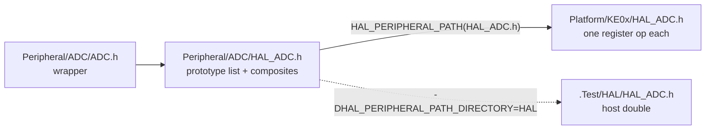

# Peripheral Layer Notes

## Layers

HAL_Module -> Register abstraction. One register operation per function, no state, no sequencing. `HAL_ADC_T` is the vendor register block (`ADC_Type` on KE0x).
Wrapper module -> Minimal const configuration or state for operation. `[Pin_T]` is a register block plus a mask; `[ADC_T]` adds the channel table and `[ADC_State_T]`.

Composites that need more than one register op (`HAL_ADC_ActivateEach`, `HAL_CAN_WriteTxMessage`) stay in `Peripheral/<Module>/HAL_<Module>.h` and compose the platform's primitives, so a platform writes primitives only.

## Binding: direct include

No function pointer virtualization. Directly include inline definitions.

`Peripheral/<Module>/HAL_<Module>.h` declares the operation set as `static inline` prototypes, then includes the platform file through `HAL_PERIPHERAL_PATH(File)` (`Peripheral/HAL/HAL_Peripheral.h`). The platform is one of:

- `HAL_PERIPHERAL_PATH_PLATFORM` -> `Peripheral/HAL/Platform/<Platform>/` (`KE0x`)
- `HAL_PERIPHERAL_PATH_DIRECTORY` -> any directory on the include path (`Source/HAL/Peripheral/S32`; host tests: `.Test/HAL`)

The prototype list is the interface. A platform that omits a definition fails the TU that uses it (used but never defined); a signature mismatch is a redeclaration error. The check runs at compile time, where a vtable checks NULL at runtime or not at all.

## Rationale: direct include over virtual table

Cardinality per TU image. Hw does not change at runtime, and neither does the implementation set: one ADC IP, one PWM IP, one GPIO IP per image. Dispatch form follows how many implementations of an interface live in one image, not whether hardware changes at runtime.

| | direct include | vtable |
|---|---|---|
| implementations per image | one per class | any number, bound per instance |
| binding time | preprocessor, by include path | init, by table pointer |
| call cost, Cortex-M0+ | one `ldr`/`str`; base folds to an immediate when the descriptor is a file-scope const in the caller's TU | load table, load fn, `blx`, callee prologue, load base: 6 to 10 instructions around the same `ldr` |
| flash per op | 1 to 2 instructions inline at each site | one out-of-line body plus 3 to 4 instructions per site; cheaper only for large ops |
| interface check | compile time | runtime NULL check, or the rule "fully defined, use empty function" |
| test double | a directory, selected per build | a table, selected per instance |

The granularity decides it. A HAL op is one register access. Wrapping that in an indirect call costs more than the op; a vtable only pays at message or instance granularity, where one call does enough work to hide the dispatch. That is where this library puts its tables:

- `[Xcvr_T]`: TX/RX moves a whole message; UART, SPI, I2C, CAN sit behind it in one image.
- `[RotorSensor_T]`: CAPTURE_ANGLE per control cycle; Hall, Encoder, SinCos, Sensorless sit in `[RotorSensor_Table_T]` and `Config.SensorMode` picks one at init.

Same split as Linux: `asm/*.h` per architecture is `static inline` by include path (one arch per image); `struct file_operations` is a table (many drivers per image). Zephyr's `dev->api` buys heterogeneous instances of one class, device-tree binding, out-of-tree drivers and a syscall boundary; all OS consequences of the per-instance binding, none needed by a library compiled per board.

Rule: a table at the boundary where a second implementation enters the image (`[Xcvr_T]`, `[RotorSensor_T]`), never under `HAL_*`. An external SPI ADC would get its own module behind `[ADC_Conversion_T]`, not a table under `HAL_ADC`.

## Defaults and overrides

Three mechanisms in use. Only the first gives a default that inlines and can still be replaced.

| mechanism | example | gives |
|---|---|---|
| macro-guarded default definition | `HAL_CAN_OVERRIDE_DEFAULT_IMPLEMENTATION` around the `[CAN_Frame_T]` composites; `HAL_ADC_SelectDmaSequence` under `HAL_ADC_DMA_ENABLE` | inline default, platform replaces the whole block |
| `#ifndef` constant | `HAL_ADC_VALUE_T`, `HAL_ADC_PIN_T`, `HAL_ADC_FIFO_LENGTH_MAX`, `PIN_ID_INIT` | a platform-sized type or count |
| `__attribute__((weak))` definition | `HAL_CAN_SetRxFilterAcceptNone` (`HAL_CAN.h` line 83) | link-time override, external linkage |

`weak` cannot double as the forward declaration and the overridable default. `weak` applies to external-linkage symbols, so the function is resolved by the linker: it cannot inline, the register base cannot fold, and a `static inline` cannot be weak at all ("weak declaration must be public"). A `static inline` default cannot be overridden either; a second definition in the same TU is a redefinition error. The two properties wanted, folded inline and replaceable, meet only in the macro guard. The weak form is acceptable for cold calls (filter setup), not for anything on a control-loop path.

## Testing

Testing needs stubs. The stub is the same mechanism: a directory with the same file names, selected by `-DHAL_PERIPHERAL_PATH_DIRECTORY=HAL -I<library>/.Test`. `.Test/HAL/HAL_Types.h` defines `HAL_ADC_T` as a RAM struct (`R[]`, `SC1[]`, `IsActive`, `IsComplete`, range counters) and `.Test/HAL/HAL_ADC.h` completes conversions on activation, so the wrapper runs its real code against a behavioral double.

Two levels, both without hardware:

1. Behavioral double (`.Test/HAL`): tests the wrapper module (`[ADC_Sequence_T]`, `[ADC_Batch_T]`).
2. Real platform header over the vendor register struct held in RAM: tests the HAL itself (host clang, stub `cmsis_gcc.h`).

Limit: one HAL per build. A fake and a real driver of the same class cannot share an image. With one platform per image that is never needed.

## Exception: Pin / FastPin

KE0x has two register blocks for the same pins: `GPIO_Type` on the peripheral bus and `FGPIO_Type` on the single-cycle IOPORT alias, identical layout (`PDOR`, `PSOR`, `PCOR`, `PTOR`, `PDIR`, `PDDR`, `PIDR`). `HAL_Pin.h` and `HAL_FastPin.h` have the same bodies over the two types. One wrapper, two implementations in one image: the only place the cardinality rule is broken at HAL level.

Options:

- `_Generic` on the wrapper pointer (sketch in `Pin.h`): compile-time dispatch, zero cost. Requires `[FastPin_T]` to be a distinct struct, not `typedef Pin_T FastPin_T`; `_Generic` selects on type, and a typedef is the same type.
- Table in `[Pin_T]`: runtime cost on the hottest pin ops, so no.
- One type: since the layout is identical, `HAL_Pin_T` can be `FGPIO_Type` for every pin on KE0x, with the board passing IOPORT addresses. No second implementation, no dispatch. Preferred unless a pin must stay on the peripheral-bus block.

`_Generic` vs vtable, in general: `_Generic` is the compile-time form of the same choice, right when the set of implementations is closed at compile time and every instance's type is visible at the call site. A table is for the set that closes at init.
