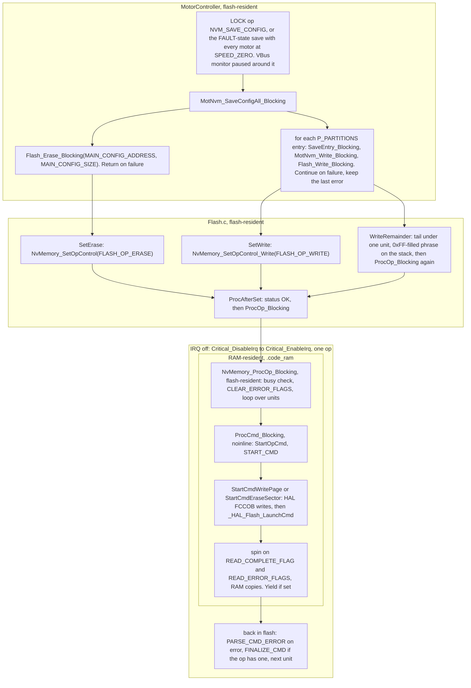
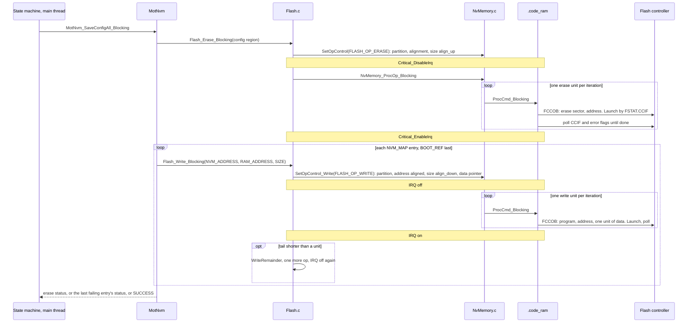

# NvMemory Blocking Write Path

From `MotNvm_SaveConfigAll_Blocking` down to the flash controller command, for the flash back end (`MOTOR_CONTROLLER_USER_NVM_FLASH`): the call chain, which code must execute from RAM, where interrupts are off, and the generic admission a request passes. The partition rows and their addresses are the board's; this sheet describes what a row does, the board's flash map lists its rows.

## Call chain

One op in time:

## Where the code runs

The array is unreadable while a command executes, so nothing fetched from flash may run between the launch and the completion flag, and the vector table cannot be reached either: hence the RAM section and the IRQ-off span together.

| Code | Section | Why |
|---|---|---|
| `ProcCmd_Blocking`, `NvMemory.c` | `NV_MEMORY_ATTRIBUTE_RAM_SECTION`, `noinline` | Launches the command and spins until it completes |
| `OpCmdAddress`, `StartOpCmd`, `NvMemory.c` | same, `static inline` | Called from `ProcCmd_Blocking`; the attribute covers the case they are not inlined |
| `StartCmdWritePage`, `StartCmdEraseSector`, `StartCmdVerifyWriteUnit`, `StartCmdVerifyEraseUnits`, `StartCmdWriteOnce`, `StartCmdReadOnce`, `StartCmdEraseAll`, `Flash.c` | `FLASH_ATTRIBUTE_RAM_SECTION` | The `START_CMD` targets. The platform's `HAL_Flash_StartCmd*` helpers and their FCCOB writes are `static inline` and land inside them |
| `_HAL_Flash_LaunchCmd`, `HAL_Flash_ReadCompleteFlag`, `HAL_Flash_ReadErrorFlags`, platform `HAL_Flash.h` | `FLASH_ATTRIBUTE_RAM_SECTION static inline` | The launch and the two spin reads. `FLASH_INIT` takes the readers' addresses, so an out-of-line copy is emitted in the defining unit, in RAM |
| The `Flash_T` instance and its `NvMemory_State_T` | the board forces `.data` | `const` by type, so they would default to flash; the spin reads `READ_COMPLETE_FLAG` through them |
| `Yield` callback | must be RAM-resident if set | `Flash_SetYield` has no caller, so the spin is a bare poll |
| `NvMemory_ProcOp_Blocking`, `Flash_Write_Blocking`, `ProcOp_Blocking`, `HAL_Flash_ClearErrorFlags`, `ParseCmdError*`, `FinalizeCmdReadOnce`, the `FLASH_OP_*` tables | flash | Run before the launch or after the completion flag, when the array is readable again |

`NV_MEMORY_ATTRIBUTE_RAM_SECTION` is the board's `section(".code_ram")`; `NvMemory.h` warns when it is undefined and then places nothing in RAM. `FLASH_ATTRIBUTE_RAM_SECTION` defaults to it. The linker puts `*(.code_ram)` first in `.data`, so the startup copy that initialises data also loads the RAM code; its load image sits after `__etext`.

## Interrupt-off spans

| Span | Boundaries | Covers |
|---|---|---|
| One op | `ProcOp_Blocking` in `Flash.c`: `Critical_DisableIrq`, `NvMemory_ProcOp_Blocking`, `Critical_EnableIrq` | Every unit of that op: all sectors of an erase, all aligned units of one entry's write, the one phrase of a `WriteRemainder` |
| Between ops | none | Interrupts run between the erase and each entry, and between entries. `MotNvm_SaveConfigAll_Blocking`'s own disable and enable are commented out; the caller's remark that it blocks with interrupts disabled holds per op |
| Nesting | `_Critical_InterruptDisableCount` | `Critical_DisableIrq` counts up, `Critical_EnableIrq` re-enables at zero. A caller already inside a critical section stays inside; the PWM and 1 ms threads see the gap as a stall of one op |

The controller pauses the bus-voltage monitor around the save and, from the FAULT state, refuses the save unless every motor is at SPEED_ZERO, because the current loop is lost for the span.

## Op controls, `Flash.c`

| `NvMemory_OpControl_T` | `START_CMD` | `UNIT_SIZE` | `FORCE_ALIGN` on the size | `FINALIZE_CMD` | `PARSE_CMD_ERROR` |
|---|---|---|---|---|---|
| `FLASH_OP_WRITE` | `StartCmdWritePage` | `FLASH_UNIT_WRITE_SIZE` | `nvmemory_align_down`; the tail goes through `WriteRemainder` | — | `ParseCmdErrorWrite`: protection flag → `ERROR_PROTECTION`, write-verify flag → `ERROR_VERIFY`, else `ERROR_CMD` |
| `FLASH_OP_ERASE` | `StartCmdEraseSector` | `FLASH_UNIT_ERASE_SIZE` | `nvmemory_align_up` | — | `ParseCmdErrorErase`: protection → `ERROR_PROTECTION`, else `ERROR_CMD` |
| `FLASH_OP_VERIFY_WRITE` | `StartCmdVerifyWriteUnit` | `FLASH_UNIT_VERIFY_WRITE_SIZE`; 0 where the platform has no command, then `Flash_VerifyWrite_Blocking` is a `memcmp` | `align_down` | — | `ParseCmdErrorVerify` |
| `FLASH_OP_VERIFY_ERASE` | `StartCmdVerifyEraseUnits` | `FLASH_UNIT_VERIFY_ERASE_SIZE` | `align_up` | — | `ParseCmdErrorVerify` |
| `FLASH_OP_WRITE_ONCE` | `StartCmdWriteOnce` | `FLASH_UNIT_WRITE_ONCE_SIZE` | none, caller aligns | — | `ERROR_CMD` |
| `FLASH_OP_READ_ONCE` | `StartCmdReadOnce` | `FLASH_UNIT_READ_ONCE_SIZE` | none | `FinalizeCmdReadOnce`, `HAL_Flash_ReadOnceData` into `p_OpData` | `ERROR_CMD` |
| `FLASH_OP_ERASE_ALL` | `StartCmdEraseAll` | 0 | — | — | `ParseCmdErrorErase` |

`NvMemory_ProcOp_Blocking` issues `OpSizeAligned / UNIT_SIZE` commands, each one unit at `OpAddress + offset`, and stops at the first error.

## Admission, `NvMemory.c`

`NvMemory_SetOpControl` → `NvMemory_SetOpAddress` → `NvMemory_SetOpSize`, then `NvMemory_SetOpData` for a write. Each returns the first failing status and `ProcAfterSet` skips the op.

| Check | Rule | Status |
|---|---|---|
| Partition | `SearchPartitionTable`: some row with `ADDRESS <= address` and `address + size <= ADDRESS + SIZE`, tested on the requested, unaligned size. The op kind is not part of the test | `NV_MEMORY_STATUS_ERROR_BOUNDARY` |
| Address | multiple of the op's `UNIT_SIZE` | `ERROR_ALIGNMENT` |
| Size | with `IsForceAlignEnable`, set at `Flash_Init`: `OpSizeAligned = FORCE_ALIGN(size, UNIT_SIZE)`; without it, the size must be a multiple | `ERROR_ALIGNMENT` |
| Data | `BUFFER_SIZE > 0`: copied into `P_BUFFER`, else `p_OpData` points at the caller's RAM; a source larger than the buffer | `ERROR_BUFFER` |
| Busy | `READ_COMPLETE_FLAG` false when the op starts | `ERROR_BUSY` |

A partition row is `{ADDRESS, SIZE}`, supplied by the board through `FLASH_INIT`. The rows a board typically supplies, and what each admits:

| Row | Admits | Who writes through it |
|---|---|---|
| User configuration region, `MAIN_CONFIG_ADDRESS`, `MAIN_CONFIG_SIZE` | The save's erase of the whole region and every `MotNvm_Entry_T` write into it, the boot reference included | `MotNvm_SaveConfigAll_Blocking` |
| Program-once space, `MANUFACTURE_ADDRESS`, `MANUFACTURE_SIZE` | Once-record reads and programs by index. As a plain range it also admits an ordinary program or erase at the same flash addresses | `MotNvm_ReadManufacture_Blocking`, `MotNvm_WriteManufacture_Blocking` |
| Boot region | The flash loader's `DATA_MODE` writes and erases over the bootloader and vectors | Only when `MOTOR_CONTROLLER_FLASH_LOADER_ENABLE` is built; absent otherwise, so no row admits the vector table |
| One row per board constant record, `sizeof` the struct | That record's manufacturing write | `MotNvm_WritePhaseBoard`, `MotNvm_WritePhaseAnalogBoard` |

What the save's erase covers: `Flash_Erase_Blocking(MAIN_CONFIG_ADDRESS, MAIN_CONFIG_SIZE)` with the size aligned up to whole erase units, so every sector the region touches, including the one holding the boot reference when the board places it there. Each `NVM_MAP` entry is then rewritten from its RAM copy, the boot reference last; `MotNvm_LoadConfigAll` is the reverse `memcpy`. `MotNvm_WriteManufacture_Blocking` reads the record first and skips the program when it already matches or when the source is all erased or zero; a once record cannot be erased.

Sources: `Motor/MotorController/MotNvm/MotNvm.c` (`MotNvm_SaveConfigAll_Blocking`, `SaveEntry_Blocking`, `MotNvm_Write_Blocking`, `MotNvm_LoadConfigAll`, `MotNvm_ReadManufacture_Blocking`, `MotNvm_WriteManufacture_Blocking`, `MotNvm_WritePhaseBoard`, `MotNvm_WritePhaseAnalogBoard`), `MotNvm.h` (`MotNvm_T`, `MotNvm_Entry_T`, the back-end defaults); `Peripheral/NvMemory/Flash/Flash.c` (`ProcOp_Blocking`, `ProcAfterSet`, `Flash_Write_Blocking`, `WriteRemainder`, `Flash_Erase_Blocking`, `Flash_VerifyWrite_Blocking`, `FLASH_OP_*`, `StartCmd*`, `ParseCmdError*`, `FinalizeCmdReadOnce`), `Flash.h` (`FLASH_INIT`, `Flash_SetYield`, `FLASH_UNIT_*`); `Peripheral/NvMemory/NvMemory/NvMemory.c` (`NvMemory_ProcOp_Blocking`, `ProcCmd_Blocking`, `StartOpCmd`, `OpCmdAddress`, `NvMemory_SetOpControl`, `NvMemory_SetOpControl_Write`, `NvMemory_SetOpAddress`, `NvMemory_SetOpSize`, `NvMemory_SetOpData`, `SearchPartitionTable`, `CheckAddressBoundary`), `NvMemory.h` (`NvMemory_T`, `NvMemory_State_T`, `NvMemory_OpControl_T`, `NvMemory_Partition_T`, `NV_MEMORY_ATTRIBUTE_RAM_SECTION`); `Peripheral/NvMemory/Flash/HAL_Flash.h` and `Peripheral/HAL/Platform/KE0x/HAL_Flash.h` (`FLASH_ATTRIBUTE_RAM_SECTION`, `_HAL_Flash_LaunchCmd`, `HAL_Flash_ReadCompleteFlag`, `HAL_Flash_ReadErrorFlags`, `HAL_Flash_StartCmdWritePage`, `HAL_Flash_StartCmdEraseSector`, `HAL_Flash_StartCmdWriteOnce`); `System/Critical/Critical.h` (`Critical_DisableIrq`, `Critical_EnableIrq`); `Motor/MotorController/MotorController_StateMachine.c` (the LOCK `NVM_SAVE_CONFIG` op, `Fault_InputLockSaveConfig_Blocking`).

## Not shown / open

- `WriteRemainder` programs a whole unit at `OpAddress + OpSizeAligned`; the admission covered only the requested size, so the 0xFF padding may extend past the admitted range by up to one unit less a byte.
- No verify follows the save: `IsVerifyEnable` is set at init and nothing calls `Flash_VerifyWrite_Blocking` on the path.
- `MotNvm_SaveConfigAll_Blocking` returns the erase status on an erase failure and otherwise the last entry status that failed; an earlier failure is lost.
- The EEPROM back end (`MOTOR_CONTROLLER_USER_NVM_EEPROM`): `MotNvm_Write_Blocking` goes to `EEPROM_Write_Blocking` with no erase step; not drawn.
- The non-blocking op path and the virtual buffer are commented out; `FINALIZE_CMD` is used by `READ_ONCE` only.
- `Yield` is never set, and nothing asserts that a future one is RAM-resident.
- Platform HALs differ in how much of the command path they mark RAM-resident; the KE0x one marks the launch and the two readers and relies on inlining for the FCCOB writes.
