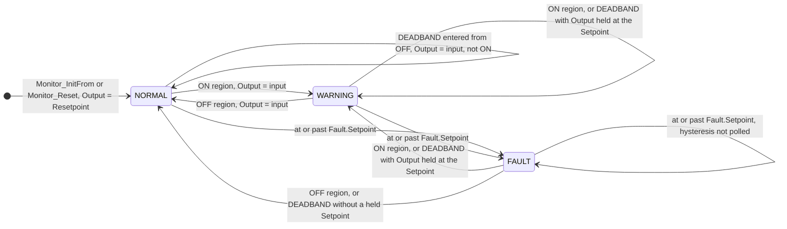

# Monitor status

The single-direction monitor `Monitor_T` (`Transducer/Monitor/Base`): its status NORMAL, WARNING, FAULT; the warning hysteresis band between `Warning.Resetpoint` and `Warning.Setpoint`; the fault limit without hysteresis; the OFF-region fast path, which since 2026-11-13 also polls the hysteresis; and the derate the heat monitor derives from the same thresholds. The two-sided `RangeMonitor_T` composes two of these; its mode diagram is not redrawn here: [ConfigStateRef.md, Config interface](../../Docs/Conventions/ConfigStateRef.md#config-interface).

## Status, every Poll

`Monitor_Poll` switches on `Direction`: DISABLED stores `LastInput` and leaves `Status`; HIGH runs `_Monitor_EvaluateAsHigh`, LOW `_Monitor_EvaluateAsLow`, the same logic with the comparisons mirrored. Status is re-evaluated from the input on every poll, nothing latches here; `StatusPrev` gives the edge (`Monitor_IsFaultTriggering`, `Monitor_GetStatusEdge`), the caller latches.



Evaluation order in `_Monitor_EvaluateAsHigh`: OFF region first (NORMAL, with the poll), then the fault compare (`input >= FaultLimit`, FAULT, no hysteresis poll), then `Hysteresis_Poll` (ON → WARNING, else NORMAL). `Hysteresis_Poll` writes `Output = hysteresis_on_falling(Setpoint, Resetpoint, Output, input)`: the input itself in the ON and OFF regions, and inside the band the Setpoint while the previous Output was at or past it, the input otherwise. `OutputState` is "Output in the ON region". The fast path's poll (M17) is what lets a held Setpoint clear: without it a WARNING episode left `Output` at the Setpoint, and the next entry into the band from below re-asserted WARNING at the Resetpoint.

## Thresholds on one axis

HIGH direction: `Fault.Setpoint >= Warning.Setpoint > Warning.Resetpoint >= Nominal` (`Monitor_Config_IsValidAsHigh`). Over-voltage, or a PTC reading.

```
input →  low ───────────────────────────────────────────────────────────── high
          Nominal         Warning.Resetpoint      Warning.Setpoint      Fault.Setpoint
             │                    │                       │                    │
  region     │        OFF         │       DEADBAND        │         ON         │   FAULT
  status     │       NORMAL       │  NORMAL, or WARNING*  │       WARNING      │   FAULT
  derate     │ 1.0 ───────────────┼───────────────────────┤ Linear 1.0 → 0     │ 0
```

LOW direction: `Fault.Setpoint <= Warning.Setpoint < Warning.Resetpoint <= Nominal` (`Monitor_Config_IsValidAsLow`). Under-voltage, or an NTC's ADC reading falling with temperature, the heat monitors' usual case.

```
input →  low ───────────────────────────────────────────────────────────── high
       Fault.Setpoint     Warning.Setpoint      Warning.Resetpoint          Nominal
             │                    │                       │                    │
  region     │         ON         │       DEADBAND        │        OFF         │
  status     │       WARNING      │  WARNING*, or NORMAL  │       NORMAL       │
  derate   0 │ 0 → 1.0 Linear     ├───────────────────────────────────────── 1.0
```

\* WARNING while `Output` holds the Setpoint, which is the case when the band was entered from ON (and not from OFF). `Hysteresis_RegionOf` for HIGH: `<= Resetpoint` OFF, `>= Setpoint` ON; `Hysteresis_Inverted_RegionOf` mirrors it for LOW.

| Config field | Runtime copy (`_Monitor_InitFrom`) | Used as |
|---|---|---|
| `Fault.Setpoint` | `Base.FaultLimit` | the fault compare, `>=` HIGH, `<=` LOW; also chooses the direction: `Fault.Setpoint >= Warning.Setpoint` reads HIGH (`Monitor_InitFrom`) |
| `Warning.Setpoint` | `Base.Warning.Setpoint` | ON boundary; the held Output inside the band |
| `Warning.Resetpoint` | `Base.Warning.Resetpoint` | OFF boundary; the Output after `Hysteresis_Reset` |
| `Nominal` | | `LastInput` after `Monitor_Reset`; the validity bound; `Monitor_IsOverNominal` |
| `IsEnabled` | `Direction` | false, or an invalid ordering → `MONITOR_DISABLED`; the config is never rewritten by the derivation (B5), so a field-by-field edit that passes through an invalid ordering re-enables on the next valid write |
| `Fault.Resetpoint` | | carried, never read by the evaluation |

## The derate (heat monitor)

`HeatMonitor_ToLimitScale`: `Linear_Fract16_Init(p_linear, x0 = Fault.Setpoint, xRef = Warning.Setpoint)`, so f(Fault) = 0 and f(Warning) = 1.0 (32767). `HeatMonitor_GetDerate` = `Linear_Fract16_SatPos(LastInput)`, saturated to [0, 1.0]: 1.0 anywhere between Nominal and the Warning setpoint, 0 at or past the Fault setpoint, the straight line between. The slope sign follows the direction, the same call serves HIGH and LOW. Re-derived with the thresholds by `HeatMonitor_InitFrom` and by `HeatMonitor_ConfigId_Set` (M18).

Equal setpoints: `Monitor_Config_IsValid` admits `Fault.Setpoint == Warning.Setpoint`; `Monitor_InitFrom` then reads the layout as HIGH, so only the HIGH ordering stays valid. ON and FAULT coincide and FAULT wins, being tested first. `Linear_Fixed_Init` would divide by the zero interval, so `HeatMonitor_ToLimitScale` substitutes `Warning.Setpoint + 1` for the fault end (M19): the derate is 1.0 up to the Setpoint and 0 one unit past it, where the fault trips anyway.

`HeatMonitor_Poll` averages `(input + LastInput) / 2` before `Monitor_Poll`, so the derate reads the averaged value. A `HeatMonitor_Group_T` polls each instance, then the collective `Monitor_T` with the hottest instance's `LastInput` (`_HeatMonitor_Group_FindHottest`: `Monitor_GetLastInputComparable` = `LastInput * Direction`, disabled instances skipped, the search starts at `INT32_MIN`, M20); `HeatMonitor_Group_GetDerate` uses the group's shared `P_LIMIT_SCALE`.

## RangeMonitor

`RangeMonitor_T` = `MonitorHigh` + `MonitorLow`, both `Monitor_Base_T`, built by `Monitor_Config_FromRangeHigh` and `FromRangeLow` from one `RangeMonitor_Config_T`: `Warning.Resetpoint = Warning.LimitHigh − Deadband` above, `LimitLow + Deadband` below; `Fault.Deadband` is carried the same way and, as above, never read. `RangeMonitor_Evaluate` runs both evaluations and reports the higher severity, signed: `FAULT_UNDER_LIMIT` −2, `WARNING_LOW` −1, NORMAL 0, `WARNING_HIGH` 1, `FAULT_OVER_LIMIT` 2. `Mode` DISABLED / PAUSED / ACTIVE replaces `Direction`; the diagram is in the convention sheet linked above.

## Not shown / open

- The FAULT branch does not poll the warning hysteresis. An input that steps from the OFF region or the band straight into FAULT and back into the band reads NORMAL (the Output never reached the Setpoint), while the same band input reached through WARNING reads WARNING. The status after a fault clears is history-dependent; not evaluated further here.
- `Monitor_Evaluate` is declared in `Monitor.h` and defined nowhere; `Monitor.c`'s evaluators are `_Monitor_EvaluateAsHigh` and `_Monitor_EvaluateAsLow`.
- `Monitor_Enable_High` and `Monitor_Enable_Low` set `Direction` to `Setpoint − Resetpoint` (a magnitude, not ±1), unlike `Monitor_InitFrom`; `Monitor_GetLastInputComparable` would then scale the comparable. No caller found in the library; report only.
- `_Monitor_Status.h` and `Monitor_Derate.h` hold commented-out alternatives only (a seven-level status; a derate from the setpoints without the equal-setpoint guard).
- The per-direction `Monitor_Config_Create` writes `Fault.Resetpoint = warnReset`; the range form writes `Fault.LimitX ∓ Fault.Deadband`. Neither value is read.
- Which boards' monitors run HIGH and which LOW (voltage monitors through `RangeMonitor_T`, heat monitors on NTC readings as LOW) is the application's; not listed here.
